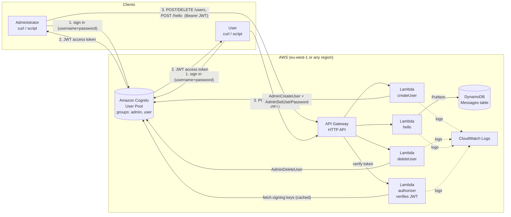
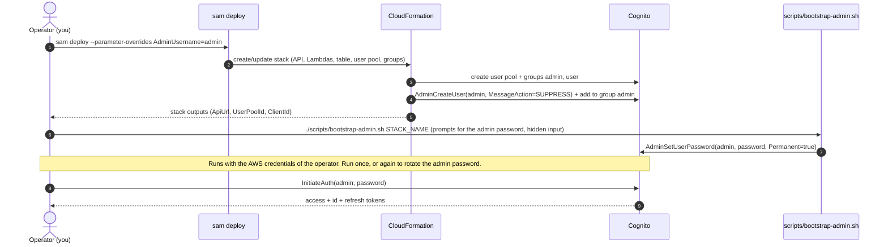
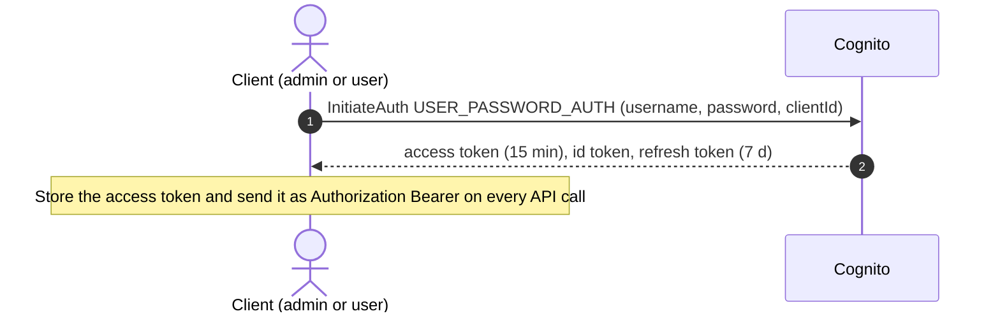
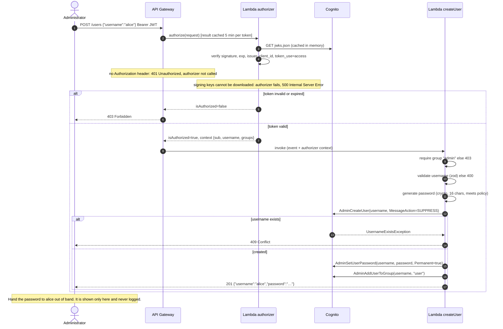
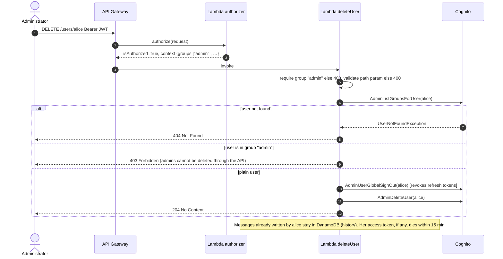
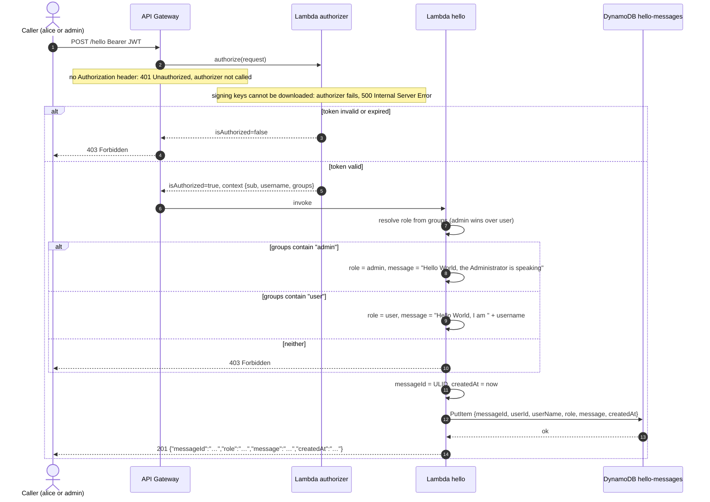
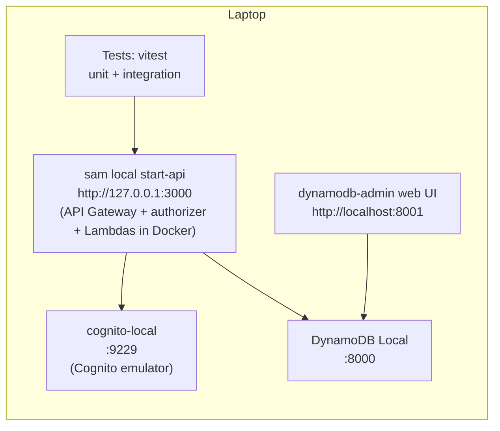

# Hello World API — Architecture

| | |
|---|---|
| Status | Draft v7 — base for the implementation plan |
| Date | 2026-10-30 |
| Stack | TypeScript · AWS Lambda · API Gateway (HTTP API) · Amazon Cognito · DynamoDB · AWS SAM |

### Change log

| Version | Date | Change |
|---|---|---|
| v1 | 2026-10-26 | First draft |
| v2 | 2026-10-27 | **Simplified passwords:** no forced password change at first sign-in; accounts are created with a permanent password returned once to the Administrator; self-service password change/reset deferred to a later version with a documented, minimal upgrade path (section 7.4). **Administrator can call Hello World:** the message depends on the caller's role (section 4). The admin bootstrap no longer needs e-mail. |
| v3 | 2026-10-28 | Findings from implementation steps 2–3. **Token errors:** an invalid or expired token is answered with 403, not 401: it is the HTTP API's fixed answer when a Lambda authorizer denies; 401 remains for a missing `Authorization` header (section 4 contract and conventions, section 6 diagrams). **Error alarms** specified (section 11): one on the API's 5xx responses, covering every route including handled 500s, and one on authorizer crashes, both e-mailed to `AlertEmail`. |
| v4 | 2026-10-28 | Finding from implementation step 5. **Key server unreachable:** when the authorizer cannot download Cognito's signing keys (connection error, time-out, error status) it fails instead of denying, so the client gets 500 rather than a misleading 403 and the authorizer `Errors` alarm fires (section 4 conventions, section 6 diagrams, section 11). Any problem with the token itself is still a 403. |
| v5 | 2026-10-29 | Finding from implementation step 8. **404 error code:** `DELETE /users/{username}` answers an unknown user with `{ "error": "user_not_found" }`, named like `user_exists`. **400 listed:** the same route now lists 400 for an invalid username, which section 6.4 already specified (section 4 contract). **Global sign-out skipped locally:** cognito-local lacks `AdminUserGlobalSignOut`, so a local-only `SKIP_GLOBAL_SIGN_OUT` setting skips it; the cloud always signs out (section 8 note on Cognito emulation). |
| v6 | 2026-10-29 | Finding from implementation step 10. **Deploy gate:** `npm run deploy` no longer runs `verify` itself (verify needs the local Docker stack, which a deploy should not have to start); it checks the stamp `.verify-ok` that a passing `verify` writes: same commit, younger than 30 minutes, clean working tree both at verify time and at deploy time (section 8.1). **Environments:** `npm run deploy` uses the one deploy environment in `samconfig.toml` (section 9.2). **Smoke test** also runs against the local stack (section 9.3). |
| v7 | 2026-10-30 | Finding from implementation step 11. **Local CPU type:** the functions stay `arm64` in the cloud, but the local stack runs them on the machine's own CPU type (template parameter `FunctionArchitecture`, set by `scripts/local-api.sh`): on an x86 machine Docker must emulate arm64, and the emulated cold starts exceed the 10 s timeout. The code is plain JavaScript, so behaviour does not depend on the CPU (section 9.2). |

---

## 1. Purpose and scope

This document describes the architecture of a small back-end application exposing a "Hello World" API to registered users and to the Administrator, plus an administrative API to create and delete users. It is written for a reader who knows TypeScript and basic AWS concepts but is **not** an expert in Infrastructure as Code: every infrastructure choice is explained in plain terms.

The document is the input for the implementation plan (next step). It fixes the **what** and the **why**; the plan will fix the **in which order**.

### 1.1 Requirements recap

Functional

- **F1 — Hello World.** An authenticated caller invokes the API; the service builds a message that depends on the caller's role, stores it in the database and returns it:
  - Administrator → `Hello World, the Administrator is speaking`
  - User → `Hello World, I am <UserName>`
- **F2 — User management.** An Administrator can create and delete Users.
- **F3 — Roles.** Two roles: `User` (may call Hello World) and `Administrator` (may create/delete Users **and** call Hello World).
- **F4 — Passwords (v1).** Accounts are created with a permanent password chosen by the system and returned once to the Administrator. No password change or reset flow in v1; adding it later must require minimal effort.

Non-functional

- **N1** Hosted on AWS; APIs implemented as Lambda functions; language TypeScript.
- **N2** Security is a first-class concern.
- **N3** Prefer services with a free plan, database included. Target cost ≈ 0 € / month.
- **N4** Database contents (users, messages) must be easy to inspect, ideally through a web UI.
- **N5** Everything must be testable locally without deploying. Cloud deployment happens only after all local tests pass.
- **N6** Load: ≤ 10 users, almost never concurrent.

### 1.2 Decisions already taken (from the clarification rounds)

| Topic | Decision | Reason in one line |
|---|---|---|
| Authentication | **Amazon Cognito user pool** | Managed, secure by default, free ≤ 10 000 monthly active users, roles via groups |
| Database | **DynamoDB** | Always-free tier (25 GB, 25 RCU/WCU), stays inside AWS/IAM, emulator + web UI available locally |
| Infrastructure as Code | **AWS SAM** | One readable YAML file, first-party, `sam local start-api` runs the API on the laptop |
| Admin provisioning | **Created by the deployment**; its password is set once by the operator with a post-deploy script | No e-mail infrastructure, no first-login challenge, fully testable locally |
| User credentials | **Permanent password generated by the API and returned in the create-user response**, handed over out of band | Simplest flow; one Cognito call more, one client-side challenge less |
| Password change / reset | **Deferred** (not in v1) | Cognito already implements it; section 7.4 shows the minimal upgrade path |

---

## 2. Architecture overview



**How to read it.** Clients never talk to our Lambdas without a token. They first sign in against Cognito (step 1–2) and get a short-lived JWT. Every API call carries that JWT; API Gateway asks the authorizer Lambda to verify it before any business Lambda runs. Users live in Cognito, messages live in DynamoDB. Nothing else exists: no servers, no VPC, no NAT, no load balancer, no e-mail.

### 2.1 Why these pieces

| Piece | Role | Why this and not something else |
|---|---|---|
| **API Gateway HTTP API** | Public HTTPS entry point, routing, throttling, TLS | HTTP API (not REST API) is ~70 % cheaper and simpler; supports Lambda authorizers |
| **Lambda authorizer** | Verifies the Cognito JWT signature/expiry and injects identity into the request | API Gateway also has a built-in JWT authorizer with zero code, **but it cannot run locally**. A tiny Lambda authorizer behaves identically on the laptop and in the cloud (N5). |
| **Lambda functions** (`hello`, `createUser`, `deleteUser`) | Business logic, one function per route | One route = one function = one least-privilege IAM role. Easy to read, easy to secure. |
| **Cognito user pool** | User directory, passwords, sign-in, groups (= roles), token issuing | We never store or hash a password ourselves. Roles are group memberships that only an administrator (or the deployment) can change. Password change/reset exist in Cognito already, ready for a later version. |
| **DynamoDB** | Stores Hello World messages | Serverless, zero idle cost, always-free tier, browsable in the AWS console and locally with a web UI |
| **CloudWatch Logs** | Structured logs per function | Free tier 5 GB/month; retention set to 14 days to keep it free |
| **AWS SAM** | Describes all of the above in one `template.yaml`; builds, runs locally, deploys | See section 9 |

---

## 3. Roles and identity model

Roles are **Cognito groups**. A user's roles arrive inside the JWT as the claim `cognito:groups`, signed by Cognito, so they cannot be forged or self-assigned.

| Role | Cognito group | Can call | Hello World message |
|---|---|---|---|
| Administrator | `admin` | `POST /users`, `DELETE /users/{username}`, `POST /hello` | `Hello World, the Administrator is speaking` |
| User | `user` | `POST /hello` | `Hello World, I am <UserName>` |

Rules

- Self sign-up is **disabled** in the user pool. Only `AdminCreateUser` (from the `createUser` Lambda or from the deployment) creates accounts.
- The one Administrator account is created by the deployment (section 6.1). The API cannot create additional administrators and cannot delete members of the `admin` group — this keeps the admin role out of reach of the API surface.
- **Role resolution.** Cognito groups are not mutually exclusive: an account can belong to `admin`, to `user`, to both, or to neither, and the token lists every membership in the `cognito:groups` array. The code must therefore define the outcome for all four combinations, not only the two normal ones. Two checks use the groups:
  - *Admin endpoints* (`POST /users`, `DELETE /users/{username}`) ask a yes/no question: is `admin` in the list? Membership of `user` is irrelevant.
  - *Hello World* must choose exactly one message, so it applies a precedence rule, **admin wins**: if `admin` is present the Administrator message is produced, even if `user` is also present; if only `user` is present the User message is produced; if neither is present the call is rejected with 403.

  | Groups in the token | Admin endpoints | `POST /hello` message | Deletable via API |
  |---|---|---|---|
  | `admin` | allowed | `Hello World, the Administrator is speaking` | no |
  | `user` | 403 | `Hello World, I am <UserName>` | yes |
  | `admin` + `user` | allowed | `Hello World, the Administrator is speaking` (never `I am admin`) | no |
  | none | 403 | 403 | yes |

  Dual membership cannot be produced through the API (the deployment puts the admin only in `admin`, and `POST /users` only ever assigns `user`). It can only arise if an operator adds a group by hand in the Cognito console; the rule exists so that this manual action has a defined and safe outcome.

### 3.1 Tokens

Clients sign in directly with Cognito (no Lambda involved) using the `USER_PASSWORD_AUTH` flow over TLS and receive three JWTs. The API uses the **access token**:

| Setting | Value | Why |
|---|---|---|
| Access token validity | 15 minutes | Bounds the window in which a deleted user's token still works (section 7.3) |
| Refresh token validity | 7 days | Clients sign in again after 7 days, with the same password; revoked on delete |
| Signature | RS256, keys published by Cognito at `…/.well-known/jwks.json` | Standard; the authorizer caches the keys |
| Claims used | `sub` (stable user id), `username`, `cognito:groups`, `exp`, `client_id`, `token_use=access` | `username` is the `<UserName>` in the User message |

---

## 4. API contract

Base URL: `https://<api-id>.execute-api.<region>.amazonaws.com` (cloud) or `http://127.0.0.1:3000` (local). All requests: `Authorization: Bearer <access token>`, `Content-Type: application/json`.

| Method & path | Role | Request body | Success | Errors |
|---|---|---|---|---|
| `POST /hello` | admin **or** user | *(none)* | `201` `{ "messageId", "role", "message", "createdAt" }` | 401 missing token · 403 invalid token or in neither group |
| `POST /users` | admin | `{ "username": "alice" }` | `201` `{ "username", "password" }` | 400 invalid username · 401 missing token · 403 invalid token or not admin · 409 already exists |
| `DELETE /users/{username}` | admin | *(none)* | `204` | 400 invalid username · 401 missing token · 403 invalid token, not admin **or** target is an admin · 404 unknown user (`{ "error": "user_not_found" }`) |

`POST /hello` response examples

```json
{ "messageId": "01JB5…", "role": "admin", "message": "Hello World, the Administrator is speaking", "createdAt": "2026-10-27T09:00:00.000Z" }
{ "messageId": "01JB6…", "role": "user",  "message": "Hello World, I am alice",                   "createdAt": "2026-10-27T09:00:05.000Z" }
```

Conventions

- `username`: `^[a-z0-9][a-z0-9._-]{2,31}$` (3–32 chars, lowercase). Validated with `zod` before anything else runs.
- `password` in the `POST /users` response is **permanent** and shown **only in this response**. It is generated server-side (16 random characters satisfying the pool policy), never logged, and the Administrator hands it to the user out of band.
- Error body: `{ "error": "<short code>", "message": "<human text>" }`. Never leaks stack traces or AWS error details.
- Token errors are answered by API Gateway before any handler runs: **401** when the `Authorization` header is missing, **403** when the token is invalid or expired (the HTTP API's fixed answer when the Lambda authorizer denies). Their body is API Gateway's own `{ "message": "…" }`, not the shape above. Handlers answer 403 for a valid token with the wrong role.
- One exception is not the caller's fault: if the authorizer cannot download Cognito's signing keys (network error, time-out, error status), it fails instead of denying. API Gateway then answers **500** with its own `{ "message": "Internal Server Error" }`, and the authorizer `Errors` alarm fires (section 11). A 403 here would hide an outage behind what looks like a bad token.
- `POST /hello` is a POST (not GET) because it **creates** a record.

---

## 5. Data model

### 5.1 Cognito user pool (users)

Cognito is the only store for users: no duplicate "users" table to keep in sync.

| Attribute | Notes |
|---|---|
| `username` | Chosen by the admin; immutable; shown in the User's Hello message |
| `sub` | UUID generated by Cognito; stored on every message as `userId` so history survives deletions |
| group membership | `admin` and/or `user` |
| status | `CONFIRMED` immediately after creation (the password is set as permanent, no first-login challenge) |

Password policy: min 12 chars, upper + lower + digit + symbol. Users are created with `AdminCreateUser` (`MessageAction=SUPPRESS`, so Cognito sends nothing) followed by `AdminSetUserPassword(Permanent=true)`. MFA optional (off by default to stay simple; can be enabled per pool later without code changes).

### 5.2 DynamoDB table `hello-messages`

| Attribute | Type | Key | Example (User) | Example (Administrator) |
|---|---|---|---|---|
| `messageId` | S | **Partition key** | `01JB6…` (ULID — time-sortable, unguessable) | `01JB5…` |
| `userId` | S | | Cognito `sub` of alice | Cognito `sub` of admin |
| `userName` | S | | `alice` | `admin` |
| `role` | S | | `user` | `admin` |
| `message` | S | | `Hello World, I am alice` | `Hello World, the Administrator is speaking` |
| `createdAt` | S | | ISO-8601 UTC | ISO-8601 UTC |

`role` is stored so that the DB UI shows at a glance who produced each message. Settings: **provisioned capacity 1 RCU / 1 WCU** (inside the always-free 25/25), deletion protection on, encryption at rest (AWS-owned key, free), no TTL (messages are kept). A global secondary index `byUser (userName, createdAt)` can be added later if listing a user's messages becomes a requirement; it is not needed now.

---

## 6. Interaction diagrams

### 6.1 Deployment and Administrator bootstrap (one-off)



The bootstrap script is the **only** way to set or rotate the Administrator's password; the API never touches admin accounts. The same script, pointed at the local emulator, seeds the admin locally.

### 6.2 Sign-in (prerequisite for every journey)



No challenge step: because every password is set as permanent, the first sign-in is identical to any other sign-in.

### 6.3 Create a User



If `AdminSetUserPassword` or `AdminAddUserToGroup` fails after the account was created, the handler deletes the half-created account (`AdminDeleteUser`) and returns 500, so a retry by the Administrator does not hit 409.

### 6.4 Delete a User



### 6.5 Call Hello World (User or Administrator)



---

## 7. Security design

### 7.1 Controls

| Layer | Control | Where it is configured |
|---|---|---|
| Transport | HTTPS only (API Gateway terminates TLS 1.2+) | built-in |
| Authentication | Cognito-issued RS256 JWT verified on **every** request (signature, `exp`, `iss`, `client_id`, `token_use`) | authorizer Lambda, `aws-jwt-verify` |
| Authorization | Role check against `cognito:groups` **inside each handler** (defence in depth: the authorizer proves *who*, the handler decides *what*) | `hello`, `createUser`, `deleteUser` |
| Account hygiene | Self sign-up disabled; password policy 12+ chars with symbols; passwords generated server-side with `crypto.randomInt`, returned exactly once, never logged; Cognito built-in lockout after repeated failed sign-ins | user pool, `createUser` |
| Privilege boundary | API can never create an admin, delete an admin, or set an admin's password | `createUser` always assigns `user`; `deleteUser` refuses admins; admin password only via bootstrap script |
| Least privilege IAM | Each Lambda has its own role with only the actions it needs, scoped to the one pool/table: `hello` → `dynamodb:PutItem`; `createUser` → `AdminCreateUser`, `AdminSetUserPassword`, `AdminAddUserToGroup`, `AdminDeleteUser` (rollback only); `deleteUser` → `AdminListGroupsForUser`, `AdminUserGlobalSignOut`, `AdminDeleteUser`; authorizer → none | `template.yaml` |
| No secrets | There is no secret anywhere: Lambdas use IAM roles, JWT verification uses public keys. Nothing to rotate or leak | — |
| Input validation | `zod` schemas on body and path; unknown fields rejected; errors never echo AWS internals | handlers |
| Abuse / cost protection | API stage throttling 5 req/s, burst 10 (plenty for 10 users, blocks brute force and bill surprises); AWS Budget alarm at 1 USD | `template.yaml`, Budgets |
| Data protection | DynamoDB encrypted at rest; deletion protection; Cognito stores password hashes, we never see them | table, pool |
| Logging | Structured JSON logs with request id and `username`, **never** tokens or passwords (the `POST /users` response body is explicitly excluded from logs) | handlers, log groups |
| Supply chain | Lock file committed, `npm audit` in the test gate, bundle with `esbuild` so only used code ships | CI / scripts |

### 7.2 Threats considered

| Threat | Mitigation |
|---|---|
| Stolen or forged token | Signature verification; 15-min expiry; tokens never logged |
| Normal user calling admin endpoints | Group check in handler → 403; group claims signed by Cognito |
| Admin account takeover via API | API cannot create admins or set their password; admin password only via operator-run script with AWS credentials |
| Password leaked from the create-user response | Response travels over TLS to an authenticated admin only, is never logged, and the Administrator can revoke it at any time by deleting the user |
| Enumeration of usernames via `POST /users` 409 | Accepted: endpoint is admin-only |
| Brute-force sign-in | Cognito lockout + API throttling |
| Injection | DynamoDB SDK uses typed parameters (no query strings); input validated |
| Runaway cost | Throttling, provisioned 1/1 capacity, budget alarm |

### 7.3 Residual risks (accepted, documented)

- A deleted user's **access token remains valid until it expires** (≤ 15 min) plus up to 5 min of authorizer cache. JWT verification is stateless by design; checking Cognito on every call would cost a network round-trip per request. Acceptable for this application; if it ever is not, drop the authorizer cache TTL to 0 and call `AdminGetUser` in the authorizer.
- **No password change or reset in v1.** A user who loses or leaks the password cannot recover it alone; the Administrator deletes and recreates the account (history survives because messages carry `userId` and `userName`). Section 7.4 shows how to add self-service later.
- `USER_PASSWORD_AUTH` sends the password over TLS to Cognito. The SRP flow avoids that but needs a heavier client library; can be switched on later with no server-side change.
- MFA is off. Turning it on is a pool setting.

### 7.4 Adding password change / reset later (designed-in upgrade path)

Cognito already implements both flows; v1 simply does not expose them. Three incremental options, from cheapest to most complete, none of which changes the v1 data model, the authorizer or the Hello World handler:

| Option | What it gives | Effort |
|---|---|---|
| **A. Admin-driven reset** | `POST /users/{username}/password` → new random permanent password returned to the admin | One new Lambda that reuses the existing `cognito.ts` adapter call `setPermanentPassword` (already used by `createUser`) + one route + one IAM statement. ~1 hour. |
| **B. Self-service change** | User calls Cognito `ChangePassword(accessToken, old, new)` directly | **Zero server-side change.** The app client already allows it; only client documentation is needed. |
| **C. Self-service "forgot password"** | User calls Cognito `ForgotPassword` / `ConfirmForgotPassword`; Cognito e-mails a code | Add an optional `email` field to `POST /users` (one `zod` field + one user attribute in the adapter), set `AutoVerifiedAttributes: [email]` in the pool. Cognito's default sender covers 50 e-mails/day for free. ~2 hours. |

To keep these cheap, v1 already: isolates every Cognito call in `src/lib/cognito.ts`, keeps `password.ts` as the single password generator, uses one route-per-Lambda layout so a new route is a copy of `createUser`, and leaves the `email` attribute unused but allowed in the pool schema.

---

## 8. Local development and testing

Everything runs on the laptop; **no AWS account is needed to run the full test suite.**



| Component | Tool | Notes |
|---|---|---|
| API Gateway + Lambdas | `sam local start-api` | Runs the real handler code in Lambda-like Docker containers. Since SAM CLI 1.80 it also invokes the Lambda authorizer locally. |
| DynamoDB | `amazon/dynamodb-local` (Docker) | Same API as the cloud service; table created by a seed script from the same definition as `template.yaml` |
| **DB inspection UI** | `aaronshaf/dynamodb-admin` (Docker) | Browser table viewer/editor at `localhost:8001` — satisfies N4 locally. In the cloud, the DynamoDB console "Explore items" page gives the same view. |
| Cognito | `jagregory/cognito-local` (Docker) | Community emulator: sign-in (`USER_PASSWORD_AUTH`), the admin APIs we use except `AdminUserGlobalSignOut` (see the note below), groups, and a JWKS endpoint so the authorizer verifies tokens exactly as in the cloud. Dropping the first-login password challenge (v2) removed the emulator's least faithful area from our flows. |
| Wiring | `docker-compose.yml` + `env.local.json` | Lambdas receive `DYNAMODB_ENDPOINT`, `COGNITO_ENDPOINT`, `JWKS_URI` via environment; in the cloud these are simply absent and the SDK defaults apply |

**Note on Cognito emulation.** Our Lambdas only call admin APIs (`AdminCreateUser`, `AdminSetUserPassword`, `AdminAddUserToGroup`, `AdminListGroupsForUser`, `AdminUserGlobalSignOut`, `AdminDeleteUser`) and verify JWTs. The Cognito access is isolated behind one small adapter (`src/lib/cognito.ts`) that unit tests mock. The emulator is used for integration tests; a 2-minute post-deploy smoke test (section 9.3) is the final proof against real Cognito.

**`AdminUserGlobalSignOut` is skipped locally.** cognito-local does not implement it and answers "Unsupported", which would make every local delete fail with 500. `env.local.json` therefore sets `SKIP_GLOBAL_SIGN_OUT=true` for `deleteUser`, and the adapter skips that one call. `template.yaml` declares the variable empty, so in the cloud the sign-out always runs; the smoke test, which deletes its throw-away user, covers it against real Cognito. Locally, a deleted user's refresh token is therefore not revoked.

### 8.1 Test pyramid and the "deploy gate"

| Level | What | Tool | Needs Docker? |
|---|---|---|---|
| Unit | Each handler and the authorizer with mocked AWS SDK clients; validation; password generator; role resolution (admin, user, both, neither); create-user rollback | `vitest`, `aws-sdk-client-mock` | no |
| Integration | The journeys of section 6 end-to-end through `sam local start-api` against DynamoDB Local and cognito-local: create user, sign in, hello as user, hello as admin, delete user, plus the negative cases (401/403/404/409) | `vitest` + `fetch` | yes |
| Static | `tsc --noEmit`, `eslint`, `npm audit`, `sam validate --lint` | — | no |

`npm run verify` runs all three levels and, only if all pass, writes the stamp `.verify-ok` (commit hash, time, and whether the working tree was clean). **`npm run deploy` refuses to run unless `verify` has just passed**: the stamp must exist, be younger than 30 minutes, name the current commit, and have been written on a clean tree, and the tree must still be clean (the build packages the files on disk, so uncommitted changes would ship untested). Deploy does not run `verify` itself because the integration tests need the local Docker stack. That is the mechanical enforcement of N5.

---

## 9. Deployment

### 9.1 What SAM does, in plain words

`template.yaml` is a single YAML file (≈ 150 lines) that lists the resources of section 2 and their settings. Four commands cover the whole life cycle:

```
sam build                        # bundles each TypeScript handler with esbuild
sam local start-api              # runs the API on the laptop
sam deploy --guided              # first time: asks for region, stack name, admin username; then one command
./scripts/bootstrap-admin.sh     # once after the first deploy: sets the admin password
```

`sam deploy` hands the template to CloudFormation, which creates or updates every resource and rolls back automatically on failure. Deleting the whole application is `sam delete`. There is no state file to manage and no extra tool to install besides the SAM CLI and Docker.

### 9.2 Environments

One AWS account, one stack per environment (`hello-dev`, `hello-prod`) selected by `--config-env`. Given the load, a single `prod` stack is enough to start; the local stack is the "dev" environment. v1 therefore has one deploy environment, the `default` section of `samconfig.toml`, and `npm run deploy` takes no environment argument (extra arguments go to `sam deploy`, e.g. `npm run deploy -- --guided` for the first deployment).

Runtime choices: Node.js 22, `arm64` (cheaper, faster cold start), 256 MB, 10 s timeout, bundled with `esbuild` through SAM's `Metadata.BuildMethod: esbuild`. The CPU type is the template parameter `FunctionArchitecture` (default `arm64`, the cloud value); the local stack sets it to the machine's own type, because emulating arm64 on an x86 machine makes cold starts exceed the timeout.

### 9.3 Post-deploy smoke test

A script `scripts/smoke.sh <stack>` that signs in as admin, calls `/hello` as admin (expects the Administrator message), creates a throw-away user, calls `/hello` as that user (expects `I am <name>`), verifies both rows in DynamoDB, deletes the user, and checks that the user can no longer sign in. Run after every deploy; it is the only test that touches real Cognito. `scripts/smoke.sh local` runs the same checks against the local stack, which tests the script itself; there the global sign-out is skipped (section 8), so only the cloud run exercises refresh-token revocation.

---

## 10. Cost estimate (per month, 10 users, ~1 000 requests)

| Service | Free allowance | Expected usage | Cost |
|---|---|---|---|
| Lambda | 1 M requests + 400 000 GB-s, always free | ~2 000 invocations | 0 € |
| API Gateway HTTP API | 1 M requests free for 12 months, then 1 USD per million | ~1 000 | 0 € (≈ 0.001 USD after year 1) |
| DynamoDB | 25 GB + 25 RCU/WCU provisioned, always free | 1 RCU / 1 WCU, < 1 MB | 0 € |
| Cognito (Essentials plan) | 10 000 MAU free | 11 MAU | 0 € |
| CloudWatch Logs | 5 GB ingest free | < 10 MB | 0 € |
| **Total** | | | **≈ 0 €** |

Guard-rails: budget alarm at 1 USD; API throttling; no on-demand DynamoDB (provisioned 1/1 cannot scale into cost). No e-mail is sent in v1, so no SES/SNS cost.

---

## 11. Observability

- Structured JSON logs (`requestId`, `route`, `username`, `role`, `outcome`, `durationMs`) via a 20-line logger (or AWS Lambda Powertools Logger if preferred).
- CloudWatch default metrics (errors, duration, throttles) per function.
- Two alarms, notification by e-mail to `AlertEmail` (SNS, free): the API's `5xx` responses > 0 in 5 min (every route, including handled 500s), and the `authorizer` Lambda's `Errors` > 0 in 5 min. The authorizer fails, rather than denying, only when it cannot download Cognito's signing keys (section 4), so this alarm means an outage, never a bad token.
- No tracing (X-Ray) to stay in the free tier and keep the template short; it is a one-line switch if ever needed.

---

## 12. Proposed repository layout

```
.
├── template.yaml                  # all infrastructure (SAM)
├── samconfig.toml                 # deploy parameters per environment
├── docker-compose.yml             # dynamodb-local, dynamodb-admin, cognito-local
├── env.local.json                 # Lambda env vars for sam local
├── package.json                   # scripts: build, local:up, local:api, test, verify, deploy, smoke
├── src/
│   ├── handlers/
│   │   ├── authorizer.ts
│   │   ├── hello.ts               # role resolution + message per role
│   │   ├── createUser.ts
│   │   └── deleteUser.ts
│   └── lib/
│       ├── auth.ts                # claims typing, resolveRole(), requireGroup()
│       ├── cognito.ts             # thin adapter: createUser, setPermanentPassword, addToGroup, listGroups, globalSignOut, deleteUser
│       ├── db.ts                  # DynamoDB DocumentClient + putMessage()
│       ├── http.ts                # ok()/error() response helpers
│       ├── password.ts            # password generator (used by createUser now, by reset later)
│       └── validation.ts          # zod schemas
├── tests/
│   ├── unit/
│   └── integration/
├── scripts/
│   ├── local-seed.sh              # create table, pool, client, groups, admin + sample user locally
│   ├── bootstrap-admin.sh         # set/rotate the admin password (cloud or local)
│   ├── smoke.sh                   # post-deploy end-to-end check
│   ├── target.sh                  # shared by the two above: stack or local ids and endpoints
│   ├── cognito.mjs                # sign-in / set-password with the password on stdin (AWS SDK)
│   ├── verify.sh                  # all checks; writes .verify-ok on success
│   └── deploy.sh                  # checks .verify-ok, then sam build + sam deploy
└── docs/
    └── ARCHITECTURE.md
```

Dependencies (runtime): `@aws-sdk/client-cognito-identity-provider`, `@aws-sdk/client-dynamodb`, `@aws-sdk/lib-dynamodb`, `aws-jwt-verify`, `zod`, `ulid`. Dev: `typescript`, `esbuild`, `vitest`, `aws-sdk-client-mock`, `eslint`, `@types/aws-lambda`.

---

## 13. Alternatives considered

| Alternative | Why not (for this project) |
|---|---|
| API Gateway built-in JWT authorizer instead of a Lambda authorizer | Zero code and no cold start, but cannot run under `sam local`; N5 wins. Documented as a later swap if local auth emulation is ever dropped. |
| Lambda Function URLs (no API Gateway) | Free and simpler, but no authorizer, no throttling, no routing: all security would move into handler code. |
| App-managed users + own JWT | Fully local, but we would own password hashing, lockout, token signing keys. Cognito gives all of that for free. |
| Temporary password + forced change at first sign-in (v1 design) | More secure in theory (the admin never knows the final password) but adds a client-side challenge step, an e-mail for the admin bootstrap, and the least faithful part of the local emulator. Dropped in v2 by requirement; can return later as a pool setting plus the challenge step in the client. |
| Postgres on Supabase/Neon | Excellent web UI, but adds a non-AWS vendor, a connection secret in Lambda and connection-pool concerns. DynamoDB + dynamodb-admin covers N4 well enough. |
| AWS CDK / Serverless Framework | More abstraction (CDK) or a third-party licence model (Serverless v4). SAM is the easiest to read for a non-IaC expert. |
| One "users" table in DynamoDB mirroring Cognito | Two sources of truth to keep in sync for no benefit. |

---

## 14. Assumptions and open points

Assumptions made (change them in the implementation plan if wrong):

1. The username **is** the display name in the User message (`Hello World, I am alice`). No separate "full name" attribute.
2. The Administrator's message is fixed text and does not include the admin's username.
3. An account in both groups behaves as Administrator (section 3, role resolution).
4. Messages are never deleted and never listed by the API (inspection happens through the DB UI).
5. One region, one production stack; local Docker stack is the development environment.
6. Clients are scripts/curl/Postman; no front end is in scope.
7. The Administrator keeps the generated user passwords confidential and delivers them out of band; the system offers no in-band delivery (no e-mail) in v1.

Nothing is blocking: the implementation plan can start from this document.

---

## 15. Next step — implementation plan outline

1. Repository scaffold, TypeScript/esbuild/vitest config, lint.
2. `template.yaml`: table, user pool + groups + app client, HTTP API, authorizer, three functions, IAM policies, admin user, outputs.
3. Local stack: `docker-compose.yml`, `local-seed.sh`, `bootstrap-admin.sh` (local mode), `env.local.json`, `sam local start-api` working against emulators.
4. Handlers + libs with unit tests (authorizer → hello with role resolution → createUser with rollback → deleteUser).
5. Integration tests for the journeys and negative cases.
6. `verify` and `deploy` scripts (gate), `smoke.sh`.
7. First cloud deployment, `bootstrap-admin.sh`, smoke test, budget alarm, README.
