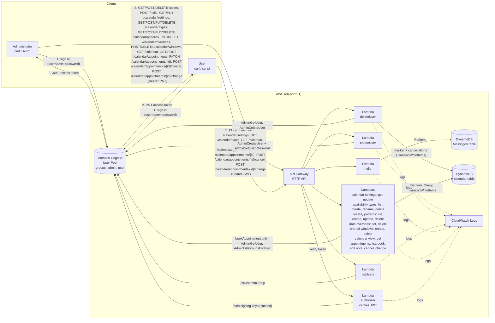
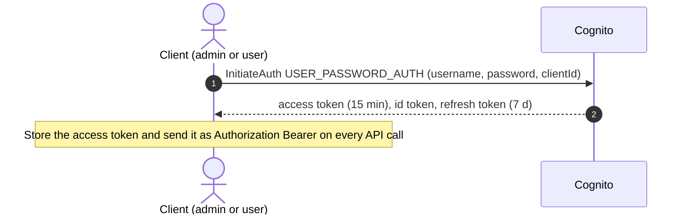
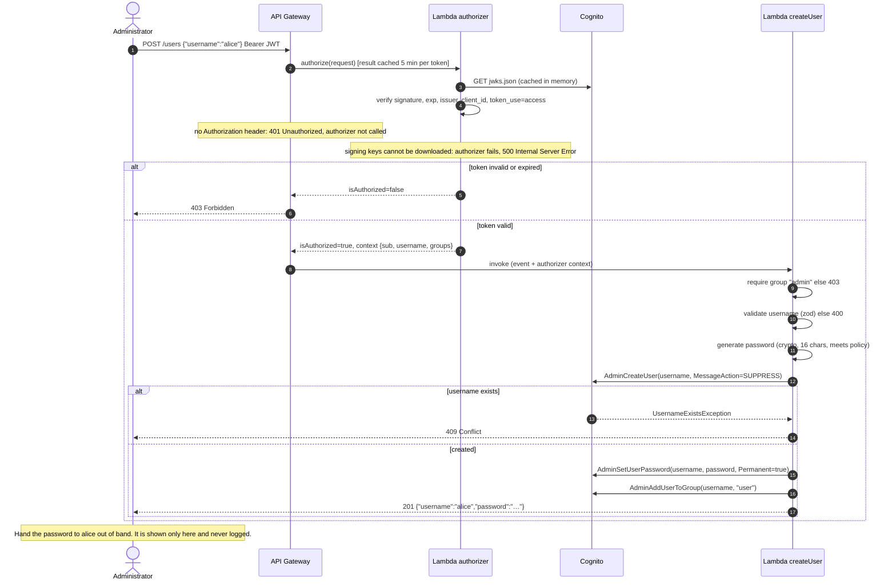
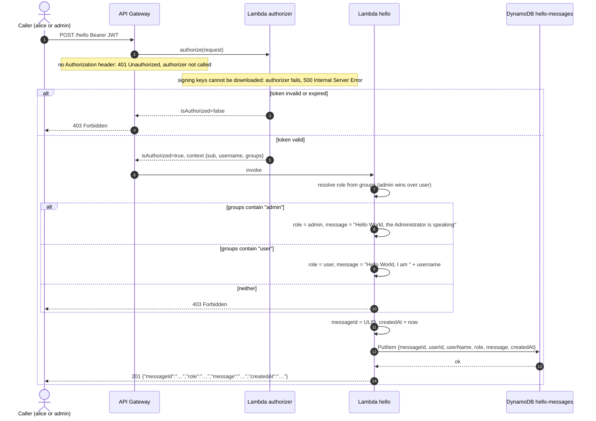
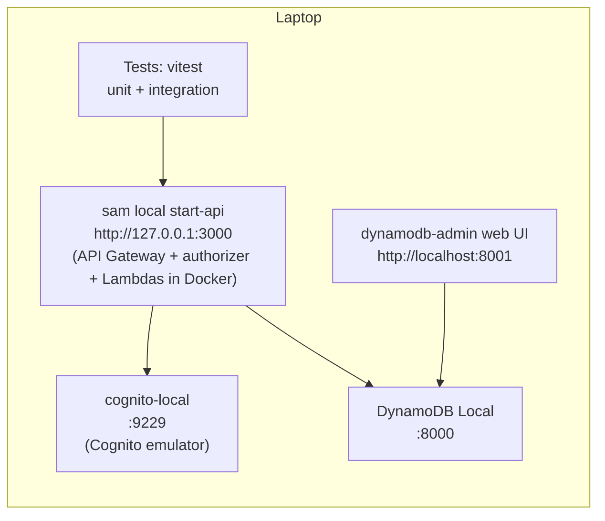

# Hello World API — Architecture

| | |
|---|---|
| Status | v1 implemented (plan step 12, tag `v1.0.0`); monorepo layout (plan step 20); v12 open: shared calendar (F5) in progress, plan steps 41–56 |
| Date | 2026-11-14 |
| Stack | TypeScript · AWS Lambda · API Gateway (HTTP API) · Amazon Cognito · DynamoDB · AWS SAM |

### Change log

| Version | Date | Change |
|---|---|---|
| v1 | 2026-10-26 | First draft |
| v2 | 2026-10-27 | **Simplified passwords:** no forced password change at first sign-in; accounts are created with a permanent password returned once to the Administrator; self-service password change/reset deferred to a later version with a documented, minimal upgrade path (section 7.4). **Administrator can call Hello World:** the message depends on the caller's role (section 4). The admin bootstrap no longer needs e-mail. |
| v3 | 2026-10-28 | Findings from implementation steps 2–3. **Token errors:** an invalid or expired token is answered with 403, not 401: it is the HTTP API's fixed answer when a Lambda authorizer denies; 401 remains for a missing `Authorization` header (section 4 contract and conventions, section 6 diagrams). **Error alarms** specified (section 11): one on the API's 5xx responses, covering every route including handled 500s, and one on authorizer crashes, both e-mailed to `AlertEmail`. |
| v4 | 2026-10-28 | Finding from implementation step 5. **Key server unreachable:** when the authorizer cannot download Cognito's signing keys (connection error, time-out, error status) it fails instead of denying, so the client gets 500 rather than a misleading 403 and the authorizer `Errors` alarm fires (section 4 conventions, section 6 diagrams, section 11). Any problem with the token itself is still a 403. |
| v5 | 2026-10-29 | Finding from implementation step 8. **404 error code:** `DELETE /users/{username}` answers an unknown user with `{ "error": "user_not_found" }`, named like `user_exists`. **400 listed:** the same route now lists 400 for an invalid username, which section 6.4 already specified (section 4 contract). **Global sign-out skipped locally:** cognito-local lacks `AdminUserGlobalSignOut`, so a local-only `SKIP_GLOBAL_SIGN_OUT` setting skips it; the cloud always signs out (section 8 note on Cognito emulation). |
| v6 | 2026-10-29 | Finding from implementation step 10. **Deploy gate:** `npm run deploy` no longer runs `verify` itself (verify needs the local Docker stack, which a deploy should not have to start); it checks the stamp `.verify-ok` that a passing `verify` writes: same commit, younger than 30 minutes, clean working tree both at verify time and at deploy time (section 8.1). **Environments:** `npm run deploy` uses the one deploy environment in `samconfig.toml` (section 9.2). **Smoke test** also runs against the local stack (section 9.3). |
| v7 | 2026-10-30 | Finding from implementation step 11. **Local CPU type:** the functions stay `arm64` in the cloud, but the local stack runs them on the machine's own CPU type (template parameter `FunctionArchitecture`, set by `scripts/local-api.sh`): on an x86 machine Docker must emulate arm64, and the emulated cold starts exceed the 10 s timeout. The code is plain JavaScript, so behaviour does not depend on the CPU (section 9.2). |
| v8 | 2026-10-30 | Finding from implementation step 11. **Budget outside the stack:** CloudFormation does not offer `AWS::Budgets::Budget` in every region (not in `eu-north-1`), so the 1 USD monthly budget is created after the deploy by `npm run budget <stack>` (`scripts/budget.sh`, idempotent, Budgets API) instead of by `template.yaml`. Same budget, same `AlertEmail` recipient (section 9.2, security table). |
| v9 | 2026-11-04 | **v1 implemented.** Plan step 12: the stack is deployed and smoke-tested, the README exists, the status line says so. Wording aligned with what was built: region `eu-north-1` in the overview (section 2), `npm run` commands and the real template size in 6.1 and 9.1, the logger of section 11, sections 1 and 15 in the past tense. A browser front end is now planned (section 14, assumption 6); section 12 points to the target monorepo layout (`docs/FOLDER_STRUCTURE.md`), which a later step applies. |
| v10 | 2026-11-04 | **Monorepo layout** (plan step 20). The back end moves to `backend/`; the API contract (response and error body types, error codes, `Role` and `resolveRole`) and the username rule move to `shared/`, which the back end imports and bundles; `frontend/` is reserved. Section 12 is replaced by a pointer to `docs/FOLDER_STRUCTURE.md`; paths in this document are relative to `backend/`. No change to behaviour, contract, resources or IAM. The build runs esbuild inside `backend/` with SAM's beta support for npm workspaces (section 9.1). |
| v11 | 2026-11-05 | Section 8, note on Cognito emulation: two sign-in differences of cognito-local found by the front end's `LoginService` integration test (`InvalidPasswordException` for a wrong password; 24-hour access tokens without `ExpiresIn`). Documentation only; the back end is unchanged. |
| v12 | 2026-11-12 (open) | **Shared calendar (F5), in progress.** The shared calendar (F5) is being implemented in plan steps 41–56; a calendar matter that the architecture does not yet describe is governed by `docs/SHARED_CALENDAR_SPEC.md`; whatever the architecture already describes, including everything Hello World does, is governed by the architecture. Each plan step merges the part of spec section 19 it implements and adds its sentence here; step 56 closes v12. **Step 41:** the calendar's time model in `shared/src/calendar/` (time helpers with `Intl` only, primitive schemas, default settings and limits; `docs/FOLDER_STRUCTURE.md`); no route, resource or behaviour of the API changes. **Step 42:** the calendar's shared contract and rules: in `shared/src/api.ts` the 20 calendar error codes of spec 11.3, the optional `conflicts` field of the error body, `UserSummary` and `ListUsersResponse`; in `shared/src/calendar/` the response types (`types.ts`), the request bodies and path and query parameters (`schemas.ts`) and the pure rules (`rules.ts`: defined and effective windows, slots, overlap, the local-time grids, `cancellableUntil`); no route, resource or behaviour of the API changes, and no handler answers the new error codes yet (section 4 lists each route's codes in the step that adds the route). **Step 43:** the first calendar slice: the DynamoDB table `calendar` (section 5.3) with the calendar lock, the parameter `CalendarTimeZone`, and the routes `GET` and `PUT /calendar/settings` (sections 3 and 4) with their two functions (section 2); the calendar's DynamoDB permissions are written once as shared managed policies attached to each calendar function's own role (section 7.1); capacity 11/11 in total (section 10). **Step 44:** availability types, routes `GET` and `POST /calendar/types`, `PUT` and `DELETE /calendar/types/{typeId}` (sections 3 and 4, with the `AvailabilityType` shape, case-insensitive uniqueness by `nameKey` and the order of the list), with their four functions (section 2); the `TYPE` item and the reads the delete check needs (section 5.3); the third shared policy, `CalendarDeletePolicy` (section 7.1). Open point O2 (template size, spec section 22) checked: one function block is 64 lines, the template is estimated at about 2 060 lines when complete (about +1 500, the spec estimated +1 450), and the local stack is light (about 1.4 GB and 30 s at 25 functions, extrapolated from 10); the PO confirmed T2, one function per route (section 2.1), on 2026-11-12. **Step 45:** weekly patterns, routes `GET` and `POST /calendar/patterns`, `PUT` and `DELETE /calendar/patterns/{patternId}`, all admin only (sections 3 and 4, with the `WeeklyPattern` shape, the order of the list, the checks of every availability write and the `conflicts` field of the error body), with their four functions (section 2); the `PATTERN` item and the availability state that every such check reads under the lock (section 5.3); the diagram "edit availability when appointments exist" (section 6.6); the roles of the four functions (section 7.1). Overlaps are compared as local times, and two patterns overlap only if they share a date (spec v6, R-AV-01). **Step 46:** the calendar view, route `GET /calendar` open to both roles (sections 3 and 4, with the `CalendarView` shape, what is admin only, how slots are chosen per role, `busy` and the appointments array; "active" means `status = booked`, an ended appointment included), with its function (section 2), read-only (section 7.1); the range reads and the appointment item's attribute names, which step 48 writes (section 5.3). Spec v7: the night clocks go back gives two slots at one local time, a window of a deleted type is not shown, the appointment range's upper bound is exclusive. **Step 47:** date overrides and one-off windows, routes `PUT` and `DELETE /calendar/overrides/{date}`, `POST /calendar/windows` and `DELETE /calendar/windows/{windowId}`, all admin only (sections 3 and 4, with the `DateOverride` and `OneOffWindow` shapes, the order of the checks, `date_in_past` and what the view shows afterwards), with their four functions (section 2) and roles (section 7.1); the `OVERRIDE` and `WINDOW` items with every attribute, and how a window is found by id (section 5.3). Availability is complete. Spec v8: a one-off window dated before today cannot be deleted (`409 date_in_past`); an override's windows are stored sorted by start, and two of its own that overlap are `409 availability_overlap`. Corrected here: the view's `source` value is `one_off`, and an appointment's `status` is `booked` or `cancelled` only. **Step 48:** booking, route `POST /calendar/appointments`, open to both roles (sections 3 and 4, with the `Appointment` shape, `cancellableUntil`, what each role may book and the order of the checks), with its function, the only calendar function that calls Cognito (section 2); the `APPT` item as written, the `APPTID` pointer, the `EVENT` item and the deleted-user marker as booking checks it (section 5.3); the "book" diagram with the lock retry (section 6.7); the fourth shared policy `CalendarBookPolicy` and the booking role's Cognito statement (section 7.1); `AdminGetUser` in the note on cognito-local (section 8). Spec v9: the order of the booking checks as the handler runs them, a target in no group is `409 target_not_user`, and what the `APPT` item stores. Corrected here: the appointment item has five cancellation and replacement fields, not six. **Step 49:** listing, note and cancel, routes `GET /calendar/appointments` (both roles), `PATCH /calendar/appointments/{appointmentId}` and `POST /calendar/appointments/{appointmentId}/cancel` (admin or owner, R-PERM-01: someone else's appointment is `404`) (sections 3 and 4, with the list's selections and filters and the order of the checks), with their three functions (section 2) and roles, none with a Cognito statement (section 7.1); the attributes a cancel and a note change, the lookup by id through the pointer and the list's reads (section 5.3). No new sequence diagram: a cancel and a note follow the lock loop of 6.7 with two `GetItem`s and a three-item transaction. Spec v10: exactly one selection on the list, `upcoming` selecting by time and `status` filtering it; a User's list on the `sub`, the Administrator's `username` on the stored name; `cancellableUntil` `null` on a cancelled appointment; the order of the cancel and note checks, R-CAN-03 to the millisecond, an unchanged note writing nothing; routes 18 and 19 reading with `GetItem` only. **Step 50:** change, route `POST /calendar/appointments/{appointmentId}/change` (admin or owner) (sections 3 and 4, with the order of the checks), its function (section 2) and role, read + write + `CalendarBookPolicy` and no Cognito (section 7.1); what a change writes, the six-item transaction and `previous` on the `appointment.changed` event (section 5.3); sequence diagram 6.8. Spec v11: the order of the change checks, the old appointment before the new one; the User is the old appointment's, with no Cognito call; the old appointment left out of the overlap and the limit; route 20's errors listed explicitly; `previous` as stored after the change. **Step 51:** users, the new route `GET /users` (admin, read-only, Cognito only) and the calendar part of the existing `DELETE /users/{username}` (sections 2, 3 and 4, with the order of the checks and the new answer `409 concurrent_update`): before the Cognito sign-out and delete, the account's `sub`, the deleted-user marker and the cancellation of its appointments not yet ended, in locked chunks of at most 40 (section 5.3, diagram 6.4); `DeleteUserRole` gains `AdminGetUser`, `CalendarReadPolicy` and `CalendarWritePolicy`, and `ListUsersRole` has `ListUsersInGroup` only (section 7.1); the marker closes the deleted user's token window for the calendar (section 7.3); `ListUsersInGroup` in the note on cognito-local (section 8). Spec v12: the order of the deletion's checks; one in progress is cancelled too; the marker is written in the first chunk as a plain `Put`; a busy lock answers `409 concurrent_update`; the time-zone check after the Cognito checks; `GET /users` sorted by code units. |

---

## 1. Purpose and scope

This document describes the architecture of a small back-end application exposing a "Hello World" API to registered users and to the Administrator, plus an administrative API to create and delete users. It is written for a reader who knows TypeScript and basic AWS concepts but is **not** an expert in Infrastructure as Code: every infrastructure choice is explained in plain terms.

The document was the input for `docs/IMPLEMENTATION_PLAN.md`. It fixes the **what** and the **why**; the plan fixes the **in which order**.

### 1.1 Requirements recap

Functional

- **F1 — Hello World.** An authenticated caller invokes the API; the service builds a message that depends on the caller's role, stores it in the database and returns it:
  - Administrator → `Hello World, the Administrator is speaking`
  - User → `Hello World, I am <UserName>`
- **F2 — User management.** An Administrator can create and delete Users.
- **F3 — Roles.** Two roles: `User` (may call Hello World) and `Administrator` (may create/delete Users **and** call Hello World).
- **F4 — Passwords (v1).** Accounts are created with a permanent password chosen by the system and returned once to the Administrator. No password change or reset flow in v1; adding it later must require minimal effort.
- **F5 — Shared calendar.** *In progress* (plan steps 41–56): the Administrator publishes availability, Users book, cancel and change one-hour appointments. Specified in `docs/SHARED_CALENDAR_SPEC.md`, which governs every calendar matter this document does not yet describe (change log v12).

Non-functional

- **N1** Hosted on AWS; APIs implemented as Lambda functions; language TypeScript.
- **N2** Security is a first-class concern.
- **N3** Prefer services with a free plan, database included. Target cost ≈ 0 € / month.
- **N4** Database contents (users, messages) must be easy to inspect, ideally through a web UI.
- **N5** Everything must be testable locally without deploying. Cloud deployment happens only after all local tests pass.
- **N6** Load: ≤ 10 users, almost never concurrent.

### 1.2 Decisions already taken (from the clarification rounds)

| Topic | Decision | Reason in one line |
|---|---|---|
| Authentication | **Amazon Cognito user pool** | Managed, secure by default, free ≤ 10 000 monthly active users, roles via groups |
| Database | **DynamoDB** | Always-free tier (25 GB, 25 RCU/WCU), stays inside AWS/IAM, emulator + web UI available locally |
| Infrastructure as Code | **AWS SAM** | One readable YAML file, first-party, `sam local start-api` runs the API on the laptop |
| Admin provisioning | **Created by the deployment**; its password is set once by the operator with a post-deploy script | No e-mail infrastructure, no first-login challenge, fully testable locally |
| User credentials | **Permanent password generated by the API and returned in the create-user response**, handed over out of band | Simplest flow; one Cognito call more, one client-side challenge less |
| Password change / reset | **Deferred** (not in v1) | Cognito already implements it; section 7.4 shows the minimal upgrade path |

---

## 2. Architecture overview



**How to read it.** Clients never talk to our Lambdas without a token. They first sign in against Cognito (step 1–2) and get a short-lived JWT. Every API call carries that JWT; API Gateway asks the authorizer Lambda to verify it before any business Lambda runs. Users live in Cognito; messages and the shared calendar live in DynamoDB, one table each. The calendar (F5) is being built route by route (plan steps 43–51); the diagram shows the functions that exist so far. Deleting a User also writes to the calendar table (section 6.4). Nothing else exists: no servers, no VPC, no NAT, no load balancer, no e-mail.

### 2.1 Why these pieces

| Piece | Role | Why this and not something else |
|---|---|---|
| **API Gateway HTTP API** | Public HTTPS entry point, routing, throttling, TLS | HTTP API (not REST API) is ~70 % cheaper and simpler; supports Lambda authorizers |
| **Lambda authorizer** | Verifies the Cognito JWT signature/expiry and injects identity into the request | API Gateway also has a built-in JWT authorizer with zero code, **but it cannot run locally**. A tiny Lambda authorizer behaves identically on the laptop and in the cloud (N5). |
| **Lambda functions** (`hello`, `createUser`, `deleteUser`, `listUsers`; calendar: `getCalendarSettings`, `updateCalendarSettings`, `listAvailabilityTypes`, `createAvailabilityType`, `renameAvailabilityType`, `deleteAvailabilityType`, `listPatterns`, `createPattern`, `updatePattern`, `deletePattern`, `setOverride`, `deleteOverride`, `createOneOffWindow`, `deleteOneOffWindow`, `getCalendar`, `listAppointments`, `bookAppointment`, `updateAppointmentNote`, `cancelAppointment`, `changeAppointment`) | Business logic, one function per route | One route = one function = one least-privilege IAM role. Easy to read, easy to secure. `bookAppointment` is the only calendar function that calls Cognito: read-only, to find the account the Administrator books for (its `sub` and its groups). `changeAppointment` books the old appointment's User, whose `sub` is stored on it, so it needs no Cognito. `listUsers` reads Cognito only (the plain Users, for the "book for a User" choice). `deleteUser` also reaches the calendar table: before the account is deleted it marks it deleted and cancels its appointments not yet ended (section 6.4). |
| **Cognito user pool** | User directory, passwords, sign-in, groups (= roles), token issuing | We never store or hash a password ourselves. Roles are group memberships that only an administrator (or the deployment) can change. Password change/reset exist in Cognito already, ready for a later version. |
| **DynamoDB** | Stores Hello World messages (`hello-messages`) and the shared calendar (`calendar`, section 5.3) | Serverless, zero idle cost, always-free tier, browsable in the AWS console and locally with a web UI |
| **CloudWatch Logs** | Structured logs per function | Free tier 5 GB/month; retention set to 14 days to keep it free |
| **AWS SAM** | Describes all of the above in one `template.yaml`; builds, runs locally, deploys | See section 9 |

---

## 3. Roles and identity model

Roles are **Cognito groups**. A user's roles arrive inside the JWT as the claim `cognito:groups`, signed by Cognito, so they cannot be forged or self-assigned.

| Role | Cognito group | Can call | Hello World message |
|---|---|---|---|
| Administrator | `admin` | `GET /users` (the plain Users), `POST /users`, `DELETE /users/{username}`, `POST /hello`, `GET` and `PUT /calendar/settings`, `GET` and `POST /calendar/types`, `PUT` and `DELETE /calendar/types/{typeId}`, `GET` and `POST /calendar/patterns`, `PUT` and `DELETE /calendar/patterns/{patternId}`, `PUT` and `DELETE /calendar/overrides/{date}`, `POST /calendar/windows`, `DELETE /calendar/windows/{windowId}`, `GET /calendar` (the view, with everything), `GET /calendar/appointments` (every appointment, or those booked under a `username`), `POST /calendar/appointments` (for any User, named in the body; custom times; no notice, horizon or limit), `PATCH /calendar/appointments/{appointmentId}` and `POST /calendar/appointments/{appointmentId}/cancel` (any active appointment not yet ended; no notice), `POST /calendar/appointments/{appointmentId}/change` (any active appointment not yet ended, to a future time; no notice, horizon or limit) | `Hello World, the Administrator is speaking` |
| User | `user` | `POST /hello`, `GET /calendar/settings`, `GET /calendar/types`, `GET /calendar` (the view, with own appointments only and others' as anonymous busy time), `GET /calendar/appointments` (own only, their history), `POST /calendar/appointments` (for themself only; whole-hour slots; notice, horizon and limit apply), `PATCH /calendar/appointments/{appointmentId}` (own active appointment not yet ended) and `POST /calendar/appointments/{appointmentId}/cancel` (own, with enough notice), `POST /calendar/appointments/{appointmentId}/change` (own, with enough notice on the old one and the booking rules on the new one); someone else's appointment answers `404`, never `403` (spec R-PERM-01) | `Hello World, I am <UserName>` |

Rules

- Self sign-up is **disabled** in the user pool. Only `AdminCreateUser` (from the `createUser` Lambda or from the deployment) creates accounts.
- The one Administrator account is created by the deployment (section 6.1). The API cannot create additional administrators and cannot delete members of the `admin` group — this keeps the admin role out of reach of the API surface.
- **Role resolution.** Cognito groups are not mutually exclusive: an account can belong to `admin`, to `user`, to both, or to neither, and the token lists every membership in the `cognito:groups` array. The code must therefore define the outcome for all four combinations, not only the two normal ones. Two checks use the groups:
  - *Admin endpoints* (`GET /users`, `POST /users`, `DELETE /users/{username}`, `PUT /calendar/settings`, `POST /calendar/types`, `PUT` and `DELETE /calendar/types/{typeId}`, all four `/calendar/patterns` routes, both `/calendar/overrides/{date}` routes and both `/calendar/windows` routes) ask a yes/no question: is `admin` in the list? Membership of `user` is irrelevant.
  - *Routes open to both roles* (`GET /calendar/settings`, `GET /calendar/types`, `GET /calendar`, `GET` and `POST /calendar/appointments`, `PATCH /calendar/appointments/{appointmentId}`, `POST /calendar/appointments/{appointmentId}/cancel`, `POST /calendar/appointments/{appointmentId}/change`) accept `admin` or `user` and answer 403 to a token in neither group. The appointment routes and `GET /calendar` answer each role differently (section 4): with `admin` in the token as the Administrator (admin wins), otherwise as the User. The note, cancel and change routes are *admin or owner*: a User reaches only appointments whose `userId` is the `sub` of their token; another User's appointment is `404 appointment_not_found`, so ids cannot be probed (spec R-PERM-01).
  - *Hello World* must choose exactly one message, so it applies a precedence rule, **admin wins**: if `admin` is present the Administrator message is produced, even if `user` is also present; if only `user` is present the User message is produced; if neither is present the call is rejected with 403.

  | Groups in the token | Admin endpoints | `POST /hello` message | Deletable via API |
  |---|---|---|---|
  | `admin` | allowed | `Hello World, the Administrator is speaking` | no |
  | `user` | 403 | `Hello World, I am <UserName>` | yes |
  | `admin` + `user` | allowed | `Hello World, the Administrator is speaking` (never `I am admin`) | no |
  | none | 403 | 403 | yes |

  Dual membership cannot be produced through the API (the deployment puts the admin only in `admin`, and `POST /users` only ever assigns `user`). It can only arise if an operator adds a group by hand in the Cognito console; the rule exists so that this manual action has a defined and safe outcome.

### 3.1 Tokens

Clients sign in directly with Cognito (no Lambda involved) using the `USER_PASSWORD_AUTH` flow over TLS and receive three JWTs. The API uses the **access token**:

| Setting | Value | Why |
|---|---|---|
| Access token validity | 15 minutes | Bounds the window in which a deleted user's token still works (section 7.3) |
| Refresh token validity | 7 days | Clients sign in again after 7 days, with the same password; revoked on delete |
| Signature | RS256, keys published by Cognito at `…/.well-known/jwks.json` | Standard; the authorizer caches the keys |
| Claims used | `sub` (stable user id), `username`, `cognito:groups`, `exp`, `client_id`, `token_use=access` | `username` is the `<UserName>` in the User message |

---

## 4. API contract

Base URL: `https://<api-id>.execute-api.<region>.amazonaws.com` (cloud) or `http://127.0.0.1:3000` (local). All requests: `Authorization: Bearer <access token>`, `Content-Type: application/json`.

| Method & path | Role | Request body | Success | Errors |
|---|---|---|---|---|
| `POST /hello` | admin **or** user | *(none)* | `201` `{ "messageId", "role", "message", "createdAt" }` | 401 missing token · 403 invalid token or in neither group |
| `POST /users` | admin | `{ "username": "alice" }` | `201` `{ "username", "password" }` | 400 invalid username · 401 missing token · 403 invalid token or not admin · 409 already exists |
| `GET /users` | admin | *(none)* | `200` `{ "users": UserSummary[] }`: `{ username, createdAt }`, sorted by username (see below) | 401 missing token · 403 invalid token or not admin (`forbidden`) · 500 `internal_error` |
| `DELETE /users/{username}` | admin | *(none)* | `204` | In this order: 403 not admin (`forbidden`) · 400 invalid username (`invalid_request`) · 404 unknown user (`{ "error": "user_not_found" }`) · 403 target is an admin (`cannot_delete_admin`) · then, before any Cognito change: 500 `internal_error` (a broken `CalendarTimeZone`, or a failure writing the calendar) · 409 `concurrent_update` (the calendar lock was busy three times in a row; retry) · and after: 500 `internal_error` (the sign-out or the delete failed; retry) · also 401 missing token · 403 invalid token |
| `GET /calendar/settings` | admin **or** user | *(none)* | `200` `CalendarSettings` | 401 missing token · 403 invalid token or in neither group (`forbidden`) · 500 `internal_error` |
| `PUT /calendar/settings` | admin | `UpdateSettingsBody`: all four of `cancellationNoticeHours` (0–720), `minBookingNoticeHours` (0–720), `bookingHorizonDays` (1–365), `maxFutureAppointmentsPerUser` (1–100 or `null`), integers, no other field | `200` `CalendarSettings` | 400 `invalid_json` / `invalid_request` · 401 missing token · 403 invalid token or not admin (`forbidden`) · 409 `concurrent_update` · 500 `internal_error` |
| `GET /calendar/types` | admin **or** user | *(none)* | `200` `{ "types": AvailabilityType[] }`, sorted by name (see below) | 401 missing token · 403 invalid token or in neither group (`forbidden`) · 500 `internal_error` |
| `POST /calendar/types` | admin | `TypeBody`: `{ "name" }`, 1–40 characters after trimming (UTF-16 code units), no control characters, no other field | `201` `AvailabilityType` | 400 `invalid_json` / `invalid_request` · 401 missing token · 403 invalid token or not admin (`forbidden`) · 409 `type_name_exists` (the name exists, compared case-insensitively), `limit_reached` (20 types exist), `concurrent_update` · 500 `internal_error` |
| `PUT /calendar/types/{typeId}` | admin | `TypeBody` as above | `200` `AvailabilityType` | 400 `invalid_json` / `invalid_request` (also a `typeId` that is not a ULID) · 401 missing token · 403 invalid token or not admin (`forbidden`) · 404 `type_not_found` · 409 `type_name_exists` (another type's name), `concurrent_update` · 500 `internal_error` |
| `DELETE /calendar/types/{typeId}` | admin | *(none)* | `204` | 400 `invalid_request` (a `typeId` that is not a ULID) · 401 missing token · 403 invalid token or not admin (`forbidden`) · 404 `type_not_found` · 409 `type_in_use`, `concurrent_update` · 500 `internal_error` |
| `GET /calendar/patterns` | admin | *(none)* | `200` `{ "patterns": WeeklyPattern[] }`, by weekday, then start | 401 missing token · 403 invalid token or not admin (`forbidden`) · 500 `internal_error` |
| `POST /calendar/patterns` | admin | `PatternBody`: `{ weekday, start, end, typeId, validFrom, validUntil }`, all required (`validUntil` may be `null`), no other field; `weekday` 1 (Monday)–7, `start`/`end` local `HH:mm` on the 15-minute grid with `start < end` (`end` may be `24:00`), `validFrom`/`validUntil` local dates with `validFrom ≤ validUntil` | `201` `WeeklyPattern` | 400 `invalid_json` / `invalid_request` · 401 missing token · 403 invalid token or not admin (`forbidden`) · 409 `type_not_found` (the body's `typeId`), `limit_reached` (50 patterns exist), `availability_overlap`, `availability_conflict` (with `conflicts`), `concurrent_update` · 500 `internal_error` |
| `PUT /calendar/patterns/{patternId}` | admin | `PatternBody` as above: a full replacement, nothing is kept from the stored pattern but its id and `createdAt` | `200` `WeeklyPattern` | 400 `invalid_json` / `invalid_request` (also a `patternId` that is not a ULID) · 401 missing token · 403 invalid token or not admin (`forbidden`) · 404 `pattern_not_found` · 409 `type_not_found`, `availability_overlap`, `availability_conflict` (with `conflicts`), `concurrent_update` · 500 `internal_error` |
| `DELETE /calendar/patterns/{patternId}` | admin | *(none)* | `204` | 400 `invalid_request` (a `patternId` that is not a ULID) · 401 missing token · 403 invalid token or not admin (`forbidden`) · 404 `pattern_not_found` · 409 `availability_conflict` (with `conflicts`), `concurrent_update` · 500 `internal_error` |
| `PUT /calendar/overrides/{date}` | admin | `OverrideBody`: `{ "windows": WindowBody[] }`, 0–10 windows `{ start, end, typeId }` (local times as for patterns), no other field; `[]` closes the date | `200` `DateOverride` | 400 `invalid_json` / `invalid_request` (also a `date` that is not a real `YYYY-MM-DD` date, and 11 windows or more) · 401 missing token · 403 invalid token or not admin (`forbidden`) · 409 `date_in_past`, `type_not_found`, `availability_overlap`, `availability_conflict` (with `conflicts`), `concurrent_update` · 500 `internal_error` |
| `DELETE /calendar/overrides/{date}` | admin | *(none)* | `204` | 400 `invalid_request` (the `date`) · 401 missing token · 403 invalid token or not admin (`forbidden`) · 404 `override_not_found` · 409 `date_in_past`, `availability_overlap`, `availability_conflict` (with `conflicts`), `concurrent_update` · 500 `internal_error` |
| `POST /calendar/windows` | admin | `OneOffWindowBody`: `{ date, start, end, typeId }`, all required, no other field | `201` `OneOffWindow` | 400 `invalid_json` / `invalid_request` · 401 missing token · 403 invalid token or not admin (`forbidden`) · 409 `date_in_past`, `type_not_found`, `limit_reached` (the date has 10 one-off windows), `availability_overlap`, `concurrent_update` · 500 `internal_error` |
| `DELETE /calendar/windows/{windowId}` | admin | *(none)* | `204` | 400 `invalid_request` (a `windowId` that is not a ULID) · 401 missing token · 403 invalid token or not admin (`forbidden`) · 404 `window_not_found` · 409 `date_in_past`, `availability_conflict` (with `conflicts`), `concurrent_update` · 500 `internal_error` |
| `GET /calendar?from&to` | admin **or** user | *(none)*; query `from`, `to`: local dates `YYYY-MM-DD`, `from ≤ to`, at most 31 days inclusive, no other parameter | `200` `CalendarView` (see below) | 400 `invalid_request` (a missing, invalid, repeated or unknown parameter, `from > to`, more than 31 days) · 401 missing token · 403 invalid token or in neither group (`forbidden`) · 500 `internal_error` |
| `POST /calendar/appointments` | admin **or** user | `BookBody`: `{ start, end?, username?, note? }`, no other field; `start`, `end` instants in the exact form `YYYY-MM-DDTHH:mm:00.000Z`, `end > start`; `note` a string (trimmed, at most 500 UTF-16 units, no control character but line feed; empty → `null`) or `null`; `username` the User the appointment is for | `201` `Appointment` (see below) | In this order, the first failure decides: 400 `invalid_json` / `invalid_request` (the body, the note included) · 403 `forbidden` (a User naming someone else) · 400 `invalid_request` (the Administrator without `username`; the times off the role's grid) · 404 `user_not_found` (the Administrator's target is unknown) · 409 `target_not_user` (the target is an Administrator or in no group) · 409 `booking_too_soon`, `booking_too_far`, `outside_availability`, `slot_taken`, `appointment_limit_reached` (under the lock) · 404 `user_not_found` (the User has been deleted: the deleted-user marker) · 409 `concurrent_update` · also 401 missing token · 403 invalid token or in neither group (`forbidden`) · 500 `internal_error` |
| `GET /calendar/appointments` | admin **or** user | *(none)*; query: **exactly one** selection, `from` and `to` (local dates, `from ≤ to`, at most 92 days inclusive) **or** `upcoming=true`; optional `status` = `booked` (default), `cancelled` or `all`; optional `username` (the shared username pattern); no other parameter | `200` `{ "appointments": Appointment[] }`, by start, then id | 400 `invalid_request` (neither or both selections, `from` or `to` alone, `upcoming` other than `true`, more than 92 days, `from > to`, an unknown or invalid parameter) · 403 `forbidden` (a User passing a `username` other than their own) · 401 missing token · 403 invalid token or in neither group (`forbidden`) · 500 `internal_error` |
| `PATCH /calendar/appointments/{appointmentId}` | admin **or** owner | `NoteBody`: `{ "note" }`, required, a string (trimmed, at most 500 UTF-16 units, no control character but line feed; empty → `null`) or `null` to clear it; no other field | `200` `Appointment` | In this order: 400 `invalid_request` (an `appointmentId` that is not a ULID) · 400 `invalid_json` / `invalid_request` (the body) · 404 `appointment_not_found` (unknown, or another User's) · 409 `appointment_not_active` (cancelled or ended) · 409 `concurrent_update` · also 401 missing token · 403 invalid token or in neither group (`forbidden`) · 500 `internal_error` |
| `POST /calendar/appointments/{appointmentId}/cancel` | admin **or** owner | *(none)* | `200` `Appointment` (cancelled) | In this order: 400 `invalid_request` (an `appointmentId` that is not a ULID) · 404 `appointment_not_found` (unknown, or another User's) · 409 `appointment_not_active` (cancelled or ended) · 403 `cancellation_too_late` (a User, less than `cancellationNoticeHours` before the start) · 409 `concurrent_update` · also 401 missing token · 403 invalid token or in neither group (`forbidden`) · 500 `internal_error` |
| `POST /calendar/appointments/{appointmentId}/change` | admin **or** owner | `ChangeBody`: `{ start, end?, note? }`, no other field (no `username`: the User stays the old appointment's); `start`, `end` as in `BookBody`; `note` absent keeps the old note, `null` clears it, a string is trimmed (empty → `null`) | `201` `{ "cancelled": Appointment, "booked": Appointment }` | In this order (spec 8.4 v11): 400 `invalid_request` (an `appointmentId` that is not a ULID) · 400 `invalid_json` / `invalid_request` (the body, the note included) · 400 `invalid_request` (the times off the role's grid) · under the lock, the old appointment: 404 `appointment_not_found` (unknown, or another User's) · 409 `appointment_not_active` (cancelled, already changed, or ended) · 403 `cancellation_too_late` (a User, less than `cancellationNoticeHours` before the old start) · then the new one: 409 `booking_too_soon`, `booking_too_far`, `outside_availability`, `slot_taken`, `appointment_limit_reached` · 404 `user_not_found` (the User has been deleted: the deleted-user marker) · 409 `concurrent_update` · also 401 missing token · 403 invalid token or in neither group (`forbidden`) · 500 `internal_error` |

`CalendarSettings` (types in `shared/src/calendar/types.ts`): `{ timeZone, cancellationNoticeHours, minBookingNoticeHours, bookingHorizonDays, maxFutureAppointmentsPerUser, updatedAt, updatedBy }`. `timeZone` is the deployment parameter `CalendarTimeZone`, read-only. Until the Administrator first saves, `GET` answers the defaults (24, 0, 56, `null`) with `updatedAt: null` and `updatedBy: null`; a save sets `updatedAt` to the time of the request and `updatedBy` to `{ username, role }` of the caller. `409 concurrent_update` means the calendar lock (section 5.3) was busy three times in a row; the client may retry. An invalid `CalendarTimeZone` makes every calendar request answer `500 internal_error`, whatever the caller's role.

`AvailabilityType` (spec 6.1): `{ typeId, name, createdAt, updatedAt }`. `typeId` is a ULID generated by the server; `name` is stored trimmed. Names are unique **case-insensitively**: they are compared by `nameKey`, the trimmed name lower-cased with JavaScript's `toLowerCase()` (no locale and no further Unicode case folding, so `Straße` and `STRASSE` count as different names). A rename may keep the type's own name or change only its case. `GET /calendar/types` sorts by the same `nameKey`, comparing UTF-16 code units, so `alpha` comes before `Beta`. At most 20 types exist at the same time. A rename shows everywhere at once. `DELETE` answers `409 type_in_use` while the type is referred to by any weekly pattern (whatever its validity), by an override or one-off window dated today or later in the calendar's time zone, or by a booked appointment that has not ended (spec R-TYPE-03); past references do not block. A `typeId` in the path that does not exist is `404 type_not_found`; as a reference inside a request body (later routes) it is `409 type_not_found`.

`WeeklyPattern` (spec 6.2): `{ patternId, weekday, start, end, typeId, validFrom, validUntil, createdAt, updatedAt }`. A pattern gives one window on every date with its weekday from `validFrom` to `validUntil` inclusive (`null`: no end), except on a date with an override. `validFrom` may lie in the past. At most 50 patterns exist at the same time. Every write of availability is checked under the calendar lock (section 5.3) against the calendar **as it would be after the write**, in this order:

1. `409 type_not_found` if the body names a type that does not exist;
2. `409 limit_reached` for a 51st pattern, or an 11th one-off window on one date;
3. `409 availability_overlap` if two windows of one date would overlap (spec R-AV-01, R-AV-02). Windows are compared as the **local times** the Administrator typed, so the check does not depend on daylight saving. A pattern is compared with every other pattern of the same weekday that shares at least one date with it, past dates included, and with the one-off windows dated today or later on the dates it applies to. Touching windows (`12:00` end, `12:00` start) do not overlap. The `message` names the first date of the overlap and both windows, e.g. `On 2026-11-02 the window 11:00–13:00 would overlap the window 08:00–12:00`;
4. `409 availability_conflict` if a booked appointment that has not ended (one in progress included) would no longer lie entirely inside one window **of its own type** on the dates the write changes (spec R-AV-03, R-AV-04). Adjacent windows of one type count as one. Extending a window never conflicts; changing its type, shrinking it under an appointment, moving it or deleting it does. The body lists the appointments, by start, in `conflicts`: `[{ appointmentId, username, start, end }]`. The `message` only counts them (`2 appointments would fall outside the availability`). Only the Administrator can write availability, so only the Administrator ever receives `conflicts`; it is never logged.

`DateOverride` (spec 6.3): `{ date, windows, updatedAt }`, `windows` a list of `{ start, end, typeId }` **sorted by start**, whatever the order of the body (spec v8). An override replaces **every** pattern window of its date (an empty list closes the date); the patterns of other dates are unchanged, and one-off windows of the date still apply on top. `PUT` creates the override or replaces it whole; `DELETE` removes it, and the patterns apply on that date again. Two windows of one override that overlap are `409 availability_overlap` (with the message above), not `400`. An override is checked against the one-off windows of its date; deleting one checks the returning pattern windows against them (`409 availability_overlap`), and both check the date's appointments (`409 availability_conflict`).

`OneOffWindow` (spec 6.4): `{ windowId, date, start, end, typeId, createdAt }`, `windowId` a ULID generated by the server. It adds a window on its date, with or without an override there, and is checked against the date's override or pattern windows and its other one-off windows. At most 10 per date (`409 limit_reached` for the 11th; other dates are not counted). There is no update: delete and create again. Creating one never conflicts with an appointment; deleting one does if an appointment that has not ended lay in it.

**The past (spec R-AV-02, v8).** An override cannot be set or deleted, and a one-off window cannot be created or deleted, on a date before today in the calendar's zone: `409 date_in_past`; today is accepted. For the three routes whose date is in the path or the body, this is checked before any read, right after the body (so a past date without an override answers `409 date_in_past`, not 404). A one-off window is named by its id only, so its date is known once it is found (section 5.3), and `date_in_past` comes after the lookup. After these, the checks run in the order above (`type_not_found`, `limit_reached`, `availability_overlap`, `availability_conflict`). What the view shows afterwards: `windows` with `source: 'override'` and `sourceId` the date, or `source: 'one_off'` and `sourceId` the `windowId` (admin only), `hasOverride: true` on a date with an override, also an empty one.

`CalendarView` (spec 11.6; types in `shared/src/calendar/types.ts`): `{ timeZone, from, to, generatedAt, days, appointments }`, built for the caller's role. A field marked *admin only* is **absent** from a User's answer, not `null` or `false`. `generatedAt` is the request's "now", which every rule of the view compares with; "today" is its date in the calendar's time zone.

- `days`: one per date from `from` to `to`, each bounded by its local midnights (a day can last 23 or 25 hours): `{ date, weekday, windows, slots, busy, hasOverride? }`.
  - `windows`: the **defined** windows of the date (spec 6.5: the override's windows if the date has one, otherwise the patterns valid on it; plus the one-off windows), as instants, sorted by start and **not merged** (T11): `{ start, end, typeId, typeName, source?, sourceId? }`. `source` (`pattern`, `override`, `one_off`) and `sourceId` (the pattern id, the override's date, the window id) are admin only. A past date shows its windows as the current rules define them (A3). A window whose type has been deleted is left out: R-TYPE-03 lets that happen only to past overrides and one-off windows (spec v7, R-VIEW-03).
  - `slots`: the hourly slots (spec R-SLOT-01) of the **effective** windows (same-type windows that touch or overlap merged, spec 6.6), minus every slot that overlaps an active appointment, the caller's own included. A User is offered those that start after now, at least `minBookingNoticeHours` ahead, on a local date no later than today + `bookingHorizonDays` (R-SLOT-03); the Administrator those that start after now (R-SLOT-04). A past date therefore has windows and no slots. On the night clocks go back, two slots can start at the same local time, an hour apart (spec v7); on the night they go forward a slot across the gap still lasts 60 real minutes (AC-35).
  - `busy`: for a User, the other Users' active appointments of that date as bare `{ start, end }` intervals, sorted, with nothing else (no id, name or note: spec section 17); `[]` for the Administrator, who sees the appointments themselves.
  - `hasOverride`, admin only: whether the date has an override, `true` also for an override with no windows (a closed day).
- `appointments`: the **active** appointments (`status = booked`, including one that has already ended) that start in the range, sorted by start: all of them for the Administrator, with `cancellableUntil: null`; the caller's own for a User, with `cancellableUntil` (spec 11.5). Ownership is the appointment's `userId` (the Cognito `sub`), never its `username`, which a later User could be given. `typeName` is the type's current name, or the name taken at booking (`typeNameAtBooking`) once the type is gone. Cancelled and replaced appointments are neither listed nor busy (the Administrator's history comes with `GET /calendar/appointments`, plan step 49).

`Appointment` (spec 8.1, 11.5): `{ appointmentId, username, start, end, date, typeId, typeName, note, status, createdAt, createdBy, updatedAt, updatedBy, cancelledAt, cancelledBy, cancelReason, replaces, replacedBy, cancellableUntil }`. `appointmentId` is a ULID generated by the server; `date` is the local date of `start`; `typeName` is the type's current name (the snapshot `typeNameAtBooking` once the type is gone). After a booking, `status` is `booked`, `createdAt` = `updatedAt` = the request's "now", `createdBy` = `updatedBy` = `{ username, role }` of the caller, and the five cancellation and replacement fields are `null`. `cancellableUntil` is `start − cancellationNoticeHours` for a User caller on a `booked` appointment (the last instant they may cancel or change; already in the past once that moment has passed, an ended appointment included), and `null` on a `cancelled` appointment and in every answer to the Administrator (spec v10). The owner's Cognito `sub` (`userId`) is stored but never answered.

**Booking** (`POST /calendar/appointments`, spec 8.2 v9). A User books for themself (`username` absent or their own) on the `sub` of their token. The Administrator names the User in `username`: an existing account in group `user` and not in `admin`, read from Cognito (`AdminGetUser` for its `sub`, `AdminListGroupsForUser` for its groups) before the lock. Times: a User's `start` is a whole hour on the calendar's local clock and `end` absent or `start` + 60 real minutes; the Administrator's `start` and `end` lie on the local 15-minute grid, `end` defaults to `start` + 60 minutes, at least 15 minutes long (custom times, R-BOOK-08). Under the lock, in this order: `start` after now, and for a User at least `minBookingNoticeHours` ahead (`booking_too_soon`); for a User, `start`'s local date no later than today + `bookingHorizonDays` (`booking_too_far`); entirely inside one **effective** window of `start`'s date (merged across sources, a window of a deleted type left out: `outside_availability`), whose type the appointment takes; no booked appointment overlapping, compared as instants (`slot_taken`); for a User, fewer booked appointments starting after now than `maxFutureAppointmentsPerUser`, counted by `sub` (`appointment_limit_reached`). The Administrator is exempt from the notice, the horizon and the limit. The transaction writes the appointment, its pointer and an `appointment.booked` event, and fails with `404 user_not_found` if a deleted-user marker exists for the `sub` (section 5.3; markers are written from plan step 51).

**Listing** (`GET /calendar/appointments`, spec 11.1 route 16, v10). The query makes exactly one selection. A range takes the appointments whose `date` (the local date of `start`) lies in `from`..`to`; an appointment never crosses midnight, so these are also the ones that overlap the range. `upcoming=true` takes those with `end > now`, with no date bound. `status` then filters whichever selection was made: the default `booked` gives the active ones (an ended one included in a range: "ended" is not a status), `cancelled` the cancelled ones, `all` both. A User gets only their own appointments, matched on the `sub` of their token, never on the username: a User never sees what an earlier account with the same name booked. Passing their own `username` changes nothing; another one is `403 forbidden`. The Administrator gets every appointment, or with `username` the ones whose stored `username` is that name, earlier deleted accounts with it included (a new account with the same name gets a new `sub`); there is no Cognito call, and a name nobody booked under gives an empty list. A history longer than 92 days is read through several ranges.

**Cancelling** (`POST /calendar/appointments/{appointmentId}/cancel`, spec 8.3 v10). Under the lock, on the appointment read inside the attempt (by id through its pointer), in this order: it exists and, for a User, its `userId` is the `sub` of the token (`404 appointment_not_found` otherwise, before anything that would tell its status); it is `booked` with `end > now` (`409 appointment_not_active`); for a User, `now ≤ start − cancellationNoticeHours`, the same instant the response's `cancellableUntil` shows, compared to the millisecond (`403 cancellation_too_late`). Exactly the notice before the start is allowed. The Administrator has no notice and may cancel an appointment in progress; a User's appointment in progress is refused by the notice. The appointment stays in the table as `cancelled` with `cancelReason` `cancelled`; its time is free at once. An `appointment.cancelled` event is written in the same transaction.

**Changing** (`POST /calendar/appointments/{appointmentId}/change`, spec 8.4 v11). A cancel of the old appointment and a booking of the new one, in one transaction: either both happen or neither does. The times are checked for the caller's role before the lock, as in a booking (the Administrator's `end` absent is `start` + 60 minutes, not the old duration). Under the lock, the old appointment first, with the checks of a cancel (`404`, `409 appointment_not_active`, for a User `403 cancellation_too_late`), then the new one with the checks of a booking for the old appointment's User, with the old appointment left out: it does not overlap its own replacement (an appointment can be moved by half an hour or extended into its own time) and it does not count towards the limit (a User at the limit can move their only future appointment). The new appointment takes the type of its window, which may differ from the old one's. The old one becomes `cancelled` with `cancelReason` `changed` and `replacedBy` the new id; the new one has `replaces` the old id, a new id and a new pointer. The note is carried over unless the body sets it. A change to the same times is written like any other. The Administrator may change an appointment in progress, but only to a future start: it cannot be extended in place. An already changed appointment is `cancelled`, so changing it again is `409`; `replaces` and `replacedBy` are never followed. One `appointment.changed` event carries both.

**The note** (`PATCH /calendar/appointments/{appointmentId}`, spec 8.5 v10). The checks of a cancel without the notice: exists and visible (`404`), active and not ended (`409`); the owner and the Administrator may edit it up to the end, an appointment in progress included. A note equal to the stored one after trimming changes nothing: `200` with the appointment, no write and no event, so every `appointment.note_updated` event records a real change.

**Users** (`GET /users`, `DELETE /users/{username}`, spec 10 v12). `GET /users` answers the members of group `user` that are not in `admin`, read from Cognito (`ListUsersInGroup` for both groups, every page), sorted by username comparing UTF-16 code units; `createdAt` is the account's creation instant. An account in no group is not listed. No query parameter; the answer is not paged (≤ 10 users, N6). `DELETE /users/{username}` keeps every earlier check and answer, and between the admin check and the Cognito sign-out it does the calendar's part: it reads the account's `sub` (`AdminGetUser`), writes the deleted-user marker for it (from then on every booking and change for that `sub` answers `404 user_not_found`, even with a still-valid token), and cancels every `booked` appointment of that `sub` with `end > now` (one in progress included; ended and cancelled ones are history and stay as they are), with `cancelReason` `user_deleted`, `cancelledBy` the Administrator and one `appointment.cancelled` event each. Appointments are selected by `sub`, never by name: an earlier account with the same username keeps its appointments. If anything in the calendar fails the answer comes before any Cognito change, `409 concurrent_update` for a busy lock and `500` otherwise, and the account still exists; repeating the delete is safe (the marker is written again, appointments already cancelled are skipped). A target in no group is deletable, with its marker and cancellations too.

`POST /hello` response examples

```json
{ "messageId": "01JB5…", "role": "admin", "message": "Hello World, the Administrator is speaking", "createdAt": "2026-10-27T09:00:00.000Z" }
{ "messageId": "01JB6…", "role": "user",  "message": "Hello World, I am alice",                   "createdAt": "2026-10-27T09:00:05.000Z" }
```

Conventions

- `username`: `^[a-z0-9][a-z0-9._-]{2,31}$` (3–32 chars, lowercase). Validated with `zod` before anything else runs.
- `password` in the `POST /users` response is **permanent** and shown **only in this response**. It is generated server-side (16 random characters satisfying the pool policy), never logged, and the Administrator hands it to the user out of band.
- Error body: `{ "error": "<short code>", "message": "<human text>" }`. Never leaks stack traces or AWS error details. With `availability_conflict` only, it also carries `conflicts` (see `WeeklyPattern` above).
- Token errors are answered by API Gateway before any handler runs: **401** when the `Authorization` header is missing, **403** when the token is invalid or expired (the HTTP API's fixed answer when the Lambda authorizer denies). Their body is API Gateway's own `{ "message": "…" }`, not the shape above. Handlers answer 403 for a valid token with the wrong role.
- One exception is not the caller's fault: if the authorizer cannot download Cognito's signing keys (network error, time-out, error status), it fails instead of denying. API Gateway then answers **500** with its own `{ "message": "Internal Server Error" }`, and the authorizer `Errors` alarm fires (section 11). A 403 here would hide an outage behind what looks like a bad token.
- `POST /hello` is a POST (not GET) because it **creates** a record.

---

## 5. Data model

### 5.1 Cognito user pool (users)

Cognito is the only store for users: no duplicate "users" table to keep in sync.

| Attribute | Notes |
|---|---|
| `username` | Chosen by the admin; immutable; shown in the User's Hello message |
| `sub` | UUID generated by Cognito; stored on every message as `userId` so history survives deletions |
| group membership | `admin` and/or `user` |
| status | `CONFIRMED` immediately after creation (the password is set as permanent, no first-login challenge) |

Password policy: min 12 chars, upper + lower + digit + symbol. Users are created with `AdminCreateUser` (`MessageAction=SUPPRESS`, so Cognito sends nothing) followed by `AdminSetUserPassword(Permanent=true)`. MFA optional (off by default to stay simple; can be enabled per pool later without code changes).

### 5.2 DynamoDB table `hello-messages`

| Attribute | Type | Key | Example (User) | Example (Administrator) |
|---|---|---|---|---|
| `messageId` | S | **Partition key** | `01JB6…` (ULID — time-sortable, unguessable) | `01JB5…` |
| `userId` | S | | Cognito `sub` of alice | Cognito `sub` of admin |
| `userName` | S | | `alice` | `admin` |
| `role` | S | | `user` | `admin` |
| `message` | S | | `Hello World, I am alice` | `Hello World, the Administrator is speaking` |
| `createdAt` | S | | ISO-8601 UTC | ISO-8601 UTC |

`role` is stored so that the DB UI shows at a glance who produced each message. Settings: **provisioned capacity 1 RCU / 1 WCU** (inside the always-free 25/25), deletion protection on, encryption at rest (AWS-owned key, free), no TTL (messages are kept). A global secondary index `byUser (userName, createdAt)` can be added later if listing a user's messages becomes a requirement; it is not needed now.

### 5.3 DynamoDB table `calendar`

The shared calendar (F5) keeps every kind of calendar item in one table (single-table design), told apart by a generic two-part key: the partition key `PK` groups the items of one kind, the sort key `SK` orders them. The single `messageId` key of `hello-messages` cannot do that, hence a second table.

| Setting | Value | Why |
|---|---|---|
| Keys | `PK` (S, partition), `SK` (S, sort) | one key shape for every item kind |
| Secondary indexes | none | every read is a strongly consistent `GetItem` or `Query` on the keys; indexes are only eventually consistent, and the lock below relies on consistent reads |
| Capacity | provisioned 10 RCU / 10 WCU | a transaction costs 2 WCU per item; with `hello-messages` (1/1) the total stays inside the always-free 25/25 and cannot scale into cost |
| Deletion protection, encryption | on; AWS-owned key | as `hello-messages` |
| TTL, stream | none | history is kept; a stream is planned for notifications (spec section 15) |

Items so far (the other kinds of `docs/SHARED_CALENDAR_SPEC.md` 13.2 arrive with their routes):

| Item | `PK` | `SK` | Other attributes |
|---|---|---|---|
| Calendar lock | `LOCK` | `LOCK` | `version` (N) |
| Settings | `SETTINGS` | `SETTINGS` | `cancellationNoticeHours`, `minBookingNoticeHours`, `bookingHorizonDays`, `maxFutureAppointmentsPerUser`, `updatedAt`, `updatedBy` (`{ username, role }`) |
| Weekly pattern | `PATTERN` | `<patternId>` | `weekday`, `start`, `end`, `typeId`, `validFrom`, `validUntil` (`null`: no end), `createdAt`, `updatedAt`. The id is the `SK` only. Create and update write the whole item (`Put`); delete removes it. |
| Availability type | `TYPE` | `<typeId>` | `name`, `nameKey` (the name lower-cased, for uniqueness and order), `createdAt`, `updatedAt`. The id is the `SK` only. Create and rename write the whole item (`Put`); delete removes it. |
| Date override | `OVERRIDE` | `<date>` (local `YYYY-MM-DD`) | `windows` (a list of maps `{ start, end, typeId }`, sorted by start; `[]` for a closed date), `updatedAt`, `updatedBy` (`{ username, role }`, stored, never answered). The date is the `SK` only. Set writes the whole item (`Put`), creating or replacing it; delete removes it. |
| One-off window | `WINDOW` | `<date>#<windowId>` (so the partition sorts by date) | `date` (repeated: the readers use it), `start`, `end`, `typeId`, `createdAt`, `createdBy` (`{ username, role }`, stored, never answered). The id is the `SK` after `#` only. Create is a `Put`; there is no update; delete removes it. |
| Appointment | `APPT` | `<start>#<appointmentId>` (`start` the UTC instant, `YYYY-MM-DDTHH:mm:ss.sssZ`, so the partition sorts by start) | `userId` (the owner's Cognito `sub`), `username`, `start`, `end`, `date` (the local date of `start`), `typeId`, `typeNameAtBooking`, `note`, `status` (`booked`, `cancelled`; a change is a cancellation with `cancelReason` `changed`), `createdAt`, `createdBy`, `updatedAt`, `updatedBy`, `cancelledAt`, `cancelledBy`, `cancelReason`, `replaces`, `replacedBy`, `version` (N, internal). Actors are maps `{ username, role }`. `note` and the five cancellation and replacement fields (`cancelledAt`, `cancelledBy`, `cancelReason`, `replaces`, `replacedBy`) are stored as `null` until set. The id is the `SK` after `#` only; `typeName` and `cancellableUntil` are never stored (worked out per response). A booking (plan step 48) writes `status` `booked`, `version` 1, `createdAt` = `updatedAt` = now and `createdBy` = `updatedBy` = the caller. A cancel (plan step 49) sets `status` `cancelled`, `cancelledAt` and `updatedAt` now, `cancelledBy` and `updatedBy` the caller, `cancelReason` `cancelled` and `version` + 1; a note change sets `note`, `updatedAt`, `updatedBy` and `version` + 1; a change (plan step 50) sets on the old one what a cancel sets, with `cancelReason` `changed` and `replacedBy` the new id, and creates the new one as a booking does, with `replaces` the old id and the old one's `userId` and `username`. The cancel, the note and the change's old appointment are an `Update` of these attributes only (any other attribute is kept), with no condition of its own: every appointment write takes the calendar lock. Read by the view since plan step 46. |
| Appointment pointer | `APPTID#<appointmentId>` | `APPTID` | `sk` (the appointment's `SK`). Written in the same transaction as the appointment, never changed: finds an appointment by id with two consistent `GetItem`s (spec 13.3), read by the note and cancel routes inside the locked attempt. A pointer without its appointment would be treated as absent (`404`); it cannot happen, since both are written in one transaction and an appointment is never deleted. |
| Calendar event | `EVENT` | `<occurredAt>#<eventId>` | `eventId` (ULID, repeated), `type` (`appointment.booked`, `appointment.cancelled`, `appointment.changed`, `appointment.note_updated`), `occurredAt` (the request's "now"), `actor` (`{ username, role }` of the caller), `recipients` (`{ userId, username, administrator: true }`), `appointment` (the appointment as stored after the change: every attribute of the `APPT` item but `PK` and `SK`, plus `appointmentId`; the only place the note appears), `schemaVersion` (N, 1). `previous`, on `appointment.changed` only: the old appointment as stored after the change (cancelled, `replacedBy` set), in the same form as `appointment`; the other types have no such key. Written in the same transaction as the change it records, never updated or deleted (the transactional outbox of spec section 15). |
| Deleted-user marker | `DELETEDUSER#<sub>` | `DELETEDUSER` | `username`, `deletedAt` (the request's "now"), `deletedBy` (`{ username, role }` of the Administrator). Written by `DELETE /users/{username}` (plan step 51) as a plain `Put`: a repeated deletion writes it again. Never deleted. Booking and changing only check that it does **not** exist for the appointment's `sub` (a `ConditionCheck` in its transaction); nothing reads the attributes. |

Reads so far, every one strongly consistent and following `LastEvaluatedKey` to the last page: `GetItem` of the lock and the settings; `Query PK = TYPE` (all types, for the list and for create and rename) and `PK = PATTERN` (all patterns, for the list). Every write that compares itself with the rest of the calendar (deleting a type; creating, updating or deleting a pattern; setting or deleting an override; creating or deleting a one-off window) reads the **availability state** inside the locked attempt, five queries (spec 13.2 access patterns): `PK = TYPE` and `PK = PATTERN` whole; `PK = OVERRIDE` and `PK = WINDOW` with `SK ≥ today` (a window's `SK` is `<date>#<windowId>`); `PK = APPT` with `SK ≥ now − 24 h` (an appointment lasts at most a day, inside one date, so every one that has not ended is found), keeping in code the booked ones with `end > now`. **A booking** (`POST /calendar/appointments`) reads, inside the locked attempt, the settings (`GetItem`) and the same availability state, so a retry re-reads and re-checks. It then writes one transaction of five items: the lock update, `Put APPT`, `Put APPTID`, `Put EVENT`, and a `ConditionCheck` that `DELETEDUSER#<sub>` does not exist (`attribute_not_exists(PK)`). The appointment and event ids are made once per request, so a retry writes the same ones. **A one-off window by id** (`DELETE /calendar/windows/{windowId}`): there is no pointer item; the window is looked for among those the state already read (dated today or later), and only when it is not there is the whole `PK = WINDOW` partition read, in the same locked attempt: found there, it is dated before today (`409 date_in_past`); otherwise `404 window_not_found`. The extra query runs on that rare path only. **A cancel or a note** (`POST …/cancel`, `PATCH /calendar/appointments/{appointmentId}`) reads, inside the locked attempt, the settings and the pointer (`GetItem`, in parallel), then the `APPT` item and its type (`GetItem TYPE/<typeId>`, for the current `typeName`); no query. It writes one transaction of three items: the lock update, the `Update` of the `APPT` item, `Put EVENT`. A note equal to the stored one writes nothing, not even the lock. **A change** (`POST …/change`) reads, inside the locked attempt, the settings, the availability state and the old appointment by id (pointer, then `APPT`); the type names come from the state's `PK = TYPE` query. It writes one transaction of six items: the lock update, the `Update` of the old `APPT`, `Put` of the new `APPT`, `Put` of its `APPTID`, `Put EVENT`, and the marker `ConditionCheck` on the old appointment's `sub`, last. **A user deletion** (`DELETE /users/{username}`) works in chunks of at most 40 appointments, each under the lock as its own transaction. Inside each locked attempt it reads `PK = APPT` with `SK ≥ now − 24 h` and keeps, in code, the appointments whose `userId` is the account's `sub`, `status` `booked` and `end > now`. The first chunk writes the lock update, `Put DELETEDUSER#<sub>` and, per appointment, the `Update` of the `APPT` item (what a cancel sets, with `cancelReason` `user_deleted`) and `Put EVENT` `appointment.cancelled`: at most 82 items. Each later chunk re-reads and writes the lock update and the next 40. An account without appointments writes one transaction of two items. The event ids are made once per appointment on first sight and kept across attempts and chunks, so a retry writes the same ones.

The **calendar view** (`GET /calendar`, plan step 46) is a read: no lock, no transaction. It reads, in parallel and consistently, the settings, `PK = TYPE` and `PK = PATTERN` whole, `PK = OVERRIDE` with `SK BETWEEN from AND to`, `PK = WINDOW` with `SK BETWEEN from AND to#~`, and `PK = APPT` with `SK BETWEEN <rangeStart> AND <rangeEnd>`, where `rangeStart` is the local midnight that starts `from` and `rangeEnd` the local midnight after `to`. `rangeEnd` is exclusive without a filter: an instant always has the same length, so an appointment starting exactly at `rangeEnd` has the `SK` `<rangeEnd>#<id>`, which sorts after `<rangeEnd>` (spec 13.2, v7). The status is filtered in code. Every query goes through one helper that follows `LastEvaluatedKey` to the last page.

The **appointment list** (`GET /calendar/appointments`, plan step 49) is a read too: the settings (`GetItem`, for `cancellableUntil`), `PK = TYPE` whole (for `typeName`) and one `APPT` query: for a range, `SK BETWEEN <rangeStart> AND <rangeEnd>` exactly as the view; for `upcoming`, `SK ≥ now − 24 h`, keeping in code those with `end > now`. The owner (`userId` for a User, the stored `username` for the Administrator's filter) and the status are filtered in code.

No item is seeded: until the first save, the settings are the defaults of `shared/src/calendar/defaults.ts`. The time zone is not stored; it is the parameter `CalendarTimeZone`, which must not change once the table holds data.

**The calendar lock.** Several calendar rules compare a write with the rest of the calendar (no double booking, no overlap), so two writes at the same moment must not both pass their checks against a state the other is changing. Every calendar write therefore takes one optimistic lock for the whole calendar:

1. read `LOCK` (consistent; version 0 if the item does not exist yet);
2. read what the rules need and check them; on failure answer 4xx and write nothing;
3. `TransactWriteItems`: first the lock update, `version = v + 1` only if `version = v` (on first use: only if the item does not exist), then the operation's own writes. All succeed or none does;
4. if the transaction was cancelled because of the lock's condition (the first entry of the cancellation reasons), another write came first: wait a random 50–150 ms and start again from 1, at most 3 attempts in total, then answer `409 concurrent_update`. Any other failure is not retried. The lock is looked at first, so a lost lock is retried even if another condition failed in the same answer. One other condition is named by its operation and answered without a retry: the deleted-user marker of a booking or a change (the transaction's last item), `404 user_not_found`.

All calendar writes take turns, which costs nothing at ≤ 10 users (N6) and makes the calendar serializable. The code is `backend/src/lib/calendarDb.ts` (`withCalendarLock`), the only module that knows the item layout.

---

## 6. Interaction diagrams

### 6.1 Deployment and Administrator bootstrap (one-off)

```mermaid
sequenceDiagram
    autonumber
    actor Op as Operator (you)
    participant SAM as sam deploy
    participant CFN as CloudFormation
    participant COG as Cognito
    participant BS as npm run bootstrap-admin

    Op->>SAM: npm run deploy (first deploy: -- --parameter-overrides AlertEmail=…; AdminUsername comes from samconfig.toml)
    SAM->>CFN: create/update stack (API, Lambdas, table, user pool, groups)
    CFN->>COG: create user pool + groups admin, user
    CFN->>COG: AdminCreateUser(admin, MessageAction=SUPPRESS) + add to group admin
    CFN-->>Op: stack outputs (ApiUrl, UserPoolId, ClientId)
    Op->>BS: npm run bootstrap-admin hello-world-api (prompts for the admin password, hidden input)
    BS->>COG: AdminSetUserPassword(admin, password, Permanent=true)
    Note over Op,COG: Runs with the AWS credentials of the operator. Run once, or again to rotate the admin password.
    Op->>COG: InitiateAuth(admin, password)
    COG-->>Op: access + id + refresh tokens
```

The bootstrap script is the **only** way to set or rotate the Administrator's password; the API never touches admin accounts. The same script, pointed at the local emulator, seeds the admin locally.

### 6.2 Sign-in (prerequisite for every journey)



No challenge step: because every password is set as permanent, the first sign-in is identical to any other sign-in.

### 6.3 Create a User



If `AdminSetUserPassword` or `AdminAddUserToGroup` fails after the account was created, the handler deletes the half-created account (`AdminDeleteUser`) and returns 500, so a retry by the Administrator does not hit 409.

### 6.4 Delete a User

The Cognito checks come first, so no calendar write ever happens for an administrator. The calendar's part (spec 10.2) comes before any Cognito change: if it fails, the account still exists and the delete can be repeated.

```mermaid
sequenceDiagram
    autonumber
    actor A as Administrator
    participant GW as API Gateway + authorizer
    participant DU as Lambda deleteUser
    participant COG as Cognito
    participant DB as DynamoDB calendar

    A->>GW: DELETE /users/alice  Bearer JWT
    GW->>DU: request + {sub, username, groups}
    DU->>DU: require group "admin" else 403, validate path param else 400
    DU->>COG: AdminListGroupsForUser(alice)
    alt user not found
        DU-->>A: 404 user_not_found
    else user is in group "admin"
        DU-->>A: 403 cannot_delete_admin
    end
    DU->>DU: calendar configured? else 500
    DU->>COG: AdminGetUser(alice) → sub
    loop per chunk of ≤ 40 appointments, each with the lock loop of 6.7
        DU->>DB: GetItem LOCK → v; Query APPT ≥ now − 24 h (consistent); keep userId = sub, booked, end > now
        DU->>DB: TransactWriteItems [Update LOCK, Put DELETEDUSER#sub (first chunk), per appointment: Update APPT (cancelled, user_deleted), Put EVENT appointment.cancelled]
    end
    alt the calendar failed
        DU-->>A: 409 concurrent_update (lock busy 3 times) / 500 — nothing changed in Cognito
    else written
        DU->>COG: AdminUserGlobalSignOut(alice)   [revokes refresh tokens; skipped locally]
        DU->>COG: AdminDeleteUser(alice)
        DU-->>A: 204 No Content
    end
    Note over DU: one log line: target, cancelledCount, lockAttempts, outcome; never the sub or a note. Messages and past appointments stay (history); alice's access token dies within 15 min, and can no longer book.
```

### 6.5 Call Hello World (User or Administrator)



### 6.6 Edit availability when appointments exist (calendar, plan step 45)

Every availability write (here: changing a weekly pattern; setting or deleting an override and creating or deleting a one-off window follow the same path) is checked against the whole calendar, under the calendar lock, as it would be after the write.

```mermaid
sequenceDiagram
    autonumber
    actor A as Administrator
    participant GW as API Gateway + authorizer
    participant L as Lambda updatePattern
    participant DB as DynamoDB calendar

    A->>GW: PUT /calendar/patterns/{patternId} {weekday, start, end, typeId, validFrom, validUntil}
    GW->>L: request + {sub, username, groups}
    L->>L: admin? body valid (PatternBody)? now, today (calendar zone)
    loop at most 3 attempts (calendar lock, section 5.3)
        L->>DB: GetItem LOCK (consistent) → version v
        L->>DB: Query TYPE, PATTERN, OVERRIDE ≥ today, WINDOW ≥ today, APPT ≥ now − 24 h (consistent)
        L->>L: pattern exists? type exists? calendar after the write: overlap (local times)? every booked appointment not yet ended still inside a window of its type?
        alt pattern missing
            L-->>A: 404 pattern_not_found (nothing written)
        else overlap
            L-->>A: 409 availability_overlap "On <date> the window … would overlap the window …"
        else appointments left outside
            L-->>A: 409 availability_conflict {conflicts: [{appointmentId, username, start, end}]}
        else all checks pass
            L->>DB: TransactWriteItems [Update LOCK v→v+1 if version = v, Put PATTERN]
            alt lock taken by another write
                L->>L: wait 50–150 ms, start again (after 3 attempts: 409 concurrent_update)
            else written
                L-->>A: 200 WeeklyPattern
            end
        end
    end
    Note over L: one log line: patternId, lockAttempts, outcome, conflictCount; never the body or the conflicts
```

### 6.7 Book an appointment (calendar, plan step 48)

The checks run in the order of spec 8.2 (v9); the first failure decides. Cognito is asked before the lock, because its answer does not depend on the calendar; everything that does is read and checked inside the locked attempt, so a retry re-reads and re-checks.

```mermaid
sequenceDiagram
    autonumber
    actor C as User or Administrator
    participant GW as API Gateway + authorizer
    participant L as Lambda bookAppointment
    participant COG as Cognito
    participant DB as DynamoDB calendar

    C->>GW: POST /calendar/appointments {start, end?, username?, note?}
    GW->>L: request + {sub, username, groups}
    L->>L: admin or user? body valid (BookBody, note)? User naming someone else → 403; admin without username → 400; times on the role's grid? now, today
    alt Administrator
        L->>COG: AdminGetUser(username) → sub
        L->>COG: AdminListGroupsForUser(username)
        alt unknown
            L-->>C: 404 user_not_found
        else not a plain User (admin, or no group)
            L-->>C: 409 target_not_user
        end
    else User
        L->>L: the target is the caller: sub from the token
    end
    loop at most 3 attempts (calendar lock, section 5.3)
        L->>DB: GetItem LOCK (consistent) → version v
        L->>DB: GetItem SETTINGS; Query TYPE, PATTERN, OVERRIDE ≥ today, WINDOW ≥ today, APPT ≥ now − 24 h (consistent)
        L->>L: in the future, notice, horizon (User)? inside one effective window? no overlap? limit (User)?
        alt a check fails
            L-->>C: 409 booking_too_soon / booking_too_far / outside_availability / slot_taken / appointment_limit_reached (nothing written)
        else all checks pass
            L->>DB: TransactWriteItems [Update LOCK v→v+1 if version = v, Put APPT, Put APPTID, Put EVENT appointment.booked, ConditionCheck DELETEDUSER#sub not exists]
            alt lock taken by another write
                L->>L: wait 50–150 ms, start again (after 3 attempts: 409 concurrent_update)
            else the marker exists
                L-->>C: 404 user_not_found (nothing written, no retry)
            else written
                L-->>C: 201 Appointment (cancellableUntil for a User, null for the Administrator)
            end
        end
    end
    Note over L: one log line: appointmentId (on success), target (Administrator), lockAttempts, outcome; never the note, the body or the target's sub
```

### 6.8 Change an appointment (calendar, plan step 50)

The checks run in the order of spec 8.4 (v11): the old appointment as a cancel, then the new one as a booking with the old one left out. There is no Cognito call: the User is the old appointment's.

```mermaid
sequenceDiagram
    autonumber
    actor C as User or Administrator
    participant GW as API Gateway + authorizer
    participant L as Lambda changeAppointment
    participant DB as DynamoDB calendar

    C->>GW: POST /calendar/appointments/{id}/change {start, end?, note?}
    GW->>L: request + {sub, username, groups}
    L->>L: admin or user? id a ULID? body valid (ChangeBody, note)? times on the role's grid? now, today
    loop at most 3 attempts (calendar lock, section 5.3)
        L->>DB: GetItem LOCK → version v; GetItem SETTINGS; state queries as in 6.7; GetItem APPTID#id → GetItem APPT (consistent)
        L->>L: old: exists and (User) own? booked, not ended? (User) notice?
        L->>L: new, with the old one left out: future, notice, horizon (User)? inside one window? no overlap? limit (User)?
        alt a check fails
            L-->>C: 404 / 409 appointment_not_active / 403 cancellation_too_late / 409 booking rule (nothing written)
        else all checks pass
            L->>DB: TransactWriteItems [Update LOCK, Update old APPT (cancelled, changed, replacedBy), Put new APPT (replaces), Put APPTID, Put EVENT appointment.changed (+ previous), ConditionCheck DELETEDUSER#sub not exists]
            alt lock taken by another write
                L->>L: wait 50–150 ms, start again (after 3 attempts: 409 concurrent_update)
            else the marker exists
                L-->>C: 404 user_not_found (nothing written, no retry)
            else written
                L-->>C: 201 {cancelled, booked}
            end
        end
    end
    Note over L: one log line: appointmentId (old), newAppointmentId (on success), lockAttempts, outcome; never the note, the body or a sub
```

---

## 7. Security design

### 7.1 Controls

| Layer | Control | Where it is configured |
|---|---|---|
| Transport | HTTPS only (API Gateway terminates TLS 1.2+) | built-in |
| Authentication | Cognito-issued RS256 JWT verified on **every** request (signature, `exp`, `iss`, `client_id`, `token_use`) | authorizer Lambda, `aws-jwt-verify` |
| Authorization | Role check against `cognito:groups` **inside each handler** (defence in depth: the authorizer proves *who*, the handler decides *what*) | `hello`, `createUser`, `deleteUser`, `listUsers`, every calendar handler |
| Account hygiene | Self sign-up disabled; password policy 12+ chars with symbols; passwords generated server-side with `crypto.randomInt`, returned exactly once, never logged; Cognito built-in lockout after repeated failed sign-ins | user pool, `createUser` |
| Privilege boundary | API can never create an admin, delete an admin, or set an admin's password | `createUser` always assigns `user`; `deleteUser` refuses admins; admin password only via bootstrap script |
| Least privilege IAM | Each Lambda has its own role with only the actions it needs, scoped to the one pool/table: `hello` → `dynamodb:PutItem`; `createUser` → `AdminCreateUser`, `AdminSetUserPassword`, `AdminAddUserToGroup`, `AdminDeleteUser` (rollback only); `deleteUser` → `AdminGetUser`, `AdminListGroupsForUser`, `AdminUserGlobalSignOut`, `AdminDeleteUser`, plus `CalendarReadPolicy` and `CalendarWritePolicy` for its calendar part (the lock and appointment reads; the marker, the cancelled appointments and their events, the lock update: every action used); `listUsers` → `ListUsersInGroup` only, on the user pool's ARN, no table; authorizer → none. **Calendar functions:** the DynamoDB permissions on `calendar` are written once, as shared customer-managed policies (`AWS::IAM::ManagedPolicy`, resource: the `calendar` table's ARN only, no wildcard): `CalendarReadPolicy` (`GetItem`, `Query`), `CalendarWritePolicy` (`PutItem`, `UpdateItem`; transactions are authorized by the actions of their parts) and `CalendarDeletePolicy` (`DeleteItem`, `UpdateItem`: a delete is a transaction that also moves the lock on). Each calendar role lists the policies its route needs: `getCalendarSettings`, `listAvailabilityTypes`, `listPatterns`, `getCalendar` → read; `updateCalendarSettings`, `createAvailabilityType`, `renameAvailabilityType`, `createPattern`, `updatePattern`, `setOverride`, `createOneOffWindow` → read + write; `deleteAvailabilityType`, `deletePattern`, `deleteOverride`, `deleteOneOffWindow` → read + delete; `listAppointments` → read; `updateAppointmentNote`, `cancelAppointment` → read + write, no Cognito statement; `changeAppointment` → read + write + `CalendarBookPolicy`, no Cognito statement (every action used); `bookAppointment` → read + write + `CalendarBookPolicy` (`ConditionCheckItem`, the booking's deleted-user check), plus one inline Cognito statement on the user pool's ARN only: `AdminGetUser`, `AdminListGroupsForUser` (read-only, to find the User the Administrator books for). Every action of the booking role is used by its route. A managed policy is a reusable list of permissions, not an identity: every function keeps its own role, with its inline `write-own-logs` statement naming its own log group. The price: a read route may get one read action it does not call (`getCalendarSettings`, `updateAppointmentNote` and `cancelAppointment` never query, `listAvailabilityTypes` and `listPatterns` never use `GetItem`), which exposes nothing a `GetItem` on the table does not already allow. | `template.yaml` |
| No secrets | There is no secret anywhere: Lambdas use IAM roles, JWT verification uses public keys. Nothing to rotate or leak | — |
| Input validation | `zod` schemas on body and path; unknown fields rejected; errors never echo AWS internals | handlers |
| Abuse / cost protection | API stage throttling 5 req/s, burst 10 (plenty for 10 users, blocks brute force and bill surprises); AWS Budget alarm at 1 USD | `template.yaml`; budget by `scripts/budget.sh` |
| Data protection | DynamoDB encrypted at rest; deletion protection; Cognito stores password hashes, we never see them | table, pool |
| Logging | Structured JSON logs with request id and `username`, **never** tokens or passwords (the `POST /users` response body is explicitly excluded from logs) | handlers, log groups |
| Supply chain | Lock file committed, `npm audit` in the test gate, bundle with `esbuild` so only used code ships | CI / scripts |

### 7.2 Threats considered

| Threat | Mitigation |
|---|---|
| Stolen or forged token | Signature verification; 15-min expiry; tokens never logged |
| Normal user calling admin endpoints | Group check in handler → 403; group claims signed by Cognito |
| Admin account takeover via API | API cannot create admins or set their password; admin password only via operator-run script with AWS credentials |
| Password leaked from the create-user response | Response travels over TLS to an authenticated admin only, is never logged, and the Administrator can revoke it at any time by deleting the user |
| Enumeration of usernames via `POST /users` 409 | Accepted: endpoint is admin-only |
| Brute-force sign-in | Cognito lockout + API throttling |
| Injection | DynamoDB SDK uses typed parameters (no query strings); input validated |
| Runaway cost | Throttling, provisioned capacity (1/1 messages, 10/10 calendar), budget alarm |

### 7.3 Residual risks (accepted, documented)

- A deleted user's **access token remains valid until it expires** (≤ 15 min) plus up to 5 min of authorizer cache. JWT verification is stateless by design; checking Cognito on every call would cost a network round-trip per request. Acceptable for this application; if it ever is not, drop the authorizer cache TTL to 0 and call `AdminGetUser` in the authorizer. For the calendar the window is closed: the deleted-user marker, written before the account is deleted, makes every booking and change for that account answer `404 user_not_found` at once. Other calls with such a token (`POST /hello`, the calendar's reads) stay possible for up to 20 minutes; its appointments are already cancelled, so a cancel, a note or a change on them answers `409`.
- **No password change or reset in v1.** A user who loses or leaks the password cannot recover it alone; the Administrator deletes and recreates the account (history survives because messages carry `userId` and `userName`). Section 7.4 shows how to add self-service later.
- `USER_PASSWORD_AUTH` sends the password over TLS to Cognito. The SRP flow avoids that but needs a heavier client library; can be switched on later with no server-side change.
- MFA is off. Turning it on is a pool setting.

### 7.4 Adding password change / reset later (designed-in upgrade path)

Cognito already implements both flows; v1 simply does not expose them. Three incremental options, from cheapest to most complete, none of which changes the v1 data model, the authorizer or the Hello World handler:

| Option | What it gives | Effort |
|---|---|---|
| **A. Admin-driven reset** | `POST /users/{username}/password` → new random permanent password returned to the admin | One new Lambda that reuses the existing `cognito.ts` adapter call `setPermanentPassword` (already used by `createUser`) + one route + one IAM statement. ~1 hour. |
| **B. Self-service change** | User calls Cognito `ChangePassword(accessToken, old, new)` directly | **Zero server-side change.** The app client already allows it; only client documentation is needed. |
| **C. Self-service "forgot password"** | User calls Cognito `ForgotPassword` / `ConfirmForgotPassword`; Cognito e-mails a code | Add an optional `email` field to `POST /users` (one `zod` field + one user attribute in the adapter), set `AutoVerifiedAttributes: [email]` in the pool. Cognito's default sender covers 50 e-mails/day for free. ~2 hours. |

To keep these cheap, v1 already: isolates every Cognito call in `src/lib/cognito.ts`, keeps `password.ts` as the single password generator, uses one route-per-Lambda layout so a new route is a copy of `createUser`, and leaves the `email` attribute unused but allowed in the pool schema.

---

## 8. Local development and testing

Everything runs on the laptop; **no AWS account is needed to run the full test suite.**



| Component | Tool | Notes |
|---|---|---|
| API Gateway + Lambdas | `sam local start-api` | Runs the real handler code in Lambda-like Docker containers. Since SAM CLI 1.80 it also invokes the Lambda authorizer locally. |
| DynamoDB | `amazon/dynamodb-local` (Docker) | Same API as the cloud service; table created by a seed script from the same definition as `template.yaml` |
| **DB inspection UI** | `aaronshaf/dynamodb-admin` (Docker) | Browser table viewer/editor at `localhost:8001` — satisfies N4 locally. In the cloud, the DynamoDB console "Explore items" page gives the same view. |
| Cognito | `jagregory/cognito-local` (Docker) | Community emulator: sign-in (`USER_PASSWORD_AUTH`), the admin APIs we use except `AdminUserGlobalSignOut` (see the note below), groups, and a JWKS endpoint so the authorizer verifies tokens exactly as in the cloud. Dropping the first-login password challenge (v2) removed the emulator's least faithful area from our flows. |
| Wiring | `docker-compose.yml` + `env.local.json` | Lambdas receive `DYNAMODB_ENDPOINT`, `COGNITO_ENDPOINT`, `JWKS_URI` via environment; in the cloud these are simply absent and the SDK defaults apply |

**Note on Cognito emulation.** Our Lambdas only call admin APIs (`AdminCreateUser`, `AdminSetUserPassword`, `AdminAddUserToGroup`, `AdminGetUser`, `AdminListGroupsForUser`, `ListUsersInGroup`, `AdminUserGlobalSignOut`, `AdminDeleteUser`) and verify JWTs. `ListUsersInGroup` (`GET /users`, plan step 51): cognito-local answers every member at once, without a `NextToken`, so the paging loop runs once locally; real Cognito pages by 60, which only the unit tests (mocked) and the smoke test exercise. `AdminGetUser` (booking, plan step 48) returns the account's `sub` attribute, which cognito-local sets at `AdminCreateUser`, and it is the same `sub` as in that account's access tokens (the booking journeys compare the two). The Cognito access is isolated behind one small adapter (`src/lib/cognito.ts`) that unit tests mock. The emulator is used for integration tests; a 2-minute post-deploy smoke test (section 9.3) is the final proof against real Cognito.

**`AdminUserGlobalSignOut` is skipped locally.** cognito-local does not implement it and answers "Unsupported", which would make every local delete fail with 500. `env.local.json` therefore sets `SKIP_GLOBAL_SIGN_OUT=true` for `deleteUser`, and the adapter skips that one call. `template.yaml` declares the variable empty, so in the cloud the sign-out always runs; the smoke test, which deletes its throw-away user, covers it against real Cognito. Locally, a deleted user's refresh token is therefore not revoked.

**Sign-in differs in two details** (found by the front end's `LoginService` integration test,
`docs/FRONTEND_SERVICES.md` v2). cognito-local answers a wrong password with
`InvalidPasswordException`, while real Cognito answers `NotAuthorizedException`, the same as for
an unknown user (`PreventUserExistenceErrors`); the front end maps both to one failure. And it
issues access tokens valid for 24 hours, without `ExpiresIn`, ignoring the pool's 15 minutes
(section 3.1); the short validity can only be observed against real Cognito.

### 8.1 Test pyramid and the "deploy gate"

| Level | What | Tool | Needs Docker? |
|---|---|---|---|
| Unit | Each handler and the authorizer with mocked AWS SDK clients; validation; password generator; role resolution (admin, user, both, neither); create-user rollback | `vitest`, `aws-sdk-client-mock` | no |
| Integration | The journeys of section 6 end-to-end through `sam local start-api` against DynamoDB Local and cognito-local: create user, sign in, hello as user, hello as admin, delete user, plus the negative cases (401/403/404/409) | `vitest` + `fetch` | yes |
| Static | `tsc --noEmit`, `eslint`, `npm audit`, `sam validate --lint` | — | no |

`npm run verify` runs all three levels, for the back end and for the shared package it bundles (`shared/`, section 12), and, only if all pass, writes the stamp `.verify-ok` (commit hash, time, and whether the working tree was clean). **`npm run deploy` refuses to run unless `verify` has just passed**: the stamp must exist, be younger than 30 minutes, name the current commit, and have been written on a clean tree, and the tree must still be clean (the build packages the files on disk, so uncommitted changes would ship untested). Deploy does not run `verify` itself because the integration tests need the local Docker stack. That is the mechanical enforcement of N5.

---

## 9. Deployment

### 9.1 What SAM does, in plain words

`template.yaml` is a single YAML file (≈ 560 lines, comments included) that lists the resources of section 2 and their settings. Four commands cover the whole life cycle:

```
npm run build -w backend                       # sam build: bundles each TypeScript handler with esbuild
npm run local:api -w backend                   # sam local start-api: runs the API on the laptop
npm run deploy -w backend                      # verify gate, then sam deploy; the first time with the alert e-mail
npm run bootstrap-admin -w backend -- <stack>  # once after the first deploy: sets the admin password
```

The handlers import the shared contract (`@shared-calendar/shared`, section 12) through an npm workspace link. To reach it, esbuild runs inside `backend/` (`build_in_source` in `samconfig.toml`), and SAM's beta support for npm workspaces (`SAM_CLI_BETA_NODEJS_MONOREPO=1`, set by the build script and `scripts/local-api.sh`) installs the dependencies once at the repository root from the lock file. Without it SAM runs an `npm update` per function that strips the repository's development tools. The shared code ends up inside each function's bundle, as `src/lib` always did.

`sam deploy` hands the template to CloudFormation, which creates or updates every resource and rolls back automatically on failure. Deleting the whole application is `sam delete`. There is no state file to manage and no extra tool to install besides the SAM CLI and Docker.

### 9.2 Environments

One AWS account, one stack per environment (`hello-dev`, `hello-prod`) selected by `--config-env`. Given the load, a single `prod` stack is enough to start; the local stack is the "dev" environment. v1 therefore has one deploy environment, the `default` section of `samconfig.toml`, and `npm run deploy` takes no environment argument (extra arguments go to `sam deploy`). `samconfig.toml` is in the public repository, so it holds no e-mail address: the first deploy of a stack passes `--parameter-overrides AlertEmail=…`, CloudFormation stores the value with the stack, and later deploys reuse it.

Runtime choices: Node.js 22, `arm64` (cheaper, faster cold start), 256 MB, 10 s timeout, bundled with `esbuild` through SAM's `Metadata.BuildMethod: esbuild`. The CPU type is the template parameter `FunctionArchitecture` (default `arm64`, the cloud value); the local stack sets it to the machine's own type, because emulating arm64 on an x86 machine makes cold starts exceed the timeout.

The 1 USD monthly cost budget is not in `template.yaml`: CloudFormation does not offer `AWS::Budgets::Budget` in every region. `npm run budget <stack>` creates it once after the first deploy through the Budgets API (account-wide, served from `us-east-1`), named `<stack>-monthly`, with e-mail alerts to the stack's `AlertEmail` on actual and forecast spend above the limit. The script leaves an existing budget unchanged.

### 9.3 Post-deploy smoke test

A script `scripts/smoke.sh <stack>` that signs in as admin, calls `/hello` as admin (expects the Administrator message), creates a throw-away user, calls `/hello` as that user (expects `I am <name>`), verifies both rows in DynamoDB, deletes the user, and checks that the user can no longer sign in. Run after every deploy; it is the only test that touches real Cognito. `scripts/smoke.sh local` runs the same checks against the local stack, which tests the script itself; there the global sign-out is skipped (section 8), so only the cloud run exercises refresh-token revocation.

---

## 10. Cost estimate (per month, 10 users, ~1 000 requests)

| Service | Free allowance | Expected usage | Cost |
|---|---|---|---|
| Lambda | 1 M requests + 400 000 GB-s, always free | ~2 000 invocations | 0 € |
| API Gateway HTTP API | 1 M requests free for 12 months, then 1 USD per million | ~1 000 | 0 € (≈ 0.001 USD after year 1) |
| DynamoDB | 25 GB + 25 RCU/WCU provisioned, always free | 11 RCU / 11 WCU (messages 1/1, calendar 10/10), < 1 MB | 0 € |
| Cognito (Essentials plan) | 10 000 MAU free | 11 MAU | 0 € |
| CloudWatch Logs | 5 GB ingest free | < 10 MB | 0 € |
| **Total** | | | **≈ 0 €** |

Guard-rails: budget alarm at 1 USD; API throttling; no on-demand DynamoDB (provisioned 11/11 in total cannot scale into cost). No e-mail is sent in v1, so no SES/SNS cost.

---

## 11. Observability

- Structured JSON logs (`requestId`, `route`, `username`, `role`, `outcome`, `durationMs`) via the 20-line logger `src/lib/logger.ts`.
- CloudWatch default metrics (errors, duration, throttles) per function.
- Two alarms, notification by e-mail to `AlertEmail` (SNS, free): the API's `5xx` responses > 0 in 5 min (every route, including handled 500s), and the `authorizer` Lambda's `Errors` > 0 in 5 min. The authorizer fails, rather than denying, only when it cannot download Cognito's signing keys (section 4), so this alarm means an outage, never a bad token.
- No tracing (X-Ray) to stay in the free tier and keep the template short; it is a one-line switch if ever needed.

---

## 12. Repository layout

The repository is a monorepo: the back end described here lives in `backend/`, the code it shares with the future browser front end (the API contract types, `Role` and `resolveRole`, the username schemas) in `shared/`, and `frontend/` is reserved. The tree, the rules for placing a file and the build mechanics are in `docs/FOLDER_STRUCTURE.md`. Paths elsewhere in this document (`template.yaml`, `samconfig.toml`, `src/lib/cognito.ts`, `scripts/…`, `.verify-ok`, `env.local.json`) are relative to `backend/`, and its commands run in that workspace (`npm run <script> -w backend`, or from inside `backend/`).

Dependencies (runtime, `backend/`): `@shared-calendar/shared`, `@aws-sdk/client-cognito-identity-provider`, `@aws-sdk/client-dynamodb`, `@aws-sdk/lib-dynamodb`, `aws-jwt-verify`, `zod`, `ulid`; `shared/` depends on `zod` only. Dev, at the repository root: `typescript`, `esbuild`, `vitest`, `@vitest/coverage-v8`, `eslint`, `typescript-eslint`, `@types/node`; in `backend/`: `aws-sdk-client-mock`, `@types/aws-lambda`.

---

## 13. Alternatives considered

| Alternative | Why not (for this project) |
|---|---|
| API Gateway built-in JWT authorizer instead of a Lambda authorizer | Zero code and no cold start, but cannot run under `sam local`; N5 wins. Documented as a later swap if local auth emulation is ever dropped. |
| Lambda Function URLs (no API Gateway) | Free and simpler, but no authorizer, no throttling, no routing: all security would move into handler code. |
| App-managed users + own JWT | Fully local, but we would own password hashing, lockout, token signing keys. Cognito gives all of that for free. |
| Temporary password + forced change at first sign-in (v1 design) | More secure in theory (the admin never knows the final password) but adds a client-side challenge step, an e-mail for the admin bootstrap, and the least faithful part of the local emulator. Dropped in v2 by requirement; can return later as a pool setting plus the challenge step in the client. |
| Postgres on Supabase/Neon | Excellent web UI, but adds a non-AWS vendor, a connection secret in Lambda and connection-pool concerns. DynamoDB + dynamodb-admin covers N4 well enough. |
| AWS CDK / Serverless Framework | More abstraction (CDK) or a third-party licence model (Serverless v4). SAM is the easiest to read for a non-IaC expert. |
| One "users" table in DynamoDB mirroring Cognito | Two sources of truth to keep in sync for no benefit. |

---

## 14. Assumptions and open points

Assumptions made (change them in the implementation plan if wrong):

1. The username **is** the display name in the User message (`Hello World, I am alice`). No separate "full name" attribute.
2. The Administrator's message is fixed text and does not include the admin's username.
3. An account in both groups behaves as Administrator (section 3, role resolution).
4. Messages are never deleted and never listed by the API (inspection happens through the DB UI).
5. One region, one production stack; local Docker stack is the development environment.
6. Clients of v1 are scripts, curl or Postman. A browser front end is planned (`docs/FOLDER_STRUCTURE.md`); it will use the same API and the same sign-in flow.
7. The Administrator keeps the generated user passwords confidential and delivers them out of band; the system offers no in-band delivery (no e-mail) in v1.

Nothing is blocking: the implementation plan can start from this document.

---

## 15. Implementation plan outline (historical)

This outline became `docs/IMPLEMENTATION_PLAN.md` and is kept as it was written.

1. Repository scaffold, TypeScript/esbuild/vitest config, lint.
2. `template.yaml`: table, user pool + groups + app client, HTTP API, authorizer, three functions, IAM policies, admin user, outputs.
3. Local stack: `docker-compose.yml`, `local-seed.sh`, `bootstrap-admin.sh` (local mode), `env.local.json`, `sam local start-api` working against emulators.
4. Handlers + libs with unit tests (authorizer → hello with role resolution → createUser with rollback → deleteUser).
5. Integration tests for the journeys and negative cases.
6. `verify` and `deploy` scripts (gate), `smoke.sh`.
7. First cloud deployment, `bootstrap-admin.sh`, smoke test, budget alarm, README.
