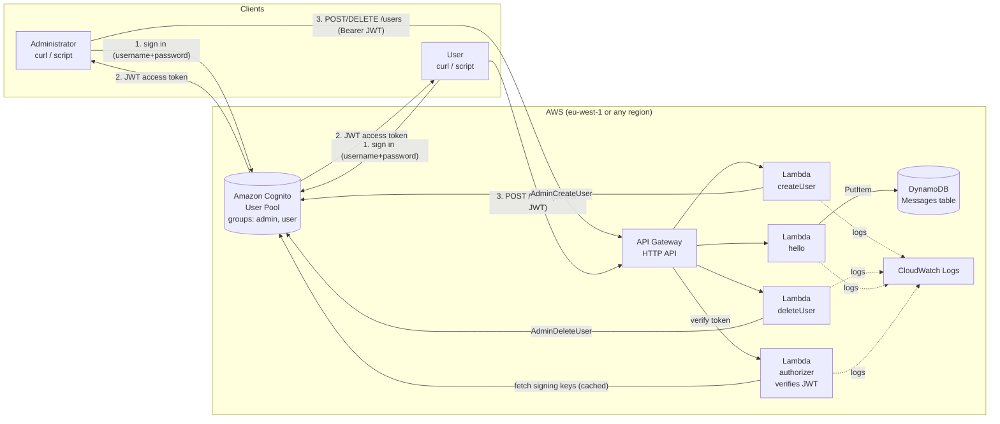
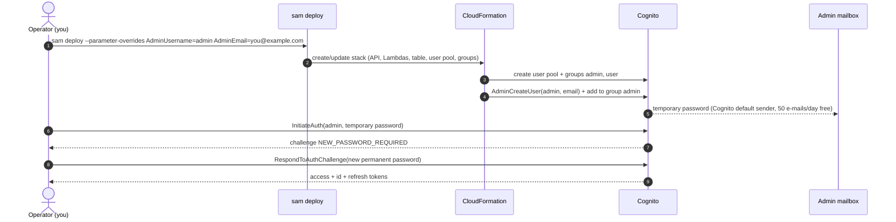
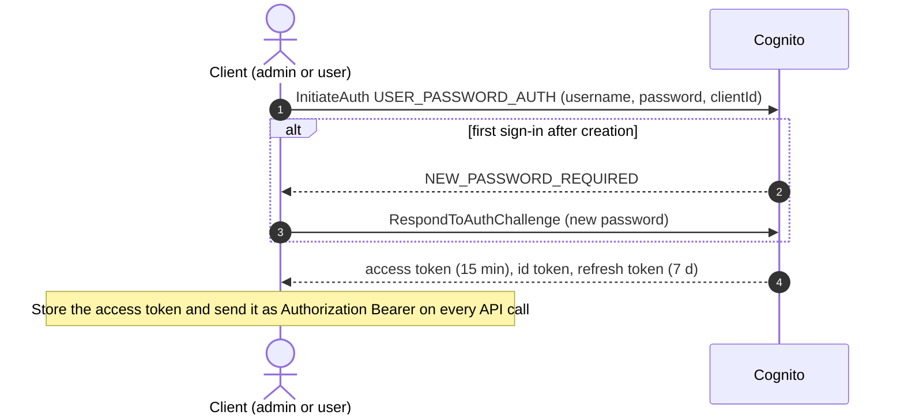
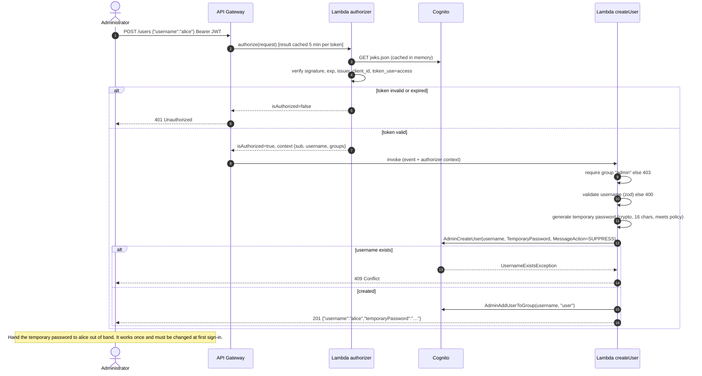
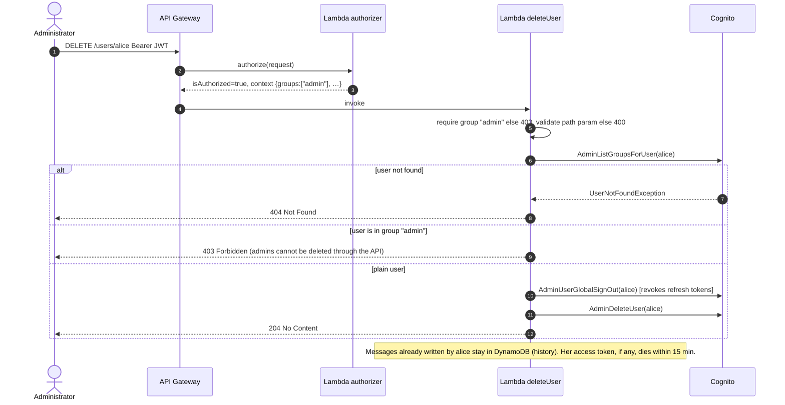
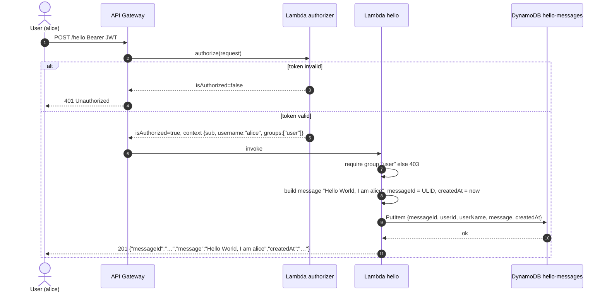
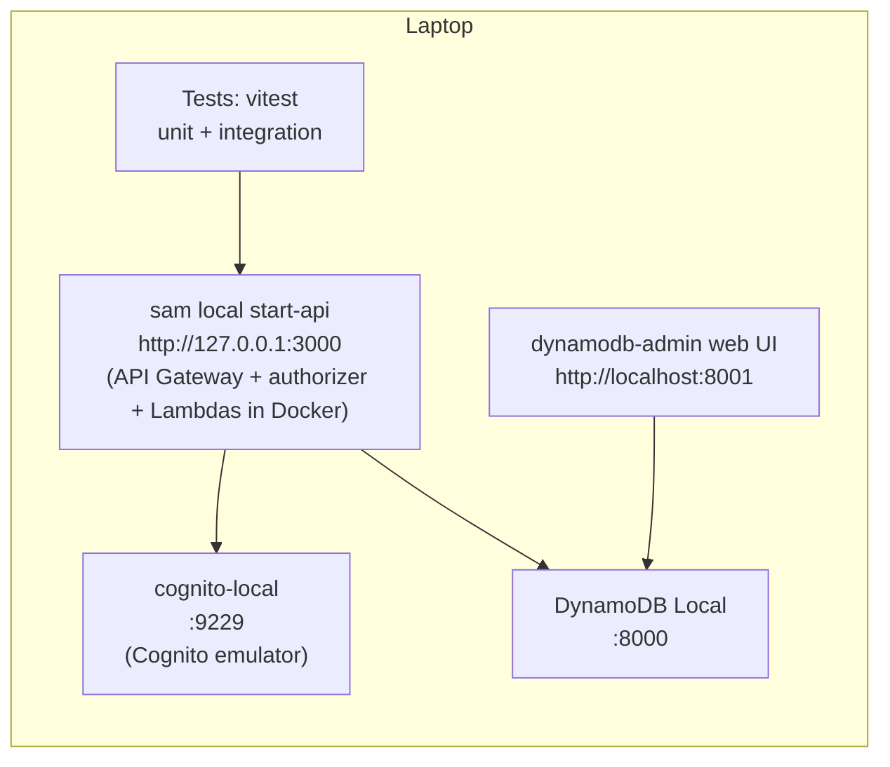

# Hello World API — Architecture

| | |
|---|---|
| Status | Draft v1 — base for the implementation plan |
| Date | 2026-10-26 |
| Stack | TypeScript · AWS Lambda · API Gateway (HTTP API) · Amazon Cognito · DynamoDB · AWS SAM |

---

## 1. Purpose and scope

This document describes the architecture of a small back-end application exposing a "Hello World" API to registered users, plus an administrative API to create and delete those users. It is written for a reader who knows TypeScript and basic AWS concepts but is **not** an expert in Infrastructure as Code: every infrastructure choice is explained in plain terms.

The document is the input for the implementation plan (next step). It fixes the **what** and the **why**; the plan will fix the **in which order**.

### 1.1 Requirements recap

Functional

- **F1 — Hello World.** A registered User calls the API; the service builds the message `Hello World, I am <UserName>`, stores it in the database and returns it.
- **F2 — User management.** An Administrator can create and delete Users.
- **F3 — Roles.** Two roles: `User` (may call Hello World) and `Administrator` (may create/delete Users).

Non-functional

- **N1** Hosted on AWS; APIs implemented as Lambda functions; language TypeScript.
- **N2** Security is a first-class concern.
- **N3** Prefer services with a free plan, database included. Target cost ≈ 0 € / month.
- **N4** Database contents (users, messages) must be easy to inspect, ideally through a web UI.
- **N5** Everything must be testable locally without deploying. Cloud deployment happens only after all local tests pass.
- **N6** Load: ≤ 10 users, almost never concurrent.

### 1.2 Decisions already taken (from the clarification round)

| Topic | Decision | Reason in one line |
|---|---|---|
| Authentication | **Amazon Cognito user pool** | Managed, secure by default, free ≤ 10 000 monthly active users, roles via groups |
| Database | **DynamoDB** | Always-free tier (25 GB, 25 RCU/WCU), stays inside AWS/IAM, emulator + web UI available locally |
| Infrastructure as Code | **AWS SAM** | One readable YAML file, first-party, `sam local start-api` runs the API on the laptop |
| Admin provisioning | **Created at deploy time**; new Users receive a one-time temporary password **in the API response**, handed over out of band | No e-mail infrastructure, fully testable locally |

---

## 2. Architecture overview



**How to read it.** Clients never talk to our Lambdas without a token. They first sign in against Cognito (step 1–2) and get a short-lived JWT. Every API call carries that JWT; API Gateway asks the authorizer Lambda to verify it before any business Lambda runs. Users live in Cognito, messages live in DynamoDB. Nothing else exists: no servers, no VPC, no NAT, no load balancer.

### 2.1 Why these pieces

| Piece | Role | Why this and not something else |
|---|---|---|
| **API Gateway HTTP API** | Public HTTPS entry point, routing, throttling, TLS | HTTP API (not REST API) is ~70 % cheaper and simpler; supports Lambda authorizers |
| **Lambda authorizer** | Verifies the Cognito JWT signature/expiry and injects identity into the request | API Gateway also has a built-in JWT authorizer with zero code, **but it cannot run locally**. A tiny Lambda authorizer behaves identically on the laptop and in the cloud (N5). |
| **Lambda functions** (`hello`, `createUser`, `deleteUser`) | Business logic, one function per route | One route = one function = one least-privilege IAM role. Easy to read, easy to secure. |
| **Cognito user pool** | User directory, passwords, sign-in, groups (= roles), token issuing | We never store or hash a password ourselves. Roles are group memberships that only an administrator (or the deployment) can change. |
| **DynamoDB** | Stores Hello World messages | Serverless, zero idle cost, always-free tier, browsable in the AWS console and locally with a web UI |
| **CloudWatch Logs** | Structured logs per function | Free tier 5 GB/month; retention set to 14 days to keep it free |
| **AWS SAM** | Describes all of the above in one `template.yaml`; builds, runs locally, deploys | See section 9 |

---

## 3. Roles and identity model

Roles are **Cognito groups**. A user's roles arrive inside the JWT as the claim `cognito:groups`, signed by Cognito, so they cannot be forged or self-assigned.

| Role | Cognito group | Can call |
|---|---|---|
| Administrator | `admin` | `POST /users`, `DELETE /users/{username}` |
| User | `user` | `POST /hello` |

Rules

- Self sign-up is **disabled** in the user pool. Only `AdminCreateUser` (from the `createUser` Lambda or from the deployment) creates accounts.
- The one Administrator account is created by the deployment (section 6.1). The API cannot create additional administrators and cannot delete members of the `admin` group — this keeps the admin role out of reach of the API surface.
- An account may be in both groups if you want the Administrator to also call Hello World; the design does not require it.

### 3.1 Tokens

Clients sign in directly with Cognito (no Lambda involved) using the `USER_PASSWORD_AUTH` flow over TLS and receive three JWTs. The API uses the **access token**:

| Setting | Value | Why |
|---|---|---|
| Access token validity | 15 minutes | Bounds the window in which a deleted user's token still works (section 7.3) |
| Refresh token validity | 7 days | Users re-enter the password weekly; revoked on delete |
| Signature | RS256, keys published by Cognito at `…/.well-known/jwks.json` | Standard; the authorizer caches the keys |
| Claims used | `sub` (stable user id), `username`, `cognito:groups`, `exp`, `client_id`, `token_use=access` | `username` is the `<UserName>` in the Hello message |

---

## 4. API contract

Base URL: `https://<api-id>.execute-api.<region>.amazonaws.com` (cloud) or `http://127.0.0.1:3000` (local). All requests: `Authorization: Bearer <access token>`, `Content-Type: application/json`.

| Method & path | Role | Request body | Success | Errors |
|---|---|---|---|---|
| `POST /hello` | user | *(none)* | `201` `{ "messageId", "message", "createdAt" }` | 401 no/invalid token · 403 not in `user` group |
| `POST /users` | admin | `{ "username": "alice" }` | `201` `{ "username", "temporaryPassword" }` | 400 invalid username · 403 not admin · 409 already exists |
| `DELETE /users/{username}` | admin | *(none)* | `204` | 403 not admin **or** target is an admin · 404 unknown user |

Conventions

- `username`: `^[a-z0-9][a-z0-9._-]{2,31}$` (3–32 chars, lowercase). Validated with `zod` before anything else runs.
- Error body: `{ "error": "<short code>", "message": "<human text>" }`. Never leaks stack traces or AWS error details.
- `POST /hello` is a POST (not GET) because it **creates** a record.

---

## 5. Data model

### 5.1 Cognito user pool (users)

Cognito is the only store for users: no duplicate "users" table to keep in sync.

| Attribute | Notes |
|---|---|
| `username` | Chosen by the admin; immutable; shown in the Hello message |
| `sub` | UUID generated by Cognito; stored on every message as `userId` so history survives renames/deletions |
| group membership | `admin` and/or `user` |
| status | `FORCE_CHANGE_PASSWORD` after creation → `CONFIRMED` after first sign-in |

Password policy: min 12 chars, upper + lower + digit, temporary passwords expire after 7 days. MFA optional (off by default to stay simple; can be enabled per pool later without code changes).

### 5.2 DynamoDB table `hello-messages`

| Attribute | Type | Key | Example |
|---|---|---|---|
| `messageId` | S | **Partition key** | `01JB5…` (ULID — time-sortable, unguessable) |
| `userId` | S | | Cognito `sub` |
| `userName` | S | | `alice` |
| `message` | S | | `Hello World, I am alice` |
| `createdAt` | S | | ISO-8601 UTC |

Settings: **provisioned capacity 1 RCU / 1 WCU** (inside the always-free 25/25), deletion protection on, encryption at rest (AWS-owned key, free), no TTL (messages are kept). A global secondary index `byUser (userName, createdAt)` can be added later if listing a user's messages becomes a requirement; it is not needed now.

---

## 6. Interaction diagrams

### 6.1 Deployment and Administrator bootstrap (one-off)



Only the Administrator's first password travels by e-mail, and only once. If you prefer no e-mail at all, the alternative is a post-deploy command `aws cognito-idp admin-set-user-password --permanent` run with the deployer's credentials; both options are supported by the same template.

### 6.2 Sign-in (prerequisite for every journey)



### 6.3 Create a User



### 6.4 Delete a User



### 6.5 Call Hello World



---

## 7. Security design

### 7.1 Controls

| Layer | Control | Where it is configured |
|---|---|---|
| Transport | HTTPS only (API Gateway terminates TLS 1.2+) | built-in |
| Authentication | Cognito-issued RS256 JWT verified on **every** request (signature, `exp`, `iss`, `client_id`, `token_use`) | authorizer Lambda, `aws-jwt-verify` |
| Authorization | Role check against `cognito:groups` **inside each handler** (defence in depth: the authorizer proves *who*, the handler decides *what*) | `hello`, `createUser`, `deleteUser` |
| Account hygiene | Self sign-up disabled; password policy 12+ chars; temporary password single-use and forced change; Cognito built-in lockout after repeated failed sign-ins | user pool |
| Privilege boundary | API can never create an admin or delete an admin | `createUser` always assigns `user`; `deleteUser` refuses admins |
| Least privilege IAM | Each Lambda has its own role with only the actions it needs, scoped to the one pool/table: `hello` → `dynamodb:PutItem`; `createUser` → `AdminCreateUser`, `AdminAddUserToGroup`; `deleteUser` → `AdminListGroupsForUser`, `AdminUserGlobalSignOut`, `AdminDeleteUser`; authorizer → none | `template.yaml` |
| No secrets | There is no secret anywhere: Lambdas use IAM roles, JWT verification uses public keys. Nothing to rotate or leak | — |
| Input validation | `zod` schemas on body and path; unknown fields rejected; errors never echo AWS internals | handlers |
| Abuse / cost protection | API stage throttling 5 req/s, burst 10 (plenty for 10 users, blocks brute force and bill surprises); AWS Budget alarm at 1 USD | `template.yaml`, Budgets |
| Data protection | DynamoDB encrypted at rest; deletion protection; Cognito stores password hashes, we never see them | table, pool |
| Logging | Structured JSON logs with request id and `username`, **never** tokens or passwords; 14-day retention | handlers, log groups |
| Supply chain | Lock file committed, `npm audit` in the test gate, bundle with `esbuild` so only used code ships | CI / scripts |

### 7.2 Threats considered

| Threat | Mitigation |
|---|---|
| Stolen or forged token | Signature verification; 15-min expiry; tokens never logged |
| Normal user calling admin endpoints | Group check in handler → 403; group claims signed by Cognito |
| Admin account takeover via API | API cannot create admins; admin password set only through Cognito challenge flow |
| Enumeration of usernames via `POST /users` 409 | Accepted: endpoint is admin-only |
| Brute-force sign-in | Cognito lockout + API throttling |
| Injection | DynamoDB SDK uses typed parameters (no query strings); input validated |
| Runaway cost | Throttling, provisioned 1/1 capacity, budget alarm |

### 7.3 Residual risks (accepted, documented)

- A deleted user's **access token remains valid until it expires** (≤ 15 min) plus up to 5 min of authorizer cache. JWT verification is stateless by design; checking Cognito on every call would cost a network round-trip per request. Acceptable for this application; if it ever is not, drop the authorizer cache TTL to 0 and call `AdminGetUser` in the authorizer.
- `USER_PASSWORD_AUTH` sends the password over TLS to Cognito. The SRP flow avoids that but needs a heavier client library; can be switched on later with no server-side change.
- MFA is off. Turning it on is a pool setting.

---

## 8. Local development and testing

Everything runs on the laptop; **no AWS account is needed to run the full test suite.**



| Component | Tool | Notes |
|---|---|---|
| API Gateway + Lambdas | `sam local start-api` | Runs the real handler code in Lambda-like Docker containers. Since SAM CLI 1.80 it also invokes the Lambda authorizer locally. |
| DynamoDB | `amazon/dynamodb-local` (Docker) | Same API as the cloud service; table created by a seed script from the same definition as `template.yaml` |
| **DB inspection UI** | `aaronshaf/dynamodb-admin` (Docker) | Browser table viewer/editor at `localhost:8001` — satisfies N4 locally. In the cloud, the DynamoDB console "Explore items" page gives the same view. |
| Cognito | `jagregory/cognito-local` (Docker) | Community emulator: sign-in (`USER_PASSWORD_AUTH`), `AdminCreateUser`, `AdminDeleteUser`, groups, and a JWKS endpoint so the authorizer verifies tokens exactly as in the cloud. The emulator is not 100 % faithful (e.g. the first-login password challenge is partial), see note below. |
| Wiring | `docker-compose.yml` + `env.local.json` | Lambdas receive `DYNAMODB_ENDPOINT`, `COGNITO_ENDPOINT`, `JWKS_URI` via environment; in the cloud these are simply absent and the SDK defaults apply |

**Note on Cognito emulation.** Our Lambdas only call admin APIs (`AdminCreateUser`, `AdminAddUserToGroup`, `AdminListGroupsForUser`, `AdminUserGlobalSignOut`, `AdminDeleteUser`) and verify JWTs; the password-change challenge happens between the *client* and Cognito, never in our code. Where the emulator lacks an API, the Cognito access is isolated behind one small adapter (`src/lib/cognito.ts`) that unit tests mock. The emulator is used for integration tests; a 2-minute post-deploy smoke test (section 9.3) is the final proof against real Cognito.

### 8.1 Test pyramid and the "deploy gate"

| Level | What | Tool | Needs Docker? |
|---|---|---|---|
| Unit | Each handler and the authorizer with mocked AWS SDK clients; validation; password generator; role checks | `vitest`, `aws-sdk-client-mock` | no |
| Integration | The four journeys of section 6 end-to-end through `sam local start-api` against DynamoDB Local and cognito-local, including the negative cases (401/403/404/409) | `vitest` + `fetch` | yes |
| Static | `tsc --noEmit`, `eslint`, `npm audit`, `sam validate --lint` | — | no |

`npm run verify` runs all three levels. **`npm run deploy` refuses to run unless `verify` has just passed** (the deploy script calls `verify` first). That is the mechanical enforcement of N5.

---

## 9. Deployment

### 9.1 What SAM does, in plain words

`template.yaml` is a single YAML file (≈ 150 lines) that lists the resources of section 2 and their settings. Three commands cover the whole life cycle:

```
sam build          # bundles each TypeScript handler with esbuild
sam local start-api
sam deploy --guided   # first time: asks for region, stack name, admin username/e-mail; then one command
```

`sam deploy` hands the template to CloudFormation, which creates or updates every resource and rolls back automatically on failure. Deleting the whole application is `sam delete`. There is no state file to manage and no extra tool to install besides the SAM CLI and Docker.

### 9.2 Environments

One AWS account, one stack per environment (`hello-dev`, `hello-prod`) selected by `--config-env`. Given the load, a single `prod` stack is enough to start; the local stack is the "dev" environment.

Runtime choices: Node.js 22, `arm64` (cheaper, faster cold start), 256 MB, 10 s timeout, bundled with `esbuild` through SAM's `Metadata.BuildMethod: esbuild`.

### 9.3 Post-deploy smoke test

A script `scripts/smoke.sh <stack>` that signs in as admin, creates a throw-away user, calls `/hello` as that user, verifies the row in DynamoDB, deletes the user. Run after every deploy; it is the only test that touches real Cognito.

---

## 10. Cost estimate (per month, 10 users, ~1 000 requests)

| Service | Free allowance | Expected usage | Cost |
|---|---|---|---|
| Lambda | 1 M requests + 400 000 GB-s, always free | ~2 000 invocations | 0 € |
| API Gateway HTTP API | 1 M requests free for 12 months, then 1 USD per million | ~1 000 | 0 € (≈ 0.001 USD after year 1) |
| DynamoDB | 25 GB + 25 RCU/WCU provisioned, always free | 1 RCU / 1 WCU, < 1 MB | 0 € |
| Cognito (Essentials plan) | 10 000 MAU free | 10 MAU | 0 € |
| CloudWatch Logs | 5 GB ingest free | < 10 MB | 0 € |
| **Total** | | | **≈ 0 €** |

Guard-rails: budget alarm at 1 USD; API throttling; no on-demand DynamoDB (provisioned 1/1 cannot scale into cost).

---

## 11. Observability

- Structured JSON logs (`requestId`, `route`, `username`, `outcome`, `durationMs`) via a 20-line logger (or AWS Lambda Powertools Logger if preferred).
- CloudWatch default metrics (errors, duration, throttles) per function; one alarm on `authorizer` or `hello` 5xx > 0 in 5 min, notification by e-mail (SNS, free).
- No tracing (X-Ray) to stay in the free tier and keep the template short; it is a one-line switch if ever needed.

---

## 12. Proposed repository layout

```
.
├── template.yaml                  # all infrastructure (SAM)
├── samconfig.toml                 # deploy parameters per environment
├── docker-compose.yml             # dynamodb-local, dynamodb-admin, cognito-local
├── env.local.json                 # Lambda env vars for sam local
├── package.json                   # scripts: build, local:up, local:api, test, verify, deploy, smoke
├── src/
│   ├── handlers/
│   │   ├── authorizer.ts
│   │   ├── hello.ts
│   │   ├── createUser.ts
│   │   └── deleteUser.ts
│   └── lib/
│       ├── auth.ts                # claims typing, requireGroup()
│       ├── cognito.ts             # thin adapter over the Cognito SDK (mockable)
│       ├── db.ts                  # DynamoDB DocumentClient + putMessage()
│       ├── http.ts                # ok()/error() response helpers
│       ├── password.ts            # temporary password generator
│       └── validation.ts          # zod schemas
├── tests/
│   ├── unit/
│   └── integration/
├── scripts/
│   ├── local-seed.sh              # create table, pool, client, groups, admin + sample user locally
│   ├── smoke.sh                   # post-deploy end-to-end check
│   └── deploy.sh                  # runs verify, then sam deploy
└── docs/
    └── ARCHITECTURE.md
```

Dependencies (runtime): `@aws-sdk/client-cognito-identity-provider`, `@aws-sdk/client-dynamodb`, `@aws-sdk/lib-dynamodb`, `aws-jwt-verify`, `zod`, `ulid`. Dev: `typescript`, `esbuild`, `vitest`, `aws-sdk-client-mock`, `eslint`, `@types/aws-lambda`.

---

## 13. Alternatives considered

| Alternative | Why not (for this project) |
|---|---|
| API Gateway built-in JWT authorizer instead of a Lambda authorizer | Zero code and no cold start, but cannot run under `sam local`; N5 wins. Documented as a later swap if local auth emulation is ever dropped. |
| Lambda Function URLs (no API Gateway) | Free and simpler, but no authorizer, no throttling, no routing: all security would move into handler code. |
| App-managed users + own JWT | Fully local, but we would own password hashing, lockout, token signing keys. Cognito gives all of that for free. |
| Postgres on Supabase/Neon | Excellent web UI, but adds a non-AWS vendor, a connection secret in Lambda and connection-pool concerns. DynamoDB + dynamodb-admin covers N4 well enough. |
| AWS CDK / Serverless Framework | More abstraction (CDK) or a third-party licence model (Serverless v4). SAM is the easiest to read for a non-IaC expert. |
| One "users" table in DynamoDB mirroring Cognito | Two sources of truth to keep in sync for no benefit. |

---

## 14. Assumptions and open points

Assumptions made (change them in the implementation plan if wrong):

1. The username **is** the display name in the Hello message (`Hello World, I am alice`). No separate "full name" attribute.
2. The Administrator does not need to call `/hello`; if they do, add the admin account to the `user` group too.
3. Messages are never deleted and never listed by the API (inspection happens through the DB UI).
4. One region, one production stack; local Docker stack is the development environment.
5. Clients are scripts/curl/Postman; no front end is in scope.

Nothing is blocking: the implementation plan can start from this document.

---

## 15. Next step — implementation plan outline

1. Repository scaffold, TypeScript/esbuild/vitest config, lint.
2. `template.yaml`: table, user pool + groups + app client, HTTP API, authorizer, three functions, IAM policies, admin user, outputs.
3. Local stack: `docker-compose.yml`, `local-seed.sh`, `env.local.json`, `sam local start-api` working against emulators.
4. Handlers + libs with unit tests (authorizer → hello → createUser → deleteUser).
5. Integration tests for the four journeys and negative cases.
6. `verify` and `deploy` scripts (gate), `smoke.sh`.
7. First cloud deployment, smoke test, budget alarm, README.
