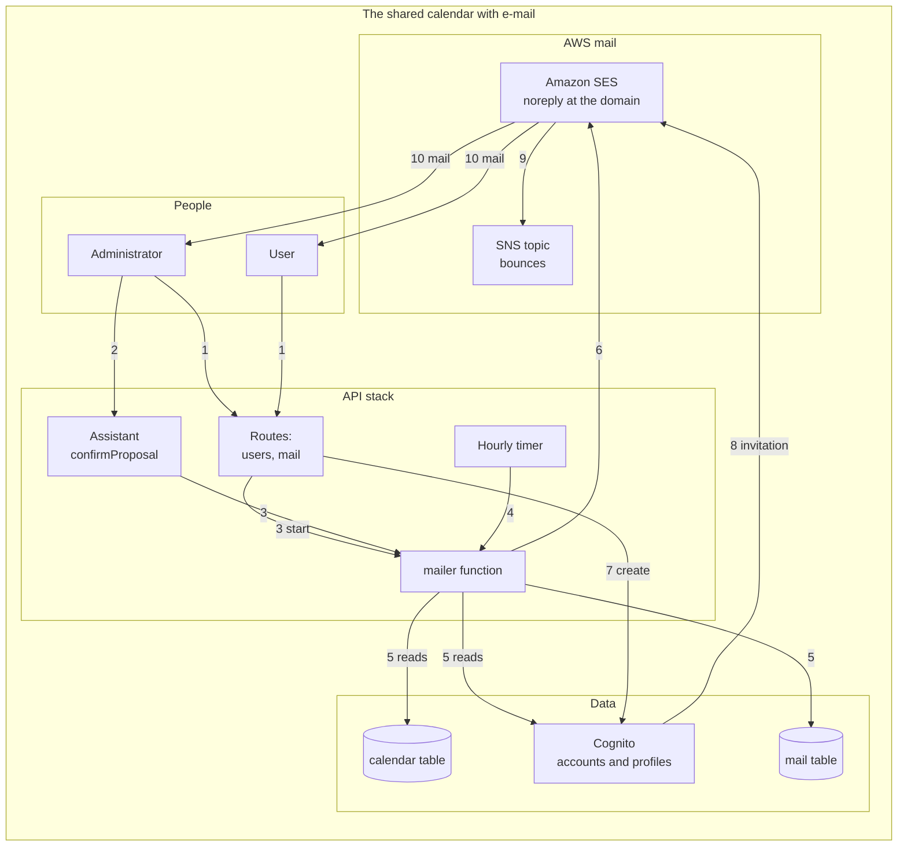
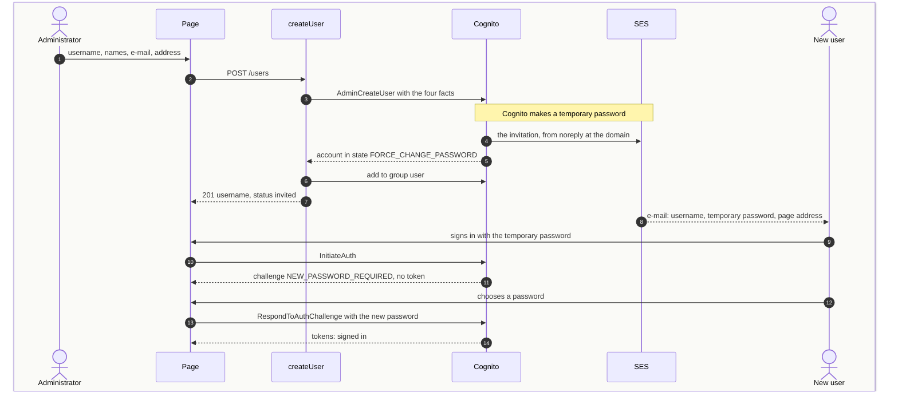

# Shared Calendar: e-mail (architecture proposal)

| | |
|---|---|
| Status | Being built, `docs/EMAIL_PLAN.md`. The decisions of sections 2.2 and 2.3 and every open point (section 21) are confirmed by the Product Owner (2026-11-25); the plan's decisions F1 to F5, F13 and F15 (its section 3), and the deletion of the existing Users moved to step 9, are written in here (2026-11-25); step m5's decisions on the daily mail's retry and on several administrators are in section 6.2; the languages of `docs/MULTILANGUAGE_ARCHITECTURE.md` (English and Italian, built in `docs/MULTILANGUAGE_PLAN.md` steps l6 and l7, not deployed yet) replace decision M17 and are written in sections 2.3, 3.1, 4, 5.1, 6, 12, 13.1 and 21 (2026-11-27) |
| Date | 2026-11-25; the languages 2026-11-27 |
| Brief | `prompts/mail-m01-integrate-mail-idea.md`, with the answers of the clarification round (section 2.2) |
| Builds on | `docs/ARCHITECTURE.md` (sections 4, 5, 6.3, 7, 9, 10), `docs/SHARED_CALENDAR_SPEC.md` section 15 (e-mail notifications prepared), `docs/CONVERSATIONAL_ARCHITECTURE.md` sections 5.4 and 8 (proposals and tools) |
| Would add to the stack | Amazon SES (one domain identity, one configuration set), one SNS topic, one DynamoDB table `mail`, one scheduled function `mailer`, five routes, one assistant tool |
| Would change | The creation of a user (an invitation e-mail and a forced password change instead of a password shown to the Administrator); four new facts about every person (first name, last name, e-mail, address) |
| What comes next | `docs/EMAIL_PLAN.md`, the implementation plan, steps m1 to m10 from section 20's outline; when it is finished, this document becomes a record and `docs/ARCHITECTURE.md` holds its content |

This document says how the shared calendar would send e-mail, what changes for the people who
use it, what changes in the code and in the cloud, and what you, as Product Owner and operator,
have to decide and do. Where it reverses a rule of `docs/ARCHITECTURE.md`, it says so (section
17). Once finalized and implemented, its content is merged into `docs/ARCHITECTURE.md`, which
then wins, as was done for the assistant.

The facts about AWS were read on 2026-11-25 in AWS's documentation (section 22). The facts about
the local Cognito emulator were tried that day on the local stack (section 14.1).

---

## 1. In short

**What a person sees**

1. **The Administrator creates a user** by typing a username, a first name, a last name, an
   e-mail address and a postal address. The page no longer shows a password.
2. **The new user receives an e-mail** with their username, a temporary password and the
   page's address. At their first sign-in the page asks them to choose their own password
   before anything else. The temporary password then stops working; unused, it expires after
   7 days, and the Administrator can send a new invitation with one button.
3. **Every morning** (at an hour the Administrator chooses, or never) the Administrator
   receives an e-mail with two Excel files: the appointments of the next 7 days, and a backup
   with every appointment from the first day of last month onwards.
4. **On demand**, from a button on the week page or by asking the assistant, the Administrator
   gets an Excel file of the whole calendar between two dates, and a User gets their own
   appointments between two dates, as a list in the e-mail and as an Excel file. Each mail goes
   only to the address of the person who asked. The assistant asks for a Confirm first.

**How it works, in one paragraph**

Cognito, which already holds the accounts, sends the invitation itself, through Amazon SES, the
AWS e-mail service: the temporary password is made and sent by Cognito and never passes through
our code, our logs or the Administrator's screen. Every other e-mail is sent by one new
function, the **mailer**, which reads the calendar, builds the Excel files and hands the mail to
SES. The routes and the assistant never send mail themselves: they check the request and start
the mailer in the background, so a slow mail never holds up a page. A timer starts the mailer
every hour; when the hour is the one the Administrator chose, it sends the daily mail, once.

**What is new and needs care**, mostly outside the code:

- **The domain must be proven** to SES with three DNS records, and the AWS account must be
  taken out of SES's "sandbox" by a request to AWS (section 8). Until then no mail reaches an
  address that is not verified in SES.
- **Personal data grows**: names, an e-mail and a postal address for every person, and Excel
  files with names sitting in a mailbox. The purpose of each fact goes into the privacy notice,
  for the GDPR page that will come (section 12.3).
- **Two rules of the design change** (section 17): the first password is now temporary and
  e-mailed, and the system now sends e-mail. The creation route's answer changes shape, which
  breaks an old client: the release is a new major version, v3.0.0.

---

## 2. What is asked, and what was decided

### 2.1 The use cases

| Id | Use case | Who | When |
|---|---|---|---|
| E1 | Invitation: a new user receives their username and a temporary password; they must choose their own password at the first sign-in | the new User, started by the Administrator's creation | at creation, and again on "resend" |
| E2 | Daily mail to the Administrator: two Excel files, the next 7 days and the backup | the Administrator | every day at the chosen hour, if switched on |
| E3 | The calendar on demand, to the Administrator: every appointment between two dates, as an Excel file | the Administrator | a button on the week page, or the assistant |
| E4 | My appointments on demand, to a User: their own appointments between two dates, listed in the mail and as an Excel file | a User | a button on the week page, or the assistant |
| E5 | The person's data: first name, last name, e-mail, postal address, typed by the Administrator | the Administrator | at creation, and when editing a user |
| E6 | Notifications (booked, cancelled, changed, reminders) | both | later, sketched only (section 19) |

### 2.2 The decisions of the clarification round (2026-11-25)

| Id | Decision |
|---|---|
| M1 | The invitation carries a generated password, and the user must change it at the first sign-in |
| M2 | The forced change is Cognito's own: the account is created in the state "must change password", Cognito refuses every token until the new password is set, and the temporary password expires |
| M3 | A person's first name, last name, e-mail and postal address (free text, not checked) are all required at creation; only the Administrator edits them |
| M4 | Mail is sent from an address of the calendar's domain with a **Reply-To** address the Administrator reads; the domain, the sender and the Reply-To are parameters, so that a later move to a domain that receives mail, or forwards it, is a change of parameters and DNS records, not of code |
| M5 | Notifications are a later step, only sketched here |
| M6 | The Excel files hold appointments only (no free slots, no opening hours) |
| M7 | The daily mail holds two files: the next 7 days (fixed) and the backup, from the 1st of last month to the last future appointment. The Administrator switches it on or off and chooses the hour |
| M8 | A User's mail: their appointments listed in the body, plus an Excel file of the same |
| M9 | Through the assistant, a mail is a proposal with a Confirm button, as a calendar change is |
| M10 | On-demand mails go only to the address of the person who asks; there is no recipient field |

### 2.3 What this document proposed, confirmed by the Product Owner (2026-11-25)

| Id | Proposal | Why |
|---|---|---|
| M11 | Cognito sends the invitation (its own template, through our SES), not our mailer | The temporary password is never seen by our code, our logs or the Administrator; "resend" is one Cognito call |
| M12 | The Administrator's own e-mail, names and address are set by the bootstrap script and can be changed by the Administrator through the edit route on their own account | The daily mail needs the Administrator's address; the template must not hold it (public repository) |
| M13 | A User can read their own data (`GET /me`), not change it | GDPR's right of access, and the future consent page needs it |
| M14 | The hourly timer, not a timer set at the chosen hour | A fixed schedule in the template, no permission to change schedules; the hour is just a setting the mailer reads |
| M15 | A new table `mail` for the mail settings and counters, not the `calendar` table | The calendar's contract, lock and tools stay untouched |
| M16 | At most 5 on-demand mails per person per day, and at most 366 days in one request | Protects the sender's reputation at SES and the cost; enough for any real use |
| M17 | The mails, their Excel files and the invitation are written in the recipient's language (English or Italian), else in the installation's default language (`DefaultLanguage`), else in English | The calendar has one list of languages for the pages, the mails and the assistant (`docs/MULTILANGUAGE_ARCHITECTURE.md` sections 7 and 8) |

Also decided in review (2026-11-25): the postal address is kept for future features, such as
printing invoices (O1, section 12.3); the Reply-To is today's alarm address, `AlertEmail` (O2,
section 8.2); the release is the major version v3.0.0 (section 9.1).

---

## 3. The architecture

| Arrow | What happens |
|---|---|
| 1 | A person uses the page: creating or editing a user, asking for a mail, changing the daily-mail settings |
| 2 | A person asks the assistant for a mail; nothing is sent until they press Confirm |
| 3 | The route, or the confirmed proposal, checks the request, counts it, and starts the mailer in the background (an asynchronous call: it answers at once) |
| 4 | Every hour the timer starts the mailer; it sends the daily mail when the hour is the chosen one and today's has not gone yet |
| 5 | The mailer reads the appointments, the people's names and addresses, and the mail settings |
| 6 | The mailer builds the e-mail and its Excel files and hands it to SES |
| 7 | Creating a user creates the Cognito account with the four facts, in the state "must change password" |
| 8 | Cognito itself sends the invitation with the temporary password, through our SES identity |
| 9 | A mail that bounces, or is marked as spam, is reported to an SNS topic, which e-mails the Reply-To address |
| 10 | The mail arrives, from `noreply@<domain>`, with Reply-To the Administrator's address |

### 3.1 The pieces, and why each

| Piece | What it does | Why this one |
|---|---|---|
| **Amazon SES** in `eu-north-1` | Sends every mail | The AWS e-mail service; in `eu-north-1`, Cognito can only use SES identities of the same region ("In-Region only", section 22), which suits us; pennies a month (section 15) |
| **SES domain identity** with Easy DKIM | Proves we may send as `…@<domain>` | Mail signed for the domain lands in inboxes, not in spam; the domain is a parameter |
| **SES configuration set** + **SNS topic** | Reports bounces and complaints by e-mail to the Reply-To address | `noreply@` receives nothing, so without it a bounce would be lost |
| **Cognito invitation** | Sends E1 | Cognito makes the temporary password, keeps it, expires it and resends it; our code never touches it |
| **Invitation function** (`inviteMessage`) | Words E1 in the person's language, else the installation's (section 5.1) | Cognito's "custom message" trigger: the words stay in `shared/src/mail/` with the other mails' texts, and the password still never reaches our code |
| **`mailer` function** | Sends E2, E3, E4 | One function holds the right to send mail and the Excel library; the routes stay small and fast |
| **EventBridge Scheduler**, every hour | Starts the daily mail | Free at this volume; a fixed schedule (decision M14) |
| **Table `mail`** | The daily-mail settings, the "sent today" mark, the per-person counters | Small, separate from the calendar (decision M15) |

What is deliberately **not** used: SQS (Lambda's own asynchronous call has two retries and is
enough at this volume), S3 (the files are attachments, never stored), SES receiving (not
offered for this domain set-up yet, section 8.3), a template engine (the texts are a few
functions in `shared/`).

---

## 4. The person's data

### 4.1 Four new facts, kept in Cognito

| Fact | Cognito attribute (standard) | Rule |
|---|---|---|
| First name | `given_name` | 1–100 characters after trimming |
| Last name | `family_name` | 1–100 characters after trimming |
| E-mail | `email`, with `email_verified` = `true` | a syntactically valid address, at most 254 characters, stored lower-cased; not unique (two people may share an address) |
| Postal address | `address` | free text, 1–300 characters, multi-line allowed, never checked |

Cognito stays the only store of people (`docs/ARCHITECTURE.md` section 5.1): no "users" table
to keep in step, and deleting an account deletes its personal data with it. These are Cognito's
standard attributes, so **the user pool's schema does not change** (the pool is never
replaced). The rules live in `shared/` as one `zod` schema, `UserProfile`, used by the page, the
routes and the tests.

`email_verified` is set to `true` by our code because the Administrator typed the address:
there is no verification code. The consequence is honest: a mistyped address means the
invitation goes nowhere (or to a stranger); the Administrator corrects it and resends (section 5.3).

**A fifth fact, the language**, is kept beside the four in the account, in Cognito's standard
attribute `locale` (`en` or `it`), as `docs/MULTILANGUAGE_ARCHITECTURE.md` section 4.1 says.
Unlike the four, it is the person's own: they choose it in "My details", and the page writes it
straight at Cognito with their own token. The Administrator never sets it, and no body of the
API carries it (`POST /users` and `PUT /users/{username}` refuse a `language` field). An invited
person has none until their first sign-in. Whoever reads it treats a missing value, or a word
not in the list, as none, and uses the installation's default (section 6.6).

### 4.2 Who may read and change them

| Who | Read | Change |
|---|---|---|
| Administrator | every User's (`GET /users`), their own (`GET /me`) | every User's, and their own (`PUT /users/{username}`); never another administrator's |
| User | their own (`GET /me`) | none: they ask the Administrator |
| Assistant | the first name of the person speaking, for a greeting (optional, open point O4) | none |

The language follows its own table (`docs/MULTILANGUAGE_ARCHITECTURE.md` section 4.2): the
person reads and changes their own at Cognito; the mailer reads the recipient's with the
address (`getProfile`, `adminRecipients` in `backend/src/lib/cognito.ts`); `GET /users` and
`GET /me` do not show it.

### 4.3 The accounts that exist today

**They are deleted in step 9 of section 20, just before the new API reaches the cloud**
(decision of 2026-11-25; first planned at the beginning of the work, moved so that the people
keep their access while it is built). So no facts are filled in by hand, and every User in the
new release has the four facts from the start. The Administrator deletes them in the deployed
page, still the old release, with the existing route (`DELETE /users/{username}`, the Users
page), which also cancels their future appointments (`cancelReason` `user_deleted`,
`docs/SHARED_CALENDAR_SPEC.md` section 10.2). Before deleting, the Administrator notes, outside
the system, who will need an account again and their future appointments. Those people are
created again once invitations work (step 10 of section 20), and receive one.

Consequences: no account without facts exists, so `GET /users` never answers a missing fact;
nothing ever needs to tell an "old" account from a new one; no existing User keeps a password
that was never forced to change.

The Administrator's account is not deleted. It gets its four facts from
`npm run bootstrap-admin` on a new stack, or from "My details" on the existing one. Until its
e-mail is set, a mail the Administrator asks for is refused with `409 no_email_address`, and the
daily mail is skipped with a log line. Until then `GET /me` answers `null` for each fact the
account does not hold, and "My details" says "not set" (decided by the Product Owner on
2026-11-25); `GET /users`, which lists Users only, treats a missing fact as a broken directory
(`500`).

---

## 5. The invitation and the first sign-in

### 5.1 The flow

- **The route no longer sees a password.** `createUser` calls `AdminCreateUser` without
  `MessageAction: SUPPRESS` and without a password, with `DesiredDeliveryMediums: EMAIL`.
  Cognito generates the temporary password by the pool's password policy and sends it. The
  answer becomes `201 { username, status: "invited" }`. The rollback stays: if the group step
  fails, the account is deleted (the user has received an invitation that no longer works; the
  page says "creation failed, nothing was kept").
- **Cognito enforces the change.** An account in `FORCE_CHANGE_PASSWORD` gets no token until
  the challenge is answered, so the authorizer, the routes and the assistant need no change.
- **The temporary password expires** after `TemporaryPasswordValidityDays` = 7 (pool setting).
  Used once, it is gone. So an old invitation lying in a mailbox opens nothing.
- **The invitation's text** comes from the invitation function, `backend/src/handlers/inviteMessage.ts`,
  Cognito's "custom message" trigger, which exists at `MailStage` `on`. Before sending the
  invitation, or its resend, Cognito calls it with the person's attributes and two placeholders;
  it answers the subject and the HTML body of `invitationMailText` (`shared/src/mail/texts.ts`)
  in the language of the person's `locale`, which an invited person does not have yet, so in
  practice in the installation's (`DEFAULT_LANGUAGE`, else English), with the page's address
  (`PAGE_ADDRESS`). It puts Cognito's two placeholders for the username and the temporary
  password in as they come, and Cognito fills them afterwards: the password never passes
  through our code. Any other kind of Cognito message is answered untouched. The pool's
  `InviteMessageTemplate` stays in `template.yaml`, in English, as the text Cognito falls back
  to when the function's answer is unusable. The wording is in section 6.6.

### 5.2 The page

The sign-in today treats any challenge as an error (`frontend/src/services/cognito.ts`,
reason `challenge`). It learns one: `NEW_PASSWORD_REQUIRED` leads to a screen "Choose your
password" (the same rule and the same live checks as the change-password screen, from
`shared/src/password.ts`), which answers the challenge with `RespondToAuthChallenge` and then
signs the person in as usual. Cognito's challenge session lasts 3 minutes: past that, the screen
says so and sends the person back to the sign-in.

**The future GDPR page plugs in here.** The first sign-in becomes a short sequence of gates,
each shown once: 1. choose your password (Cognito's, this document), 2. accept the privacy
terms (later, the app's own). Unlike the first, the second must be enforced by the server too
(a "consent version accepted" fact checked by the authorizer or by each route), because Cognito
knows nothing of it; that design belongs to the GDPR requirement, not here. Nothing in this
proposal makes it harder.

### 5.3 Resend, and a wrong address

`POST /users/{username}/invitation` (admin): for an account still in `FORCE_CHANGE_PASSWORD`,
`AdminCreateUser` with `MessageAction: RESEND`, which makes a new temporary password and sends
it to the address on file. An account that has already chosen its password answers
`409 not_invited`.

The users' list shows each User's state: **invited** (has not signed in yet) or **active**.

### 5.3.1 A wrong e-mail address

The Administrator types the address, so a wrong one is a typing mistake. What happens depends
on the kind of mistake:

| The address… | What happens | What the Administrator does |
|---|---|---|
| is not an address at all (`anna.rossi@`, `anna rossi@x.it`) | the form and the route refuse it (`400`, the rule of section 4.1); no account, no mail | corrects it in the form |
| looks right but does not exist (`anna.rosi@gmail.com`, `…@gmial.com`) | the account is created and SES sends the invitation; the receiving server refuses it (a "bounce"); within minutes the bounce report arrives at the alarm address (section 8.4); SES puts that address on the account's suppression list, so it is not tried again; the User stays **invited** | reads the bounce report, edits the e-mail, presses "Resend invitation" |
| exists but belongs to someone else | the stranger receives a username, a temporary password and the page's address, and could sign in and choose a password before the right person does | see below |

The third case is the one to care about, since the stranger could take the account. What
limits it:

- the creation form shows the address once more before sending ("An invitation will be sent to
  anna.rossi@gmail.com", with Confirm), and the answer repeats it;
- the account can do little: a User sees free slots and their own appointments, and a new
  account has none;
- an unused temporary password expires after 7 days;
- if the right person says "I received nothing", the Administrator looks at the state: still
  **invited** means nobody used it, so correct and resend; **active** although they never
  signed in means someone else did: delete the account and create it again with the right
  address.

Nothing in the system can tell a right address from someone else's; no verification code
would help, since the code would go to the same wrong address. The confirmation step is the
practical safeguard.

### 5.4 The Administrator

Unchanged: created by the deployment, its permanent password set once by
`npm run bootstrap-admin`. The script also sets the Administrator's four facts (prompted, never
in a file or an argument, as for the password today).

**A test User for the operator.** Between the deploys of steps 9 and 10 of section 20 no User
can be created through the page (`POST /users` answers `503 mail_unavailable`, section 13.2), so
the User's side of the app could not be tried. A command,
`npm run test-user -w backend -- <local|cloud> <username>`, creates one User straight in
Cognito, in group `user`, with the four facts (the e-mail is the operator's own, prompted) and a
**temporary** password the operator types (prompted, sent on stdin through
`backend/scripts/cognito.mjs`, never saved). At the first sign-in the page asks for a new
password, so the screen "Choose your password" is tried as a real User sees it. The User stays
until the operator deletes it in the Users page. It is the one deliberate exception to "Cognito
makes and e-mails the first password", made by the operator's own command while mail is not on.
It is not the smoke test's: that one removes everything it makes.

---

## 6. The calendar mails

### 6.1 One sender: the mailer

The mailer is one function with three ways in, all the same shape: "send mail of kind K for
person P, range R".

| Kind | Started by | Recipient | Content |
|---|---|---|---|
| `daily` | the hourly timer | every member of group `admin` that has an e-mail | two Excel files (section 6.3) |
| `calendar` | `POST /mail/calendar` by the Administrator, or the assistant's confirmed proposal | the Administrator who asked | one Excel file, every appointment in the range |
| `mine` | `POST /mail/calendar` by a User, or the assistant's confirmed proposal | the User who asked | the list in the body, and one Excel file, their appointments in the range |

What the mailer receives in its event: the kind, the person's `sub`, username and role, the
range, the request's id. **Never an address**: the mailer looks the address up in Cognito
itself, so a mail can only go to the account's own address (decision M10). It reads the
recipient's language in the same call, and writes the mail and its files in it (section 6.6);
the event carries no language either. The daily mail goes to each administrator in their own
language; its text and its two files are made once per language in use.

How it is started: the route calls Lambda's asynchronous invoke (`InvocationType: Event`) and
answers `202` at once. Lambda retries a failed run twice; a run that still fails is logged and
raises the mailer's error alarm (section 16). The person's page has already said "the e-mail is
on its way": that is the honest promise, since SES itself delivers later.

### 6.2 The daily mail, exactly once

Every hour, at minute 0, the scheduler starts the mailer with `kind: daily`. The mailer:

1. reads the mail settings: off → stops. The hour in the calendar's time zone
   (`CalendarTimeZone`) is not the chosen one → stops;
2. writes the mark `DAILY#<local date>` **only if it does not exist** (a conditional write): if
   it exists, today's mail already went (or is going) → stops. This makes a timer that fires
   twice, or a retry, harmless;
3. builds and sends; records the outcome on the mark.

If the run fails after the mark, Lambda's retries run with the same event and find the mark:
the mark therefore holds a state (`sending`, `sent`, `failed`), and a retry may proceed only
from `sending` older than 10 minutes or `failed`. The rule is "at most one daily mail a day, and
a failure is retried and alarmed". Decided by the Product Owner on 2026-11-25 (`docs/EMAIL_PLAN.md`
step m5):

- **A failed daily mail is tried again later the same day.** At the chosen hour, and at any
  later hour of the same local day, the run also goes ahead when the mark is `failed`, or
  `sending` and older than 10 minutes. With no mark, only the chosen hour sends: a later hour
  without a mark stops (`not_the_hour`). So when Lambda's own retries are spent, the next
  hourly run takes the mark again, until midnight.
- **Several administrators share one mark, and each gets a mail of their own.** On a partial
  failure (one mail went, another did not) the mark becomes `failed` and the retry sends to all
  again, so one may get the mail twice. This is accepted: the API cannot create a second
  administrator, and a duplicate daily mail harms nobody. No code guards against it.
- Nobody to send to (no administrator with an address) ends the mark `sent` with no mail, the
  outcome `no_recipient`, logged as a warning: no retry would find an address.
- The mark is taken with one conditional write and finished with another, the latter only
  while the mark is still the run's own (`sending` since its `startedAt`), so a run that was
  taken over cannot overwrite the newer run's outcome.

A change of the hour takes effect the next day the hour comes round; switching it on after the
hour has passed sends nothing until tomorrow. Daylight saving changes nothing: the hour is read
in the calendar's zone.

### 6.3 The Excel files

One sheet per file, one row per appointment, sorted by start. Times are local to the calendar's
time zone, as on the pages.

The file is in the recipient's language (`appointmentsFile(language, …)` in
`backend/src/lib/excel.ts`): the eleven headings (by the column keys `EXCEL_COLUMNS` of
`shared/src/mail/texts.ts`), the sheet's name ("Appointments", "Appuntamenti"), the statuses
(booked, cancelled; "prenotato", "annullato") and the reasons of a cancellation (cancelled,
changed, user deleted; "annullato", "spostato", "utente eliminato") come from the mail texts of
that language. The cells of dates and times stay as they are, `2026-12-01` and `10:00`, in every
language, so that they sort and filter rightly in any Excel. The table below gives the English
headings; the Italian ones are in `shared/src/mail/texts.it.ts`.

| Column | From |
|---|---|
| Date | the appointment's local date |
| Start, End | local times `HH:mm` |
| Type | the type's current name, or the name at booking if the type was deleted |
| Username | as stored on the appointment |
| First name, Last name | from Cognito; empty for a deleted account |
| Status | booked, cancelled |
| Cancelled because | cancelled, changed, user deleted (cancelled ones only) |
| Note | the appointment's note |
| Booked at | the creation instant, local |

The ranges:

| File | Range | Statuses |
|---|---|---|
| Daily, "next 7 days" | today to today + 6, local dates | booked only |
| Daily, backup | the 1st of last month to the last appointment there is (the reading stops at today + 366 days, beyond any booking horizon) | all |
| On demand (Administrator or User) | the dates asked, at most 366 days | all, with their status |

A User's file is the same with only their appointments (by `sub`) and without the name
columns of others. The backup on 26 November 2026 covers 1 October 2026 onwards: no gap.

The file names are in the language too, in plain letters, digits and `-`, without accents:

| File | English | Italian |
|---|---|---|
| On demand, Administrator | `calendar-{from}-to-{to}.xlsx` | `calendario-dal-{from}-al-{to}.xlsx` |
| On demand, User | `my-appointments-{from}-to-{to}.xlsx` | `miei-appuntamenti-dal-{from}-al-{to}.xlsx` |
| Daily, "next 7 days" | `calendar-next-7-days-{date}.xlsx` | `calendario-prossimi-7-giorni-{date}.xlsx` |
| Daily, backup | `calendar-backup-from-{from}.xlsx` | `calendario-copia-dal-{from}.xlsx` |

The files are made in memory and attached; they are never stored. Size is no concern: a year
of this calendar is a few thousand rows, well under a megabyte.

**A library is needed** to write `.xlsx` (a zip of XML files): **`write-excel-file`**, chosen by
the Product Owner on 2026-11-25 over `exceljs` on licence, upkeep and the size it adds to the
mailer's bundle (the measures in section 22). It only writes; the tests read a file back with its
sister library `read-excel-file`, a development dependency. It is imported by one module,
`backend/src/lib/excel.ts`, and bundled into the mailer only, as the Anthropic SDK is kept to its
one module today.

### 6.4 The appointments are read through the calendar's own code

The mailer is a back-end function like the handlers, so it reads with
`calendarDb.listAppointments` (the same range read as `GET /calendar/appointments`), with the
calendar's read-only permission set. It never writes the calendar.

### 6.5 Limits

- At most 5 on-demand mails per person and local day (a counter, key `QUOTA#` and the
  local date, in the table `mail`, incremented by the route under a condition): beyond it `429 mail_limit_reached`.
  The daily mail does not count.
- A range of at most 366 days, `from` ≤ `to`: else `400 invalid_request`.
- A person without an e-mail: `409 no_email_address`, before anything is counted.
- Mail switched off in this stack (section 13, stage not `on`): `503 mail_unavailable`. This
  holds for `POST /users` and `POST /users/{username}/invitation` too, which then create and send
  nothing (section 13.2).

### 6.6 The texts

The texts are pure functions in `shared/src/mail/texts.ts` (subject, plain-text body, HTML
body), so the tests can check them and the assistant can quote them. Each takes the language
first (`dailyMailText`, `calendarMailText`, `mineMailText`, `invitationMailText`); the words of
each language are one object of the type `MailTexts`, `shared/src/mail/texts.en.ts` and
`shared/src/mail/texts.it.ts`, reached through `mailTexts(language)`. The HTML body is one block
`
` (or `"it"`), so that a reader pronounces it in its language.

**Which language** (decision M17): the recipient's own, the attribute `locale` of section 4.1;
else the installation's, the deploy parameter `DefaultLanguage` (`en` or `it`, `it` in the
cloud's `samconfig.toml`), which reaches the mailer and the invitation function as
`DEFAULT_LANGUAGE`; else English. The invitation goes to a person who has never signed in, so
it is in practice always in the installation's language. The bounce and alarm mails are AWS's
own and stay in English.

Examples, in English; the Italian words, approved by the Product Owner, are in
`shared/src/mail/texts.it.ts` (and `docs/MULTILANGUAGE_PLAN.md` section 7):

- Invitation. Subject "Your account on the shared calendar". Body: "Hello, an account was
  created for you. Username: {username}. Temporary password: {password}. Sign in
  at {page address}: you will be asked to choose your own password. The temporary password
  works once and expires in 7 days. If you did not expect this e-mail, ignore it." (Cognito
  fills the username and the password; the invitation function of section 5.1 gives the
  words. The first name is not one of Cognito's placeholders, and the function does not add it:
  open point O3.) In Italian: "Il suo account sul calendario condiviso", "Buongiorno, è stato
  creato un account per lei. …".
- Daily. Subject "Calendar: next 7 days and backup, {date}". Body: the count of appointments of
  the next 7 days, the two file names, a line saying the backup covers from {date} onwards.
- Mine. Subject "Your appointments, {from} to {to}". Body: one line per appointment ("Tue 1 Dec,
  10:00–11:00, Visit, booked"), or "You have no appointments in this period."
- Every mail ends with: "This is an automatic e-mail. Replies reach the calendar's
  Administrator."

---

## 7. The assistant

One new tool, `send_calendar_mail`, for both roles: a `from` and a `to` date. It is a tool of
the kind "change" (`docs/CONVERSATIONAL_ARCHITECTURE.md` section 8.2): Claude asking for it
sends nothing and makes a proposal, worded by the server in the conversation's language:
"Send your appointments from Tuesday 1 December to Monday 7 December 2026 to
a•••@example.com?" (the Administrator: "Send the calendar from … to … to …?"), with
**Confirm** and **Don't**.

On Confirm, `confirmProposal` runs the route's own handler, `sendCalendarMail`, with the
caller's identity, exactly as it runs a booking. The handler checks, counts and starts the
mailer; the outcome ("on its way", or the reason it was refused) goes back to Claude, which
words the answer.

**The address is known at the proposal**, before Confirm: the tool's `confirmation.read` gets
the person's facts through the handler of `GET /me` (as the cancel tool reads through the list's
handler), so the proposal shows the masked address, and a person without one is told
`no_email_address` at the proposal, not after the button. The two functions that make
proposals, `sendAssistantMessage` and `continueAssistant`, gain `AdminGetUser` for it (section
12.2).

**A stage that is not `on` is refused at the proposal too** (decided by the Product Owner on
2026-11-25): the tool's `confirmation.read` looks at `MAIL_STAGE` before it reads anything, and
any value but `on` ends it with `mail_unavailable` and a sentence for Claude ("e-mail is not
available yet"): nothing is proposed. So the two functions that make proposals receive
`MAIL_STAGE` too. The route's own check at Confirm stays as it is.

**The five a day are told after Confirm** (decided on 2026-11-25): the proposal does not read the
day's count, so the functions that make proposals hold no right on the table `mail`; the route
counts at Confirm, a sixth is refused there (`mail_limit_reached`), and Claude says the day's
mails are used up.

**Several periods asked at once are one mail over the whole span** (decided on 2026-11-25):
"this week and next week", or two periods with a gap ("the first week of December and the first
week of January"), are proposed as one mail from the first day to the last; with a gap, the
gap's appointments are in the file too, and the proposal shows the real dates. The tool's
description tells Claude so; a span over 366 days is refused by the schema and Claude asks for a
shorter one. Two mail proposals never share one answer of Claude. The route and the mailer do
not change.

**As built** (`docs/EMAIL_PLAN.md` step m6): `backend/src/assistant/tools/sendCalendarMail.ts`,
its sentence in `shared/src/assistant/` in both languages ("Send your appointments from Monday
30 November 2026 to Sunday 6 December 2026 to a•••@example.com.", "Send the calendar …" for the
Administrator, "… of Monday 30 November 2026 …" for one date). After Confirm Claude is told only
that the mail is on its way, never the address, masked or not.

This keeps both rules intact: the assistant acts only through a route's handler and only after
the person's button. The confirming function's role gains the right to start the mailer
(section 12.2). The assistant itself never holds the right to send mail.

A new tool changes the mark of the instructions, which ends the conversations in progress at the
deploy (`docs/CONVERSATIONAL_ARCHITECTURE.md` section 4.3). The paid evaluation of that document
(its section 12.3) is run again with requests for a mail, in both languages and for each role,
its cost said and agreed before it runs.

Note on the root rule "the assistant changes the calendar only through `confirmProposal`": a
mail does not change the calendar, but it is an act with an effect outside the system, so it
follows the same path (decision M9). The rule's wording is widened in section 17.

---

## 8. Sending: the domain, the sender, bounces

### 8.1 Proving the domain

The stack creates an SES **domain identity** for the parameter `MailDomain`
(`enricopiccinin.com` today) with **Easy DKIM**: SES gives three DNS records (CNAME) that the
operator adds at the domain's DNS provider. Once SES sees them (minutes to a few hours) the
domain is verified, and every mail is signed for it. Recommended in the same visit: a DMARC
record (`_dmarc.<domain>`, TXT, `v=DMARC1; p=none;` at first), which mailbox providers
increasingly expect. The stack's outputs list the exact records.

### 8.2 From and Reply-To

| Header | Value | Parameter |
|---|---|---|
| From | `Shared calendar <noreply@<MailDomain>>` | `MailDomain`, `MailFromLocalPart` (default `noreply`), `MailFromName` |
| Reply-To | the address the Administrator reads: today's alarm address | `MailReplyTo`, empty by default, which means `AlertEmail` |

The Reply-To is the stack's `AlertEmail`, which already receives the alarms and the budget
alert (decision O2): no new address to pass at deploy. `MailReplyTo` exists only to point
replies elsewhere later; when set it is a personal address and, like `AlertEmail`, is **never
written in `samconfig.toml`** (public repository). The same address receives the bounce reports
(section 8.4).

### 8.3 Changing the domain, or receiving mail later

- **Another domain**: change `MailDomain` and deploy. The stack creates the new identity (and
  removes the old one); the operator adds the new DKIM records; mail is sent from the new domain
  once verified. Two deploys (the stages of section 13) avoid a gap. The SES production access
  belongs to the account and region, not the domain: it carries over.
- **The domain can receive or forward mail**: set `MailFromLocalPart` to a real mailbox (for
  example `calendar`) and `MailReplyTo` to the same address. No code changes. Receiving mail through SES itself is not proposed:
  it needs an MX record and an inbound set-up of its own, and a mailbox at the domain's provider
  is simpler.

### 8.4 Bounces and complaints

Mail sent through the configuration set reports bounces and complaints (and deliveries, if
wanted) to an SNS topic, whose one subscriber is the Reply-To address (an e-mail subscription, which
the operator confirms once by clicking the link AWS sends, as for the alarms today). Cognito's
invitations name the same configuration set, so a mistyped address in an invitation comes back
to the Administrator too. SES's account-level suppression list keeps the stack from mailing an
address that bounced hard; an address put right later is removed from that list by the
operator (a one-line AWS command in the runbook).

### 8.5 The sandbox

A new SES account is in the **sandbox** in each region: it can mail only verified addresses,
200 a day. The operator asks AWS for **production access** once, in the SES console (use case:
"transactional mail of a private booking application, about 10 recipients, invitation and
calendar reports, no marketing; bounces and complaints handled through SNS"). The console's form
takes only the mail type and the website: AWS asks for the use case by mail, in a support case,
and the operator answers there (`docs/RUNBOOK.md` section 3.3). AWS answers usually within a day,
and within 96 hours at most for a first answer. The stage `on` does not wait for it (section 13.2): in the sandbox SES delivers
only to addresses verified in SES (in the console: Identities, "Create identity", "Email address",
then the link in AWS's mail) and to the mailbox simulator, Cognito's invitations included, so until
production access the Administrator creates no User, and asks no mail, for any other address.

---

## 9. The API

### 9.1 Routes, new and changed

| Method & path | Role | Request | Success | New errors |
|---|---|---|---|---|
| `POST /users` (changed) | admin | `{ username, givenName, familyName, email, address }` | `201 { username, status: "invited" }`: **no password** | 400 for each field's rule · 503 `mail_unavailable` |
| `GET /users` (changed) | admin | | `200 { users }`, each `{ username, createdAt, givenName, familyName, email, address, status }`, `status` `invited` or `active` | |
| `PUT /users/{username}` (new) | admin | `{ givenName, familyName, email, address }`, all four | `200` the user as in `GET /users` | 404 `user_not_found` · 403 `cannot_edit_admin` (another administrator) |
| `POST /users/{username}/invitation` (new) | admin | | `202 { username, status: "invited" }`, the same shape as the creation's | 400 `invalid_request` (the username in the path) · 404 `user_not_found` · 409 `not_invited` · 403 `cannot_edit_admin` · 503 `mail_unavailable` |
| `GET /me` (new) | admin or user | | `200 { username, role, givenName, familyName, email, address }`, a fact not held yet `null` (section 4.3) | |
| `GET /mail/settings` (new) | admin | | `200 { dailyEnabled, dailyHour }` (defaults `true`, `7`) | 503 `mail_unavailable` |
| `PUT /mail/settings` (new) | admin | `{ dailyEnabled: boolean, dailyHour: 0–23 }` | `200` the settings | 503 `mail_unavailable` |
| `POST /mail/calendar` (new) | admin or user | `{ from, to }`, local dates | `202 { status: "queued" }` | 409 `no_email_address` · 429 `mail_limit_reached` · 503 `mail_unavailable` |

The common errors (401, 403 `forbidden`, 400 `invalid_json`/`invalid_request`, 500
`internal_error`) as today. `503 mail_unavailable` answers at a stage other than `on` (section
13.2), before anything is created, counted or sent. The new codes start in `shared/src/api.ts`
(root `CLAUDE.md`).

**A breaking change**: an old page that reads `password` from the creation answer finds none.
The page and the API are released together, as v3.0.0 (the project's rule on versions: a
change that breaks a client takes the next major).

Why `POST /mail/calendar` serves both roles with one shape: the role decides the content
(`calendar` or `mine`), never the body, so a User cannot ask for the whole calendar.

### 9.2 The authorizer, and the profile in the token

Unchanged. The profile is never put into the token: it is read where needed (`GET /me`, the
mailer), so a change of name or address is seen at once.

---

## 10. Data

### 10.1 The table `mail`

`<stack>-mail` in the cloud, `mail` locally. Key `PK` (S) and `SK` (S), like `calendar`.
Provisioned 2 RCU / 2 WCU: the account's total becomes 21/19, still inside the always-free
25/25. Deletion protection on, AWS-owned encryption, TTL on `expiresAt`.

| Item | `PK` | `SK` | Attributes | Kept |
|---|---|---|---|---|
| Settings | `SETTINGS` | `SETTINGS` | `dailyEnabled`, `dailyHour`, `updatedAt`, `updatedBy` | always |
| Daily mark | `DAILY` | `<local date>` | `state` (`sending`, `sent`, `failed`), `startedAt`, `finishedAt`; when `sent` also `sesMessageIds` (one per administrator's mail), `appointmentCount` (the next 7 days' file), `backupCount` (the backup's) | 400 days after its latest write (TTL) |
| Counter | `QUOTA#` | `<local date>` | `count` | 2 days (TTL) |

The module that knows this layout is `backend/src/lib/mailDb.ts`, the only one, like
`calendarDb.ts` for its table. No personal data is stored here: no address, no name.

### 10.2 What is not stored

The content of a mail and its attachments are never stored, in a table or in a log. The
record of what was sent is the log line (section 16) and the SES message id.

---

## 11. The pages

| Screen | Change |
|---|---|
| Sign-in | handles `NEW_PASSWORD_REQUIRED`: the screen "Choose your password" (section 5.2) |
| Users (admin) | the creation form gains four fields and a last look at the address before sending (section 5.3.1); the password panel shown after creation is removed, replaced by "An invitation was sent to {email}"; the list shows the names, the e-mail and the state; an "Edit" dialog with the four facts; "Resend invitation" for an invited User |
| Week (both roles) | a button "E-mail…" opens a dialog with two dates (default: the week shown) and a Send button; the answer "On its way to a•••@example.com" or the reason |
| Settings (admin) | a section "Daily e-mail": on/off and the hour |
| My details (both roles) | a small read-only screen with the person's four facts (`GET /me`), and for the Administrator an "Edit" button |
| Assistant panel | nothing new: a mail proposal is shown like any proposal |

New services in `frontend/src/services/` (`docs/FRONTEND_SERVICES.md` gains a section each):
the challenge answer, users' profile and invitation, `me`, mail settings, mail request. The
views follow `docs/FRONTEND_ARCHITECTURE.md` sections 3 and 4 (a dialog, a form).
`docs/FRONTEND_WALK.md` gains the new screens.

---

## 12. Security and privacy

### 12.1 What gets better, what gets riskier

- **Better**: the Administrator never sees a User's password, and no password crosses our API,
  our code or our logs (today the creation answer carries it). An unused invitation expires.
- **Riskier**: whoever reads a new User's mailbox before the User does can take the account
  (until the first sign-in or 7 days). Accepted: it is the usual way, and the window is short.
- **Riskier**: Excel files with names and appointments sit in the Administrator's mailbox,
  forever unless deleted. The backup is the point of E2, so this is accepted; it belongs in the
  privacy notice (section 12.3).
- **Abuse**: nobody can make the system mail a stranger: no route takes an address except the
  Administrator's edit of a profile, and the on-demand mails go to the asker. The limits of
  section 6.5 cap the volume.

### 12.2 Permissions (one role per function, nothing wildcard but the mailer's in the sandbox)

| Function | Gains |
|---|---|
| `mailer` (new) | `ses:SendEmail` on the domain identity and the configuration set (in the sandbox, on every identity of the account with the From held to the stack's address: section 13.2); `CalendarReadPolicy`; the `mail` table read/write; Cognito `ListUsersInGroup` and `AdminGetUser` on the one pool |
| `sendCalendarMail` (new route) | `lambda:InvokeFunction` on the mailer; Cognito `AdminGetUser` (has the person an address?); the `mail` table (counter) |
| `confirmProposal` | `lambda:InvokeFunction` on the mailer, plus what `sendCalendarMail` needs: `dynamodb:UpdateItem` on the table `mail` (the `AdminGetUser` it already held); the variables `MAIL_STAGE`, `MAIL_TABLE`, `MAILER_FUNCTION`, `LAMBDA_ENDPOINT` |
| `sendAssistantMessage`, `continueAssistant` | Cognito `AdminGetUser` on the one pool: the tool's proposal reads the person's address through the handler of `GET /me` (section 7); the variable `MAIL_STAGE`, and nothing of the table `mail` or the mailer |
| The hourly schedule (a role of its own) | assumable by `scheduler.amazonaws.com` only; `lambda:InvokeFunction` on the mailer alone |
| `createUser` | unchanged actions (`AdminCreateUser` now also sends; same permission) |
| `updateUser`, `resendInvitation`, `getMe` (new routes) | Cognito `AdminUpdateUserAttributes`, `AdminCreateUser` (resend), `AdminGetUser`, `AdminListGroupsForUser`, on the one pool |
| `getMailSettings`, `updateMailSettings` (new routes) | the `mail` table, read or read/write |
| `inviteMessage` (new, no route, at `MailStage` `on`) | a role of its own that writes its own log streams only; Cognito may call it through a permission limited to this pool (`SourceArn`) and this account (`SourceAccount`) |
| Cognito itself | a service-linked role that Cognito creates when the pool is pointed at our SES (section 13) |

Every new resource ARN is named; the SES actions are scoped to the identity's and the
configuration set's ARNs.

### 12.3 Personal data and the GDPR (not legal advice)

- **New personal data**: first name, last name, e-mail, postal address, for every person. The
  GDPR asks that each have a stated purpose ("data minimisation"). Names and e-mail serve E1 to
  E4. The postal address is collected for future features such as printing invoices
  (decision O1): the privacy notice must say so, and, until those features exist, it is only
  stored and shown, never sent anywhere. The language (section 4.1) is a mild fifth fact, to
  write to the person in their language; it goes into the privacy notice with the others.
- **Recipients**: AWS (SES, in `eu-north-1`, inside the EU) sends the mails; the mailbox
  providers of the recipients receive them. No new outside company (unlike WhatsApp).
- **Erasure**: deleting a User deletes their Cognito account and so their facts and language; the
  appointments keep the username only, as today; Excel files already mailed are outside the
  system, in the Administrator's mailbox.
- **Access**: `GET /me` shows a person what is held about them.
- **The consent page** (future): section 5.2 says where it plugs in.

### 12.4 Logs

A new logging rule, added to the root `CLAUDE.md` (section 17): **logs never contain an e-mail
address, a name, a postal address, a mail's text or an attachment**. The mailer logs the kind,
the recipient's username, the range, the number of appointments, the SES message id, the
outcome, and the language's code (`language` on demand, `languages` for the daily mail). The
invitation function logs the kind of Cognito message, the language's code and the outcome,
nothing of the person. The profile routes log the target's username and which facts changed, never their
values.

---

## 13. Deployment

### 13.1 New parameters

| Parameter | Example | In `samconfig.toml`? |
|---|---|---|
| `MailStage` | `off`, `domain`, `on` | yes |
| `MailDomain` | `enricopiccinin.com` | yes (public anyway: it is the page's domain) |
| `MailFromLocalPart` | `noreply` | yes |
| `MailFromName` | `Shared calendar` | yes |
| `MailReplyTo` | empty: replies go to `AlertEmail` | yes while empty; a real address **never** (passed once, as `AlertEmail`) |
| `PageAddress` | `https://calendar.enricopiccinin.com` | yes (the invitation's link) |
| `DefaultLanguage` | `en` (the default), `it` | yes, `it` for the cloud: the language of a mail to a person with none, so of every invitation (section 6.6) |

### 13.2 In stages

The pool cannot be pointed at an SES identity that is not verified yet, and verification waits
for DNS. Hence a stage parameter:

1. **`MailStage=off`** (the default): nothing of this document exists in the cloud; the mail
   routes, `POST /users` and `POST /users/{username}/invitation` answer `503 mail_unavailable`
   and create nothing; profiles work. The code can ship this way. (Without our SES, Cognito
   would send the invitation through its own default service, from
   `no-reply@verificationemail.com` with its default text: hence no creation at all.)
2. **`MailStage=domain`**: the stack creates the domain identity, the configuration set, the
   SNS topic, the `mail` table. The operator adds the DKIM records, confirms the SNS
   subscription, and asks for production access. Still no mail is sent, and the routes of
   stage `off` still answer `503`. **The new page is deployed with this API** (step 9 of section
   20): the old page takes the challenge `NEW_PASSWORD_REQUIRED` for a failed sign-in, so the
   operator's test User (section 5.4) could not sign in with it. The new page says "E-mail is not
   available yet" wherever `503 mail_unavailable` answers: the creation of a User, the resend,
   the week's "E-mail…", the settings' "Daily e-mail".
3. **`MailStage=on`**, once the domain is verified: the pool sends through SES with its
   invitation template and 7-day validity, the creation route sends invitations, the mailer and
   its timer exist, the routes work. It does not wait for production access (section 8.5), so
   that the work goes on while AWS answers, which can take days: the deploy, the smoke test and
   the operator's look with real mails are done and proven before it. While
   the account is in the sandbox, SES delivers only to addresses verified in SES and to the
   mailbox simulator, Cognito's invitations included: so until production access the
   Administrator creates no User, and asks no mail, for an address that is not verified. The
   smoke test fits that rule (its Users get the simulator, its invitation the operator's own
   verified address). In the sandbox SES also checks the mailer's role against the recipient when
   the recipient is a verified address, so while it lasts the mailer's `ses:SendEmail` names
   every identity of the account, its From held to the stack's address by a condition (the one
   exception to the root `CLAUDE.md`'s wildcard rule; Cognito's invitations, sent with Cognito's
   own role, need none). Once the account is out of the sandbox, one deploy puts the right back to
   the domain alone, and the same stage mails any address. `docs/EMAIL_PLAN.md` step m10 runs this stage in two parts, A in the
   sandbox and B after production access.

Pointing the pool at SES (`EmailConfiguration` with `EmailSendingAccount: DEVELOPER`) makes
Cognito create its service-linked role, which needs `iam:CreateServiceLinkedRole` in the
deploying profile: `shared-calendar-admin` has it (open point O6, answered). It is an update of
the pool, not a replacement: a change set at `on`, read and never executed, shows the pool
"Modify", each of its changes needing no re-creation (`docs/RUNBOOK.md` section 5.11).

### 13.3 The smoke test

`npm run smoke` gains: create a throw-away User with the operator's own address (a parameter
of the smoke run), see the invitation state, resend it, delete the User; ask a mail for
`admin`; read the mailer's log line for `sent`. The mailbox is checked by the operator's eyes,
as the quick look at the page is today.

Only that invitation's check uses the operator's address: one real mail per run. The other
throw-away Users the smoke test signs in with (its own User, and the two of the capacity
journey) get SES's mailbox simulator address `success@simulator.amazonses.com` (delivered, never
a real mailbox, never a bounce), and the script sets their permanent password through
`backend/scripts/cognito.mjs`, with the operator's own credentials and the password on stdin, as
`npm run bootstrap-admin` does for the Administrator. At stage `domain` the smoke test creates
its Users straight in Cognito, with the four facts and the group, and checks the `503`s. That the
simulator accepts mail sent by Cognito, in the sandbox too, is to be confirmed in AWS's
documentation when the smoke test is rewritten.

---

## 14. Local development and testing

### 14.1 Cognito locally (tried on 2026-11-25)

On the local stack (`cognito-local` 5.3.0), with a throw-away user, deleted afterwards:

| Tried | Result |
|---|---|
| `AdminCreateUser` with the four attributes, no password, `DesiredDeliveryMediums EMAIL` | Works; the attributes are kept; the "invitation" is printed in the container's log with a generated temporary password (6 characters, not by the pool's policy) |
| Sign-in with the temporary password | `NEW_PASSWORD_REQUIRED` challenge, no token, the attributes in the challenge |
| `RespondToAuthChallenge` with a new password | Tokens; the account becomes `CONFIRMED` |
| `AdminCreateUser` with `MessageAction RESEND` | **Not supported** (`Unsupported`) |
| `RespondToAuthChallenge` with a made-up `Session` (tried 2026-11-25, `docs/EMAIL_PLAN.md` step m7) | **Tokens**: the session is not checked, so a challenge never ends locally |
| `RespondToAuthChallenge` with a new password the pool's rule refuses (`weak`) | **Tokens**: the rule is not checked for the new password |

So the first sign-in can be tested end to end locally, but not its two refusals: the page checks
the rule itself before it sends the new password, and the end of the 3 minutes of section 5.2
(Cognito's `NotAuthorizedException`, AWS's API reference of `RespondToAuthChallenge`) is proved by
the front end's unit tests and seen only in the cloud (`docs/EMAIL_PLAN.md` step m9). The resend cannot: as for the global
sign-out today, either the local stack takes a different path behind a flag that only
`env.local.json` sets, or the route is only proved by the smoke test in the cloud (open point
O5). The integration journeys get the temporary password without reading the container's log:
they set one with `AdminSetUserPassword` (`Permanent: false`) through the test helpers.

### 14.2 SES locally: a fake mail service

A fifth service in the local Docker stack, `fake-mail`, in the manner of the fake Claude: a
small Node server answering the one SES call the mailer makes (`SendEmail`), keeping each mail
(headers, text, attachments' names and sizes, and the files) in memory, and showing them at
`http://localhost:8025` for a person, and as JSON for the journeys. The mailer's SES client
takes its endpoint from `SES_ENDPOINT`, empty in the cloud, as Cognito's and DynamoDB's do
today. Ready-made emulators exist (for example `aws-ses-v2-local`); our own is proposed because
it must accept attachments in the simple message form and stay as small as the fake Claude
(open point O7).

**Starting the mailer locally.** `sam local start-api` offers no Lambda endpoint for the
routes' asynchronous invoke. A third local process, `npm run local:lambda -w backend`
(`sam local start-lambda`, in the foreground like `local:api`), serves the functions' invoke on
`127.0.0.1:3001`; an `Event` invocation runs in the background and is answered at once. The
routes' Lambda client takes its endpoint from `LAMBDA_ENDPOINT` (empty in the cloud,
`http://host.docker.internal:3001` in `env.local.json`), as Cognito's and DynamoDB's do;
`verify` checks that it runs, as it checks `local:api`.

The hourly timer does not run locally; a script starts the mailer's daily run by hand through
the same endpoint, and the journeys call it with a fixed "now" in the event, which the mailer
honours only when `MAIL_ALLOW_NOW` is `true`, set by `env.local.json` alone (as
`SKIP_GLOBAL_SIGN_OUT` is).

### 14.3 Tests

- `shared/`: the profile schema, the mail request schema, the texts.
- Back end, unit, 100 % lines on `src/lib`: `mailDb.ts`, `excel.ts` (open the made file again
  and read its rows), `ses.ts`, `lambdaInvoke.ts`; the handlers with mocks.
- Back end, journeys: profiles and the first sign-in; a mail on demand for each role, read back
  from the fake; the daily run twice in the same hour sends once; the limits.
- Front end: the new services against the local stack; the new views by the rules of
  `docs/FRONTEND_ARCHITECTURE.md` section 8; `docs/FRONTEND_WALK.md`.
- The assistant: a fake-Claude answer that asks for `send_calendar_mail`, confirmed, read back
  from the fake mail.

---

## 15. Cost

| Item | Expected use (10 users, a month) | Cost |
|---|---|---|
| SES | ~30 daily mails + ~50 on demand + a few invitations, ~100 mails, < 50 MB | at the SES Essentials plan's 0.16 USD per 1 000 mails (new accounts since 2026-07-21), about 0.02 USD, plus pennies for data |
| Lambda (mailer, hourly) | ~720 timer runs + ~80 sends | 0 (free tier) |
| EventBridge Scheduler | ~720 invocations | 0 (free tier) |
| SNS (bounce e-mails) | a handful | 0 |
| DynamoDB `mail` | 2/2 provisioned | 0 (inside the 25/25) |
| **Total** | | **a few US cents a month**, under the 1 USD budget |

AWS changes SES's prices: the plan's first step reads the pricing page again.

---

## 16. Observability

- One log line per mailer run: kind, recipient's username, range, appointment count, outcome,
  SES message id, duration. No address, no content (section 12.4).
- A new alarm: the mailer's `Errors` > 0 in an hour, to `AlertEmail`, like the authorizer's.
- Bounces and complaints by e-mail to the Reply-To address, `AlertEmail` (section 8.4).
- The daily marks in the `mail` table show at a glance which days' mails went.

---

## 17. What changes in the existing documents and rules

| Where | Today | Becomes |
|---|---|---|
| Root `CLAUDE.md`, "Hard rules" | "Every password is set as permanent. There is no forced password change and no e-mail sending." | "A User's first password is temporary: Cognito makes it, e-mails it and forces its change at the first sign-in; the API never sees it or answers it. The Administrator's password is set once as permanent by the bootstrap. The system sends e-mail only through SES: Cognito's invitations and the mailer." |
| Root `CLAUDE.md`, logs | tokens, passwords, the create-user answer's body, a conversation's text | adds: an e-mail address, a name, a postal address, a mail's text or attachment |
| Root `CLAUDE.md`, the assistant | "changes the calendar only through `confirmProposal`" | "changes the calendar, or sends a mail, only through `confirmProposal`" |
| `docs/ARCHITECTURE.md` | 1.2 (admin provisioning, password reset), 5.1 (attributes, `MessageAction=SUPPRESS`), 6.3 (create a user), 7.3 risk 7 ("no in-band delivery"), 7.4 option C, 10 ("No e-mail is sent"), 13 (the temporary-password alternative rejected) | rewritten from this document when merged; 13 records why the earlier rejection no longer holds (the change of password now exists in the page, and Cognito's challenge was tried locally) |
| `docs/SHARED_CALENDAR_SPEC.md` section 15 | "the recipient's address will be the Cognito `email` attribute" | holds: this document provides it |
| `docs/FRONTEND_SERVICES.md`, `docs/FRONTEND_ARCHITECTURE.md`, `docs/FRONTEND_WALK.md` | | new sections (section 11) |
| `docs/RUNBOOK.md`, `docs/COMMANDS.md` | | the stages, DNS, production access, the suppression list, the fake mail |
| `README.md` | | the versions: v3.0.0 |

---

## 18. Alternatives considered

| Alternative | Why not |
|---|---|
| Our mailer sends the invitation, with a password our code generates | The password would pass through our code, an asynchronous event and possibly a log; resend means our own temporary-password logic. Its one advantage: the resend works locally. |
| A flag "must change password" of our own instead of Cognito's state | Decided against (M2): the server would have to enforce it on every route, and nothing would expire the first password |
| A timer set to the chosen hour | Changing it needs scheduler permissions and a role to pass; the hourly check is simpler and free |
| A queue (SQS) between the routes and the mailer | Lambda's asynchronous invoke already queues and retries; one less resource |
| A link to download the file (S3, a signed URL) instead of an attachment | A bucket, a lifetime, a link that works for whoever has it; attachments are small here |
| CSV instead of Excel | Asked for Excel; CSV opens badly in Excel with accents and dates |
| The settings of the daily mail in the calendar's `SETTINGS` item | Its route requires exactly four fields: adding two breaks the page and the assistant's tool |
| Cognito's default e-mail (no SES) | 50 mails a day per account, sent from `no-reply@verificationemail.com`, and the mailer needs SES anyway |

---

## 19. Notifications later (sketch, decision M5)

The calendar already writes an `EVENT` item in the same transaction as every booking, cancel,
change and note (`docs/SHARED_CALENDAR_SPEC.md` section 15). With this document in place, the
remaining pieces are small: a DynamoDB stream on `calendar` filtered to `PK = EVENT`, feeding
the mailer a fourth kind, `event`; the address is now in Cognito; a deleted User's address must
be copied before the deletion (`docs/SHARED_CALENDAR_SPEC.md` section 15.1 already says so); a per-person opt-out in the
`mail` table; reminders as a second timer reading tomorrow's appointments. None changes the
routes of this document.

---

## 20. Outline for the implementation plan

Each step is reviewed before the next; `docs/EMAIL_PLAN.md` refines this outline (its steps m1
to m10) and says each step's check. Nothing reaches the cloud before step 9.

1. **The contract** in `shared/`: `UserProfile`, the changed and new bodies and answers, the
   new error codes, the mail settings, the texts. Choose the Excel library; read SES's prices
   again.
2. **Profiles**: `POST /users` takes the four facts (still with a permanent password, so the
   page keeps working), `PUT /users/{username}`, `GET /users` with the facts, `GET /me`; the
   users screen and "My details". Bootstrap script asks the Administrator's facts; the local
   seed creates `admin` and `alice` with the four facts.
3. **The table `mail`, the fake mail, the mailer** with `excel.ts` and `ses.ts`; the kind
   `calendar` and `mine` run by hand locally.
4. **`POST /mail/calendar`** with its counter and limits; the week page's button.
5. **The daily mail**: the settings routes, the settings section, the hourly run with its mark;
   the timer in the template.
6. **The assistant's tool** `send_calendar_mail`, its proposal and texts in both languages.
7. **The first sign-in**: the page answers `NEW_PASSWORD_REQUIRED`; tested with accounts made
   with a temporary password.
8. **The invitation**: `createUser` lets Cognito send; the answer without password; resend; the
   invitation template; the users screen's states. The template's stages (`off`, `domain`,
   `on`) and the parameters. The command for the test User (section 5.4).
9. **Cloud, stage `domain`** (operator): the existing Users deleted, the last thing before the
   deploy (section 4.3); the API and the new page deployed together (section 13.2); the
   Administrator's facts set; the test User made and signed in (section 5.4); DNS records, SNS
   confirmation, production access request.
10. **Cloud, stage `on`**, in two parts. A, in SES's sandbox, every recipient an address
    verified in SES: deploy, smoke test, the page deployed again only if it changed after step 9,
    the quick look by the operator with a real invitation, a mail on demand and a real daily
    mail; tag v3.0.0. B, once the account is out of the sandbox: the Users who need an account
    created again; documents merged.

---

## 21. What you have to decide and do

**Decided** (the open points, all settled on 2026-11-25):

| Id | Question | Decision |
|---|---|---|
| O1 | The postal address: what is it for? | **Decided**: future features, such as printing invoices |
| O2 | The Reply-To: the same address as `AlertEmail`, or another? | **Decided**: `AlertEmail` |
| O3 | Should the invitation greet by first name? Cognito's template has no name placeholder; a "custom message" trigger function can add it | **Decided**: no, "Hello" is enough. The invitation function of section 5.1 exists for the language and could add the name later; today it does not |
| O4 | May the assistant greet a person by first name? | **Decided**: later; not part of this work |
| O5 | The resend locally: a flag in `env.local.json`, or proved only in the cloud? | **Decided**: only in the cloud, by the smoke test, like the global sign-out's revocation |
| O6 | Does the profile `shared-calendar-admin` allow `iam:CreateServiceLinkedRole`? | **Answered** (2026-11-25, `docs/EMAIL_PLAN.md` step m9): yes, a policy simulation on its role, for Cognito's e-mail role, answers `allowed` (`docs/RUNBOOK.md` section 3.3) |
| O7 | Our own fake mail, or a ready-made emulator? | **Decided**: our own |
| — | The decisions of section 2.3 (M11–M17) | **Confirmed** |

**Do** (as operator, when the plan reaches them):

1. Have access to the DNS of the domain (the same place as the page's CNAMEs,
   `docs/CUSTOM_DOMAIN.md`): three DKIM records and one DMARC record.
2. Request SES production access for `eu-north-1` (section 8.5).
3. Confirm the SNS subscription mail that arrives at the alarm address.
4. At step 9, just before the deploy: delete the existing Users (section 4.3), noting who needs
   an account again; then set your own four facts and make the test User (section 5.4). At
   step 10: create again the Users who still need an account.
5. Update the privacy notice with the new data and the Excel files in your mailbox, ahead of the
   GDPR work.

---

## 22. Sources (read on 2026-11-25)

- Amazon Cognito, "Email settings for Amazon Cognito user pools":
  https://docs.aws.amazon.com/cognito/latest/developerguide/user-pool-email.html (Europe
  (Stockholm) is "In-Region only"; the sandbox; the service-linked role; the From and Reply-To).
- Amazon SES, "Amazon SES now offers attachments in sending APIs" (April 2025):
  https://aws.amazon.com/about-aws/whats-new/2025/04/amazon-ses-attachments-sending-apis/
- Amazon SES API v2, `SendEmail` (`Content.Simple.Attachments`, `ReplyToAddresses`):
  https://docs.aws.amazon.com/boto3/latest/reference/services/sesv2/client/send_email.html
- Amazon SES pricing: https://aws.amazon.com/ses/pricing/ (the plans; Essentials 0.16 USD per
  1 000 mails for new accounts from 2026-07-21).
- AWS regional availability, checked through AWS's own catalogue: `AWS::SES::EmailIdentity`,
  `AWS::SES::ConfigurationSet`, `AWS::SES::ConfigurationSetEventDestination`,
  `AWS::Scheduler::Schedule` available in `eu-north-1`.

### 22.1 Confirmed on 2026-11-25, for step m1 of `docs/EMAIL_PLAN.md`

- **SES's prices** (https://aws.amazon.com/ses/pricing/, read again): new accounts, and account
  and region pairs with no SES use since 2025-06-01, start on the Essentials plan from
  2026-07-21, at 0.16 USD per 1 000 mails up to 10 million a month, with no monthly fee (Pro and
  Enterprise have one); attachments cost 0.12 USD per GB; à la carte pricing, 0.10 USD per 1 000,
  can be chosen instead. Mails to SES's mailbox simulator are billed as ordinary mails. Section
  15 holds: about 100 mails a month cost about 0.02 USD.
- **Cognito's invitation** (Amazon Cognito developer guide, "Configuring MFA, authentication,
  verification and invitation messages",
  https://docs.aws.amazon.com/cognito/latest/developerguide/cognito-user-pool-settings-message-customizations.html):
  the invitation's template **must** hold both `{username}` and `{####}` (the temporary
  password); an e-mail message is at most 20 000 UTF-8 characters, HTML allowed; there is no
  placeholder for a name (O3 holds). The CloudFormation reference
  (https://docs.aws.amazon.com/AWSCloudFormation/latest/TemplateReference/aws-properties-cognito-userpool-invitemessagetemplate.html):
  `EmailMessage` 6 to 20 000 characters, `EmailSubject` 1 to 140, both allowed only with
  `EmailSendingAccount: DEVELOPER`, both "Update requires: No interruption".
- **The pool's update**: `EmailConfiguration` is "Update requires: No interruption" in the
  CloudFormation reference of the user pool (`docs/EMAIL_PLAN.md` finding F10), so pointing the
  pool at SES updates it in place; the change set that proves it for our stack is read in step
  m9.
- **The Excel library**, measured in a scratch folder outside the repository with esbuild
  (`--bundle --platform=node --target=node22 --minify`), a sheet of the 11 columns of section 6.3
  and 3 000 rows with accented names, written and read back:

  | | `write-excel-file` (chosen) | `exceljs` |
  |---|---|---|
  | Licence | MIT | MIT |
  | Last release | 4.1.1, 2026-06-08; last commit 2026-11-20 | 4.4.0, 2023-10-19; last commit 2024-01-12 |
  | Open issues | 32 (GitLab, its home) | about 670 (GitHub) |
  | Packages installed | 2 (itself and `fflate`) | 193, three of them deprecated |
  | `npm audit` | nothing | 2 moderate (`uuid`) |
  | Size added to a bundle | 76 KB (22 KB gzipped) | 1 MB (314 KB gzipped), and it runs bundled only with a `require` shim |
  | 3 000 rows written | 0.09 s, a file of 105 KB | 0.15 s, a file of 124 KB |
  | Read back | every row and the accents, by `read-excel-file` and by `exceljs` | the same |

  Sources: `npm view <library> version license time`, the projects' issue trackers
  (`gh api`, GitLab's API), `npm audit`. The mailer's memory and timeout are set from these in
  step m3, with its own measure inside a Lambda container.

### 22.2 Read on 2026-11-28, for step m10 of `docs/EMAIL_PLAN.md` in two parts

- **The sandbox's recipients.** Amazon SES guide, "Request production access (Moving out of the
  Amazon SES sandbox)",
  https://docs.aws.amazon.com/ses/latest/dg/request-production-access.html: in the sandbox
  "You can only send mail **to** verified email addresses and domains, or to the Amazon SES
  mailbox simulator", at most 200 mails in 24 hours and 1 a second; out of it, mail goes to any
  recipient, and only the "From", "Source", "Sender" or "Return-Path" identities must be
  verified. No page says a Reply-To must be verified, in the sandbox or out of it. AWS's first
  answer to a request comes within 96 hours.
- **Cognito's invitations obey the same rule.** Amazon Cognito guide, "Email settings for Amazon
  Cognito user pools", its step 2,
  https://docs.aws.amazon.com/cognito/latest/developerguide/user-pool-email.html: with the pool's
  own SES configuration, in the sandbox "You can send emails only to addresses and domains that
  you have verified with Amazon SES, or you can send them to Amazon SES mailbox simulator
  addresses", and "Amazon Cognito can't send messages to your users' email addresses".
- **A User created for an address that is not verified: not said.** The API reference of
  `AdminCreateUser`,
  https://docs.aws.amazon.com/cognito-user-identity-pools/latest/APIReference/API_AdminCreateUser.html,
  lists `CodeDeliveryFailureException` (400, "a verification code fails to deliver
  successfully"), but no page says whether the sandbox's refusal raises it, or whether the account
  is then kept. Section 13.2's rule avoids the case.
- **An address identity.** Amazon SES guide, "Creating and verifying identities in Amazon SES",
  https://docs.aws.amazon.com/ses/latest/dg/creating-identities.html: Identities, "Create
  identity", "Email address", then the link in a mail from `no-reply-aws@amazon.com` or
  `no-reply-aws@verification.amazonses.com`, valid 24 hours ("Resend" on the identity's page),
  after which its status is Verified; a verified address's settings override the domain's only
  for an address of that domain. "Delete an identity using the SES console",
  https://docs.aws.amazon.com/ses/latest/dg/remove-verified-domain.html: each identity is deleted
  on its own. "Deleting personal data from Amazon SES",
  https://docs.aws.amazon.com/ses/latest/dg/deleting-personal-data.html: an e-mail address may be
  personal data.
