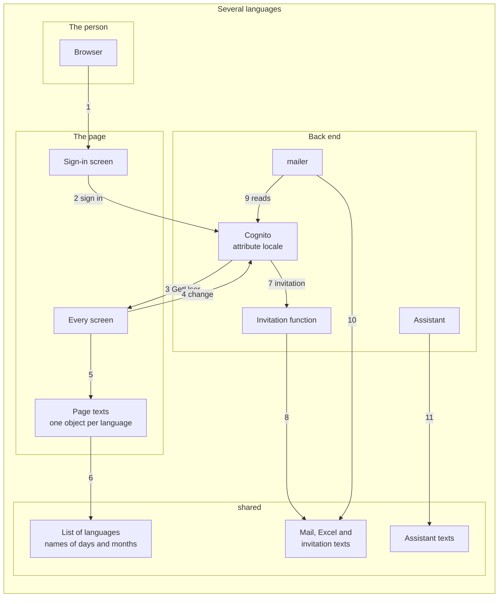

# Shared Calendar: several languages (architecture proposal)

| | |
|---|---|
| Status | Built and deployed (`docs/MULTILANGUAGE_PLAN.md`), released as `v3.1.0` (`docs/RUNBOOK.md` section 5.12). The decisions of section 2.2, the proposals of section 2.3 and every open point (section 16) are confirmed by the Product Owner (2026-11-27); L7 was changed by the plan's decision P1. The facts about the local Cognito and about the cloud's pool are tried (section 17) |
| Date | 2026-11-27 |
| Brief | `prompts/lang-l01-multilanguage-idea.md`, with the answers of the clarification round (section 2.2) |
| Builds on | `docs/ARCHITECTURE.md` (section 5.1, the user pool), `docs/EMAIL_ARCHITECTURE.md` (sections 4, 5, 6 and 7), `docs/FRONTEND_ARCHITECTURE.md` (section 12.4, the language), `docs/CONVERSATIONAL_ARCHITECTURE.md` (section 4.2, the language of a conversation) |
| Would add to the stack | One deploy parameter (`DefaultLanguage`), one small function that words Cognito's invitation, one line on the user pool's app client. No table, no route |
| Would change | Every text a person reads: the pages, the mailer's mails and their Excel files, the invitation, the assistant's fixed sentences. A fifth fact about every person: their language |
| What comes next | The implementation plan (`docs/MULTILANGUAGE_PLAN.md`, briefs `prompts/lang-l02…`), from section 15's outline, once this document is finalized |

This document says how the shared calendar would speak several languages, English and Italian
first: what changes in each part a person reads, where the translations are kept, how they are
checked, and what adding a third language costs. It also says what you, as Product Owner and
operator, have to decide and do (section 16).

The facts about the code were read in the repository on 2026-11-27. The facts about AWS were
read that day in AWS's documentation (section 17); those tried on a real stack are marked
"tried, section 17". The local Cognito was tried in the plan's step l1, the cloud's pool in the
plan's phase B (`docs/MULTILANGUAGE_PLAN.md` section 5).

---

## 1. In short

**What a person sees**

1. **The sign-in screen** opens in the browser's language when it is one of ours, and has a
   small choice of language of its own ("English", "Italiano"), remembered by that browser.
2. **Once signed in, everything follows the person's own language**: every screen, label,
   button and message, the dates and the names of days and months, the mails the calendar
   sends them and the Excel files inside, and the assistant's fixed sentences.
3. **A person changes their language in "My details"**, and the page changes at once. Nobody
   else can change it: not the Administrator, not the API.
4. **A new user** receives the invitation in the installation's default language. At their
   first sign-in the page's language (the browser's, or the one they picked on the sign-in
   screen) becomes their own.
5. **The assistant** keeps doing what it does today: it answers in the language of the first
   message of a conversation.

**How it works, in one paragraph**

The language is a fact of the person, kept in Cognito beside the other four, in Cognito's
standard attribute `locale`. The person writes it themselves, straight at Cognito, as they
change their password today; the page asks Cognito for it right after sign-in; the mailer reads it
with the address it already looks up. The translations are **typed objects in the code, one per
language**, as the assistant's fixed texts already are: a language with a text missing does not
compile. There is one list of languages, in `shared/`; adding a language is adding its entry and
writing the files the compiler then asks for. No library is added.

**What needs care**

- **The page is the large part.** About 160 fixed texts are written in `frontend/index.html`
  and about 150 more sentences are made by 15 files of the logic layer. All of them move into
  one place per language. It changes nothing a person sees in English, but it touches every
  screen and most of the views' tests.
- **A gap found on the way** (section 4.4): the user pool's app client lets a signed-in person
  change their own standard attributes directly at Cognito, the e-mail and the names included,
  which `docs/EMAIL_ARCHITECTURE.md` decision M3 forbids. The line this design adds to the app
  client closes it. It is worth closing whatever is decided here.
- **The invitation cannot follow the person's language**, by your own rule: a person who has
  never signed in has not chosen one, and the Administrator does not choose for them. It
  follows the installation's default (section 7).

---

## 2. What is asked, and what was decided

### 2.1 The requirements

| Id | Requirement |
|---|---|
| R1 | English and Italian now; another language later must be cheap and need no change of architecture |
| R2 | Translated: the pages, the mailer's mails, Cognito's mails if not too complex, the assistant |
| R3 | The language is chosen per user, by the user; the Administrator does not set another user's language |
| R4 | The language is a fact of the person: where it is stored, how it is changed, what a new user gets, how each part knows it |
| R5 | Dates, times, the names of days and months and other formats follow the language |
| R6 | Everything else stays English: the code, the comments, the documents, the logs, the API's error codes, the tests, the names in the data |

### 2.2 The decisions of the clarification round (2026-11-27)

| Id | Decision |
|---|---|
| L1 | A new user gets the installation's default language for the invitation (a deploy parameter); at the first sign-in the page takes the browser's language if it is supported and stores it as the person's own; the person changes it later |
| L2 | The language is chosen in "My details" (saved to the account) and on the sign-in screen (kept in the browser only, starting from the browser's language) |
| L3 | The Excel files follow the recipient's language like the mail: the headings, the sheet's name, the status words and the file names. Type names and notes stay as typed |

### 2.3 What this document proposed, confirmed by the Product Owner (2026-11-27)

| Id | Proposal | Why |
|---|---|---|
| L4 | The language is Cognito's standard attribute `locale`, holding the bare code (`en`, `it`) | Cognito stays the only store of people; a standard attribute changes no schema, so the pool is never replaced (`docs/EMAIL_ARCHITECTURE.md` section 4.1) |
| L5 | The person writes it straight at Cognito (`UpdateUserAttributes` with their own token); the API gets no route for it | It makes R3 true by construction: no code of ours can set anybody's language. No new function, no new role. The password already works this way |
| L6 | The app client may write `locale` and nothing else (`WriteAttributes`) | Needed for L5, and it closes the gap of section 4.4 |
| L7 | Right after sign-in the page asks Cognito for the person's own attributes (`GetUser`, with the access token it already holds) and reads `locale` there; the frame stays hidden until the answer. The id token is not read for the language | The local Cognito never puts `locale` into the id token (section 17), so reading the token could be neither run nor tested locally; one request more per sign-in, the same path locally and in the cloud, and still no screen shown in the wrong language first. Decided by the Product Owner at planning (`docs/MULTILANGUAGE_PLAN.md` decision P1) |
| L8 | Translations are typed objects in the code, one per language, checked by the compiler; no translation library, no files loaded at run time | The assistant's texts already work this way (`shared/src/assistant/texts.ts`); two small languages do not justify a library or a loading step |
| L9 | One list of languages in `shared/`, used by the page, the mails and the assistant | Today the assistant has its own list; two lists would drift |
| L10 | The names of days and months are written out per language in `shared/`, not asked of the runtime (`Intl`) | The same words in every browser and in Lambda, whatever their version. Today's page avoids `Intl`'s order and punctuation (`frontend/src/logic/texts.ts` puts the parts together itself) but still takes the names from `Intl` in `en-US`; the names are written in four more places (`shared/src/mail/texts.ts`, the assistant's two files of texts, `backend/src/assistant/prompt.ts`), which this design brings onto one |
| L11 | `frontend/index.html` holds no words: each fixed text is a key, filled from the language's object before anything is shown | One home for every text; switching language is filling again |
| L12 | A small function words Cognito's invitation from the same typed texts (Cognito's "custom message" trigger) | The invitation's translations are kept and checked with all the others, instead of living in `backend/template.yaml` (section 7 weighs the alternative) |
| L13 | The assistant keeps its rule; three small changes around it (section 9) | It already does what R2 asks |
| L14 | Italian addresses the person with the formal "lei" everywhere | As the assistant's Italian texts already do (`docs/CONVERSATIONAL_ARCHITECTURE.md` section 4.2) |
| L15 | English keeps the conventions it has today in both languages: 24-hour clock, the day before the month, the week from Monday | These are the calendar's own conventions, not a language's; only words and word order change |
| L16 | The layout does not know the language: one stylesheet, no rule per language. A text in a tight place has a length budget; the screens are looked at once in a padded test language (section 6.3) | Texts of different lengths without more CSS and without a sloppy screen; decided with the Product Owner on 2026-11-27 |

---

## 3. The architecture

| Arrow | What happens |
|---|---|
| 1 | Before sign-in the page's language is the one this browser remembers, else the browser's own if supported, else the default |
| 2, 3 | The person signs in; the page asks Cognito for their attributes (`GetUser`) and reads `locale`; from then on the page uses it |
| 4 | An account with no language yet gets the page's current one, once; later the person changes it in "My details" |
| 5, 6 | A screen takes every word from the page's texts of that language, and dates from the formats in `shared/` |
| 7, 8 | When a user is created Cognito asks the invitation function for the mail's words; the function answers in the default language |
| 9, 10 | The mailer reads the recipient's `locale` with their address and builds the mail and its Excel files in that language |
| 11 | The assistant's fixed sentences are in the conversation's language, as today |

### 3.1 The pieces, and why each

| Piece | What it does | Why this one |
|---|---|---|
| **`SUPPORTED_LANGUAGES`** in `shared/` | The one list: `en`, `it`; a `zod` schema `Language`; each language's name in its own words | Everything else is a `Record<Language, …>`, so the compiler lists what a new language still misses |
| **Formats per language** in `shared/` | The names of days and months, short and long, and the few ways a date is written | Used by the page, the mails and the assistant; today each of the three has its own copy |
| **Page texts** in `frontend/` | Every word of the pages | Only the page needs them; they stay out of the back end's bundles |
| **Mail texts** in `shared/` | The mailer's mails, the Excel words, the invitation | Already there for English (`shared/src/mail/texts.ts`) |
| **Cognito attribute `locale`** | The person's language | Section 4 |
| **Invitation function** | Words Cognito's invitation | Section 7 |
| **Parameter `DefaultLanguage`** | The language of a mail to a person who has none yet | Section 4.3 |

What is deliberately **not** used: a translation library (`i18next` and the like), translation
files in JSON loaded at run time, a table of translations, a translation service, a route to
change the language, the browser's `Intl` for the wording of dates.

---

## 4. The person's language

### 4.1 A fifth fact, kept in Cognito

| Fact | Cognito attribute (standard) | Rule |
|---|---|---|
| Language | `locale` | one of the codes of `SUPPORTED_LANGUAGES` (`en`, `it`); absent until the person's first sign-in |

It joins the four facts of `docs/EMAIL_ARCHITECTURE.md` section 4.1, with one difference:
**those four are the Administrator's to type, this one is the person's own.**

Whoever reads it treats a missing value, and a value that is not in the list, as "none yet" and
uses the default (section 4.3). This matters because Cognito itself does not check the value: a
person who calls Cognito by hand can store any word in their own `locale`. The harm is nil (they
get the default language), provided every reader checks, and the plan tests that they do.

### 4.2 Who may read and change it

| Who | Read | Change |
|---|---|---|
| The person | their own (`GetUser`, with their access token) | their own, at Cognito, from "My details" |
| Administrator | nobody else's (the Users list does not show it, open point O3; it can be added later) | **nobody else's** |
| The API | the mailer, of the person it writes to; the invitation function, of the person invited | **never**: no route, and no function's role is given the right for this purpose |
| Assistant | none | none |

`PUT /users/{username}` keeps its body of four facts (`shared/src/user.ts`,
`UpdateUserBody`, strict): a `language` field sent to it is refused as today. `POST /users`
the same. So the creation form and the edit dialog gain no field.

### 4.3 Which language, when none is stored

One rule everywhere: **a person with no language gets the installation's default.**

The default is a new deploy parameter, `DefaultLanguage` (`en` or `it`, default `en` so that an
existing stack behaves as before until you set it). It reaches the mailer and the invitation
function as an environment variable, and the page as a value built into the bundle, as the
API's address is today (`frontend/scripts/bundle.mjs`).

| Moment | Language used |
|---|---|
| The invitation, and its resend | the default: the person has never signed in |
| The sign-in screen | what this browser remembers; else the browser's first supported language; else the default |
| The first sign-in ("Choose your password" and after) | the sign-in screen's; the page then stores it as the person's own |
| Any later sign-in | the person's own; the browser's memory is updated to it |
| A mail to an account with no language (an account made before this work, never signed in since) | the default |

**The accounts that exist today** need no migration: at their next sign-in they have no
language, so the page stores its own, exactly as for a new user. Until then their mails are in
the default language. This includes the Administrator, whose daily mail turns to their language
the day they next sign in.

### 4.4 How the person changes it, and the gap this closes

The page calls Cognito's `UpdateUserAttributes` with the person's access token and the one
attribute `locale`. This is the same kind of call as the password change, which the page already
makes straight at Cognito with the same token (`frontend/src/services/change-password.service.ts`),
so the token is known to be accepted for it.

For that, the app client must be allowed to write `locale`. Today `backend/template.yaml`
gives the app client no `WriteAttributes` list, and AWS's documentation says what that means:
"When you don't specify the `WriteAttributes` for your app client, your app can write the values
of the Standard attributes of your user pool" (section 17). **So today a signed-in User can, by
calling Cognito by hand, change their own e-mail address, names and postal address**, which
decision M3 of `docs/EMAIL_ARCHITECTURE.md` gives to the Administrator alone. No page does it,
and I have not tried it against the deployed pool; it follows from the documentation. A changed
e-mail would redirect that person's own mails only, so the harm is small, but the rule is
broken.

The design sets `WriteAttributes: [locale]` on the app client. A person's token can then write
their language and nothing else. The Administrator's routes are not affected: they use the
administrative calls, which this list does not govern.

Tried in the cloud, section 17 (the local Cognito ignores the write list): the change of
`WriteAttributes` updates the app client in place (the client id must not change, or every page
would lose its sign-in), and the back end's routes still write the four facts afterwards.

### 4.5 How each part knows it

| Part | How |
|---|---|
| The page | from the attribute `locale` that Cognito's `GetUser` answers, asked with the person's access token right after each sign-in and before the frame is shown; after a change, from what it just wrote. A refresh of the tokens does not read it again |
| The mailer | from the attribute `locale` of the account, read with the same call that already reads the address (`getProfile`, `adminRecipients` in `backend/src/lib/cognito.ts`). No new permission |
| The invitation function | from the attributes Cognito hands it with the request; absent for an invited person, so the default |
| The assistant | does not use it (section 9) |

The profile is still "never put into the token" by our code (`docs/EMAIL_ARCHITECTURE.md`
section 9.2). The page does not read the language from the id token at all: the local Cognito
never puts `locale` there (section 17), so `GetUser` is the one path, locally and in the cloud.
Tried in the cloud, section 17: `GetUser` answers `locale` with the app client's default read
list.

---

## 5. How translations are kept, checked and added

This section holds for every part; sections 6 to 9 say what is particular to each.

### 5.1 Kept

One typed object per language and per part, each a file, written as the assistant's are today
(`shared/src/assistant/texts.ts`, `texts.en.ts`, `texts.it.ts`):

- a **type** lists every text of the part. A fixed text is a string; a text that carries a
  value is a function of that value (`(count: number) => string`), so each language builds its
  own sentence, with its own word order and its own singular and plural;
- **one file per language** holds an object of that type;
- **one record** `Record<Language, TheType>` joins them, and one function gives the object of a
  language.

| Part | Type and files (proposed; `docs/FOLDER_STRUCTURE.md` decides at the plan) | Size today, English |
|---|---|---|
| Languages and formats | `shared/src/language/`: the list, the names of days and months, the date writers | 38 names, about 6 functions |
| Pages | `frontend/src/texts/`: `texts.ts` (the type), `texts.en.ts`, `texts.it.ts` | about 310 texts |
| Mails, Excel, invitation | `shared/src/mail/`: `texts.ts`, `texts.en.ts`, `texts.it.ts` | about 30 texts |
| Assistant | `shared/src/assistant/`: as today, plus the notes of section 9 | about 45 texts, Italian already written |

All languages are in the page's bundle: two languages add a few kilobytes, and loading a
language on demand would add a step that can fail. To look at again past five or six languages.

The Italian is drafted with the code and **reviewed by you** before each step is accepted: a
compiler checks that a text exists, not that it is good Italian.

### 5.2 Checked

| Check | Catches | Where |
|---|---|---|
| The compiler: a `Record<Language, …>` with an entry or a text missing does not compile | a language without one of its texts; a text added in English only | `npm run typecheck` |
| A unit test over every language: every text is non-empty, every function answers for sample values, a mail's plain text and its HTML say the same | an empty text, a function that throws, a forgotten value | `npm run test:unit` |
| A unit test of the page's keys: every key in `frontend/index.html` exists in the page texts, every fixed text is used by a key, and `index.html` holds no words of its own | a mistyped key, a dead text, a sentence written straight into the HTML | `npm run test:unit` |
| A marked test language (never shipped): every text is the English one between marks, padded by about a third; each view is drawn with it and any visible text without marks fails | a sentence written straight into a view or a model instead of the texts | `npm run test:unit` |
| A unit test of the length budgets: a text with a budget is within it in every language (section 6.3) | a translation too long for a tight place | `npm run test:unit` |
| A look at each changed screen in the padded test language, on the local page, at both widths | a tight place nobody gave a budget to, for Italian and for a language not yet written | by hand, a short list in `docs/FRONTEND_WALK.md` |
| The existing tests, journeys, smoke test and `docs/FRONTEND_WALK.md` run in English | that English is unchanged | as today |
| A look at each changed screen in Italian at both widths | what only real words show: a bad break, a word that reads wrongly where it stands | by hand, the same list |
| The paid evaluation of the assistant | the assistant in a new language | section 9 |

The tests stay English (R6): they name texts by their English words or by their keys, never by
their Italian. The one exception is the test that a thing is in Italian at all (the page after
the choice, a mail to an Italian recipient), which looks for one known Italian sentence.

### 5.3 Added: a new language

1. Add its code to `SUPPORTED_LANGUAGES` and its own name ("Deutsch").
2. Run `npm run typecheck`: it lists every object now missing. Write them: the formats, the
   page texts, the mail texts, the assistant's texts and notes.
3. Run `npm run test:unit`.
4. Look at each screen in the new language at both widths. The tight places are already known
   and budgeted (section 6.3), so this look is for the wording.
5. Add the language's requests to the assistant's evaluation and run it (paid, section 9).
6. Deploy.

Nothing else changes: no table, no route, no template, no permission, no document's rule.
The sign-in screen's choice and the field in "My details" list the new language by themselves.

**The limits of "cheap"**, said plainly: a language written from right to left (Arabic,
Hebrew) also needs work on the pages' layout; a language whose plural has more than two forms
(Polish, Russian) is handled inside its own functions, with no change elsewhere; a language
where the week starts on another day would need L15 reopened.

---

## 6. The pages

### 6.1 What changes

- **Every word leaves `frontend/index.html`.** An element that shows a fixed text carries its
  key (an attribute, for its text, its placeholder or its label for a screen reader); the
  shell fills them from the language's object before it shows anything (everything starts
  hidden today already). The `<template>` elements are filled the same way.
- **Every sentence made by the logic layer comes from the page texts.** The 15 files that make
  sentences today (`texts.ts`, `availability.model.ts`, `date.model.ts`, `users.model.ts`,
  `settings.model.ts`, `appointment.detail.ts`, `booking.ts` and the others listed in
  `docs/FRONTEND_ARCHITECTURE.md` section 12.4) keep their logic and lose their words. The
  failure in plain words by its `reason` stays as designed: the page words the error code, and
  never shows the server's `message`.
- **The language is live.** A change of language fills the fixed texts again and makes the
  screen on show draw itself again. A reload is not an option: the session lives in memory
  only, so a reload would sign the person out. How a screen learns of the change (the language
  as one more input of each screen's state) is the plan's to design within
  `docs/FRONTEND_ARCHITECTURE.md` sections 3 to 5.
- **`<html lang>`** follows the language, so that a screen reader pronounces it rightly.
- **Sorting by name** uses the language (today `localeCompare(…, 'en')` in
  `frontend/src/logic/week.model.ts`).
- **The server's words shown as they are** get a text of their own by their code: the state of
  a user (`invited`, `active`), the status of an appointment, the role.
- **The sign-in screen** gains the choice of language; **"My details"** gains the field
  "Language", the only one a User can change there, saved at once.
- **The browser's memory**: one entry in `localStorage`, the language's code, read through a
  small service. It is the page's first use of browser storage; it holds no personal data and
  no token.

A new service in `frontend/src/services/` writes the language at Cognito
(`docs/FRONTEND_SERVICES.md` gains its section); the language is read in the session the
sign-in already builds.

### 6.2 What does not change

What a person typed stays as typed: the names of appointment types, notes, usernames, names and
addresses. A type called "Visit" by the Administrator is "Visit" for an Italian user (decided,
open point O5; translating data is a different and much larger work). The Administrator can
name a type in both languages ("Visit / Visita").

### 6.3 Texts of different lengths

Italian runs about a fifth longer than English, and a later language may run longer still. The
aim is no extra CSS and no sloppy screen. The discipline is put on the words, not on the layout.

`frontend/style.css` is already made for text of unknown length, because it has to hold what
people type (names, type names, notes): it sets no fixed width, its rows wrap, and a long word
breaks instead of spilling out. So only a few places are tight. Four rules:

1. **The layout does not know the language.** One stylesheet. No `:lang()` rule, no class per
   language, no font size that changes with the language.
2. **A tight place has a length budget.** A few texts stand where room is short: the links of
   the navigation, the buttons side by side in a row or a dialog, the short labels inside a
   row of a list. For these the page texts state the highest number of characters, beside the
   text's type, and a unit test refuses a language that goes over. The translator then picks
   the shorter word ("Esci", not "Disconnettiti"). A sentence, a hint or a message has no
   budget: it wraps, as today.
3. **A text that still does not fit is fixed in this order**: first a shorter wording; if
   there is no good one, the element is made to give way in every language (a button that may
   wrap onto two lines, for example), which helps English on a narrow phone too. Never a rule
   for one language.
4. **The screens are looked at once in a padded language.** The marked test language of
   section 5.2 pads every text by about a third. The local page can be shown in it (the
   development server only: the deployed bundle does not hold it), and one walk through the
   screens at both widths shows every tight place, for Italian and for a language not yet
   written. A tight place found this way gets a budget (rule 2) or gives way (rule 3).

The budget counts characters, not the width on the screen, so it is approximate: "mmm" is wider
than "iii". It catches the real mistakes at no cost; the two looks of section 5.2 catch the
rest. Measuring widths in a test would be the complexity this section avoids.

The price: here and there the Italian uses a shorter word than the most natural one. For a few
dozen labels that is accepted.

---

## 7. Cognito's e-mails

**Which mails Cognito sends.** Only one: the invitation, and its resend. The pool has no
self-registration, no verification code and no password recovery by e-mail, so there is nothing
else to translate.

**Whether it is too complex.** No, but it cannot do what one might expect. By decisions R3 and
L1 an invited person has no language, so the invitation is always in the default language; a
"translated invitation" means "the invitation in the installation's language, with its text
kept beside the other translations". Two ways give that:

| | A. The invitation function (decided, L12 and open point O1) | B. The texts in `backend/template.yaml` |
|---|---|---|
| How | Cognito's "custom message" trigger: before it sends the invitation Cognito calls a small function with the person's attributes; the function answers the subject and the body, with Cognito's two placeholders for the username and the temporary password | A table of texts per language inside the template (a `Mappings` section), picked by `DefaultLanguage` |
| Translations | in `shared/src/mail/`, typed and tested with the others | in YAML, each body cut in pieces around the page's address, outside the compiler's check |
| New in the cloud | one function, its role (logs only), the permission for Cognito to call it, one line on the pool | nothing |
| New risk | a function in the path of creating a user: if it fails, the creation fails (the route already answers an error and keeps nothing) | none at run time |
| A new language | its texts, as for the rest | also an edit of the template |
| Later | follows a person's language if a rule ever gives an invited person one; can greet by name (`docs/EMAIL_ARCHITECTURE.md` open point O3) | neither |

**Decided: A** (open point O1). The brief asks that translations be kept and checked in one
way, and B is the one place where they would not be. The price is one function.

With A, the pool's `InviteMessageTemplate` stays in the template in English as the fallback
Cognito uses when the function's answer is unusable (AWS's documentation: a message over 20 000
characters is silently dropped and the default sent). The temporary password still never passes
through our code: the function receives a placeholder, not the password, and Cognito puts the
password in afterwards.

Locally nothing changes: the local Cognito calls a "custom message" function only when its own
configuration names one (`backend/docker/cognito-local-config.json` names none), so it prints its
own invitation in its log as today and no test reads it. The function is proved by its unit tests and, in the cloud, by the smoke test and one
invitation looked at by hand. To try in the plan's step l7: that `sam local start-api` is not slowed by a
function that belongs to no route (the local stack is sensitive to the number of functions).

---

## 8. The mailer's e-mails and the Excel files

- **The texts** (`shared/src/mail/texts.ts`) take the language as their first input. The
  subject, the body in plain text and in HTML, the footer, the list of a User's appointments
  ("mar 1 dic 2026, 10:00–11:00, Visit, prenotato") and the HTML's `lang`.
- **The Excel files** (`backend/src/lib/excel.ts`): the eleven headings, the sheet's name, the
  status words and the reasons of a cancellation come from the mail texts of the language. The
  file names too (decision L3), in plain letters without accents.
- **The cells with a date or a time stay as they are**, `2026-12-01` and `10:00`: they sort
  and filter rightly in any Excel, whatever the language (decided, open point O4).
- **The mailer** reads the recipient's language with their address. The event that starts it
  does not change: it never carried an address, and it carries no language either.
- **The daily mail** goes to each administrator in their own language; the files are built
  once per language in use.
- **Not translated**: the bounce and alarm mails, which are AWS's own and the operator's.

No new permission, no change to the table `mail`, no change to the routes.

---

## 9. The assistant

**What is true today** (checked in the code): at the first message of a conversation the server
asks Claude which of the supported languages the message is written in, stores the answer with
the conversation, and states it to Claude at every request, so that the assistant keeps to it
even when the person later writes in another language (`backend/src/assistant/exchange.ts`,
`backend/src/assistant/prompt.ts`, `docs/CONVERSATIONAL_ARCHITECTURE.md` section 4.2). The
confirmation of a change, the two buttons, the notices and the refusals are fixed texts per
language, Italian included. The paid evaluation already asks in both languages. **So the
assistant already answers in the language of the first question**, for English and Italian; a
first message in any other language is answered in English.

The tools need no change: they take and give data (dates, ids, codes), never sentences.

**Three small changes**, all in the spirit of "one list, cheap to extend":

1. **One list.** `ASSISTANT_LANGUAGES` becomes `SUPPORTED_LANGUAGES` (L9). A language added to
   the pages is then a language of the assistant, and the compiler asks for its texts.
2. **The language's notes leave the fixed instructions.** Today the instructions name Italian
   twice: the formal "lei", and the application's own words for three things ("orario
   settimanale", "orari propri del giorno", "finestra aggiuntiva"). Left there, each new
   language means editing the instructions by hand. Proposed: each language's file holds these
   notes (its form of address, the application's words) and its English name, and the server
   adds the notes of the conversation's language to what it tells Claude. Dates written by the
   texts use the shared formats (section 5.1).
3. **While there is no conversation, and for a message in no supported language**, use the
   person's language instead of English. The screen's own sentences ("the daily limit is
   reached") follow the page's language; and the page sends its language with a message, used
   by the server only as the fallback when the first message is in none of ours (one optional
   field in the body of the route that takes a message, checked against the list). Decided, open
   point O2.

**One mismatch, accepted**: a person whose pages are Italian and who starts a conversation in
English gets an English conversation, and the mail they ask for in it arrives in Italian, their
account's language. Each part follows its own rule; I would not complicate either.

**Cost of these changes**: the instructions change, so their mark changes and the conversations
in progress end at the deploy, as at every change of the instructions
(`docs/CONVERSATIONAL_ARCHITECTURE.md` section 4.3). Change 2 moves words that steer Claude, so
the paid evaluation (its section 12.3) is run once more, its cost said and agreed before. A new
language later needs its requests added to the evaluation and one run.

---

## 10. Formats

| What | English | Italian | Rule |
|---|---|---|---|
| Time | `10:00` | `10:00` | 24-hour clock, the same in every language |
| A range | `09:00–10:00` | `09:00–10:00` | the same |
| A short date | `Mon 16 Nov` | `lun 16 nov` | day before month; the names from the language |
| A long date | `20 November 2026` | `20 novembre 2026` | the same |
| A date in full | `Tuesday 24 November 2026` | `martedì 24 novembre 2026` | the same |
| The week | from Monday | from Monday | the calendar's, not the language's |
| A date typed in a form, and in an Excel cell | `2026-12-01` | `2026-12-01` | the browser's own date field shows it its way; a cell stays sortable |
| A UTC offset | `+02:00` | `+02:00` | the same |
| Numbers | small whole numbers only | the same | no thousands or decimals are shown anywhere today |
| One and several | "1 appointment", "3 appointments" | "1 appuntamento", "3 appuntamenti" | inside each language's functions |

The time zone plays no part: it stays the calendar's (`CalendarTimeZone`), whatever the
language.

---

## 11. The API and the data

- **No new route, no changed route**, except the optional field of section 9, change 3.
- **The error codes stay** (`shared/src/api.ts`); the server's `message` stays English, written
  for a developer; the page words each code in the person's language, as it does today in
  English.
- **No table changes.** The conversation already stores its language.
- **Cognito**: the attribute `locale` on accounts; `WriteAttributes` on the app client; with
  proposal L12, the trigger on the pool. None replaces the pool (tried, section 17).
- **The logs** stay English and may hold a language's code: it is not one of the facts the
  logs must never contain, and it helps to explain a mail.

---

## 12. Security and privacy

- **Better**: the app client's write list (section 4.4) closes a way for a person to change
  facts that are the Administrator's to change.
- **The language is personal data**, a mild one. It is deleted with the account, like the
  others. Its purpose ("to write to you in your language") goes into the privacy notice with
  the other facts (`docs/EMAIL_ARCHITECTURE.md` section 12.3).
- **Permissions**: the invitation function's role may write its own logs and nothing else; no
  wildcard. No existing role changes.
- **A translation is code**: an Italian text can no more inject markup than an English one,
  since values are escaped where they enter HTML, as today (`shared/src/mail/texts.ts`).
- **The browser's memory** holds a language code only.

---

## 13. Deployment, local development and cost

- **One new parameter**, `DefaultLanguage`, in `backend/samconfig.toml` for the cloud and in
  the local environment; the page's build receives the same value. **The cloud's is `it`**
  (open point O6); the local stack's stays `en`, the language the tests and journeys run in.
- **Order**: the API first, then the page. An old page on the new API works (it never writes
  `locale`); a new page on the old API could not save a language, so the API goes first.
- **Version**: nothing breaks an old client, so a minor version; its number is chosen at the
  plan, after the e-mail work's release.
- **Locally**: the local Cognito keeps `locale` like any attribute, answers
  `UpdateUserAttributes` and `GetUser` with the person's access token, and accepts any word as
  `locale` (tried, section 17). It never puts `locale` into the id token, and it does not know
  the app client's write list: locally a person's token can write any of its own attributes, so
  the closing of the gap of section 4.4 is proved only in the cloud. The fake
  mail shows a mail in Italian as it shows one in English.
- **Cost**: nothing measurable. One more function called once per invitation; the same number
  of mails. The one real cost is the paid evaluation of section 9, once.

---

## 14. What changes in the existing documents and rules

| Document | Change |
|---|---|
| `docs/ARCHITECTURE.md` | section 5.1: the attribute `locale` and the app client's write list; the function and the parameter; when the work is finished, this document's content is merged in and the architecture wins |
| `docs/EMAIL_ARCHITECTURE.md` | decision M17 ("the texts are in English") is replaced; section 4 gains the fifth fact; sections 5.1 and 6.6 the invitation's source; section 6.3 the Excel words |
| `docs/FRONTEND_ARCHITECTURE.md` | section 12.4 ("English only, with no translation mechanism") is rewritten: where the texts live, the keys in the page, the live change |
| `docs/FRONTEND_SERVICES.md` | the service that writes the language; the language in the session |
| `docs/CONVERSATIONAL_ARCHITECTURE.md` | section 4.2: the one list, the notes per language, the fallback; section 7.2: what is told to Claude |
| `docs/FOLDER_STRUCTURE.md` | the new folders of section 5.1 |
| `docs/FRONTEND_WALK.md`, `docs/journeys/`, `docs/COMMANDS.md`, `docs/RUNBOOK.md` | the new checks, the journey of the language, the parameter |
| `CLAUDE.md` (root) | one hard rule: "a text a person reads lives in the texts of its part, in every language; nowhere else" |
| `frontend/CLAUDE.md`, `shared/CLAUDE.md` | where the texts are and the rule above, in their own words |

The rule R6 needs no new line: the project's language is already English everywhere.

---

## 15. Outline for the implementation plan

Each step leaves English exactly as it is, until the step that shows Italian. The steps are
sized by what they touch, not by time.

| Step | What | Seen by a person |
|---|---|---|
| l1 | Try the facts marked "to try" (sections 4.4, 4.5, 7, 13) on the local Cognito; correct this document. The cloud's pool waits for the plan's phase B | nothing |
| l2 | `shared/`: the list of languages and the formats; the mail's and the assistant's date words moved onto them | nothing |
| l3 | The page's mechanism: the type of the page texts, the English object, the keys in `index.html`, the checks of section 5.2, the padded test language on the local page and the walk in it that sets the length budgets (section 6.3). The largest step; the plan may cut it by groups of screens | nothing |
| l4 | The Italian page texts; the page's language before sign-in (browser, memory, default); the choice on the sign-in screen | the pages in Italian, per browser |
| l5 | The person's language: the app client's write list, the service, the field in "My details", the first sign-in's write, the language read with `GetUser` after sign-in, the live change | the language follows the person |
| l6 | The mailer and the Excel files by language; `DefaultLanguage` | mails in Italian |
| l7 | The invitation function | the invitation in the default language |
| l8 | The assistant: the one list, the notes, the fallback; the paid evaluation | little |
| l9 | The documents of section 14, the full regression, the walk in both languages, the deploy | the release |

Steps l6, l7 and l8 do not depend on each other and can be taken in any order after l5.

**Other work in progress.** The branches `gdpr` and `whatsapp` each add texts a person reads.
Whichever is merged after this work must put its texts into the objects of section 5.1, in
every language; whichever is merged before is swept up by step l3. The e-mail plan's last step
(`docs/EMAIL_PLAN.md` step m10) should be finished first, so that this work starts from mails
that are switched on.

---

## 16. What you have to decide and do

**Decided** (the open points, all settled on 2026-11-27):

| Id | Question | Decision |
|---|---|---|
| O1 | The invitation: the function (A) or the texts in the template (B)? Section 7 | **Decided**: A, the function |
| O2 | The assistant's fallback for a first message in no supported language: the person's language or English as today? Section 9 | **Decided**: the person's language, sent by the page in one optional field |
| O3 | Should the Users list show each User's language, read-only? | **Decided**: not now; it can be added when someone asks |
| O4 | Excel cells with a date: kept as `2026-12-01`, or written in the language? Section 8 | **Decided**: kept |
| O5 | The names of appointment types are data and stay as typed in every language? | **Decided**: yes |
| O6 | The value of `DefaultLanguage` for the cloud stack | **Decided**: Italian (`it`) |
| — | The proposals of section 2.3 (L4 to L16) | **Confirmed** |

**Do** (when the plan reaches them):

1. Review the Italian texts of each step: the pages (about 310), the mails and Excel words
   (about 30), the invitation. The assistant's Italian texts exist already.
2. Agree the cost of the assistant's paid evaluation before step l8 runs it.
3. Add the language and its purpose to the privacy notice, with the other facts.
4. Deploy with `DefaultLanguage` at `it`, the API before the page.
5. After the deploy: sign in once, so that your own account gets its language and the daily
   mail follows it.

---

## 17. Sources (read on 2026-11-27)

- AWS CloudFormation reference, `AWS::Cognito::UserPoolClient`, property `WriteAttributes`: "When
  you don't specify the `WriteAttributes` for your app client, your app can write the values of
  the Standard attributes of your user pool"; with a list, the person's access token may set
  only the attributes in it.
  https://docs.aws.amazon.com/AWSCloudFormation/latest/TemplateReference/aws-resource-cognito-userpoolclient.html
- Amazon Cognito developer guide, "Custom message Lambda trigger": the source
  `CustomMessage_AdminCreateUser`; the function must put `codeParameter` and `usernameParameter`
  into the message; an e-mail of at most 20 000 characters, HTML allowed; a longer one is
  silently replaced by the default message.
  https://docs.aws.amazon.com/cognito/latest/developerguide/user-pool-lambda-custom-message.html
- AWS CloudFormation reference, `AWS::Cognito::UserPool LambdaConfig`: the trigger's properties
  update with no interruption.
  https://docs.aws.amazon.com/AWSCloudFormation/latest/TemplateReference/aws-properties-cognito-userpool-lambdaconfig.html
- Amazon Cognito API reference, `UpdateUserAttributes`: takes the person's access token, which
  must carry the scope `aws.cognito.signin.user.admin`.
- In the repository: the local Cognito's image (`jagregory/cognito-local:5.3.0`) names
  `UpdateUserAttributes` and `CustomMessage_AdminCreateUser` in its code; neither was run.

Tried on the local Cognito (`jagregory/cognito-local:5.3.0`) on 2026-11-27, with a throw-away
user created, read, written and deleted (`docs/MULTILANGUAGE_PLAN.md` step l1):

- **Confirmed**: `UpdateUserAttributes` with the person's access token answers 200 and stores
  `locale`; `GetUser` with the same token answers it; any word is accepted as `locale`
  (`klingon` was stored), so every reader's check of section 4.1 is needed and can be tested
  locally.
- **False**: the id token never carries `locale`, at sign-in or after a refresh; its claims are
  the username, `email`, `email_verified`, the groups and the token's own. Hence L7 as decided
  by P1.
- **Found**: the local Cognito does not apply the app client's write list: with the same token
  the probe changed its own `given_name`. It calls no "custom message" function unless its own
  configuration names one.

Tried on the cloud's pool on 2026-11-28, at the deploy of `docs/MULTILANGUAGE_PLAN.md` phase B
item 8, with a throw-away User made in "Users" and deleted after (`docs/RUNBOOK.md` section 5.12):

- **Confirmed**: setting `WriteAttributes` updates the app client in place: the change set
  "Modify", replacement `False`, each detail `RequiresRecreation` `Never`, the client's id
  unchanged; a write list of `locale` alone is accepted. The pool's `LambdaConfig` changed the
  same way, so the pool was not replaced either.
- **Confirmed**: the administrative calls still write the four facts (the smoke test, 65 PASS).
- **Confirmed**: `GetUser` answers `locale` with the app client's default read list.
- **Confirmed**: a person's own access token can no longer write their e-mail
  (`UpdateUserAttributes` on `email` refused, `NotAuthorizedException`) and can write `locale`.
- **Confirmed**: the invitation function is called for each invitation and each resend (source
  `CustomMessage_AdminCreateUser`), and the mail that arrives is the one it words, in Italian.
