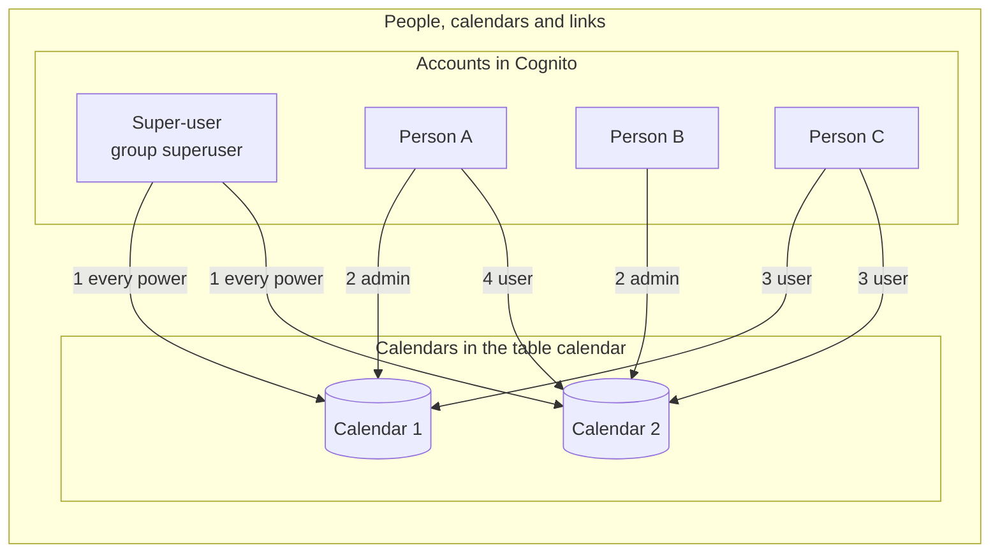
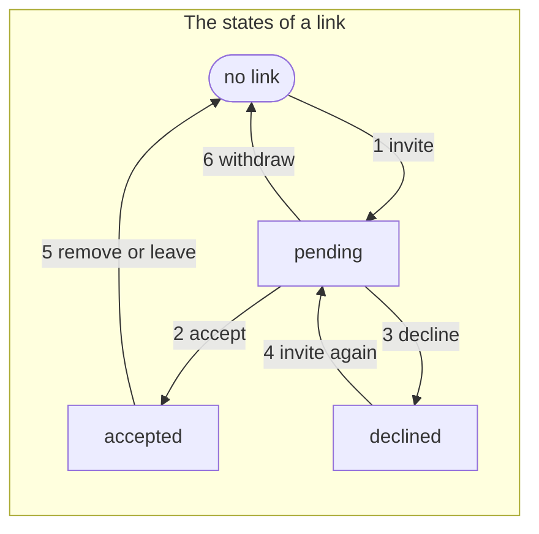
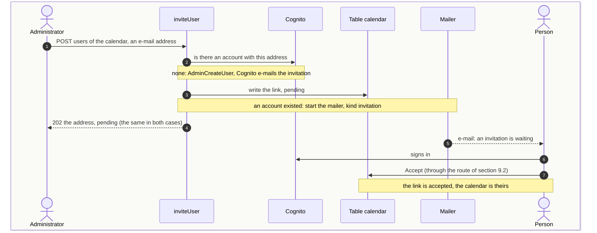
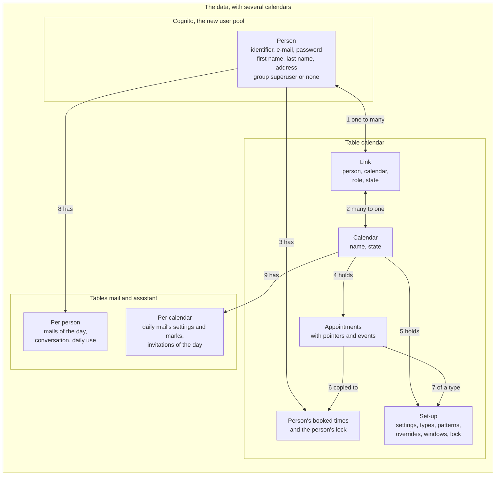

# Shared Calendar: several calendars (architecture proposal)

| | |
|---|---|
| Status | Proposal v4, agreed in its decisions, for the Product Owner's last reading before the plan (v4, 2026-11-28: corrected against `main` at `491ca3c`, which holds e-mail at the stage `on` and the two languages; the decisions K1 to K25 and Q1 to Q6 stand, and the points this version adds, K26 to K32 of section 2.4, are confirmed. v3, 2026-11-27: the open points Q1 to Q6 decided as proposed, the proposals of section 2.3 confirmed, the reasons for one table written out in section 19. v2, 2026-11-27: the assistant sees every calendar of the person, decision K21, where v1 kept it to one calendar). Nothing is built. No plan exists yet: `docs/MULTI_CALENDAR_PLAN.md` is written after this document is agreed |
| Date | 2026-11-27, corrected on 2026-11-28 |
| Brief | `prompts/cal-c01-plan-multiple-calendars.md`, with the answers of the clarification round (section 2.2); `prompts/cal-c02-revise-design-and-plan.md` for v4 |
| Designed against | `main` at commit `491ca3c`, tag `v3.1.0`: e-mail at the stage `on` in SES's sandbox (part A of step m10 of `docs/EMAIL_PLAN.md`, released as `v3.0.0`) and the two languages (`docs/MULTILANGUAGE_PLAN.md`, released as `v3.1.0`), both deployed. Part B of step m10 is still to come |
| Builds on | `docs/ARCHITECTURE.md` (sections 3, 4, 5, 6 and 7), `docs/SHARED_CALENDAR_SPEC.md` (sections 4, 8, 10 and 13), `docs/EMAIL_ARCHITECTURE.md` (sections 4, 5, 6 and 13), `docs/CONVERSATIONAL_ARCHITECTURE.md` (sections 4, 8 and 9), `docs/MULTILANGUAGE_ARCHITECTURE.md` (sections 4, 5, 7, 8 and 9) |
| Would add | A new Cognito user pool, where a person signs in with their e-mail address; calendars, and the links between people and calendars, in the table `calendar`; about a dozen routes; two background functions' work (the invitation mail to a person who already has an account, the deletion of a calendar); every new text a person reads, in English and in Italian (section 11.6) |
| Would change | Every calendar route's path; the roles (no longer two kinds of account); the creation of a User (an invitation the person accepts); who holds a person's details (the person); the keys of the tables `calendar`, `mail` and `assistant` |
| Would remove | The Cognito groups `admin` and `user`; the username a person signs in with; the routes under `/users` |
| Release | v4.0.0, a major version: every client breaks (section 9.4). Built on the branch `multi-calendar`, which is merged into `main` once, after the release is deployed (section 18) |

This document says how the shared calendar would hold several calendars, each with its own
Administrator, what changes for the people who use it, what changes in the code and in the cloud,
and what you, as Product Owner and operator, have to decide and do. It edits no existing
document: section 17 says, document by document, what the plan's steps will change in each.

The facts about AWS were read on 2026-11-27 in AWS's documentation (section 22). What `main`
holds was read in the repository on 2026-11-28. Nothing was tried on the local stack: what must
be tried before the first step is listed in section 14.1.

---

## 1. In short

**What a person sees**

1. **There is one kind of account: a person.** A person signs in with their e-mail address and
   a password. Nobody is "an administrator" or "a user" as an account: a person is the
   **Administrator** of the calendars they own and a **User** of the calendars they joined, and
   can be both, on different calendars, with one sign-in.
2. **Only the super-user creates a calendar**, giving it a name and the e-mail address of its
   Administrator. The Administrator receives an invitation and must accept it.
3. **An Administrator invites a User by typing an e-mail address**, nothing else. The person
   receives an e-mail, signs in and presses **Accept** or **Decline**. Nobody is ever added to a
   calendar without accepting.
4. **A person invited by two Administrators has one account and two calendars.** Neither
   Administrator can find out about the other calendar: the invitation answers the same whether
   the person already had an account or not, and each Administrator sees only the people of
   their own calendar.
5. **A person fills in their own details** (first name, last name, postal address) at their
   first sign-in and may correct them later. The Administrator of a calendar sees the details of
   the people who accepted its invitation.
6. **A time a person has booked in one calendar is busy for them in every other.** The person
   sees "you have another appointment"; an Administrator who tries to book them at that time is
   told only "this person is busy then".
7. **After the sign-in** a person sees their calendars and the invitations waiting for them, and
   chooses a calendar. The screens that follow are the Administrator's or the User's, as today,
   for that calendar.
8. **The super-user** sees every calendar, can do in each what its Administrator can, and alone
   creates and deletes calendars. Deleting a calendar removes everything it holds, after a last
   Excel backup has been e-mailed to its Administrator and to the super-users.
9. **The assistant knows all of a person's calendars.** "What do I have this week?" is answered
   over every calendar the person is linked to, and a change says which calendar it is for
   before the person confirms. A super-user's assistant sees every calendar.
10. **Everything a person reads is in their own language**, English or Italian, as today: the
    new screens, the invitations, the closing mail and its Excel file, the assistant's
    sentences. A person still chooses their language themself (section 4.2).

**How it works, in one paragraph**

Cognito keeps the accounts, in a new user pool where the e-mail address is the sign-in name and
the account's own name is an identifier Cognito makes. The only Cognito group left is
`superuser`. Everything else about who may do what is a **link** between a person and a
calendar, an item of the table `calendar` holding the role (`admin` or `user`) and the state
(`pending`, `accepted`, `declined`). Every calendar route names its calendar in its path, and
every handler starts with the same question, answered by one module: what is this person's link
to this calendar? No accepted link and no `superuser` group: `404`, the same answer as for a
calendar that does not exist. Each calendar has its own lock, as the one calendar has today; a
booking also takes a small lock of the person booked, so that two bookings of the same person
in two calendars cannot both pass.

**What is new and needs care**

- **A new user pool.** Cognito cannot switch an existing pool to sign-in by e-mail (section 22).
  Every account is made again at this release: the super-user by the bootstrap script, every
  other person by an invitation.
- **Privacy between Administrators is kept by the code, not by AWS permissions.** All calendars
  live in one table, and an IAM policy cannot tell one calendar's items from another's without a
  wildcard or a policy per calendar. The rule is therefore one module that every handler must go
  through, a lint rule that enforces it, and a journey with two Administrators that proves it
  route by route (section 12).
- **Several decisions of the e-mail work are reversed** (section 17.1): the Administrator no
  longer types or edits a person's details, the e-mail address becomes unique, the routes under
  `/users` go.
- **While SES keeps the account in its sandbox, an invitation reaches only an address verified
  at SES** (section 5.7). It is enough to build, test and release; the real Users are invited
  when AWS grants production access (section 18).
- **People and appointments are not carried over** (decision K11): the first calendar keeps its
  set-up, its Users are invited again and their future appointments are booked again by hand.

---

## 2. What is asked, and what was decided

### 2.1 The use cases

| Id | Use case | Who |
|---|---|---|
| U1 | Create a calendar and name its Administrator; delete a calendar | the super-user |
| U2 | Accept or decline the invitation to be a calendar's Administrator | the invited person |
| U3 | Invite a person to a calendar as a User, by e-mail address; send the invitation again; remove a User | the calendar's Administrator |
| U4 | Accept or decline an invitation; leave a calendar | the invited person, the User |
| U5 | Choose one's own password and type one's own details at the first sign-in; correct the details later | every person |
| U6 | Choose a calendar among one's own | every person with more than one |
| U7 | Everything the Administrator and the User do in a calendar today | the calendar's Administrator, its Users |
| U8 | Everything an Administrator does, in any calendar; the list of every calendar | the super-user |

### 2.2 The decisions of the clarification round (2026-11-27)

| Id | Decision |
|---|---|
| K1 | One account per person. A person may be a User of several calendars, of different Administrators, with one sign-in |
| K2 | One Administrator must never learn that a person of their calendar has another calendar, nor anything about another Administrator's calendar. One exception, accepted: K4 |
| K3 | A person always accepts an invitation before it gives any access. Nobody, not even the super-user, links a person to a calendar without it. One exception, the operator's command of section 5.6 |
| K4 | A time a person has booked in one calendar is busy for that person in every other. The person sees it in the calendar's view. The Administrator of the other calendar sees nothing of it, and learns it only when booking that person at that time: a refusal without the place or any detail. So an Administrator can learn that a User is busy elsewhere at one given time, never where |
| K5 | A person signs in with their e-mail address |
| K6 | A new user pool, made for sign-in by e-mail; the existing pool is retired at this release |
| K7 | No way to create a ready-to-use User through the API, not even for the super-user. A demonstration uses real invitations to plus-addresses of one mailbox (`name+demo1@…`), or the operator's command `test-user`, extended (section 5.6) |
| K8 | One kind of account. The role belongs to the link between a person and a calendar: `admin` (its Administrator) or `user` |
| K9 | Only the super-user creates and deletes calendars, and names the Administrator of a new one. An Administrator cannot create a calendar. A calendar has exactly one Administrator, for its whole life: it is never handed to another person |
| K10 | Deleting a calendar really deletes what it holds. Before that, a last Excel backup of its appointments is e-mailed to its Administrator and to every super-user |
| K11 | At this release the one calendar of today becomes the first calendar. Its set-up (types, weekly patterns, date overrides, one-off windows, settings) is carried over by a one-time script. People and appointments are not: the Administrator and the Users are invited again, and the appointments still to come are booked again by hand from the last Excel backup |
| K12 | A person owns their details: they type their first name, last name and postal address at the first sign-in and correct them later. An Administrator types only the e-mail address of an invitation, and sees a person's details only once that person has accepted |
| K13 | The super-user is a Cognito group, `superuser`, the only group. There may be several super-users. Each is made by the operator's bootstrap script; the API can never create one, delete one or set its password |
| K14 | Per calendar, the super-user wins over the Administrator, who wins over the User. On a calendar the super-user does everything its Administrator can, recorded as done by a super-user. Only the super-user sees the list of every calendar and who is linked to which |
| K15 | A super-user is never linked to a calendar. An invitation to a super-user's address answers as any other and stays pending for ever: the super-user is never shown it. The bootstrap script refuses an address that already has an account |
| K21 | The assistant sees every calendar of the person it speaks with: one conversation per person, over all the calendars they are linked to, whatever their role in each. A super-user's assistant sees every calendar there is. A change always names its calendar in the proposal the person confirms |

### 2.3 What this document proposed, confirmed by the Product Owner (2026-11-27)

Each follows from the decisions above or from a rule of the existing documents. (K21 was a
proposal of the first version and is a decision of section 2.2.)

| Id | Decision | Why |
|---|---|---|
| K16 | A route names its calendar in its path: `/calendars/{calendarId}/…` | A person may have several calendars, so the token cannot name one |
| K17 | A calendar that is not the caller's answers `404 calendar_not_found`, exactly as one that does not exist | Nobody can probe which calendars exist. It is the rule an appointment of another person already follows (`docs/SHARED_CALENDAR_SPEC.md` R-PERM-01) |
| K18 | The booking rules (the four calendar settings) are per calendar | They are its Administrator's choices |
| K19 | One time zone for the whole installation, the parameter `CalendarTimeZone`, as today | "Busy elsewhere", the daily counts and the daily mail's hour compare like with like; a zone per calendar is a later change that touches no key |
| K20 | The daily mail is per calendar, to its Administrator, with its own on/off and hour. A mail on demand covers the calendar it is asked in. A super-user gets no daily mail | The Administrator is the one who needs the backup |
| K22 | A User may leave a calendar by themself | The reverse of accepting; without it only the Administrator could end a link the person entered freely |
| K23 | An account that has no link left, pending or accepted, is deleted (never a super-user's) | No personal data without a purpose; a person invited again gets a new account |
| K24 | At most 20 invitations a calendar and local day, the resends included | An invitation mails an address a person typed: the limit keeps a calendar from mailing strangers in bulk |
| K25 | An appointment stores the person's identifier, not a name. A name is read from Cognito when an answer needs it; a person no longer linked to the calendar is shown as "former user" | A removed person's name must not stay in the calendar; the identifier keeps the history together |

### 2.4 Decided on 2026-11-28, and what version 4 adds

Decided by the Product Owner in the brief `prompts/cal-c02-revise-design-and-plan.md`:

- the decisions K1 to K25 and Q1 to Q6 stand; version 4 corrects this document against `main`
  and reopens none of them;
- the decisions L1 to L16 of `docs/MULTILANGUAGE_ARCHITECTURE.md` stand too: everything a
  person reads in several calendars exists in English and in Italian, kept and checked the way
  that document says;
- the build happens on the branch `multi-calendar`, never on `main`, which stays what runs in
  the cloud; the branch is merged into `main` once, after v4.0.0 is deployed;
- the release is v4.0.0.

What version 4 settles, where `main` asked a question the earlier versions could not see.
Each was proposed by this document and **confirmed by the Product Owner on 2026-11-28**, one at
a time; K32 was the Product Owner's choice between two moments.

| Id | Decision | Why |
|---|---|---|
| K26 | The language stays where decisions L4 to L6 put it: in Cognito's `locale`, written by the person straight at Cognito. `PUT /me` carries the three details and no language; `GET /me` answers no language | L5 stands, and nothing of the page's language has to be built again. The three details go through the API because they need the server's checks, which Cognito does not make (section 4.2) |
| K27 | Cognito's invitation, to a person with no account yet, is in the installation's default language. The mailer's invitation and the closing mail are in the recipient's own language, and in the default when their account holds none | Decision L1: an invited person has not chosen a language, and nobody chooses for them. A person who has an account usually has chosen (section 5.5) |
| K28 | The default language stays the stack's, the parameter `DefaultLanguage`. A calendar has no language of its own | One value that the page, the mailer and the invitation function already read. A language per calendar would be a setting its Administrator keeps for people who each have their own; like the time zone (decision K19), it can be added later without touching a key |
| K29 | The message of `POST /hello` stays in English | It is an answer of the API, stored as the proof of the chain, and no page shows it: requirement R6 of `docs/MULTILANGUAGE_ARCHITECTURE.md` keeps the API's own words English |
| K30 | Two more error codes go: `cannot_delete_admin`, answered as `403 forbidden`, and `no_email_address` | No route deletes an account by name any more, and every account has an address, its sign-in name (section 9.6) |
| K31 | The existing documents are changed step by step, each step merging what it built, and not all of them in the plan's first step | Asked by the brief, and how `docs/EMAIL_PLAN.md` worked: no document describes what is not built yet (section 17) |
| K32 | The facts that only a pool in AWS can answer are tried early, in the plan's first step, in a small stack of its own that the operator deploys and deletes the same day | A fact that fails is found before anything is built on it, not on the day of the release (section 14.1) |

---

## 3. The model



| Arrow | What it is |
|---|---|
| 1 | No link: the group `superuser` in the token gives every power on every calendar |
| 2 | A link with the role `admin`: the calendar's one Administrator, named by the super-user, accepted by the person |
| 3 | A link with the role `user`, made by the Administrator's invitation and the person's Accept. Person C has two, and neither Administrator knows of the other |
| 4 | The Administrator of one calendar may be a User of another, with the same account |

### 3.1 The words

| Word | Meaning |
|---|---|
| Person | An account of the user pool: an e-mail address, a password, three details, a language |
| Calendar | What "the calendar" is today: types, opening hours, settings, appointments. It has an identifier and a name |
| Link | A person's relation to a calendar: a role and a state |
| Administrator (of a calendar) | The person whose link to it has the role `admin`. One per calendar |
| User (of a calendar) | A person whose accepted link to it has the role `user` |
| Super-user | An account in the Cognito group `superuser` |
| Invitation | A link in the state `pending` |

"Administrator" and "User" keep their meaning inside a calendar, so the calendar's own rules
(`docs/SHARED_CALENDAR_SPEC.md`) read as they do today, with "of this calendar" understood.

### 3.2 A link's states



| Arrow | Who | What happens |
|---|---|---|
| 1 | the Administrator (a User), the super-user (the Administrator, at the calendar's creation) | The link is written `pending`; a mail goes to the address (section 5) |
| 2 | the invited person | The link becomes `accepted`; from the next request the calendar is theirs |
| 3 | the invited person | The link becomes `declined`, which the inviter sees; it gives no access |
| 4 | the inviter | A declined person may be invited again; it counts in the day's 20 |
| 5 | the Administrator removes a User, or the User leaves | The person's appointments not yet ended in that calendar are cancelled, then the link is deleted (section 6.3) |
| 6 | the inviter removes a pending or declined invitation | The link is deleted |

An Administrator's link is never removed or left: it ends only with the calendar (decision K9).
A calendar whose Administrator has not accepted yet exists and is empty; only the super-user
reaches it.

---

## 4. Accounts

### 4.1 The new user pool

| Setting | Today's pool | The new pool |
|---|---|---|
| Sign-in name | a username the Administrator chose | the e-mail address (`UsernameAttributes: email`) |
| The account's own name | that username | an identifier Cognito makes, equal to the `sub`; never shown, never typed |
| E-mail | an attribute, not unique | the sign-in name: unique, kept so by Cognito itself |
| Groups | `admin`, `user` | `superuser` only |
| Password policy, token lives, self sign-up disabled, tier, deletion protection | | unchanged |
| The invitation by e-mail, the 7-day temporary password, the sending through SES | `docs/EMAIL_ARCHITECTURE.md` section 5 | unchanged in mechanism; the text changes (section 5.5) |
| The invitation's words | the invitation function, named by the pool's `LambdaConfig.CustomMessage` (`docs/MULTILANGUAGE_ARCHITECTURE.md` section 7) | the same function, named by the new pool |
| The person's language | the attribute `locale`, which the app client alone may write (`WriteAttributes: [locale]`) | the same, on the new pool's app client: a person's token writes their language and nothing else, so never the e-mail address, which is now the sign-in name |
| The first account | `AdminUser`, made by the template from the parameter `AdminUsername` and put in the group `admin` | none made by the template, which must not hold an e-mail address: the bootstrap script makes each super-user (section 4.3). `AdminUsername`, `AdminUser`, its attachment and the two groups go |

Why Cognito keeping the address unique matters: two Administrators who invite the same new
address at the same moment cannot make two accounts. The second `AdminCreateUser` is refused
by Cognito, and the code then treats the address as one that already has an account.

**A person is named everywhere by their identifier**, the `sub` of the token: in the links, on
the appointments, in the logs, in what the assistant is told. So no e-mail address is written in
a stored record or a log line, and the rule on logs of the root `CLAUDE.md` holds unchanged.

**Changing one's e-mail address is not offered in this release.** The new pool makes it
possible later (the address is an attribute, the identifier stays), with Cognito's own
verification code to the new address. Until then a person with a new address is invited again
at it, as a new account.

### 4.2 A person's details

| Fact | Where | Who writes it, and how | Who reads it |
|---|---|---|---|
| E-mail | Cognito, the sign-in name | whoever invites first (it creates the account); nobody changes it | the person; the Administrators of the calendars the person accepted; the super-user |
| First name, last name | Cognito, `given_name`, `family_name` | the person, through `PUT /me` | the same |
| Postal address | Cognito, `address` | the person, through `PUT /me` | the same |
| Language | Cognito, `locale` | the person, straight at Cognito (`docs/MULTILANGUAGE_ARCHITECTURE.md` section 4) | the person; the mailer and the invitation function, for the mail they write to that person. No Administrator, not even the super-user |

The rules of each fact stay those of `shared/src/user.ts`, and of
`shared/src/language/languages.ts` for the language. Cognito stays the only store of people. An
Administrator sees, of a `pending` or `declined` link, only the address they typed and the
state.

**The language and the three details are both the person's own, and are written in two ways**
(decision K26). Neither way is changed by this design:

| | The three details | The language |
|---|---|---|
| Written by | the route `PUT /me`, with the administrative call | the page, straight at Cognito (`UpdateUserAttributes` with the person's token), as on `main` |
| Why | the server checks each fact (`shared/src/user.ts`); Cognito checks nothing, so a write straight at Cognito could store a name of any length or an empty one, which an Administrator would then read | decision L5: no code of ours can set anybody's language; any word stored is read as "none yet" by every reader |
| Read by the page | `GET /me` | `GetUser`, right after the sign-in and before anything is shown, as on `main` |
| The app client's write list | not in it: a person's token cannot write them | `locale`, alone |

So `GET /me` answers no language and `PUT /me` refuses one, as `PUT /users/{username}` does on
`main`. The page's language service (`frontend/src/services/language.service.ts`), the choice
on the sign-in screen and the field "Language" in "My details" stay as they are; what changes
around them is that the other fields of "My details" become editable (section 13).

**The first sign-in is two steps**, each shown once: 1. "Choose your password" (Cognito's
challenge, as built in step m7 of `docs/EMAIL_PLAN.md`), 2. "Your details" (the three facts).
Between the two the page stores its own language as the person's, as it does on `main` for an
account that holds none, so "Your details" is already shown in it.
The second step is the page's, backed by the server: until the three facts exist, accepting an
invitation answers `409 details_required` (section 9.2), so no Administrator ever sees a person
without a name. The future consent step of the GDPR work plugs in at the same place
(`docs/EMAIL_ARCHITECTURE.md` section 5.2).

### 4.3 The super-user

Made by `npm run bootstrap-superuser -w backend -- <stack|local>`, the script `bootstrap-admin`
of today under a new name and with more to do, since the template makes no account any more: with the operator's AWS credentials it creates the account (the e-mail address
prompted), puts it in the group `superuser`, and sets a permanent password (prompted, never
saved). It refuses an address that already has an account (decision K15). Run once per
super-user. A super-user is removed by the operator in the Cognito console; no script and no
route does it.

A super-user has an e-mail address but needs no details: `GET /me` answers them `null` until
typed, and nothing asks for them. Their language is stored by the page at their first sign-in,
as anyone's; until then a mail to them is in the default language.

### 4.4 An account with no link

When a person's last link goes (they decline their only invitation, leave their only calendar,
are removed from it, or its calendar is deleted), the code that removed the link deletes the
account: a global sign-out, then `AdminDeleteUser` (decision K23). A super-user's account is
never deleted this way. If the person is invited again later, a new account is made, with a new
identifier and a new invitation.

A consequence to accept: between the removal of the last link and Cognito's deletion, a second
Administrator's invitation may arrive. The order is therefore: the deletion re-reads the
person's links under the person's lock (section 10.4) and deletes the account only if there is
still none.

---

## 5. Invitations

### 5.1 One procedure for a new person and for one who already has an account



1. The route checks the caller (the calendar's Administrator or a super-user), the stage of
   e-mail (`on`, else `503 mail_unavailable`), the address, and that this calendar has no link
   to it yet (`409 already_invited`, which reveals nothing: it is the caller's own calendar).
2. It counts the invitation in the calendar's 20 a day (`429 invitation_limit_reached`).
3. It looks the address up in Cognito. **No account:** `AdminCreateUser` with the address,
   no password, no details; Cognito makes the temporary password and e-mails its invitation.
   **An account:** nothing changes in Cognito.
4. It writes the link, `pending`, with the person's identifier (a new account has one at once).
5. For an account that existed, it starts the mailer with the kind `invitation`: a mail to the
   account's own address, read in Cognito, saying that an invitation to a calendar is waiting
   and where to sign in. It names no calendar and no inviter (section 5.5).
6. It answers `202 { email, status: "pending" }`, the same body and status in both cases.

**The invitation of a calendar's Administrator** is the same procedure, started by
`POST /calendars` (section 9.1), with the role `admin`.

### 5.2 What the invited person does

After the sign-in the page shows the invitations waiting: the calendar's name, the role, and
two buttons. **Accept** makes the link `accepted`; **Decline** makes it `declined`. A person
who has no accepted link sees only this list.

Accepting needs the three details (section 4.2). A person who already has them accepts with one
button.

### 5.3 Sending an invitation again, and withdrawing it

`POST /calendars/{calendarId}/users/{userId}/invitation`, for a `pending` link only (`409
not_pending` otherwise). An account that has never signed in gets Cognito's invitation again
(`MessageAction: RESEND`, a new temporary password); any other gets the mailer's mail again.
The route cannot tell the caller which, and answers `202` the same.

`DELETE /calendars/{calendarId}/users/{userId}` removes a `pending` or `declined` link, as it
removes an accepted one (section 6.3).

### 5.4 What an Administrator can and cannot learn

| What the Administrator does | What they see | What it does not reveal |
|---|---|---|
| Invites an address | `202`, pending | whether the address had an account |
| Looks at the Users' list | each link's address and state; the details of the accepted | the account's own state (never signed in, active), any other link |
| Sends an invitation again | `202` | which of the two mails went |
| Removes a User | the User gone from the list | whether the account still exists |
| Invites a super-user's address | `202`, pending for ever | that it is a super-user's |
| Books a User at a time they are busy elsewhere | `409 user_busy`, the body of a User busy in this calendar | where, or with whom (decision K4) |

What remains, and is accepted: an Administrator who invites an address and sees it accepted
within seconds may guess that the person already had an account. Nothing tells them, and a
quick first sign-in looks the same.

### 5.5 The texts, and their language

Each text exists in English and in Italian, in the mail texts of `main`
(`shared/src/mail/texts.ts`, the type `MailTexts`, with one object per language). The English is
given here; the Italian is written with the code, in the formal "lei", and read by the Product
Owner before the release (section 11.6).

| | Cognito's invitation | The mailer's invitation | The closing mail |
|---|---|---|---|
| Sent to | a person with no account yet | a person who has an account | a deleted calendar's Administrator and every super-user (section 7.2) |
| Worded by | the invitation function, which answers Cognito (`backend/src/handlers/inviteMessage.ts`) | the mailer, kind `invitation` | the mailer, kind `closing` |
| Language (decision K27) | the installation's default, `DefaultLanguage`: the account is new and holds none. The function already reads the account's `locale` first, so a resend to a person who has signed in is in theirs | the recipient's own, read with their address; the default when the account holds none (invited once, never signed in) | each recipient's own, else the default; the Excel file is built once per language in use, as the daily mail's are |

- **Cognito's invitation.** It cannot name a calendar: Cognito hands the function the account,
  not the reason it was made. "Hello, you have been invited to a shared calendar. Sign in at
  {page address} with your e-mail address and this temporary password: {password}. You will be
  asked to choose your own password, then you can accept or decline the invitation. The
  temporary password works once and expires in 7 days. If you did not expect this e-mail,
  ignore it." It replaces the words of `MailTexts.invitation`, whose line "Username" goes.
  Whether Cognito's placeholder for the username prints the address or the made identifier in
  such a pool is to be confirmed (section 14.1); the message must hold the placeholder
  (`docs/EMAIL_ARCHITECTURE.md` section 22.1), so the wording follows what it prints. The
  template's own `InviteMessageTemplate` stays, in English, as what Cognito sends when the
  function's answer is unusable.
- **The mailer's invitation.** Subject "An invitation is waiting for you". Body: "Hello, you
  have been invited to a calendar. Sign in at {page address} to accept or decline." No
  calendar's name and no inviter's name: a mail is read on lock screens and forwarded, and the
  page shows both after the sign-in.
- **The closing mail.** Subject "Calendar {name}: deleted, last backup". Its file has the
  columns and words of the mailer's other files (section 11.2).

The default language is the stack's (decision K28): the invitation function and the mailer read
it from their environment, as on `main`, and no route's body carries a language to them.

### 5.6 The operator's command for a demonstration

`npm run test-user -w backend -- <local|cloud> <email> <calendarId>`, the command of
`docs/EMAIL_ARCHITECTURE.md` section 5.4, extended: it creates a person straight in Cognito
with a temporary password the operator types, sets three placeholder details, and writes an
**accepted** link with the role `user` to the calendar named. It is the one path that links a
person without their Accept (decision K3's exception), run with the operator's AWS credentials
and never reachable through the API. It refuses an address that already has an account.

### 5.7 While SES keeps the account in its sandbox

Until AWS grants production access, SES delivers only to addresses verified at SES and to its
mailbox simulator, Cognito's invitations included (`docs/EMAIL_ARCHITECTURE.md` section 22.2).
For this design:

- **An invitation is typed only for a verified address**, the rule `docs/RUNBOOK.md` section 3.3
  gives today for creating a User. AWS does not say what `AdminCreateUser` does for an address
  that is not verified, nor whether the account is then kept.
- **When Cognito refuses to send**, the route writes no link and answers `500 internal_error`,
  as `POST /users` does today. In the sandbox this answer differs from the `202` of an address
  that has an account, so the rule "the same answer" (section 5.4) holds fully only out of the
  sandbox. Accepted: in the sandbox every Administrator is the operator or a tester.
- **The mailer's two new kinds** send under the mailer's role as it is, with its right on every
  identity of the account while the sandbox lasts (section 12.2).
- The sandbox's 200 mails a day are the account's: the 20 invitations a calendar and day
  (decision K24) stay well inside them for a build and its tests, not for many calendars.

---

## 6. A User of a calendar

### 6.1 What stays

Everything a User and an Administrator do in a calendar today, with the same rules, checks and
answers, on the calendar of the route: the settings, the types and their capacity, the weekly
patterns, the date overrides, the one-off windows, the view, the appointments. The calendar's
specification is not rewritten; it gains "of this calendar".

### 6.2 Busy in another calendar (decision K4)

| Where | Today | Becomes |
|---|---|---|
| A booking, a change | `409 user_busy` when the person has an overlapping appointment in the calendar | the same check over the person's appointments in **every** calendar |
| The Administrator's `overbook` | goes over a type's capacity; never over `user_busy` | unchanged: no Administrator can book a person twice at one time |
| The view, for a User | their own appointments, others' as anonymous busy time | also `busyElsewhere`, the person's own booked times in other calendars inside the range, as intervals with nothing else; the page shows "you have another appointment" and offers no slot there |
| The view, for the Administrator | everything of the calendar | unchanged: nothing of any other calendar |
| `user_busy` to the Administrator | the code and a sentence, with no appointment named: `conflicts` belongs to `availability_conflict` alone | unchanged, and so the same body whether the appointment in the way is in this calendar or in another. The page's sentence for the Administrator, "This User already has an appointment at this time.", is true of both and stays |

The refusal is the one thing an Administrator can learn about a User's life elsewhere, one
time at a time, and each try is a booking they must be willing to make. The limit of the page's
ordinary use is the protection; the API's throttle bounds a script.

How the check stays correct when two calendars are written at once is in section 10.4.

### 6.3 Removing a User, leaving a calendar

`DELETE /calendars/{calendarId}/users/{userId}` (the Administrator or a super-user) and
`DELETE /me/calendars/{calendarId}` (the User) do the same: what `DELETE /users/{username}`
does today (`docs/ARCHITECTURE.md` section 6.4), inside one calendar. The person's appointments
not yet ended in that calendar are cancelled, in locked chunks, with the reason `user_removed`
(today's `user_deleted`, renamed); the link is deleted in the first chunk, so a booking racing
with the removal fails its check of the link (section 10.3). The person's other calendars are
untouched. Then section 4.4 applies.

The deleted-user marker of today (`docs/ARCHITECTURE.md` section 5.3) goes: its job, refusing a
booking for an account that is going, is done by the check of the link, which is also
immediate, since the link is read at every request and not carried in the token.

---

## 7. A calendar's life

### 7.1 Creating

`POST /calendars` (super-user): a name (1 to 60 characters, unique among the calendars, compared
without case) and the Administrator's e-mail address. It writes the calendar and its
Administrator's `pending` link in one transaction, then invites as section 5.1 does. The
calendar's identifier is a ULID, made by the server.

A calendar can be renamed by its Administrator or a super-user (`PUT /calendars/{calendarId}`).
The name is shown to its Users and in the mails' subjects.

### 7.2 Deleting (decision K10)

`DELETE /calendars/{calendarId}` (super-user), with the calendar's name in the body as a
confirmation typed by hand (`409 name_mismatch` otherwise). E-mail must be at the stage `on`
(`503 mail_unavailable`): no backup, no deletion.

1. The route marks the calendar `deleting` and answers `202`. From that write on, every route of
   the calendar answers `404` to everyone but a super-user, who sees the state.
2. It starts the mailer with the kind `closing`: one Excel file of every appointment of the
   calendar, all statuses, with the names, sent to the Administrator (if their link is accepted)
   and to every super-user, each at their own address.
3. When every mail is handed to SES, the mailer starts a new function, the **eraser**, which
   deletes the calendar's items in pages: appointments, pointers, events, types, patterns,
   overrides, windows, settings, lock, links (each with its mirror under the person, section
   10.2), the calendar's mail settings and marks, then the calendar itself. For each person whose
   last link went, section 4.4.
4. The eraser can be started again and continues where it stopped: a second `DELETE` of a
   calendar in the state `deleting` starts it again without a second mail. Its errors raise an
   alarm, like the mailer's.

The Users are not told: notifications to Users do not exist yet (`docs/EMAIL_ARCHITECTURE.md`
section 19). The page says so to the super-user before the confirmation.

A conversation with the assistant that spoke of the calendar is not touched by the eraser: it
expires by itself within two days (`docs/ARCHITECTURE.md` section 5.4). Until then it may hold
what its person read in the calendar; a proposal about the calendar that is still waiting is
refused at Confirm, since the calendar answers `404`.

### 7.3 What does not exist

Handing a calendar to another Administrator (decision K9); a second Administrator on a
calendar; a calendar closed but kept; a calendar created by an Administrator. When an
Administrator leaves, the super-user deletes the calendar or creates a new one for the new
person.

---

## 8. Roles and identity

This replaces section 3 of `docs/ARCHITECTURE.md`.

### 8.1 Role resolution

The authorizer verifies the token as today and passes on the person's identifier and groups. It
reads no table. Each handler then asks one module, `backend/src/lib/access.ts`:

| The route | The question | The answers |
|---|---|---|
| names a calendar | `resolveAccess(calendarId, caller)` | `superuser`, `admin`, `user`, or none |
| names no calendar and is the super-user's (`GET` and `POST /calendars`) | is `superuser` in the groups? | yes or no |
| names no calendar and is every person's (`/me…`, `POST /hello`) | none: a valid token is enough | |

`resolveAccess`, in this order:

1. the calendar does not exist → none;
2. `superuser` is in the token's groups → `superuser` (also for a calendar in the state
   `deleting`);
3. the calendar is `deleting` → none;
4. the person's link to the calendar, one consistent `GetItem`: `accepted` with the role
   `admin` → `admin`; `accepted` with the role `user` → `user`; anything else → none.

None is answered `404 calendar_not_found` (decision K17). A role too low for the route is
answered `403 forbidden`, as today: a User who calls an Administrator's route of their own
calendar already knows the calendar exists.

| The caller, on calendar X | Routes of X open to Users | The Administrator's routes of X | `GET /calendars` |
|---|---|---|---|
| in the group `superuser` | as the Administrator | allowed | every calendar |
| accepted link, role `admin` | as the Administrator | allowed | `403` |
| accepted link, role `user` | as a User | `403` | `403` |
| pending or declined link, or none | `404` | `404` | `403` |

Inside a calendar the rule "admin wins over user" needs no order any more: a person has at most
one link to a calendar, with one role. The order that is left is **super-user, then
Administrator, then User**, and a person with no accepted link gets `404`, where a token in no
group gets `403` today. A super-user acting in a calendar is checked as its Administrator is
(no notice, no horizon, no limit, custom times, `overbook`), and stored as the actor
`{ id, role: "superuser" }`.

A role is read from the table at every request, so a link removed stops working at the next
request, not when the token expires. The cost is one read more per request, inside the
capacity of section 10.6.

### 8.2 The hard rule on administrators

| Today (root `CLAUDE.md`) | Becomes |
|---|---|
| "The API can never create an administrator, delete one, or set its password." | "The API can never create a super-user, delete one, or set its password. A calendar's Administrator is invited by a super-user and accepts; the API never sets anybody's password." |
| "Role resolution: `admin` wins over `user`; a token in neither group gets 403." | "Role resolution, per calendar: the group `superuser` wins, then the person's accepted link (`admin` or `user`); with neither, the calendar answers 404." |

The rule's reason is kept: the account that can do everything is still made only by the
operator, with AWS credentials. An Administrator is now a limited account, with power over its
own calendars only, and can be made through the API without that risk. What an Administrator
could do through the API to a person is bounded too: invite an address, see the details of those
who accepted, remove them from the calendar. Never set a password, never read or change another
calendar's link.

---

## 9. The API

### 9.1 The calendars (new)

| Method & path | Who | Request | Success | Errors |
|---|---|---|---|---|
| `GET /calendars` | super-user | | `200 { calendars }`, each `{ calendarId, name, state, createdAt, administrator: { email, status } }` and the number of Users | 403 `forbidden` |
| `POST /calendars` | super-user | `{ name, administratorEmail }` | `201` the calendar | 403 · 503 `mail_unavailable` · 400 · 409 `calendar_name_taken` |
| `PUT /calendars/{calendarId}` | super-user, Administrator | `{ name }` | `200` | 404 `calendar_not_found` · 403 · 400 · 409 `calendar_name_taken` |
| `DELETE /calendars/{calendarId}` | super-user | `{ name }` | `202 { state: "deleting" }` | 404 · 403 · 503 `mail_unavailable` · 409 `name_mismatch` |
| `POST /calendars/{calendarId}/administrator/invitation` | super-user | | `202` | 404 · 403 · 503 · 409 `not_pending` · 429 `invitation_limit_reached` |

`409 calendar_name_taken` is answered to an Administrator who renames, which tells them that
another calendar has that name. Accepted: a name is not a secret, and the alternative, names
that may repeat, confuses a person who is a User of two calendars called the same.

### 9.2 The person (changed and new)

| Method & path | Who | Request | Success | Errors |
|---|---|---|---|---|
| `GET /me` (changed) | every person | | `200 { id, email, givenName, familyName, address, superuser, calendars, invitations }`: `calendars` each `{ calendarId, name, role }` for the accepted links, `invitations` each `{ calendarId, name, role, invitedAt }` for the pending ones; both empty for a super-user. A detail not typed yet is `null`. No language: the page reads it at Cognito (section 4.2). Today's `username` and `role` go | |
| `PUT /me` (new) | every person | `{ givenName, familyName, address }`, all three and no other field: an `email` or a `language` is refused | `200` as `GET /me` | 400 |
| `POST /me/invitations/{calendarId}/accept` (new) | the invited person | | `200` as `GET /me` | 404 `invitation_not_found` · 409 `details_required` |
| `POST /me/invitations/{calendarId}/decline` (new) | the invited person | | `200` as `GET /me` | 404 `invitation_not_found` |
| `DELETE /me/calendars/{calendarId}` (new) | a User of the calendar | | `200` as `GET /me` | 404 `calendar_not_found` · 403 `forbidden` (its Administrator) · 409 `concurrent_update` |
| `POST /hello` (changed) | every person | | `201`, the message of section 11.4 | |

`GET /me` is the page's first call after the sign-in: it says which calendars to offer and
whether the person is a super-user. It replaces the role the page reads from the token today.

### 9.3 The Users of a calendar (replace the routes under `/users`)

| Method & path | Who | Request | Success | Errors |
|---|---|---|---|---|
| `GET /calendars/{calendarId}/users` | Administrator | | `200 { users }`, each `{ userId, email, status, invitedAt }`, and for `status` `accepted` also `givenName`, `familyName`, `address`, `acceptedAt`; sorted by e-mail | 404 · 403 |
| `POST /calendars/{calendarId}/users` | Administrator | `{ email }` | `202 { userId, email, status: "pending" }` | 404 · 403 · 503 `mail_unavailable` · 400 · 409 `already_invited` · 429 `invitation_limit_reached` |
| `POST /calendars/{calendarId}/users/{userId}/invitation` | Administrator | | `202 { userId, email, status: "pending" }` | 404 `user_not_found` · 409 `not_pending` · 503 · 429 |
| `DELETE /calendars/{calendarId}/users/{userId}` | Administrator | | `204` | 404 `user_not_found` · 403 `forbidden` (the Administrator's own link) · 409 `concurrent_update` |

"Administrator" in these tables means the calendar's Administrator or a super-user. The `userId`
of an answer is the person's identifier; it is the same in two calendars, which two
Administrators who compared their lists could notice. They could compare the e-mail addresses
as easily: two Administrators who talk to each other are outside what decision K2 can protect.

Removed: `POST /users`, `GET /users`, `PUT /users/{username}`, `DELETE /users/{username}`,
`POST /users/{username}/invitation`. The `status` of these answers is the link's (`pending`,
`accepted`, `declined`); the account's own state, `invited` or `active` on `main`, is answered
nowhere (section 5.4).

### 9.4 The calendar's own routes (moved)

Every route of the calendar and of e-mail moves under its calendar, with its
body, its answers and its checks unchanged but for the points of section 9.5.

| Today | Becomes |
|---|---|
| `GET /calendar?from&to` (the view) | `GET /calendars/{calendarId}/view?from&to` |
| `/calendar/settings`, `/calendar/types…`, `/calendar/patterns…`, `/calendar/overrides…`, `/calendar/windows…`, `/calendar/appointments…` | `/calendars/{calendarId}/settings`, `…/types…`, `…/patterns…`, `…/overrides…`, `…/windows…`, `…/appointments…` |
| `GET` and `PUT /mail/settings`, `POST /mail/calendar` | `GET` and `PUT /calendars/{calendarId}/mail/settings`, `POST /calendars/{calendarId}/mail` |
| the six `/assistant/…` routes | unchanged: a conversation belongs to the person, not to a calendar (section 11.1). The body of `POST /assistant/messages`, `{ text, language? }` on `main`, gains an optional `calendarId`, the calendar on the person's screen |

**Every client breaks**: the page, the smoke test, any script. The page and the API are
released together as **v4.0.0** (`README.md`, section "Versions": the major version changes
when a client would break).

### 9.5 What changes inside the moved routes

- **A person is named by `userId`**, never by a username: the body of a booking for a User
  (`userId` where `username` is today), the list's filter, every answer. An appointment answers
  `user: { userId, givenName, familyName }`, or `user: null` for a person no longer linked to
  the calendar (decision K25); a User's own answers carry no `user`.
- **An actor** (`createdBy`, `cancelledBy`, `updatedBy`) is `{ id, role }`, the role one of
  `superuser`, `admin`, `user`.
- **`user_busy`** and **`busyElsewhere`**: section 6.2.
- **`cancelReason`** gains nothing and renames `user_deleted` to `user_removed`.
- **The target of a booking** must hold an accepted link with the role `user` to the calendar:
  `404 user_not_found` otherwise (today's `409 target_not_user` goes, since an Administrator
  cannot be a User of their own calendar and a super-user has no link).
- **An appointment in the way** of an availability write (`AppointmentConflict`, in the body of
  `availability_conflict`) names its person by `userId` where `username` is today.

In `shared/src`, by `main`'s names: `USERNAME_PATTERN`, `Username`, `UsernameParam`,
`CreateUserBody`, `UpdateUserBody`, `CreateUserResponse`, `UserSummary`, `ListUsersResponse`
and `UserStatus` go with the routes under `/users`; `MeResponse` becomes the answer of section
9.2; `Role` gains `superuser` and `resolveRole`, which reads the token's groups, gives way to
the module of section 8.1; `HelloResponse` keeps its shape with the roles of section 11.4;
`EmailAddress` keeps its rule and loses the sentence that two people may share one.

### 9.6 New error codes

They start in `shared/src/api.ts`, in the type `ApiErrorCode`: `calendar_not_found`,
`calendar_name_taken`, `name_mismatch`, `invitation_not_found`, `already_invited`,
`not_pending`, `details_required`, `invitation_limit_reached`.

Removed: `user_exists`, `cannot_edit_admin`, `not_invited`, `target_not_user`, and with
decision K30 `cannot_delete_admin` and `no_email_address`.

Kept, with a wider or narrower use: `user_not_found` (a `userId` that is not among the Users of
the calendar), `mail_unavailable` (the invitations, the deletion of a calendar and the mail
routes, below the stage `on`), `mail_limit_reached`, `forbidden`, `concurrent_update`.

Each new code gets its sentence in the page's texts, in both languages (section 11.6): the
page words a failure by its code and never shows the server's `message`, which stays English.

---

## 10. Data

What is stored and how it hangs together, as a relational model would draw it: each box a
kind of record, each arrow a reference. How each is laid out in DynamoDB, and its keys, are in
the sections below.



| Arrow | What it means |
|---|---|
| 1 | Read both ways, hence the two heads: a person has links, one per calendar they are invited to; a link is of exactly one person |
| 2 | Both ways too: a calendar has links, one per person invited to it; a link is to exactly one calendar. So a link is the row of a junction table between people and calendars, with a role (`admin`, `user`) and a state. A super-user has none. How it is stored: section 10.2 |
| 3 | Under each person: a lock, and the times of their booked appointments in every calendar, which is what "busy elsewhere" reads (section 10.4) |
| 4, 5 | Everything of a calendar lives in partitions that start with its identifier (section 10.1). An appointment names its person by the identifier only: the name is read in Cognito when an answer needs it |
| 6 | Each booked appointment has a copy of its start and end under its person, written with the booking and deleted with its cancellation (section 10.3) |
| 7 | An appointment, a pattern and a window name their type by its identifier, inside the same calendar |
| 8, 9 | The tables `mail` and `assistant` (section 10.5): the count of a person's mails, their conversation and its daily use belong to the person; the daily mail and the count of invitations belong to a calendar |

### 10.1 The table `calendar`: every key gains its calendar

The single-table design, the two-part key and the absence of indexes stay
(`docs/ARCHITECTURE.md` section 5.3). Every item of a calendar moves into partitions that start
with the calendar's identifier:

| Item | `PK` today | `PK` becomes | `SK` |
|---|---|---|---|
| Calendar lock | `LOCK` | `CAL#<calendarId>#LOCK` | unchanged |
| Settings | `SETTINGS` | `CAL#<calendarId>#SETTINGS` | unchanged |
| Type, pattern, override, window | `TYPE`, `PATTERN`, `OVERRIDE`, `WINDOW` | `CAL#<calendarId>#TYPE`, … | unchanged |
| Appointment | `APPT` | `CAL#<calendarId>#APPT` | unchanged |
| Appointment pointer | `APPTID#<appointmentId>` | `CAL#<calendarId>#APPTID#<appointmentId>` | unchanged |
| Event | `EVENT` | `CAL#<calendarId>#EVENT` | unchanged |
| Deleted-user marker | `DELETEDUSER#<sub>` | removed (section 6.3) | |

Every read and write of today keeps its shape, with a longer partition key. The attributes
change as section 9.5 says: `username` goes from the appointment, from the event's
`recipients` and from every stored actor (`createdBy`, `updatedBy`, `cancelledBy`, the event's
`actor`, `{ username, role }` on `main`), which become `{ id, role }`; `userId` stays.

### 10.2 New items

| Item | `PK` | `SK` | Attributes |
|---|---|---|---|
| Calendar | `CALENDARS` | `<calendarId>` | `name`, `nameKey` (lower-cased, for uniqueness), `state` (`active`, `deleting`), `administratorId`, `createdAt`, `createdBy` |
| Calendar's name | `CALNAME#<nameKey>` | `CALNAME` | `calendarId`. Written with the calendar under the condition that it does not exist: the uniqueness of the name |
| Link, by calendar | `CAL#<calendarId>#LINK` | `<personId>` | `role`, `state`, `invitedAt`, `invitedBy`, `acceptedAt`, `declinedAt` |
| Link, by person | `PERSON#<personId>#LINK` | `<calendarId>` | the same attributes, written in the same transaction as the item above |
| Person's lock | `PERSON#<personId>#LOCK` | `LOCK` | `version` |
| Person's booked time | `PERSON#<personId>#BUSY` | `<start>#<appointmentId>` | `end`, `calendarId`. One per appointment in the status `booked`; written with the booking, deleted with its cancellation |

**Why a link is two items.** In a relational database a link would be one row of a junction
table, with the key (calendar, person), and an index on the person:

```sql
CREATE TABLE link (calendar_id, person_id, role, state, PRIMARY KEY (calendar_id, person_id));
CREATE INDEX link_by_person ON link (person_id);
```

The key answers "who are the people of this calendar?", the index "which calendars has this
person?", and the database keeps the index in step with the row. A DynamoDB table finds items
by the first part of their key and by nothing else. It has indexes too, but an index's entry is
written a moment after its item, and the checks of this design ask "is this link accepted, right
now?" at every request: they need a read that is never behind
(`docs/ARCHITECTURE.md` section 5.3, which has no index for the same reason). So the code writes
the index's entry itself, as a second item keyed the other way round. "Link, by calendar" is the
row, "Link, by person" is its index entry: one fact, stored twice, written, changed and deleted
together in one transaction, so the two cannot disagree. The person's booked times (the last
row of the table above) are the same idea: the index of the appointments by person.

No e-mail address and no name is stored in the table. The Users' list reads the links, then
each accepted person's details in Cognito; a pending link's address is read in Cognito too.

### 10.3 A booking's transaction

Today five items (`docs/ARCHITECTURE.md` section 5.3). It becomes:

1. the calendar lock's update, as today;
2. the person lock's update (`version = v + 1` only if `version = v`);
3. `Put` of the appointment, 4. of its pointer, 5. of the event, as today;
6. `Put` of the person's booked time;
7. a `ConditionCheck` that the link by calendar exists with `state = accepted` and
   `role = user`, in the place of the deleted-user marker's check.

A cancellation updates the appointment, writes the event and deletes the booked time under the
calendar's lock; it frees time, so it needs no person's lock. A change does both, with both
locks. A removal of a User cancels in chunks of 30 appointments (three items each, inside
DynamoDB's limit of 100 items a transaction), where today's deletion takes 40.

### 10.4 The person's lock

The calendar's lock makes the writes of one calendar take turns. It cannot stop the same person
being booked at the same moment in two calendars. Hence a second optimistic lock, per person,
read and checked with the calendar's:

1. read the calendar's lock and the person's lock;
2. read what the rules need: the calendar's state as today, and
   `PK = PERSON#<personId>#BUSY` with `SK ≥ now − 24 h` (an appointment lasts at most a day);
   check `user_busy` over those intervals;
3. write the transaction of section 10.3, both locks first;
4. a transaction cancelled by either lock's condition is retried as today, three attempts, then
   `409 concurrent_update`.

Accepting an invitation, the deletion of an account with no link (section 4.4) and the writing
of any link of a person take the person's lock too, so "this person has no link left" is checked
against a state nobody is changing.

### 10.5 The tables `mail` and `assistant`

| Table | Item | Key today | Becomes |
|---|---|---|---|
| `mail` | Settings of the daily mail | `SETTINGS` / `SETTINGS` | `CAL#<calendarId>#SETTINGS` / `SETTINGS`; `updatedBy` holds the person's identifier where the username is |
| `mail` | Daily mark | `DAILY` / `<local date>` | `CAL#<calendarId>#DAILY` / `<local date>` |
| `mail` | A person's count of the day | `QUOTA#<sub>` / `<local date>` | unchanged: five a person and day, over all their calendars |
| `mail` | A calendar's invitations of the day (new) | | `INVITES#<calendarId>` / `<local date>`: `count`, deleted by its time to live |
| `assistant` | Conversation and its messages | `CONV#<sub>` | unchanged: one conversation a person (decision K21). Each change of a stored proposal gains its `calendarId` |
| `assistant` | Daily use | `USAGE#<sub>` / `<local date>` | unchanged: one allowance a person and day, over all their calendars |

### 10.6 Capacity

The account's provisioned total is 21 read and 19 write units of the always-free 25 and 25
(`docs/EMAIL_ARCHITECTURE.md` section 10.1). This design adds no table. It adds one read to
every request (the link), two reads and two written items to a booking, and the eraser, which
deletes at the table's pace (about ten items a second: a calendar of a few thousand items takes
minutes, in the background). Several calendars in use at once share the `calendar` table's 10
and 10: enough for the load of today's requirement N6 (`docs/ARCHITECTURE.md` section 1.1),
which was written for one calendar. **The load this design is written for is about 10 calendars of 10
people each (point Q3 of section 21); well beyond it, the capacity is looked at again.**

### 10.7 The migration (decision K11)

Named here, written in the plan. One script, run once by the operator at the release, between
the deploy of the new API and the first invitation:

1. the super-user is made (section 4.3) and creates the first calendar through the API, naming
   as its Administrator the address of today's Administrator;
2. the script copies today's set-up items into the new calendar's partitions: `SETTINGS`,
   `TYPE`, `PATTERN`, `OVERRIDE`, `WINDOW` become `CAL#<calendarId>#…`, with the same sort keys
   and attributes, the stored actors (`updatedBy`, `createdBy`) rewritten to the super-user who
   runs it. The type identifiers are kept, so the patterns and windows still point at their
   types;
3. the old items (the set-up just copied, and every `APPT`, `APPTID`, `EVENT`, `DELETEDUSER`
   and `LOCK`) are deleted, after the operator has the last backup file in hand;
4. the mail settings of today become the first calendar's; the tables `assistant` and
   `hello-messages` are left as they are (conversations expire by themselves; the messages are
   history that names accounts of the old pool);
5. the accounts of the old pool are not touched by the script. They stop working when the
   authorizer and the page turn to the new pool, and go with the old pool when it is removed
   (section 14.1).

The script holds no person's identifier and writes no appointment, so it cannot put an
appointment under the wrong person. Before the release the Administrator notes, outside the
system, who must be invited again and the appointments still to come, as at step m9 of
`docs/EMAIL_PLAN.md`.

**To decide again when the plan is written**: if the calendar holds hundreds of future
appointments by then, carrying them over (accounts made by the script and matched by address)
may be worth its risk. The plan's first step counts them.

---

## 11. The rest of the system

### 11.1 The assistant

| Point | Becomes |
|---|---|
| The calendars it sees | every calendar the person holds an accepted link to; for a super-user, every calendar there is (decision K21) |
| The conversation | one per person, as today, over all their calendars. The page sends the calendar on screen with each message; the instructions tell Claude to take it when the person names none, and to ask when a request could mean two calendars |
| A new read tool | `list_my_calendars`: the name and the identifier of each calendar and the person's role in it (for a super-user: every calendar, each with the Administrator's role). It is the handler of `GET /me` for a person, of `GET /calendars` for a super-user |
| The other tools | each gains a required `calendarId`. The server runs the route's own handler for that calendar with the caller's identity, so `resolveAccess` decides at every call: a calendar that is not the person's is answered to Claude as one that does not exist, and a tool of the Administrator asked on a calendar where the person is a User is answered exactly as a tool that does not exist, as a tool of the other role is today |
| The tools offered | the User's and the Administrator's both, to a person who is the Administrator of at least one calendar or a super-user; the User's alone to anyone else. What a call may do is decided by the calendar it names, never by the list offered |
| Users | `list_users` answers the accepted Users of the calendar named, with their names and `userId`; `book_appointment` for a User takes a `userId` from that list. No tool invites, removes or lists the people of a calendar the caller does not administer |
| A proposal | names the calendar of each change in the server's own words ("Book Tuesday 1 December, 10:00 to 11:00, in Calendar 1"), so a calendar Claude chose wrongly is seen before Confirm. One proposal may hold changes in several calendars; each runs through its own calendar's handler and has its own outcome |
| Busy elsewhere | for a person's own booking the assistant may say where, since it is their own appointment in a calendar they see. For an Administrator booking a User who is busy in a calendar the Administrator does not hold, the refusal is `user_busy` without a place, as in the page (decision K4) |
| The instructions | say that the person may have several calendars and how to choose one. They are written in English whatever the conversation's language, as on `main` (`backend/src/assistant/prompt.ts`), and so are the tools' descriptions: both are read by Claude, not by the person. Their mark changes, which ends the conversations in progress at the deploy (`docs/CONVERSATIONAL_ARCHITECTURE.md` section 4.3) |
| The fixed sentences | in English and Italian, in `shared/src/assistant/texts.ts` (section 11.6): a proposal's sentence for each kind of change gains its calendar's name; a person is named by first and last name where the username is; the panel's line "reading…" gains the kind of the new tool. The notes of each language (its form of address, the application's own words) change only if a new word of the application needs one |
| The language of a conversation | unchanged: the language of its first message, else the page's, else English (`docs/MULTILANGUAGE_ARCHITECTURE.md` section 9) |
| The daily allowance | per person, over all their calendars, as the cost is |
| The evaluation | owed again, since the instructions and every tool change: run with the real model at the release, its cost said and agreed first (the last run, 69 requests in both languages, cost 52.96 US cents). The existing requests with one calendar, and new ones with two, some of them in Italian (a request that names no calendar, two calendars with types of the same name, "what do I have this week?" over both, a change in the calendar that is not on screen, a slot busy elsewhere, the Administrator booking a User who is busy elsewhere, a person who is the Administrator of one and a User of the other asking for an Administrator's change in the wrong one, a super-user over three calendars). The wrong calendar chosen is the new mistake it measures |
| The hard rule | unchanged: a change, or a mail, only through `confirmProposal`, after the person's button, through a route's handler |

What Anthropic receives changes in two points. A person's first and last name are sent where a
username is today (`docs/ARCHITECTURE.md` section 7.3), with the identifier, never the e-mail
address or the postal address. And one conversation may now hold what the person read in several
calendars; a super-user's may hold any calendar's people and notes.

Nothing passes between Administrators through the assistant: a conversation is its person's
alone, found by the `sub` of the token as today, and every read in it was allowed to that
person by `resolveAccess`. What is new is the planted text: a note written by a User of one
calendar is read by its Administrator's assistant, which now also holds tools for that person's
other calendars. The guard is the one of today, and it is enough: nothing changes without a
proposal in the server's words and the person's button (`docs/ARCHITECTURE.md` section 7.2).

### 11.2 E-mail

| Point | Becomes |
|---|---|
| The daily mail | per calendar: the hourly run reads the calendars, and for each its settings and its mark. It goes to the calendar's Administrator, at their own address. A calendar whose Administrator has not accepted gets none |
| The mail on demand | `POST /calendars/{calendarId}/mail`: the whole calendar for its Administrator or a super-user, the person's own appointments in that calendar for a User |
| The files | the column `username` of `EXCEL_COLUMNS` becomes `email`, with its heading in both languages; the names are read from Cognito, empty for a person no longer linked. The words of a file follow its recipient's language, as on `main` |
| The language of a mail | the recipient's own, read with their address, else `DefaultLanguage`, as on `main`. The daily mail is in its Administrator's language; the closing mail's file is built once per language among its recipients |
| The subject | the daily mail's and the Administrator's mail on demand name the calendar, since a person may administer several |
| New kinds of the mailer | `invitation` (section 5.1) and `closing` (section 7.2), beside `calendar`, `mine` and `daily`. On `main` the kind on demand follows the caller's role; it follows the caller's role on the calendar of the route |
| The rule "mail only to oneself" | holds for every kind: the mailer reads each address in Cognito, and no body or event carries one. What is new is that an invitation mails an address a person typed; today's creation of a User already does, and the 20 a day bound it |

### 11.3 The settings

The four booking rules are an item per calendar (decision K18); a new calendar has the defaults
of `shared/src/calendar/defaults.ts` until its first save, as the one calendar does today.

### 11.4 Hello World

`POST /hello` keeps its purpose: it proves the chain API, authorizer, Lambda, DynamoDB. It
names no calendar and is open to every valid token. Its message cannot depend on a role any
more, nor carry a username (decided, point Q1 of section 21): a super-user gets "Hello World,
the super-user is speaking"; anyone else "Hello World, I am {first name}", and "Hello World, I
am a new person" before the details are typed. The stored message keeps the person's identifier
and its `role` is `superuser` or `person`; `userName` goes.

The message is in English for everyone (decision K29): it is an answer of the API, kept as the
proof of the chain, and the page shows it nowhere.

### 11.5 The logs

Every log line of a route of a calendar carries `calendarId` and the caller's identifier, where
`username` is today. Never an e-mail address, a name or a postal address: the rule of the root
`CLAUDE.md` is unchanged, and easier to keep, since the identifier is not personal text. The
invitation routes log the target's identifier and the outcome, never the address typed, and
never whether the account existed (a log line that said so would be the leak decision K2
forbids, one console away).

### 11.6 The texts, in two languages

Every text a person reads lives in the texts of its part, in English and in Italian, and
nowhere else: the hard rule of the root `CLAUDE.md`, kept by the compiler and by the tests of
`docs/MULTILANGUAGE_ARCHITECTURE.md` section 5.2. This design adds no mechanism; it adds and
changes texts in the three objects `main` has. The plan counts them, step by step.

| Part | The object on `main` | New | Changed or removed |
|---|---|---|---|
| The pages | `PageTexts` in `frontend/src/texts/texts.ts`, with `texts.en.ts` and `texts.it.ts`; the keys in `frontend/index.html` | the screens "Your details", "Calendars" (the calendars with the person's role in each, the invitations with Accept and Decline, "Leave this calendar" and its question, "You have no calendar yet") and "All calendars" ("New calendar", "Delete" and its typed confirmation, the sentence that the Users are not told, the state of a calendar being deleted); the calendar's name and the way back in the header; "you have another appointment" in the week; the three states of a link; "former user"; the sentence of each new error code (section 9.6) | the sign-in asks for an e-mail address; "Users": "Invite" with one field, "Send again", "Remove" and its question, the texts of the creation form and of "Edit" removed; "My details": the three details editable, their save and its refusals; the sentences of the removed error codes go; the words of the account's state (`invited`, `active`) go |
| The tight places (decision L16) | `PAGE_TEXT_BUDGETS`, beside the type | a budget for each new button and link that stands in a row: Accept, Decline, Invite, Send again, Remove, Leave, New calendar, Delete, the links to "Calendars" and "All calendars", the state's word in a row of a list | the walk in the padded test language, on the new and changed screens only |
| The mails and the files | `MailTexts` in `shared/src/mail/texts.ts`, with `texts.en.ts` and `texts.it.ts` | the mailer's invitation; the closing mail and its file's name | Cognito's invitation, reworded (section 5.5); the heading of the column `email` in the place of `username`; the reason `user_removed` in the place of `user_deleted`; the calendar's name in two subjects (section 11.2) |
| The assistant | `AssistantTexts` in `shared/src/assistant/texts.ts`, with `texts.en.ts` and `texts.it.ts` | the calendar's name in the sentence of each kind of change; the kind of the new read | a person named by first and last name where the username is |

Not translated, by requirement R6 of `docs/MULTILANGUAGE_ARCHITECTURE.md`: the API's error
codes and `message`, the message of `POST /hello`, the logs, the assistant's instructions and
tools, what the operator's scripts print (the bootstrap, `test-user`, the migration).

The Italian is written with the code, in the formal "lei" (decision L14) and within the
budgets, and read once by the Product Owner before the release. The tests stay in English and
name a text by its English words or its key; the local stack's default language stays `en`.

---

## 12. Security and privacy

### 12.1 The rule between Administrators

**No Administrator can read or change anything of a calendar that is not theirs, nor learn
that it exists, nor learn that a person of their calendar has another** (decision K2, with the
one exception of decision K4).

How it is kept:

| Layer | Control |
|---|---|
| One gate | Every handler of a route that names a calendar calls `resolveAccess` before anything else and stops on none. A lint rule refuses a handler under the calendars' folder that does not, as the rules of `eslint.config.js` keep the assistant's modules apart today |
| One module for the keys | `backend/src/lib/calendarDb.ts` stays the only module that knows the layout; each of its functions takes the `calendarId` and builds the partition key from it. No function reads "every calendar" except the two the super-user's list and the mailer's hourly run need, named for what they are |
| No identifier trusted from a body | The calendar comes from the path and is checked; a `userId` in a body or a path is looked for among the links of that calendar only |
| The same answer | `404 calendar_not_found` for a calendar that is not the caller's and for one that does not exist; `202` for an invitation whatever the address is |
| The assistant | A conversation is keyed by the person alone. The calendar of a tool's call is chosen by Claude and therefore trusted for nothing: each call goes through the route's handler and its `resolveAccess`, and each change is named with its calendar in the proposal |
| Logs | Section 11.5 |

**What is not a control**: IAM. Every calendar function's role names the whole `calendar`
table, as today. DynamoDB's condition on the leading key could scope a role to one calendar, but
the calendars are data, not resources of the template: it would need a role per calendar, made
at run time. So a mistake in a handler could read another calendar, and section 12.3 exists to
catch it.

### 12.2 Permissions (one role per function, nothing wildcard but the mailer's in the sandbox)

| Function | Holds |
|---|---|
| Every calendar function | as today, the shared policies on the `calendar` table; `CalendarReadPolicy` on all, for the link |
| `listCalendars`, `createCalendar`, `renameCalendar` (new) | the `calendar` table, read or read and write; `createCalendar` also what `inviteUser` holds |
| `deleteCalendar` (new) | the `calendar` table, read and write (the mark `deleting`); `lambda:InvokeFunction` on the mailer |
| `inviteUser`, `resendInvitation`, `inviteAdministrator` | Cognito `AdminGetUser`, `AdminCreateUser` on the one pool; the `calendar` table, read and write; `dynamodb:UpdateItem` on the table `mail` (the day's count); `lambda:InvokeFunction` on the mailer |
| `listCalendarUsers` | the `calendar` table, read; Cognito `AdminGetUser` |
| `removeCalendarUser`, `leaveCalendar` | the `calendar` table, read, write and delete; Cognito `AdminUserGlobalSignOut`, `AdminDeleteUser` (section 4.4) |
| `getMe`, `updateMe` | Cognito `AdminGetUser`, `AdminUpdateUserAttributes` (`updateMe` only); the `calendar` table, read |
| `acceptInvitation`, `declineInvitation` | the `calendar` table, read and write (decline: and delete, with the Cognito pair of section 4.4) |
| `mailer` | as today (`ses:SendEmail`, the `calendar` table's read policy, the table `mail`, Cognito `ListUsersInGroup` and `AdminGetUser`, now on the new pool: the group read is `superuser`'s, for the closing mail), and `lambda:InvokeFunction` on the eraser alone. Its two new kinds need no new right to send |
| The invitation function | as today: its own log and nothing else. The permission that lets Cognito call it names the new pool |
| `eraser` (new, no route) | the `calendar` table, `Query` and `DeleteItem`; the table `mail`, `Query` and `DeleteItem`; Cognito `AdminUserGlobalSignOut`, `AdminDeleteUser` |
| The authorizer | none, as today; it verifies against the new pool |
| No function | may add a member to the group `superuser`, set a password, or create a pool's group |

Every resource is named by its ARN; no action and no resource is a wildcard, with the one
exception `main` has: while SES keeps the account in its sandbox the mailer's `ses:SendEmail`
is on every identity of the account, the sender held to the stack's address
(`docs/EMAIL_ARCHITECTURE.md` section 12.2). This design neither widens nor needs it; part B of
step m10 of `docs/EMAIL_PLAN.md` takes it back (section 18). `AdminCreateUser`
in a route's role is what `createUser` holds today; it cannot make a super-user, since no role
holds `AdminAddUserToGroup` any more.

### 12.3 The tests that prove it

- **A journey with two Administrators** (back end, against the local stack). Two calendars, A
  and B, each with its Administrator; one person a User of both; one person a User of A only.
  It checks:
  1. **every route that names a calendar**, called on B with the token of A's Administrator, of
     A's User and of a person with a pending invitation to B, answers `404 calendar_not_found`
     with the body of a calendar that does not exist. The list of routes is read from
     `backend/template.yaml`, so a route added later is tested without anybody remembering;
  2. inviting an address that has an account and one that has none answer the same status and
     the same body;
  3. A's list of Users holds nothing that B's Administrator typed or that came from B, and no
     field that differs between the person of two calendars and the person of one;
  4. an identifier of B (an appointment, a type, a pattern, a window, a User) used in a route of
     A answers that route's own `404`;
  5. the shared User booked in B: in A, the User's view holds the time in `busyElsewhere`, the
     Administrator's view holds nothing of it, and the Administrator's booking of that User at
     that time answers `user_busy` with the very body of a User busy in A;
  6. two bookings of the shared User at the same time in A and B, sent together: exactly one
     succeeds;
  7. `GET /calendars` answers `403` to both Administrators.
- **Unit tests** of `access.ts`: every row of section 8.1's table, the state `deleting`, a link
  of each state.
- **The lint rule** of section 12.1, with its own test.
- **The assistant**: with the fake Claude asking for a tool on calendar B, A's Administrator and
  A's User get the answer of a calendar that does not exist; a person who is the Administrator
  of A and a User of B, asking an Administrator's tool on B, gets the answer of a tool that does
  not exist; a proposal with one change in A and one in B names both calendars and runs each.
- **The smoke test** gains two throw-away calendars and the checks 1, 2 and 5 against the
  deployed stack, and removes everything it made, the calendars through the eraser.

### 12.4 What gets better, what gets riskier

- **Better**: a removed User loses access at the next request, not in up to 20 minutes
  (`docs/ARCHITECTURE.md` section 7.3). A wrong address no longer gives a stranger an account
  that works: they must accept first, and the Administrator sees who accepted. Nobody types
  another person's details.
- **Riskier**: one table and one set of functions hold every calendar; the separation is the
  code's (section 12.1).
- **Riskier**: the super-user sees every calendar, every person and every link. It is the
  operator's own account; its password is set only with AWS credentials. Switching on Cognito's
  second factor for the pool (`docs/ARCHITECTURE.md` section 7.3) is worth deciding with this
  release: decided as a later step, for super-users only (point Q4 of section 21).
- **Riskier**: an Administrator can make the system mail any address, 20 a day. The mail says
  nothing but "an invitation is waiting".
- **Personal data** (not legal advice): each Administrator is now, in the GDPR's terms, likely
  a controller of their calendar's data, and the operator a processor for all of them. That
  belongs to the GDPR work (branch `gdpr`), which should read this document.

---

## 13. The pages

| Screen | Change |
|---|---|
| Sign-in | an e-mail address where the username is; its choice of language stays |
| Your details (new) | after "Choose your password" at the first sign-in, and whenever the details are missing: the three facts |
| Calendars (new, the first screen after the sign-in) | the person's calendars, each with its role, and the invitations waiting, each with Accept and Decline. With exactly one calendar and no invitation it is skipped; with none it says "You have no calendar yet" |
| The calendar's screens | the Administrator's or the User's of today, by the person's role on the calendar chosen; the calendar's name in the header, with the way back to "Calendars"; the address in the browser holds the calendar's identifier, so a page reloaded stays on its calendar |
| Week, for a User | a time busy elsewhere shown as "you have another appointment" |
| Users, for the Administrator | "Invite" with one field, the e-mail address; the list with each state (pending, accepted, declined); "Send again"; "Remove" in the place of "Delete"; no "Edit" |
| My details | the three details editable by the person, saved through `PUT /me`; the e-mail address shown and not editable; the field "Language" as today, saved at once at Cognito; a User's "Leave this calendar" is on the Calendars screen |
| All calendars (new, the super-user) | every calendar with its Administrator's address and state and its number of Users; "New calendar"; "Delete", which asks for the name typed; opening one shows the Administrator's screens |
| Settings | the daily e-mail's section is the calendar's own |
| Assistant panel | one conversation, the same on every screen and calendar; a proposal names the calendar of each change. It is also on the Calendars screen |

New and changed services in `frontend/src/services/`: `MeService` (the calendars, the
invitations, the details' save), a `CalendarsService` for the super-user, `UsersService`
rewritten on the calendar's Users, and every calendar and mail service taking the calendar's
identifier; `AssistantService` sends the calendar on screen with a message. The session keeps no role: the role comes from `GET /me` for the
calendar chosen. The views follow `docs/FRONTEND_ARCHITECTURE.md` sections 3 and 4.

Every screen, new or changed, takes its words from the page's texts in the person's language
(section 11.6), by the mechanism `main` has: a key on each element of `frontend/index.html`,
the logic layer's objects given the texts when they are made, the frame entered again when the
language changes. "Calendars" and "All calendars" are screens of the frame like the others, so
a change of language in "My details" needs nothing new from them. The rule of
`.claude/rules/frontend-views.md` that no class holds the word `admin` is read again by the
plan, now that a screen is the Administrator's by the calendar chosen and not by the account.

---

## 14. Local development and testing

### 14.1 To try before the first step

Nothing was run for this proposal. The plan's first step tries, on the local stack and in AWS's
documentation, and the design is corrected by what it finds. The first row is the one that can
change the design:

| To try | Why it matters | If it fails |
|---|---|---|
| `cognito-local` with a pool whose sign-in name is the e-mail address: create, sign in by address, the made identifier, `AdminGetUser` by address | the whole local stack and every journey sign in this way | the local seed makes accounts whose username is the address, behind the module `backend/src/lib/cognito.ts`, and the difference is written in section 8 of `docs/ARCHITECTURE.md` with the other differences of the emulator |
| What Cognito's `{username}` placeholder prints in the invitation of such a pool | the invitation's text (section 5.5) | the text does without the sentence that repeats the address |
| The `username` claim of an access token of such a pool | the authorizer passes the identifier on | the handlers use `sub`, which is the identifier in any case |
| The replacement of the pool in CloudFormation: a new logical resource beside the old one, the old one removed in a later deploy (it has deletion protection) | the release's order (section 18) | the old pool is removed by hand after the release, and the runbook says how |
| The limit of 100 items a transaction, against the removal's chunks of 30 | section 10.3 | smaller chunks |
| `cognito-local` with such a pool: `GetUser` and `UpdateUserAttributes` with the person's token, `locale` stored and answered | the page's language (section 4.2), tried on today's kind of pool only (`docs/MULTILANGUAGE_ARCHITECTURE.md` section 17) | the same answer as the first row: accounts whose username is the address |
| `sam local start-api` with the functions this design adds (13 new and 4 removed, on the 39 of today) | the local API has stalled on a new function before (`docs/MULTILANGUAGE_PLAN.md` finding F9) | the time of the first request measured before and after each step that adds functions; a stall told from a slow start with `docker ps`; one restart tried, then the step stops and asks |

**In the cloud, on the new pool.** The cloud's facts of `docs/MULTILANGUAGE_ARCHITECTURE.md`
section 17 were tried on today's pool. A new pool with a new app client makes one of them
pointless and four of them new:

| Fact of that section | On the new pool |
|---|---|
| The app client is changed in place, its id unchanged | Pointless: the new pool has a new app client and a new id, which the page receives at its release, as it receives the API's address. Everybody signs in again in any case |
| A write list of `locale` alone is accepted | **To try again.** A pool whose sign-in name is the e-mail address may count the address as an attribute the app client must be able to write. AWS's guide, read on 2026-11-28, does not say (section 22). The new pool's schema declares no required attribute, as today's, so that nothing forces another name into the list |
| A person's own token cannot write its e-mail and can write `locale` | **To try again**, and it matters more: the e-mail is the sign-in name |
| `GetUser` answers `locale` with the default read list | **To try again** |
| The invitation function is called for an invitation and its resend, and its mail arrives | **To try again**, with what Cognito's placeholder for the username prints (the second row of the table above) |

They need a pool in AWS, and the emulator cannot answer them: it knows no write list and calls
no invitation function. **They are tried in the plan's first step** (decision K32), in a small
stack of its own: a pool made as the new one will be, its app client with the write list, the
invitation function, and nothing of the application. The operator deploys it and deletes it the
same day, each command on their word; it costs nothing and does not touch the stack
`shared-calendar-api`. The same stack answers the second and third rows of the first table
above, what the placeholder for the username prints and what the token's `username` claim
holds. Its invitation goes to an address verified at SES, the operator's.

If a write list of `locale` alone is refused, the list would also name what Cognito demands,
and the gap that `docs/MULTILANGUAGE_ARCHITECTURE.md` section 4.4 closed would be open again
for that attribute: decision K26 is then read again with the Product Owner, before the second
step. The release's deploy reads the same facts once more in its change set and with a
throw-away person, as a check and no longer as a trial.

### 14.2 The local stack

No new service. The local seed makes one super-user, two calendars with their Administrators
and three people, one of them a User of both, so that the two-Administrator journey and a look
at the pages need no set-up. The accounts of `docs/COMMANDS.md` change with it. The fake mail
shows the mailer's invitation; Cognito's own invitation is not sent locally, as today, and
the emulator does not call the invitation function. The local default language stays `en`, the
language the tests and the journeys run in. One local stack runs on this machine at a time,
whatever the folder (`docs/MULTILANGUAGE_PLAN.md` finding F10).

### 14.3 Tests

- `shared/`: the new bodies and answers, the error codes, the texts of the two new mails and
  the assistant's changed sentences, each in every language (the tests of
  `docs/MULTILANGUAGE_ARCHITECTURE.md` section 5.2: no empty text, every function answers, a
  mail's plain text and its HTML say the same).
- Back end, unit, 100 % lines on `src/lib`: `access.ts`, the new parts of `calendarDb.ts` (the
  links, the person's lock and booked times), `mailDb.ts`.
- Back end, journeys: section 12.3; the invitation accepted and declined; a User removed, a
  User leaving, the account with no link deleted; a calendar created, deleted, the closing mail
  read back from the fake mail, nothing of it left in the table.
- Front end: the new and changed services against the local stack; the new screens by the rules
  of `docs/FRONTEND_ARCHITECTURE.md` section 8 and of `.claude/rules/frontend-views.md`; the
  page's keys, the budgets and the marked test language over the new texts; a look at the new
  and changed screens in Italian and in the padded test language, at both widths; `docs/FRONTEND_WALK.md` walked as a super-user,
  an Administrator, a User of two calendars.
- Every existing journey and its page under `docs/journeys/` changes its sign-in and its paths.

---

## 15. Cost

Nothing new is billed at this size. Cognito's price counts people active in the month, far
below the free 10 000; the new pool is in the same tier. The tables stay inside the always-free
capacity (section 10.6). The invitations and the closing mails are a few more mails at SES's
price (`docs/EMAIL_ARCHITECTURE.md` section 15). The assistant's cost is Anthropic's and grows
with the people who use it: each person's daily allowance bounds it, and with several
calendars the number of people is what to watch (point Q3 of section 21). The one cost of the
build itself is the paid evaluation of section 11.1, once, at the release: about the last
run's 53 US cents, more by the new requests, said and agreed before it runs.

---

## 16. Observability

- Every route's log line names the calendar (section 11.5), so one calendar's activity can be
  read alone.
- A new alarm on the eraser's errors, to `AlertEmail`, like the mailer's.
- A calendar left in the state `deleting` for more than a day is visible in the super-user's
  list; the runbook says to start its deletion again.

---

## 17. What changes in the existing documents and rules

None of these is edited now. Each step of the plan merges what it built into the documents
below (decision K31), so that no document describes what is not built. Until its last step,
this document and the plan are the truth for what the steps built, on the branch only.

### 17.1 Decisions of the e-mail work and of the languages that this reverses or touches

| Decision of `docs/EMAIL_ARCHITECTURE.md` | Becomes |
|---|---|
| M3: the four facts are typed at creation and edited only by the Administrator | the person types and edits three; the fourth, the e-mail, is typed by whoever invites first and not edited (decision K12) |
| Section 4.1: the e-mail is not unique | unique, the sign-in name |
| M12: the Administrator's own details set by the bootstrap script and edited through the route on their own account | every person edits their own through `PUT /me`; the bootstrap script sets the super-user's address and password only |
| M13: a User reads their own data and cannot change it | they change it |
| Section 9.1: `POST /users`, `GET /users`, `PUT /users/{username}`, `POST /users/{username}/invitation` | replaced by the routes of sections 9.2 and 9.3 |
| Section 6.2: the daily mail to every member of the group `admin` | to each calendar's Administrator, per calendar |
| Section 5.4: the command `test-user` | extended (section 5.6) |

No decision of `docs/MULTILANGUAGE_ARCHITECTURE.md` is reversed (L1 to L16 stand). Four of its
sentences describe what this design changes:

| Where in `docs/MULTILANGUAGE_ARCHITECTURE.md` | Becomes |
|---|---|
| Section 4.1: the other four facts "are the Administrator's to type, this one is the person's own" | three of the four are the person's too, written through `PUT /me`; the language keeps its own way (decision K26) |
| Section 4.2: `PUT /users/{username}` and `POST /users` refuse a `language` | the routes go; `PUT /me` refuses one |
| Section 4.4: the app client's write list closes a way to change the facts "that are the Administrator's to change" | the list stays `locale` alone; what it protects is the sign-in name and the server's checks of the three details |
| Sections 7 and 8: one invitation, Cognito's; the daily mail to each administrator | two invitations (section 5.5); the daily mail per calendar; a new mail, the closing one |

### 17.2 Document by document

| Where | What changes |
|---|---|
| Root `CLAUDE.md`, "What this project is" | several calendars, each with its Administrator; a super-user; a person signs in with their e-mail address |
| Root `CLAUDE.md`, "Where the truth lives" | this document, merged into the documents above it, which win, as the line of `docs/MULTILANGUAGE_ARCHITECTURE.md` says of the languages |
| Root `CLAUDE.md`, "Hard rules" | the two rules of section 8.2; the rule on the texts and the rule on the logs unchanged; the wildcard rule as `main` has it when the step is done; "A User's first password…" keeps its sense, with "person" for "User" and the super-user's permanent one for the Administrator's; a new rule: "Every handler of a route that names a calendar goes through `backend/src/lib/access.ts` first; a calendar that is not the caller's answers 404" |
| Root `CLAUDE.md`, "Everyday commands" | the local accounts |
| `backend/CLAUDE.md`, `frontend/CLAUDE.md`, `shared/CLAUDE.md` | the folder maps, as the files move; what each says of roles, of the Users' routes and of the session |
| `.claude/rules/frontend-views.md` | the rule that no class holds the word `admin`, and whatever else it says of a role, read again for a role that depends on the calendar chosen; the new screens among its examples |
| `.claude/rules/comments.md` | its examples of references, where a section or an item they name is renumbered or removed by the rows below |
| `docs/ARCHITECTURE.md` section 1 | a new requirement after F6, the several calendars; F2 and F3 rewritten; the decision rows on the Administrator's provisioning and on the User's credentials |
| `docs/ARCHITECTURE.md` sections 2 and 3 | the overview's diagram and its table; section 3 replaced by section 8 of this document |
| `docs/ARCHITECTURE.md` section 4 | every route's path and role; the routes of sections 9.1 to 9.3; the points of section 9.5; the error codes |
| `docs/ARCHITECTURE.md` section 5 | 5.1 the new pool, its app client's write list and its invitation function, the paragraph on the person's language beside the three details; 5.2 the message's `role` and no `userName`; 5.3 the keys and the new items, the lock paragraph gaining the person's lock; 5.4 and 5.5 the keys of section 10.5 |
| `docs/ARCHITECTURE.md` section 6 | 6.1 the bootstrap of the super-user; 6.3 "Create a User" becomes the invitation of section 5.1; 6.4 "Delete a User" becomes the removal; 6.7 and 6.8 the two locks; a new diagram for a calendar's deletion |
| `docs/ARCHITECTURE.md` section 7 | the rows "Authorization", "Privilege boundary", "Least privilege IAM", "Logging"; the threats, with the reading of another calendar; the residual risks of section 12.4, the deleted user's token window shortened |
| `docs/ARCHITECTURE.md` sections 8 to 11 | the local seed and the emulator's notes; the parameters; the smoke test; the eraser's alarm |
| `docs/SHARED_CALENDAR_SPEC.md` | section 4 (actors: per calendar, the super-user); section 8 (`user_busy` over every calendar, `busyElsewhere`); section 10 (the Users of a calendar, the removal); section 11 (the paths, the bodies' `userId`); section 13 (the keys, the person's lock); R-PERM-01 gains the calendar's own `404` |
| `docs/EMAIL_ARCHITECTURE.md` | a record by then; a note at its top pointing at section 17.1 of this document |
| `docs/MULTILANGUAGE_ARCHITECTURE.md` | a record too; a note at its top pointing at the second table of section 17.1 |
| `docs/EMAIL_PLAN.md`, `docs/MULTILANGUAGE_PLAN.md` and the other plans | nothing: records of finished work. Part B of step m10 of `docs/EMAIL_PLAN.md` is changed on `main`, by its own session, if it is still open at the release (section 18) |
| `docs/CONVERSATIONAL_ARCHITECTURE.md` | section 3 (what the assistant can do: over every calendar of the person), section 4.2 (the fixed sentences that name a calendar), section 6 (the message's `calendarId`), section 7 (the instructions), section 8 (every tool's `calendarId`, `list_my_calendars`, the proposal's wording), section 9 (the proposal's `calendarId`), section 10 (the planted text across calendars), section 12 (the evaluation's new requests) |
| `docs/FRONTEND_SERVICES.md` | the sign-in by address; the session without a role; `MeService`, `UsersService`, a new `CalendarsService`; every calendar service's calendar identifier; the language service unchanged but for the new pool's app client |
| `docs/FRONTEND_ARCHITECTURE.md` | the shell's navigation by calendar and role; the new screens of section 13; section 12.4, the new texts and their budgets |
| `docs/FRONTEND_WALK.md` | the checks of the new screens; every existing check walked inside a calendar; the short lists in Italian and in the padded test language, for the new and changed screens |
| `docs/journeys/` | every page: the sign-in and the paths; new pages for the journeys of section 12.3 |
| `docs/RUNBOOK.md`, `docs/COMMANDS.md` | `bootstrap-superuser`; the release's order and the migration; a super-user's removal; a deletion stuck; the local accounts; `docs/RUNBOOK.md` sections 3.3 and 3.4, the invitation and the languages on the new pool, with the facts of section 14.1 as tried; a new record in its section 5 |
| `docs/MULTI_CALENDAR_SEQUENCE.md` | the state of its steps, at each of them |
| `docs/FOLDER_STRUCTURE.md` | the new handlers, `access.ts`, the eraser |
| `README.md` | what the project is; "Versions": v4.0.0 |

---

## 18. What this builds on, and the order of the releases

**The build happens on the branch `multi-calendar`**, which holds `main` at `491ca3c`: e-mail
at the stage `on` (`v3.0.0`) and the two languages (`v3.1.0`), both deployed. `main` is what
runs in the cloud and stays deployable: part B of step m10 of `docs/EMAIL_PLAN.md`, and any
fix of a release, deploy from it, and the branch then merges `main` again. The branch is merged
into `main` once, after v4.0.0 is deployed (`docs/MULTI_CALENDAR_SEQUENCE.md` step 4). The plan
says so in its first lines.

Everything this design needs from the earlier work is on `main`:

| Point of this design | What it uses, as built |
|---|---|
| Every invitation (sections 5 and 7.1) | the stage `on`: the domain verified, the pool sending through SES. In the sandbox, to verified addresses only (section 5.7) |
| The first sign-in (section 4.2) | the page's "Choose your password", and the language the page stores at a first sign-in |
| The mailer's new kinds and the closing backup (sections 5.1 and 7.2) | the mailer, its Excel module, the fake mail, `local:lambda` |
| The details kept in Cognito's standard attributes (section 4.2) | the four facts, and `locale` beside them |
| `GET /me` (section 9.2) | the route, which this design extends |
| The texts in two languages (section 11.6) | the three objects of texts, the one list of languages, the invitation function, `DefaultLanguage`, the tests of the texts |
| The migration's last backup (section 10.7) | the daily mail or a mail on demand |
| The operator's command `test-user` (section 5.6) | the command, which this design extends |

**E-mail as it runs today, and what follows:**

- **The sandbox is enough to build, test and release.** The local stack sends nothing real.
  In the cloud, the smoke test mails SES's simulator and the operator's own address, and the
  operator's look uses verified addresses. v4.0.0 does not wait for production access.
- **The real Users are invited when AWS grants production access** (point Q2 of section 21),
  and it decides how:
  - *granted before v4.0.0 is deployed*: part B of step m10 runs from `main`. Its Users are
    invited in today's pool and again, weeks later, in the new one, so it invites only those
    who cannot wait;
  - *granted after*: the real Users are invited once, in the new pool, by their calendar's
    Administrator. What is left of part B is its other items, the mailer's role first.
- **The mailer's right on every identity of the account** is `main`'s exception for the
  sandbox. This design leaves it as it is. Part B takes it back: from `main` before the merge,
  or from the merged `main` after it. The plan's release names it among what is still owed.
- **Still owed on `main`, not by this work**: the look at the daily mail in Italian
  (`docs/RUNBOOK.md` section 5.12).
- **The Reply-To and the alarm address** stay the operator's (`AlertEmail`). With several
  Administrators, a reply to a calendar's mail reaches the operator, not that calendar's
  Administrator. Setting the Reply-To per calendar, from its Administrator's address, is
  possible in the mailer's own mails and not in Cognito's invitation: left out of this release.

This design was read against `main` at `491ca3c`. When `main` moves, the branch merges it and
the sections it touches are read again.

---

## 19. Alternatives considered

| Alternative | Why not |
|---|---|
| A User belongs to one calendar | Refused by decision K1: a person with two Administrators would have two accounts |
| Two kinds of account, the Administrators in a Cognito group | Two mechanisms for one question (the group, and the links the Users need anyway); a person who is both needs two addresses; a role changed waits for the token |
| The roles in the token (a group or a custom attribute per calendar) | A token would list a person's calendars to whoever reads it; a group per calendar is created at run time; a link removed would still work until the token expires |
| Keep the pool, the username being the address | No account made again, but the address could never change and would be written on every appointment and log line |
| Each Administrator keeps their own copy of a person's details | The same person stored once per calendar, by others, with no way to correct it (decision K12) |
| A table per calendar, or a stack per calendar | Section 19.1 |
| A table for the calendars and the links | A booking's check of the link must be in the booking's transaction and under the same read policy; one table keeps the permission sets as they are |
| An index instead of the link stored twice | An index is read with a delay; the checks rely on consistent reads (`docs/ARCHITECTURE.md` section 5.3) |
| The assistant kept to one calendar, a conversation per person and calendar | The first version of this proposal. A person with two calendars could not ask "what do I have this week?" (decision K21) |
| `403` for a calendar that is not the caller's | It says the calendar exists |
| A calendar closed and kept | Personal data that nobody may read, kept for no purpose |
| Carrying over people and appointments | A script that makes accounts and accepts for people, once, on production data (decision K11; to decide again, section 10.7) |
| A button for the super-user that makes a ready User | The API would set a password and skip the acceptance (decision K7) |

### 19.1 Why one table for every calendar

All the calendars live in the one table `calendar`, each in partitions that start with its
identifier (section 10.1). A table per calendar looks like the safer design. It is not, for
four reasons:

- **It would not separate the calendars.** The same functions serve every calendar, so each
  function's role would hold every calendar's table, and a mistake in a handler could read
  another calendar exactly as it can with one table. Separation by AWS permissions needs
  functions per calendar, not tables per calendar.
- **The API would have to create AWS resources.** A calendar is made at run time, by the
  super-user; a table is made by the template, at a deploy. A route that makes and deletes
  tables would hold `dynamodb:CreateTable` and `DeleteTable`, and every calendar role a resource
  such as `table/<stack>-calendar-*`: the wildcard the root `CLAUDE.md` forbids, and far more
  power than the API has today.
- **It would cost money from the second calendar.** The always-free 25 read and 25 write units
  are the account's, not a table's; 21 and 19 are in use (section 10.6), and a booking needs
  about 10 write units of its table. Billing by request instead would give up today's guarantee
  that a table cannot scale into cost (`docs/ARCHITECTURE.md` section 5.3).
- **A shared table would exist in any case**, for what belongs to no calendar: a person's
  links, their lock and their booked times (section 10.2).

What a table per calendar would give:

- a calendar deleted in one fast operation, where this design needs the eraser (section 7.2);
- one calendar's items read alone in the AWS console.

Neither is worth the four points above.

**A stack per calendar** (its own API, user pool and tables, deployed by the operator) is the
one way to have AWS itself keep calendars apart, and the right answer if each calendar were a
customer who demanded it. It is not taken because it rules out what was asked: one sign-in over
several calendars (decision K1) and the super-user's one view of them all. Every new calendar
would also be a deploy by the operator.

What this design does in the place of separation by AWS is section 12.1: one gate that every
handler goes through, a lint rule that enforces it, and the journey with two Administrators.

---

## 20. Outline for the implementation plan

The plan, `docs/MULTI_CALENDAR_PLAN.md`, is written after this document is agreed, in the shape
of `docs/EMAIL_PLAN.md` and `docs/MULTILANGUAGE_PLAN.md`: each step with what it builds, its
tests, its acceptance check, the documents it merges into (section 17) and its "As done" note.
Its steps would follow this order. Every step that adds a text a person reads adds it in both
languages. Nothing reaches the cloud before step 10.

1. **The facts**: the local trials of section 14.1 run; the facts of the new pool tried in a
   stack of its own, deployed and deleted by the operator (decision K32); this design corrected
   by both; the future appointments counted (section 10.7); the time of the local API's first
   request measured.
2. **The contract** in `shared/`: the calendar, the link, the new bodies, answers and error
   codes, `userId` in the place of `username`; the mails' and the assistant's new texts.
3. **The accounts**: the new pool in the template beside the old one, with its app client's
   write list and the invitation function; sign-in by address, the group `superuser`, the
   bootstrap script, the local seed; the authorizer and the page's sign-in.
4. **Calendars and links**: `access.ts` and its lint rule, the keys of section 10, the routes
   of the calendars, of the person and of the Users of a calendar, the invitation accepted and
   declined, the details.
5. **The calendar's routes moved** under their calendar, the person's lock and "busy
   elsewhere", the removal of a User; the journey with two Administrators.
6. **E-mail per calendar**: the daily mail, the mail on demand, the mailer's two new kinds; the
   eraser and the deletion of a calendar.
7. **The assistant** over every calendar of its person, with the fake Claude; the evaluation's
   new requests written, not run.
8. **The page**: the services, then the screens, in both languages, with their budgets and the
   looks in Italian and in the padded test language.
9. **The release prepared**: the migration script and its trial on a copy of the set-up, the
   smoke test, the runbook, the Italian read by the Product Owner, the full regression, the
   paid evaluation agreed and run.
10. **The cloud**: the last backup, the deploy from the branch, the API before the page, the
    change set read; the facts of section 14.1 on the new pool, checked again; the super-user, the first
    calendar and its set-up; the operator's look with two Administrators and one person linked
    to both; tag v4.0.0.
11. **After the release**: the branch merged into `main`; the old pool retired; what is still
    owed named (part B of step m10 of `docs/EMAIL_PLAN.md`, the mailer's role, the branches
    `gdpr` and `whatsapp`, which merge the new `main`).

How the old routes and the new ones live together while steps 3 to 8 run, and how each step
leaves the branch green, is the plan's to say after reading the code.

---

## 21. What you have to decide and do

**Decided** (the open points, all settled on 2026-11-27 as proposed):

| Id | Question | Decision |
|---|---|---|
| Q1 | What does `POST /hello` answer, now that no account is "the Administrator" and nobody has a username? | **Decided**: the messages of section 11.4 |
| Q2 | Should step m10 of `docs/EMAIL_PLAN.md` create again only the Users who cannot wait, since they are all invited again at v4.0.0? | **Decided**: chosen when v3.0.0 is released, by how soon this is built. As of 2026-11-28: v3.0.0 is released in the sandbox and no real User is invited yet; the choice is made when AWS grants production access (section 18) |
| Q3 | How many calendars and people is this for? | **Decided**: about 10 calendars of 10 people each; well beyond it, the `calendar` table's capacity and the assistant's cost are looked at again (section 10.6) |
| Q4 | A second factor at the sign-in for super-users? | **Decided**: yes, for super-users only, as a later step, outside this release |
| Q5 | The proposals of section 2.3 (K16 to K20, K22 to K25) | **Confirmed** |
| Q6 | A removed person's past appointments show "former user" to the Administrator (decision K25) | **Decided**: yes; the Excel backups hold the names |

**Confirmed on 2026-11-28** (section 2.4): K26, the language beside the three details; K27,
the language of each invitation; K28, the default language is the stack's; K29, the message of
`POST /hello` in English; K30, the two error codes that go; K31, the documents changed step by
step; K32, the facts of the new pool tried early, in a stack of its own.

Still to settle, when the plan is written: whether people and appointments are carried over
after all, by the count of section 10.7; and the local trials of section 14.1.

**Do** (as operator, when the plan reaches them):

1. In the plan's first step: deploy the small stack of decision K32, receive its invitation,
   and delete the stack the same day.
2. Before the release of v4.0.0: tell the Administrator and the testers that they will be
   invited again and will sign in with their e-mail address; have the last Excel backup; note
   the appointments still to come.
3. Read the Italian of the new texts, once, before the release (section 11.6).
4. Agree the cost of the assistant's paid evaluation before it runs.
5. At the release: verify at SES each address that will be invited while the sandbox lasts; run
   the bootstrap script for your super-user; create the first calendar; run the migration
   script; see the Administrator's invitation accepted.
6. When AWS grants production access: the real Users, as section 18 says.
7. Give the GDPR work this document (section 12.4).

---

## 22. Sources (read on 2026-11-27)

- Amazon Cognito developer guide, "Troubleshoot Amazon Cognito":
  https://docs.aws.amazon.com/cognito/latest/developerguide/troubleshooting.html ("If you want
  users to sign in with an email address as the user name itself, create a new user pool with
  email as a username attribute. You can't change the username attributes after you create a
  user pool.")
- Amazon Cognito developer guide, "Working with user attributes":
  https://docs.aws.amazon.com/cognito/latest/developerguide/user-pool-settings-attributes.html
  (the username cannot be changed after creation; an application may let Cognito make it when
  people sign in with an e-mail address).
- AWS CloudFormation reference, `AWS::Cognito::UserPoolUser`, and the API reference of
  `AdminCreateUser`: "If your user pool only supports phone numbers or email addresses as
  sign-in attributes, Amazon Cognito automatically generates a username value."
  https://docs.aws.amazon.com/AWSCloudFormation/latest/TemplateReference/aws-resource-cognito-userpooluser.html

Read on 2026-11-28, the section "Attribute permissions and scopes" of "Working with user
attributes" (the second source above): an app client with no `WriteAttributes` may write every
standard attribute, and a list limits it. It does not say whether the app client of a pool
whose sign-in name is the e-mail address accepts a list of `locale` alone: listed in section
14.1, to try.

Not read yet, and listed in section 14.1 to be confirmed before the first step: the printed
value of the invitation's username placeholder and the token's `username` claim in such a pool,
the emulator's support, and the replacement of a pool that has deletion protection.
