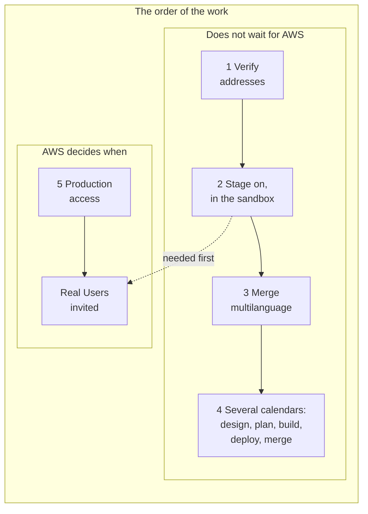

# Shared Calendar: the order of the work up to several calendars

| | |
|---|---|
| Status | Agreed with the Product Owner in the session of 2026-11-27. Nothing of it is done yet |
| Date | 2026-11-27 |
| What it is | The order in which three pieces of work reach `main` and the cloud: e-mail (`docs/EMAIL_PLAN.md`, at its step m10), the two languages (branch `multilanguage`, finished and waiting to be merged) and several calendars (`docs/MULTI_CALENDAR_ARCHITECTURE.md`, designed, no plan yet) |
| Why it exists | Step m10 of `docs/EMAIL_PLAN.md` waits for AWS to grant production access to Amazon SES, a wait of unknown length that held everything behind it. This order takes that wait off the path |
| What it does not do | It changes no plan. `docs/EMAIL_PLAN.md` and the plan of the branch `multilanguage` are changed by their own sessions, on their own branches (section 4) |

---

## 1. In short

1. Verify a few e-mail addresses at SES, so that mail works while the account is still in SES's
   sandbox.
2. Deploy `main` at the e-mail stage `on`, in the sandbox: step m10's deploy, for the verified
   addresses only.
3. Merge the branch `multilanguage` into `main`.
4. Merge `main` into the branch `multi-calendar`, correct the design against it, write the
   plan, build it on that branch, deploy, and only then merge the branch into `main`.
5. Whenever AWS grants production access, during any of the above: nothing is deployed again;
   the same stack starts reaching every address.

---

## 2. Why this order

- **Each piece lands on a `main` that already holds the one before.** The three pieces rewrite
  the same things: the people and their details, the invitation, the texts of every screen and
  mail, the assistant's wording. Built side by side they would be merged twice; in a row, each
  is merged once.
- **The sandbox is enough for everything but real Users.** In the sandbox SES sends only to
  verified addresses and domains and to its mailbox simulator, at most 200 mails a day and one
  a second (AWS's guide of Amazon SES, "Request production access",
  https://docs.aws.amazon.com/ses/latest/dg/request-production-access.html, read on
  2026-11-27). Nothing in the stack needs production access to be at the stage `on`: the
  condition of `docs/EMAIL_ARCHITECTURE.md` section 13.2 is about who can be reached, not about
  what can be deployed.
- **Several calendars need the stage `on`, not production access.** Its sign-in by e-mail
  address sends no mail. Its invitations and its mailer's mails reach the verified addresses in
  the sandbox, which is all a build and its tests need
  (`docs/MULTI_CALENDAR_ARCHITECTURE.md` section 18).

---

## 3. The steps

### Step 1. Verify addresses at SES

In the SES console of `eu-north-1`, the operator verifies their own address and the few
addresses of the people who will try the application. AWS mails each a link; its owner clicks
it.

- Keep it to the operator and the testers: the verification mail comes from Amazon and reads
  oddly to a client.
- Not confirmed: whether one verified address also covers its plus-addresses
  (`name+demo1@…`) as recipients in the sandbox. If it does not, each plus-address is verified
  by itself.

**Done when** each address shows as verified in the console.

### Step 2. `main` at the stage `on`, in the sandbox

Step m10 of `docs/EMAIL_PLAN.md`, in two halves, of which this is the first: the deploy at
`MailStage` `on`, the smoke test, the operator's look with a real invitation and a real daily
mail, all with verified addresses. The second half, the Users who need an account created
again, waits for step 5.

- The smoke test needs nothing more: it mails SES's simulator and the operator's own address
  (`docs/EMAIL_ARCHITECTURE.md` section 13.3).
- To decide in that session: whether the tag `v3.0.0` marks this half or waits for the second.
  The code is the same in both.

**Done when** the smoke test passes in the cloud at the stage `on` and the operator has received
an invitation and a daily mail.

### Step 3. Merge `multilanguage` into `main`

The merge that branch's own plan describes, which was waiting for step m10. It is released as
that plan says.

**Done when** `main` holds the two languages and its gate is green.

### Step 4. Several calendars

1. Merge `main` into the branch `multi-calendar`, so that the branch holds what `main` holds
   by then (e-mail at the stage `on`, the two languages). It cannot conflict: the branch
   changed no existing file, it only added new ones (the design, this document, the brief).
   **The branch is not merged into `main` yet**: `main` describes what is deployed, and the
   build's first step rewrites `docs/ARCHITECTURE.md`, the `CLAUDE.md` files and the calendar's
   specification for several calendars. Other work that needs the design reads it on the branch.
2. Correct `docs/MULTI_CALENDAR_ARCHITECTURE.md` against the new `main`. It was written
   without the two languages: its new screens, its two new mails and the assistant's new
   wording must exist in both, and the language kept for each person, `GET /me` and the
   person's details are read again as `main` holds them then.
3. Write `docs/MULTI_CALENDAR_PLAN.md`. Its first step runs the trials of
   `docs/MULTI_CALENDAR_ARCHITECTURE.md` section 14.1, of which one can change the design:
   whether the local Cognito emulator signs a person in by e-mail address.
4. Build it **on the branch `multi-calendar`, not on `main`**. After step 2, `main` is what
   runs in the cloud: if the first real invitations show a fault of v3.0.0, `main` must still
   be deployable to fix it.
5. Deploy v4.0.0 from the branch, then merge the branch into `main`, once, as the branch
   `slot-5min` was.

**Done when** v4.0.0 is deployed and the branch is merged into `main`.

### Step 5. Production access, whenever AWS grants it

No deploy. The operator invites the real Users again: the second half of step m10 of
`docs/EMAIL_PLAN.md`.

If step 4 is close to its release by then, those Users would be invited twice within a short
time, once in today's user pool and once in the new one. Whether to invite only those who
cannot wait is point Q2 of `docs/MULTI_CALENDAR_ARCHITECTURE.md` section 21, decided at that
moment.

---

## 4. What each piece of work must change for this order

| Where | What | By whom |
|---|---|---|
| `docs/EMAIL_PLAN.md`, step m10 | Split in two: the stage `on` in the sandbox with verified addresses (step 2 here); the real Users, at production access (step 5 here). `docs/RUNBOOK.md` section 3.3 says today that the stage `on` follows production access | the e-mail work's session, on `main` |
| The plan of the branch `multilanguage` | Its merge waits for step 2 here, not for production access | that branch's session |
| `docs/MULTI_CALENDAR_ARCHITECTURE.md` section 18 | "The build starts only after v3.0.0 is deployed" becomes: after step 3 here, on the branch `multi-calendar`, merged into `main` after its release | this branch, at step 4 |

---

## 5. What could go wrong

| Risk | What then |
|---|---|
| AWS refuses production access, or asks for more | Steps 2 to 4 are untouched. Real Users wait; the operator answers the support case (`docs/RUNBOOK.md` section 3.3) |
| A fault of v3.0.0 found late, after step 3 or during step 4 | Fixed on `main` and deployed from it; the branch of several calendars merges `main` again |
| The merge of `multilanguage` changes what the design of several calendars assumed | Expected: it is step 4's second point |
| The emulator cannot sign in by e-mail address | The fallback of `docs/MULTI_CALENDAR_ARCHITECTURE.md` section 14.1, found in the plan's first step, before anything is built |
