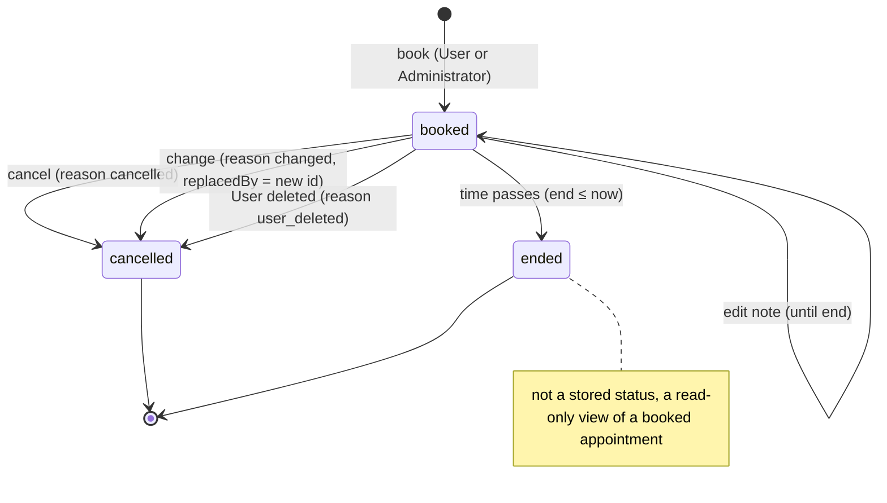

# Shared Calendar — Functional and Technical Specification

| | |
|---|---|
| Status | v16 — specification, agreed with the Product Owner (2026-11-10); assumptions confirmed; implemented (plan steps 41–59). v17 — the capacity of a type (decisions D24 to D31): several people in one slot; specified, **not built yet** (`docs/CAPACITY_PLAN.md`) |
| Date | 2026-11-10; v3 to v6 2026-11-12; v7 and v8 2026-11-13; v9, v10, v11, v12 and v13 2026-11-14; v14 and v15 2026-11-15; v16 2026-11-16; v17 2026-11-24 |
| Brief | `prompts/40-create-shared-calendar-spec.md` |
| Depends on | `docs/ARCHITECTURE.md` v11, `docs/FRONTEND_SERVICES.md` v5, `docs/FOLDER_STRUCTURE.md` v1 |
| Audience | The architect who updates `docs/ARCHITECTURE.md` and `docs/IMPLEMENTATION_PLAN.md`, and the developers who implement the steps |

### Change log

| Version | Date | Change |
|---|---|---|
| v1 | 2026-11-10 | First version, written after the Product Owner interview (section 3). |
| v2 | 2026-11-10 | Brief 41 (planning). Assumptions A1–A8 confirmed by the PO. Approved changes: how the acceptance scenarios with a fixed "now" are proven (18.3); throw-away Users `dave` and `erin` and a reset of the local `calendar` table in the back-end journeys (18.2); AC-34 wording; `docs/RUNBOOK.md` added to section 19. |
| v3 | 2026-11-12 | Brief 42 (plan step 41). Text lengths are counted in UTF-16 code units (11.4; referenced from 6.1 and R-BOOK-11). |
| v4 | 2026-11-12 | Brief 44 (plan step 43). `env.local.json` sets the calendar variables once, in its `Parameters` section, and never `CALENDAR_TIME_ZONE`, which comes from the `CalendarTimeZone` parameter only: `sam local` lets the file override the template, so a value there would make `--parameter-overrides` ineffective (14.4). |
| v5 | 2026-11-12 | Brief 45 (plan step 44). Open point O2 closed: the template stays reviewable and the local stack light; the PO confirmed T2 (section 22). |
| v6 | 2026-11-12 | Brief 46 (plan step 45). R-AV-01: windows are compared as local times, not instants (the spring-forward night), and two patterns overlap only if they share at least one date (6.5, text and table). |
| v7 | 2026-11-13 | Brief 47 (plan step 46). The 11.6 example corrected: the four Swimming Pool slots added, alice's appointment written out in full, real ULIDs. The night clocks go back gives two slots at the same local time (R-SLOT-01, 16.8). A window whose type has been deleted is not shown (R-VIEW-03). The view's appointment range is `SK BETWEEN <rangeStart> AND <rangeEnd>`, `rangeEnd` exclusive (13.2). |
| v8 | 2026-11-13 | Brief 48 (plan step 47). A one-off window dated before today cannot be deleted: `409 date_in_past`, as for an override (R-ONE-02, route 14). An override's windows are stored and returned sorted by start; two of its own windows that overlap are `409 availability_overlap` (6.3). |
| v9 | 2026-11-14 | Brief 49 (plan step 48). The order of the booking checks is stated as the handler runs them (8.2): the body's shape with the note first, R-BOOK-01's Cognito part after R-BOOK-02 and before the lock, R-BOOK-10 in the transaction. A booking target in no group is `409 target_not_user` (R-BOOK-01). The `APPT` item stores the fields of 8.1 except `appointmentId`, `typeName` and `cancellableUntil` (13.2). |
| v10 | 2026-11-14 | Brief 50 (plan step 49). The appointment list (route 16): exactly one selection, `from`+`to` or `upcoming=true`; `upcoming` selects by time and `status` filters it; a range takes the appointments dated in it; "ended" is not a status (11.1, 11.2, R-VIEW-01). A User's list is matched on the `sub`, the Administrator's `username` on the stored name, earlier accounts with it included (11.1, 11.2, 13.2). `cancellableUntil` is `null` on a cancelled appointment (8.1, 11.5). Cancel and note: the order of the checks, R-CAN-03 as `now ≤ cancellableUntil` to the millisecond, the lookup inside the locked attempt, an `Update` of the changed attributes without a condition of its own, and an unchanged note writes nothing (8.3, 8.5, 13.2, 13.4). Routes 18 and 19 read with `GetItem` only (14.3). |
| v11 | 2026-11-14 | Brief 51 (plan step 50). Change: the order of the checks, the old appointment before the new one; R-BOOK-01 is the old appointment's User, with no Cognito call, and a deleted one answers `404 user_not_found`; `end` absent is `start + 60 min`; a change to the same times is written; an appointment in progress can only be moved to a future start; the old appointment is left out of the state for R-BOOK-07 and R-BOOK-09; `replaces`/`replacedBy` are never followed (8.4). Route 20's errors listed explicitly instead of "union of #17 and #19" (11.1). The change's six items, in order (13.4). `previous` is the old appointment as stored after the change (15.2). |
| v12 | 2026-11-14 | Brief 52 (plan step 51). User deletion: the order of the checks and their answers, the time-zone check after the Cognito checks, a busy lock `409 concurrent_update`, a target in no group marked and cancelled too (10.2); an appointment in progress is cancelled too (10.2, AC-29); the marker is written in the first chunk as a plain `Put`, so a repeated deletion writes it again (10.2, 13.4); one event id per appointment, kept across retries and chunks (10.2). `GET /users` sorted by UTF-16 code units, an account in no group not listed (10.1). `DeleteUserFunction` declares the three calendar variables (14.1, 14.3). A notifier cannot look up a deleted User's address through Cognito (15.1). |
| v13 | 2026-11-14 | Brief 53 (plan step 52). The smoke test's calendar journey made independent of the settings and of the real calendar: it reads both first and searches a free 03:00–04:00 instead of assuming one; the Administrator's booking makes only `cancellationNoticeHours` matter; DST days skipped; a recognisable note for the AC-36 log search; the check lines, the clean-up on every exit and what stays as history (18.4, now "local and cloud"). |
| v14 | 2026-11-15 | Brief 54 review (plan step 53). Route 9's errors written out instead of "as #8": `limit_reached` removed, since an update replaces a pattern and never adds one (R-PAT-04); architecture section 4 and the handler never had it (11.1). |
| v15 | 2026-11-15 | Error codes of the timing rules renamed after the rule they break and its setting (user's decision, before plan step 54): `booking_too_soon` split into `booking_in_past` (R-BOOK-03) and `booking_notice_too_short` (R-BOOK-04, `minBookingNoticeHours`); `booking_too_far` → `booking_beyond_horizon` (R-BOOK-05, `bookingHorizonDays`); `cancellation_too_late` → `cancellation_notice_too_short` (R-CAN-03, `cancellationNoticeHours`). Statuses, order of the checks and messages unchanged (8.2, 8.3, 8.4, 11.1, 11.3, 18.3). |
| v16 | 2026-11-16 | Brief 71 (`docs/RENAME_PLAN.md`, plan step 56): the table's physical name in the cloud follows the stack, `<stack>-calendar`; locally it stays `calendar` (13.1). The plan's calendar steps run 41–59. |
| v17 | 2026-11-24 | Brief `prompts/e11-step-u1-implementation.md` (`docs/CAPACITY_PLAN.md` step u1), decided by the Product Owner on 2026-11-24. **The capacity of a type**: a type holds 1 to 100 people at the same time, default 1 (D24 to D31, 6.1, R-TYPE-05). The people in an interval are counted at their peak; a slot is free while they are fewer than the capacity, and says its places left (glossary, R-SLOT-02 to R-SLOT-05, 11.6). A User never holds two appointments at the same time, `409 user_busy` (R-BOOK-12). The Administrator goes over the capacity only with `overbook: true` (R-BOOK-07, R-BOOK-13, R-CHG-01, the order of the checks in 8.2 and 8.4). `busy` is the time that is full (R-SLOT-06); the Administrator's slots include the full ones (11.6, R-VIEW-01). `capacity` optional in the type's bodies (11.1, 11.4); `capacity` on the `TYPE` item, absent = 1 (13.2). Group appointments no longer out of scope as several Users each with their own appointment (1.3). The views' needs (16.8), privacy (17), unit tests (18.1), AC-37 to AC-44 (18.3). The 11.6 example gains `capacity` and `placesLeft` on each slot and keeps every other value. Not built yet. |

---

## 1. Purpose and scope

### 1.1 What this document is

The application has one Administrator and up to about ten Users (architecture N6). This
document specifies a **shared calendar**: the Administrator publishes when and where they are
available, and Users book appointments with the Administrator inside that availability. A place
may take several Users at the same time, each with an appointment of their own, up to the
capacity of its type (D24).
The Administrator can also book, move and cancel appointments on a User's behalf.

The document defines **what** the feature does (sections 4 to 10: rules with stable ids such as
`R-BOOK-03`) and **how** it fits the existing system (sections 11 to 17: API contract, shared
types, data model, Lambda functions, front-end services). Like Hello World, the new functionality
follows the existing pattern: one route = one Lambda function with its own IAM role, the contract
in `shared/`, AWS access only through `backend/src/lib`, and one front-end service class per remote
area following `docs/FRONTEND_SERVICES.md` section 3. Every departure from that pattern is listed,
with its reason, in section 20.

On any conflict `docs/ARCHITECTURE.md` wins until it has been updated. Section 19 lists the changes
this feature makes to the existing documents and code, so that the architect can merge this
specification into them.

### 1.2 In scope

- Availability types, weekly patterns, date overrides and one-off windows, all managed by the Administrator.
- Computing the effective availability and the free slots.
- Booking, cancelling and changing appointments, by the Administrator and by Users, under configurable rules.
- Calendar settings that the Administrator can change.
- Listing Users (needed so the Administrator can book for a User).
- What happens to a User's appointments when the User is deleted.
- An appointment event log, written now so that **e-mail notifications can be added later
  without redesign** (section 15).
- The back end, the shared contract, and the front-end services layer.

### 1.3 Out of scope (v1 of the calendar)

| Item | Note |
|---|---|
| The user interface (screens, components) | Waits for `docs/FRONTEND_ARCHITECTURE.md`. Section 16.8 lists the functional needs of the views. |
| Any notification: e-mail, SMS, push, in-app | **A future feature.** The design must not make it harder (section 15). |
| Date-range closures (e.g. "holidays 1–20 August") as a single operation | v1: one empty override per date (the front end can loop). Follow-up in section 21. |
| Recurrences other than weekly (fortnightly, monthly, …) | Follow-up in section 21. |
| Several Administrators / several calendars | One Administrator, one calendar (decision D20). |
| Group appointments (one appointment for several Users) | An appointment is between one User and the Administrator. Several Users may each hold their own appointment at the same time, up to the type's capacity (D24). |
| Waiting lists, payment, external calendar sync (iCal, Google) | — |
| Changing the calendar's time zone after data exists | It is a deployment parameter. Changing it would move every stored pattern, so it is an operation that needs its own design. |

---

## 2. Glossary

| Term | Meaning |
|---|---|
| **Administrator** | The one account in Cognito group `admin` (architecture section 3). Owner of the calendar. |
| **User** | An account in group `user` (and not in `admin`: "admin wins"). |
| **Calendar time zone** | The one IANA time zone (e.g. `Europe/Rome`) in which every local date and time of the calendar is meant. |
| **Local date** | A calendar date in the calendar time zone, `YYYY-MM-DD`. |
| **Local time** | A wall-clock time in the calendar time zone, `HH:mm`, in 15-minute steps. |
| **Instant** | An absolute point in time, ISO-8601 UTC with milliseconds and `Z`, e.g. `2026-11-16T07:00:00.000Z`. |
| **Availability type** | A named kind of availability, usually a place: "Studio", "Swimming Pool". |
| **Capacity** | How many people a type holds at the same time: 1 to 100, default 1 (D24). |
| **People in an interval** | The most active appointments that overlap at one instant of the interval: their peak, not their sum (D25, R-SLOT-02). |
| **Places left** | A slot's capacity minus the people in it, never below 0. |
| **Window** | An interval of one local date, `[start, end)` in local time, with a type: "Monday 16 Nov 2026, 08:00–12:00, Studio". |
| **Weekly pattern** | A rule that yields one window on a given weekday, every week, within a validity period. |
| **Date override** | For one local date, an explicit list of windows that **replaces** that date's pattern windows (an empty list means "not available that day"). |
| **One-off window** | A window defined for one specific date, **in addition to** the pattern or override windows. |
| **Effective windows** | A date's windows once patterns, override and one-offs have been combined, with adjacent windows of the same type merged (section 6.6). |
| **Slot** | A whole local hour `[hh:00, hh:00 + 60 min)` lying inside one effective window. |
| **Free slot** | A slot with a place left: the people in it are fewer than its type's capacity (R-SLOT-02). |
| **Appointment** | A booking between one User and the Administrator: a start, an end, a type, an optional note, and a status (`booked` or `cancelled`). |
| **Active appointment** | An appointment with status `booked`. |
| **Ended appointment** | An appointment whose end is not after now (`end ≤ now`). |
| **Change** | Cancelling an appointment and booking a new one, as a single operation. |
| **Notice (cancellation notice)** | The minimum time between now and an appointment's start for a User to be allowed to cancel or change it. |
| **Calendar event** | An immutable record of something that happened to an appointment (booked, cancelled, changed, note updated), kept for audit and for future notifications. Not to be confused with an appointment. |

---

## 3. Product Owner decisions (interview of 2026-11-10)

The Product Owner accepted every proposed default and added one directive: **e-mail
notifications will be added as a future feature, so no decision may make them harder to add.**

| # | Topic | Decision |
|---|---|---|
| D1 | Time zone | One IANA time zone for the whole calendar, set as a deployment parameter. Instants are stored in UTC. Patterns are in local wall-clock time, so they stay right across daylight-saving changes. |
| D2 | Granularity | Windows and the Administrator's custom appointment times use 15-minute steps. Users only book whole hours. |
| D3 | Availability types | A catalogue the Administrator manages (create, rename, delete). Each type has a name and a capacity (D24). A type that is still in use cannot be deleted. |
| D4 | Patterns | Weekly only: weekday, start, end, type, "valid from" and optional "valid until". |
| D5 | Overrides | Per date: an explicit list of windows that replaces the pattern windows of that date; an empty list = not available. The pattern itself is unchanged. Date-range closure: not in v1. |
| D6 | Overlaps | No two windows of the same date may overlap, whatever their source or type. |
| D7 | Editing availability with existing appointments | Rejected with the list of affected appointments. The Administrator cancels or moves them first. |
| D8 | Slots | A whole hour fully inside one window, with a place left: with the default capacity of 1, overlapping no active appointment (D24, D25). No break between appointments. |
| D9 | Visibility | A User sees free slots (with type) and their own appointments; others' appointments are "not free" where they fill a time (D29), without names. The Administrator sees everything. |
| D10 | Booking window | Settings: minimum booking notice (default 0 h) and booking horizon (default 8 weeks). The Administrator is exempt. |
| D11 | Limit per User | Setting "max future appointments per User", default unlimited. The Administrator is exempt. |
| D12 | Administrator's custom times | Inside one window, no overlap, 15-minute steps, at least 15 minutes. |
| D13 | Note | Optional free text, at most 500 characters, visible to and editable by both parties. |
| D14 | Users list | New `GET /users`, Administrator only. |
| D15 | Cancellation notice | One global setting in hours, before the start, default 24. Within it, a User can neither cancel nor change. |
| D16 | Change | Atomic: cancel old + book new, or nothing. User: notice on the old, booking rules on the new. |
| D17 | History | Cancelled appointments are kept (who, when). Past appointments are read-only. The Administrator can cancel any appointment that has not ended. |
| D18 | Notifications | None in v1. **Future: e-mail; the design must make it easy** (section 15). |
| D19 | User deleted | Their future appointments are cancelled automatically; past ones stay as history. |
| D20 | Administrator | Exactly one; the calendar is theirs. |
| D21 | Database | A new DynamoDB table `calendar`, in the same DynamoDB (same local emulator, same web UI, same free tier). |
| D22 | Scope | Rules, API contract, data model, back end and front-end services. UI out of scope except its functional needs. A week view fetches a date range of up to 31 days. |
| D23 | Settings | Changed by the Administrator through the API (`GET`/`PUT /calendar/settings`). |

Decisions D24 to D31, the capacity of a type, were taken by the Product Owner on 2026-11-24
(`docs/CAPACITY_PLAN.md` sections 2 and 3). They are designed and not built yet: `docs/CAPACITY_PLAN.md`
builds them.

| # | Topic | Decision |
|---|---|---|
| D24 | Capacity | Each type holds 1 to 100 people at the same time, default 1, which is the calendar of D8. Set when the type is created, changed when it is edited. |
| D25 | Counting | The people in an interval are their peak: the most appointments present at one instant. With a capacity of 2, 10:00–10:30 and 10:30–11:00 leave one place in the slot 10:00–11:00; 10:00–10:30 and 10:15–11:00 fill it. |
| D26 | Going over the capacity | Only the Administrator, and only by saying so: a booking into a full slot is refused with `409 slot_taken` for the Administrator too, who sends it again with `overbook: true`. Nobody overbooks by mistake. |
| D27 | One place per person | A User never holds two active appointments at the same time, whatever the type; `overbook` does not lift it. |
| D28 | Capacity lowered | Allowed at any time; nothing is cancelled (as R-SET-03). A slot with more people than its new capacity takes no booking until people leave. |
| D29 | What a User sees | The places left of a slot, never who holds the others (D9 stands). A time is `busy` only when it is full. |
| D30 | The Administrator's full slots | Shown to the Administrator with no place left, so that a full slot can be booked over its capacity. A User never gets a full slot. |
| D31 | A forced booking is not marked | Nothing is stored about a booking over the capacity: `createdBy` already says the Administrator made it, and "over the capacity" is a fact of one moment, since the capacity can change afterwards (D28). The event of section 15.2 is unchanged. |

---

## 4. Actors and permissions

Role resolution is unchanged (architecture section 3): `admin` wins over `user`; a token in
neither group gets `403 forbidden` on every calendar route.

| Capability | Administrator | User |
|---|---|---|
| Read settings | yes | yes (needed to explain the rules to the User) |
| Change settings | yes | no |
| List availability types | yes | yes |
| Create / edit (name, capacity) / delete availability types | yes | no |
| Manage weekly patterns, date overrides, one-off windows | yes | no |
| See the calendar (windows, free slots) for a date range | yes, with the source of every window | yes, without sources |
| See appointments | all, with the User's name | own only; others' count in a slot's places left, and a full time appears as an anonymous "busy" interval |
| Book | for any User; any free slot or custom times inside one window; no notice, horizon or limit; over the capacity with `overbook` (R-BOOK-13) | for themself only; whole-hour free slots; notice, horizon and limit apply; never over the capacity |
| Cancel | any active appointment not yet ended | own active appointment, only with enough notice |
| Change | any active appointment not yet ended | own, with notice on the old one and booking rules on the new one |
| Edit the note | any active appointment not yet ended | own active appointment not yet ended |
| List Users | yes | no |

Rule **R-PERM-01**: a User asking for another User's appointment by id gets `404
appointment_not_found`, not 403, so ids cannot be probed.

---

## 5. Time model

**R-TIME-01 — One time zone.** The calendar time zone is the deployment parameter
`CalendarTimeZone` (default `Europe/Rome`, see assumption A1). Every Lambda receives it as
`CALENDAR_TIME_ZONE` and checks it at cold start (`Intl.DateTimeFormat` must accept it); an invalid
value makes every calendar request answer `500 internal_error`, which fires the existing 5xx alarm.
The API exposes it in the settings (section 9) and in every calendar view response.

**R-TIME-02 — Representations.**

| Kind | Format | Used for |
|---|---|---|
| Local date | `YYYY-MM-DD`, a real calendar date | pattern validity, overrides, one-off windows, query ranges |
| Local time | `HH:mm`, minutes in `00, 15, 30, 45`; `24:00` allowed as an **end** only | window start/end |
| Weekday | integer `1` (Monday) … `7` (Sunday), ISO 8601 | patterns |
| Instant | ISO-8601 UTC, `YYYY-MM-DDTHH:mm:ss.sssZ` | appointments, computed windows and slots, audit timestamps |

An appointment is stored and exchanged as instants. The 15-minute and whole-hour rules apply
to the **local** time of those instants, so they hold for any zone, including the rare zones whose
UTC offset is not a whole hour.

**R-TIME-03 — Converting local to UTC.** A local date + local time becomes an instant in the
calendar time zone with the "compatible" rule (the one JavaScript's Temporal uses):
- a local time that does not exist (the hour skipped when clocks go forward) is moved forward by
  the length of the gap (e.g. 02:30 on the spring-forward night → 03:30);
- a local time that occurs twice (when clocks go back) takes the **earlier** occurrence.

Durations are always measured in real elapsed minutes. A slot is therefore exactly 60 real
minutes. On the night clocks go forward, a window 01:00–04:00 holds two real hours and the slots
01:00–03:00 (60 real minutes, ending at local 03:00) and 03:00–04:00. Availability at night is
not a realistic case, but the rule makes the code total.

**R-TIME-04 — "Today" and "now".** "Now" is the Lambda's clock. "Today" is the local date of now
in the calendar time zone. Every rule that says "future" or "past" compares with these two values,
computed once at the start of a request.

**R-TIME-05 — Week.** Weeks start on Monday (ISO 8601). Only the view layer uses this; the API
works with date ranges.

**R-TIME-06 — Helpers live in `shared/`.** The conversions (`toInstant(date, time, zone)`,
`localDateOf(instant, zone)`, `localTimeOf(instant, zone)`, `weekdayOf(date)`, `addDays(date, n)`)
are implemented once in `shared/src/calendar/time.ts` with the built-in `Intl` API only. No date
library: `Intl` exists in Node 22 and in every browser, and `shared/` may import only TypeScript
and `zod` (`docs/FOLDER_STRUCTURE.md` section 3). Unit tests cover a DST spring-forward day, a
fall-back day, and a zone with a non-whole-hour offset.

---

## 6. Availability

### 6.1 Availability types

| Field | Rule |
|---|---|
| `typeId` | ULID, generated by the server |
| `name` | 1–40 characters (counted as in 11.4) after trimming leading and trailing spaces; no control characters; unique among types, compared case-insensitively |
| `capacity` | an integer 1–100, default 1: how many people the type holds at the same time (D24) |
| `createdAt`, `updatedAt` | instants |

Not built yet: the capacity of a type is designed (decisions D24 to D31) and built by `docs/CAPACITY_PLAN.md`.

- **R-TYPE-01** Create: the name must be valid and unique (otherwise `409 type_name_exists`).
  At most 20 types exist at the same time (`409 limit_reached`).
- **R-TYPE-02** Edit: the name with the same rules, the capacity with R-TYPE-05; a capacity left
  out of the body keeps the stored one (11.4). Renaming takes effect everywhere at once, also in the
  display of existing appointments (an appointment shows the type's current name, section 8.1).
- **R-TYPE-03** Delete: refused with `409 type_in_use` while the type is referenced by any weekly
  pattern (whatever its validity), by an override or one-off window dated today or later, or by an
  active appointment that has not ended. Past references do not block: an appointment keeps a
  snapshot of the type name taken at booking, which is shown once the type no longer exists.
- **R-TYPE-04** Every window and appointment refers to an existing type. A body that names an
  unknown `typeId` gets `409 type_not_found`.
- **R-TYPE-05** Capacity: an integer from 1 to 100 (`400 invalid_request` otherwise); absent at
  creation, it is 1. It can be changed at any time, also below the people already booked in a
  future slot: no appointment is touched (D28), and that slot simply has no place left. Since the
  windows of a date never overlap (R-AV-01), two appointments that overlap lie in one effective
  window and share its type: the capacity that applies to a time is the capacity of the type of
  the window there.

### 6.2 Weekly patterns

| Field | Rule |
|---|---|
| `patternId` | ULID, generated by the server |
| `weekday` | 1–7 |
| `start`, `end` | local times, `start < end`, same day (`end` may be `24:00`) |
| `typeId` | an existing type |
| `validFrom` | local date; the first date the pattern can apply |
| `validUntil` | local date or `null` (no end); when set, `validUntil ≥ validFrom`; inclusive |
| `createdAt`, `updatedAt` | instants |

- **R-PAT-01** A pattern yields a window on every date D with `weekday(D) = weekday` and
  `validFrom ≤ D ≤ validUntil` (or no upper bound), **unless D has a date override**.
- **R-PAT-02** The example "every Monday 08:00–12:00 at Studio and 14:00–18:00 at the Swimming Pool"
  is **two** patterns. One pattern = one window per week.
- **R-PAT-03** Create, update (full replacement of the fields above) and delete are allowed at any
  time. Their effect on past dates does not matter: past slots are never bookable, and past
  appointments keep their own times and type (assumption A3).
- **R-PAT-04** At most 50 patterns exist at the same time (`409 limit_reached`).
- To change a pattern "from next month on", the Administrator sets `validUntil` on the old
  pattern and creates a new one with the new `validFrom`. The API offers no shortcut for this; the
  view may do both calls.

### 6.3 Date overrides

| Field | Rule |
|---|---|
| `date` | local date, today or later (`409 date_in_past` otherwise); the key of the override |
| `windows` | 0–10 windows `{ start, end, typeId }`, local times as for patterns; stored and returned sorted by start. Two windows of one override that overlap are `409 availability_overlap` (6.5), not `400` |
| `updatedAt` | instant |

- **R-OVR-01** When a date has an override, **none** of the pattern windows apply on that date; the
  override's windows apply instead. An empty list means "no pattern availability that day".
- **R-OVR-02** Setting an override on a date that already has one replaces it (`PUT` semantics).
  Deleting it makes the patterns apply again.
- **R-OVR-03** Overrides do not remove one-off windows: those are added on top (section 6.5).
- Example from the brief: "for a certain week change the Monday availability to 9:00". On that
  Monday the Administrator sets an override with the windows `09:00–12:00 Studio` and
  `14:00–18:00 Swimming Pool`.

### 6.4 One-off windows

| Field | Rule |
|---|---|
| `windowId` | ULID |
| `date` | local date, today or later |
| `start`, `end`, `typeId` | as for patterns |
| `createdAt` | instant |

- **R-ONE-01** A one-off window adds availability on its date, whether or not the date has an override.
- **R-ONE-02** One-off windows are created and deleted, not edited. To change one, delete it and
  create a new one (this keeps the route count down; the view can offer "edit" as these two calls).
  A one-off window dated before today cannot be deleted (`409 date_in_past`, as for an override):
  past availability is not edited (R-AV-02).
- **R-ONE-03** At most 10 one-off windows per date.
- Example from the brief: "15:00–17:00 on Monday 9 November 2026" is a one-off window.

### 6.5 Combining the sources

For a local date D, the **defined windows** are:

```
base(D)    = override(D).windows               if D has an override
           = windows of the patterns valid on D otherwise
defined(D) = base(D) ∪ oneOffWindows(D)
```

**R-AV-01 — No overlap (D6).** The defined windows of a date never overlap: for any two windows
`[s1, e1)` and `[s2, e2)`, either `e1 ≤ s2` or `e2 ≤ s1`. Touching windows (`12:00` end, `12:00`
start) are allowed, also with different types. Windows are compared as the local times that define
them (`HH:mm` of one date), not as instants: on the night clocks go forward, `02:00–02:30` and
`03:00–04:00` do not overlap, although both start at the same instant. Two patterns overlap only if
their windows overlap and they share at least one date: the same weekday, inside both validity
periods. Every write that could create an overlap is
rejected with `409 availability_overlap`, and the response's `message` names the date and both
windows. The writes and their checks:

| Write | Checked against |
|---|---|
| Create / update a pattern | Every other pattern with the same weekday and an intersecting validity period that contains at least one date of that weekday (an overlap on any date, past dates included, is an overlap). And, for every date from today on within the pattern's validity that has **no override**, the one-off windows of that date. |
| Set an override on D | Its own windows among themselves, and the one-off windows of D. |
| Create a one-off window on D | The current `base(D)` and the other one-off windows of D. |
| Delete an override on D | The pattern windows that apply again on D, against the one-off windows of D. |

**R-AV-02 — The rule cannot be broken from the past.** A pattern's overlap check against one-off
windows considers dates from today on only. One-off windows and overrides cannot be dated in the
past, nor set or deleted once their date is past (`409 date_in_past`).

### 6.6 Effective windows

The **effective windows** of D are the defined windows of D, converted to instants (R-TIME-03),
sorted by start, with **adjacent windows of the same type merged** (end of one = start of the
next). Example: `08:00–10:30 Studio` and `10:30–12:00 Studio` (from a pattern and a one-off window)
form one effective window `08:00–12:00 Studio`, which offers the slot 10:00–11:00.

Effective windows are computed on every request, never stored. This is cheap: there are at most
50 patterns, and a date has at most 10 + 10 windows.

### 6.7 Editing availability when appointments exist (D7)

**R-AV-03 — Conflict rule.** A write to availability (any row of the table in 6.5, deleting a
pattern or a one-off window, setting or deleting an override) is computed against the calendar
*as it would be after the write*. Every active appointment that has not ended (`end > now`,
including one in progress) must still lie entirely inside one effective window **of the same type**
as the appointment. If one or more do not, the write is rejected with `409 availability_conflict`,
and the body lists them:

```json
{
  "error": "availability_conflict",
  "message": "2 appointments would fall outside the availability",
  "conflicts": [
    { "appointmentId": "01JC…", "username": "alice", "start": "2026-11-16T09:00:00.000Z", "end": "2026-11-16T10:00:00.000Z" }
  ]
}
```

The list is sent only to the Administrator, who is the only one allowed to write availability.

**R-AV-04** Extending availability (a longer window, a new window) never conflicts. Changing a
window's type is a conflict for the appointments inside it: the place would change under the User's
feet.

**R-AV-05** Rule R-AV-03 is checked in the same serialized transaction as the write (section
13.4), so a booking made at the same moment cannot slip through.

---

## 7. Slots

**R-SLOT-01 — Definition.** A slot is an interval `[s, s + 60 min)` where:
1. the local time of `s` is a whole hour (`hh:00`);
2. the interval lies entirely inside one effective window;
3. its type is that window's type.

A window 08:30–12:00 yields the slots 09:00, 10:00 and 11:00. A window 08:00–08:45 yields none.

On the night clocks go back, the repeated local hour gives two slots with the same local start, one
real hour apart, one per UTC offset. In `Europe/Rome` on 2026-10-25, a window 01:00–04:00 holds four
real hours and gives four slots: 01:00 (+02:00), 02:00 (+02:00), 02:00 (+01:00) and 03:00 (+01:00).
Each lasts 60 real minutes, and all of them are free and bookable like any other slot. An instant
names each slot without ambiguity.

Not built yet: the capacity of a type is designed (decisions D24 to D31) and built by `docs/CAPACITY_PLAN.md`.

**R-SLOT-02 — Free.** The *people in* an interval are the most active appointments that overlap
at one instant of it: their peak, not their sum (D25). Overlap is computed on real instants (`[a, b)`
and `[c, d)` overlap when `a < d` and `c < b`), so two appointments that touch are never present at
the same instant. A slot is free when the people in it are fewer than the capacity of its type
(R-TYPE-05); its **places left** are `capacity − people`, never below 0. There is no break between
appointments (D8). With a capacity of 1 a slot is free exactly when it overlaps no active
appointment.

**R-SLOT-03 — Bookable by a User.** A free slot can be booked by a User when, in addition:
- it overlaps none of the User's own active appointments (R-BOOK-12);
- `start > now` and `start − now ≥ minBookingNoticeHours` (R-BOOK-04);
- `localDateOf(start) ≤ today + bookingHorizonDays` (R-BOOK-05).

**R-SLOT-04 — Offered to the Administrator.** The slots shown to the Administrator need only
`start > now`, and include the full ones, with no place left (D30): the Administrator may book one
over its capacity (R-BOOK-13). The Administrator can also book custom times that are not slots
(R-BOOK-08).

**R-SLOT-05 — Partial occupation.** If the Administrator books 10:00–10:30, that half hour counts
one person in the slot 10:00–11:00. With a capacity of 1 the slot is no longer free for Users, and
the remaining half hour can only be booked by the Administrator with custom times. With a capacity
of 2 the slot still has one place left.

**R-SLOT-06 — Busy.** What a User sees of the others' appointments, without names (D29): the
maximal intervals of the date in which the people present at every instant (all active
appointments, the User's own included) are at least the capacity that applies there, with the
times of the User's own appointments taken out, since the view shows those apart. The capacity
that applies at an instant is that of the type of the effective window holding it, or 1 where no
window of an existing type holds it (a past appointment under availability changed since, A3).
With a capacity of 1 this is the others' appointments, except that two of them that touch make
one interval. The Administrator gets no `busy`: they see the appointments themselves.

Example: the Swimming Pool has a capacity of 3 and a window 14:00–16:00. alice and bob book 14:00.
carol sees the slot 14:00 with 1 place left and the slot 15:00 with 3, and nothing `busy`. carol books
14:00: the slot is full. dan no longer gets the slot 14:00, and sees 14:00–15:00 as `busy`. The
Administrator still sees it, with no place left, and may book dan into it with `overbook: true`: four
people, one over the capacity. alice cannot book 14:00 a second time, nor may the Administrator book
her there again, forced or not (R-BOOK-12).

---

## 8. Appointments

### 8.1 Data

| Field | Meaning |
|---|---|
| `appointmentId` | ULID, generated by the server |
| `userId` | Cognito `sub` of the User (internal; not in API responses) |
| `username` | the User's username at booking time |
| `start`, `end` | instants |
| `date` | local date of `start` (an appointment never crosses midnight, since it lies inside one window) |
| `typeId` | the type of the window it lies in |
| `typeName` | in responses: the type's current name, or the snapshot if the type was deleted |
| `typeNameAtBooking` | snapshot (internal) |
| `note` | string of 1–500 characters, or `null` |
| `status` | `booked` or `cancelled` |
| `createdAt`, `createdBy` | instant; `{ username, role }` of whoever booked |
| `updatedAt`, `updatedBy` | last change of any kind (note or status) |
| `cancelledAt`, `cancelledBy`, `cancelReason` | set when cancelled; `cancelReason` ∈ `cancelled` (an explicit cancel), `changed` (replaced by a change), `user_deleted` (D19) |
| `replaces`, `replacedBy` | appointment ids linking the two halves of a change, or `null` |
| `cancellableUntil` | in responses only, for a User caller on a `booked` appointment: `start − cancellationNoticeHours`, i.e. the last instant at which the User may cancel or change (already in the past once that moment has passed, ended appointments included); `null` on a `cancelled` appointment and in every answer to the Administrator (v10) |
| `version` | internal optimistic-locking counter |

Lifecycle:



"Ended" is derived from the clock, not stored. An ended appointment cannot be changed in any way.

### 8.2 Booking

Request: `{ start, end?, username?, note?, overbook? }` (section 11.7).

| Rule | User | Administrator | Error if broken |
|---|---|---|---|
| **R-BOOK-01** `username`: the User the appointment is for | must be absent or equal to the caller | required; must be an existing account in group `user` and not in `admin` | `400 invalid_request` (admin, absent) · `404 user_not_found` (admin, unknown) · `409 target_not_user` (admin, target not a plain User: an Administrator, or in no group) · `403 forbidden` (User naming someone else) |
| **R-BOOK-02** Times | `start` a whole local hour; `end` absent or `start + 60 min` | `start` and `end` on 15-minute local steps; `end` defaults to `start + 60 min` (then `start` may be any 15-minute step); `end − start ≥ 15 min` | `400 invalid_request` |
| **R-BOOK-03** In the future | `start > now` | `start > now` | `409 booking_in_past` |
| **R-BOOK-04** Minimum notice | `start − now ≥ minBookingNoticeHours` | exempt | `409 booking_notice_too_short` |
| **R-BOOK-05** Horizon | `localDateOf(start) ≤ today + bookingHorizonDays` | exempt | `409 booking_beyond_horizon` |
| **R-BOOK-06** Inside availability | inside one effective window; the appointment takes that window's type | same | `409 outside_availability` |
| **R-BOOK-07** Places | the people in `[start, end)` (R-SLOT-02) are fewer than the capacity of the window's type (R-BOOK-06) | same, unless `overbook` is `true` (R-BOOK-13) | `409 slot_taken` |
| **R-BOOK-08** Custom times | — (forbidden by R-BOOK-02) | allowed, subject to R-BOOK-06/07/12 (D12) | — |
| **R-BOOK-09** Limit | the User's active appointments with `start > now`, **before** this booking, are fewer than `maxFutureAppointmentsPerUser` (when not `null`) | exempt | `409 appointment_limit_reached` |
| **R-BOOK-10** Account still alive | the target User has not been deleted (section 10.2) | same | `404 user_not_found` |
| **R-BOOK-11** Note | optional; trimmed; empty → `null`; at most 500 characters (counted as in 11.4); no control characters except line feed | same | `400 invalid_request` |
| **R-BOOK-12** One place per person | no active appointment of the target User overlaps `[start, end)` (D27) | same; `overbook` does not lift it | `409 user_busy` |
| **R-BOOK-13** Going over the capacity | `overbook` absent or `false` | `overbook: true` lifts R-BOOK-07, and nothing else (D26) | `403 forbidden` (a User sending `true`) |

Not built yet: the capacity of a type is designed (decisions D24 to D31) and built by `docs/CAPACITY_PLAN.md`.

The checks run in this order, and the first that fails decides the answer, so the same request
always gets the same error:

1. the body's shape, including the note of R-BOOK-11 and the instant form of 11.4 (`400
   invalid_json` / `invalid_request`);
2. the parts of R-BOOK-01 that need only the body and the caller: a User naming someone else (`403
   forbidden`), the Administrator's `username` absent (`400`); then R-BOOK-13, a User sending
   `overbook: true` (`403 forbidden`);
3. R-BOOK-02 (`400`);
4. the Administrator's target through Cognito (R-BOOK-01: `404 user_not_found`, `409
   target_not_user`), before the calendar lock: its answer does not depend on the calendar, so a
   lock retry does not repeat it;
5. inside the locked attempt, on the data read in it: R-BOOK-03, 04, 05, 06, 12, 07, 09;
6. R-BOOK-10, as a condition of the booking transaction itself (13.4): a cancellation on that item
   answers `404 user_not_found` without a retry.

R-BOOK-12 comes before R-BOOK-07, so that the Administrator is never offered to go over the
capacity for a refusal that `overbook` cannot lift. `overbook: true` on a slot that has a place
left is not an error: the booking is made as without it.

R-BOOK-08 is a permission, not a check: R-BOOK-02 applies it. A User books on the `sub` of their
token, which is also the `sub` the marker is checked on.

Success: `201` with the appointment. A calendar event `appointment.booked` is written in the same
transaction (section 15).

### 8.3 Cancelling

| Rule | User | Administrator | Error |
|---|---|---|---|
| **R-CAN-01** Exists and visible | own appointment | any | `404 appointment_not_found` |
| **R-CAN-02** Active and not ended | `status = booked` and `end > now` | same | `409 appointment_not_active` |
| **R-CAN-03** Notice (D15) | `start − now ≥ cancellationNoticeHours` | exempt; may cancel an appointment already in progress | `403 cancellation_notice_too_short` |

Success: `200` with the cancelled appointment (`cancelReason: "cancelled"`). The row stays in
the table (D17). Event `appointment.cancelled`. Cancelling frees the time at once.

With the default notice of 24 h, an appointment on Tuesday at 10:00 can be cancelled by its User
until Monday at 10:00 (the comparison is `≥`, so exactly 24 h before is still allowed).

R-CAN-03 is the same instant as the response's `cancellableUntil`: the cancel is allowed while
`now ≤ start − cancellationNoticeHours`, compared to the millisecond with `now` read once per request.
A `now` one millisecond later is refused. A User's appointment in progress passes R-CAN-02 and is
refused by R-CAN-03 (v10).

The checks run in this order, and the first that fails decides (v10):

1. the path id is a ULID (`400 invalid_request`);
2. inside the locked attempt, on the appointment read in it: R-CAN-01 / R-PERM-01, absent or (for a
   User caller) a `userId` other than the `sub` of the token (`404 appointment_not_found`); R-CAN-02
   (`409 appointment_not_active`); for a User, R-CAN-03 (`403 cancellation_notice_too_short`).

The 404 comes first, so a User learns nothing about the status of someone else's appointment. The
lookup by id (13.2) runs inside the locked attempt: the pointer never changes, but the `APPT` item
does, and a retry must re-check it. The cancel writes, with the lock update and the event, an
`Update` of the `APPT` item that sets `status` `cancelled`, `cancelledAt` and `updatedAt` now,
`cancelledBy` and `updatedBy` the caller, `cancelReason` `cancelled` and `version` + 1 (13.4).

### 8.4 Changing (D16)

Request: `POST /calendar/appointments/{id}/change` with `{ start, end?, note?, overbook? }`. The User of the
new appointment is always the User of the old one. To move an appointment to another User, the
Administrator cancels it and books a new one.

**R-CHG-01** A change must pass **all** of R-CAN-01 to R-CAN-03 for the old appointment and
**all** of R-BOOK-02 to R-BOOK-11 for the new one, with two adjustments:
- the checks of places and of one place per person (R-BOOK-07, R-BOOK-12) ignore the old
  appointment, so an appointment can be moved by half an hour or extended into its own time, also
  in a full slot;
- the limit (R-BOOK-09) does not count the old appointment.

Both adjustments are one: the new appointment is checked against the state with the old one left
out, by id (v11). The old one is always in that state (it passed R-CAN-02, so it has not ended). A
User at a limit of 1 can therefore move their only future appointment.

What the booking rules mean in a change (v11):
- R-BOOK-01: the User is the old appointment's (its `userId` and `username`). There is no
  `username` in the body and no Cognito call, so the account is not re-checked for being a plain
  User. R-BOOK-08 is applied by R-BOOK-02, as in a booking.
- R-BOOK-02: as in a booking for the caller's role; the Administrator's `end` absent is
  `start + 60 min`, not the old appointment's duration.
- R-BOOK-06: the new appointment takes the type of the window it lies in, which may differ from the
  old one's; `typeNameAtBooking` is that type's name at the time of the change.
- R-BOOK-10: checked on the old appointment's `userId`. A change by the Administrator of an
  appointment whose User has been deleted (still `booked` only if the deletion stopped before its
  cancellations, R-DEL-01) answers `404 user_not_found`.
- R-BOOK-13: `overbook` as in a booking; the Administrator may move an appointment into a full
  slot with `overbook: true`.
- A change to exactly the old times (and note) is allowed and written like any other: a new
  appointment and an event.
- The Administrator may change an appointment in progress (R-CAN-03 exempts them), but the new one
  must start in the future (R-BOOK-03): an appointment in progress can only be moved to a future
  start, never extended or shortened in place.

The checks run in this order, and the first that fails decides (v11):

1. the path id is a ULID (`400 invalid_request`);
2. the body: JSON, then `ChangeBody` with the note of R-BOOK-11 and the instant form of 11.4 (`400
   invalid_json` / `invalid_request`);
3. R-BOOK-13, a User sending `overbook: true` (`403 forbidden`);
4. R-BOOK-02 for the caller's role (`400`);
5. inside the locked attempt, on the data read in it, the old appointment as in 8.3: R-CAN-01 /
   R-PERM-01 (`404 appointment_not_found`), R-CAN-02 (`409 appointment_not_active`), for a User
   R-CAN-03 (`403 cancellation_notice_too_short`, "Too late to change this appointment");
6. then the new one: R-BOOK-03, 04, 05, 06, 12, 07, 09, with the adjustments of R-CHG-01;
7. R-BOOK-10, as a condition of the change transaction on the old appointment's `userId` (`404
   user_not_found`, without a retry).

The old appointment comes first: the 404 of R-PERM-01 must come before anything that depends on the
calendar, and the new appointment's checks depend on the old one (which appointment to leave out,
whose limit, whose marker). An appointment already changed is `cancelled`, so a second change of it
is `409 appointment_not_active`. `replaces` and `replacedBy` are stored and answered, never followed:
no rule or read walks a chain in v1.

**R-CHG-02** Atomic: one transaction cancels the old appointment (`cancelReason: "changed"`,
`replacedBy` = new id) and creates the new one (`replaces` = old id). If any rule fails, nothing
changes. Errors are those of 8.2 and 8.3.

**R-CHG-03** The note is carried over from the old appointment unless the request sets `note`
(`null` clears it).

Success: `201` `{ "cancelled": <old>, "booked": <new> }`. One event `appointment.changed`
carrying both.

### 8.5 Editing the note

`PATCH /calendar/appointments/{id}` with `{ "note": "…" | null }`.

**R-NOTE-01** Allowed to the owner and to the Administrator while the appointment is active and
not ended (no notice applies: a note changes nothing in the schedule). Errors: `404
appointment_not_found`, `409 appointment_not_active`, `400 invalid_request`. Event
`appointment.note_updated`.

The checks run in the order of 8.3 (v10): the path id (`400`); the body, JSON then `NoteBody` with
the note of R-BOOK-11 (`400 invalid_json` / `invalid_request`); inside the locked attempt, R-PERM-01
(`404 appointment_not_found`, also for someone else's appointment: route 18 has no `403`), then
active and not ended (`409 appointment_not_active`). The write is an `Update` of `note`, `updatedAt`,
`updatedBy` and `version` + 1. A note equal to the stored one, after trimming (empty → `null`),
changes nothing: `200` with the appointment, no write, no event. Every `appointment.note_updated`
event is therefore a real change.

**R-NOTE-02** The note is personal data. It is never written to logs (section 14.5).

### 8.6 Listing and viewing

- **R-VIEW-01** A User sees their own appointments in every status and every time range: their
  history. Of others' active appointments they see only the places left of a slot and, where a
  time is full, anonymous `busy` intervals in the calendar view (D29). "Ended" is not a status: a booked appointment that has ended is listed as `booked` (v10).
  A history longer than 92 days is read through several ranges.
- **R-VIEW-02** The Administrator sees every appointment, in every status.
- **R-VIEW-03** Past dates can be viewed. Their windows are shown as the *current* rules define
  them, which may differ from what applied at the time (assumption A3); their slots are empty. A
  window of a type that has since been deleted is not shown (it can only lie in the past, R-TYPE-03).

---

## 9. Calendar settings

| Setting | Type | Range | Default | Used by |
|---|---|---|---|---|
| `timeZone` | IANA name | read-only (deployment parameter) | `Europe/Rome` | everything |
| `cancellationNoticeHours` | integer | 0–720 | 24 | R-CAN-03 |
| `minBookingNoticeHours` | integer | 0–720 | 0 | R-BOOK-04 |
| `bookingHorizonDays` | integer | 1–365 | 56 (8 weeks) | R-BOOK-05 |
| `maxFutureAppointmentsPerUser` | integer or `null` | 1–100, or `null` = unlimited | `null` | R-BOOK-09 |
| `updatedAt`, `updatedBy` | | | `null` until the first change | audit |

- **R-SET-01** Until the Administrator first saves the settings, the defaults apply, and `GET`
  returns them (with `updatedAt: null`). No seeding step is needed.
- **R-SET-02** `PUT` replaces the four editable values together. All four are required, so a
  client cannot reset one by forgetting it.
- **R-SET-03** A change applies to operations made after it. It never touches existing
  appointments. For example, lowering the limit does not cancel anything; it only blocks new
  bookings until the User is below the new limit.
- Settings are calendar-wide. There are no per-User exceptions in v1.

---

## 10. Users

### 10.1 Listing Users (D14)

`GET /users`, Administrator only. It returns the members of group `user` that are not in group
`admin`, sorted by username: `{ "users": [ { "username": "alice", "createdAt": "…" } ] }`. It is
needed for the "book for a User" choice. It reads Cognito (`ListUsersInGroup` for both groups,
following pagination); there is still no users table (architecture section 13). Usernames are
compared by UTF-16 code units, as the type list is (v12); `createdAt` is the account's creation
instant. An account in no group is not listed (it cannot be booked for: R-BOOK-01). A User or a
token in neither group gets `403 forbidden`. The route reads no calendar data, so the time-zone
check of R-TIME-01 does not apply to it.

### 10.2 Deleting a User (D19)

`DELETE /users/{username}` (existing) gains calendar behaviour. After the current checks
(Administrator, valid username, exists, not an admin), and **before** the Cognito sign-out and
delete:

1. It reads the User's `sub` (`AdminGetUser`).
2. It writes a **deleted-user marker** keyed by that `sub` (section 13.2). From that moment every
   booking for this `sub` fails (R-BOOK-10), even with an access token that is still valid. This
   closes the window of architecture 7.3 (up to 15 + 5 minutes) for the calendar.
3. It cancels every active appointment of the User with `end > now`: `cancelReason:
   "user_deleted"`, `cancelledBy` = the Administrator, one `appointment.cancelled` event each.
   This happens in transactions of at most 40 appointments each (DynamoDB's limit is 100 items per
   transaction; each appointment needs two items).
4. It runs the existing global sign-out and `AdminDeleteUser`.

Past appointments (and cancelled ones) are kept: history (D17), as Hello World messages are.

**The order** (v12), the first failure decides: the Administrator (`403 forbidden`); the username
(`400 invalid_request`); `AdminListGroupsForUser` (`404 user_not_found`, `403 cannot_delete_admin`
for a target in group `admin`, also in both groups), so no calendar write ever happens for an
administrator; the calendar's configuration (R-TIME-01, `500`: the route needs no zone, but a broken
deployment stops it too, before any write); step 1 (`404 user_not_found` if the account disappeared
meanwhile); steps 2–3 (R-DEL-01: `409 concurrent_update` when the lock was busy three times in a
row, `500` for any other failure); step 4 (`500`); `204`. A target in no group is deletable, as
before, and gets its marker and cancellations too. "Active with `end > now`" includes an appointment
in progress; an ended one keeps everything.

**How steps 2–3 are written** (v12). Each chunk is its own transaction under the lock (13.4), reading
inside its locked attempt the appointments from now − 24 h and keeping in code those of the User's
`sub` (never the username: R-DEL-02), `booked`, with `end > now`. The marker is written in the
**first** chunk, with the lock update and up to 40 cancellations (at most 82 items); each later
chunk re-reads and cancels the next 40. A User without appointments writes one transaction: the lock
update and the marker. A booking at the same moment is serialized by the lock: before the first
chunk, its appointment is read and cancelled; after it, the marker refuses it. The marker is a plain
`Put` (`username`, `deletedAt` the request's "now", `deletedBy` the Administrator), so a repeated
deletion writes it again. Each cancellation sets what a cancel sets (13.2), with `cancelReason`
`user_deleted`; its `appointment.cancelled` event has the Administrator as `actor` and the deleted
User and the Administrator as `recipients`. One event id is made per appointment on first sight and
kept across lock retries and chunks, so a retry writes the same one. If a later chunk fails, the
earlier ones stay written and the answer comes before any Cognito change; the retry finds the rest.

**R-DEL-01 — Failure handling.** If steps 2–3 fail, the handler answers `500` before touching
Cognito, and the Administrator retries. Every step can be repeated safely: the marker is written
again, and appointments already cancelled are skipped. If step 4 fails after 2–3, the account still
exists but can no longer book. A retry of the delete completes it.

**R-DEL-02** A new account created later with the same username gets a new `sub`, so the marker
does not affect it.

---

## 11. API contract

Base URL, authentication, body format and the conventions of architecture section 4 apply
unchanged: `Authorization: Bearer <access token>`, JSON, error body `{ error, message }`, 401/403
from API Gateway for token problems, 403 `forbidden` from the handler for a wrong role. Request
bodies are validated with `zod` `.strict()` schemas from `shared/` (unknown fields rejected →
`400 invalid_request`; a body that is not JSON → `400 invalid_json`). Query and path parameters
are validated the same way.

**Status code rule** (applied to every new route):
- `400` — the request is malformed by itself (shape, format, grid).
- `403` — the caller's role or a time-based permission does not allow it (`forbidden`,
  `cancellation_notice_too_short`).
- `404` — the resource **in the path** does not exist (or is not visible to the caller), or
  the target User does not exist.
- `409` — the request is well formed but conflicts with the calendar's current state or
  settings. This includes a reference **in the body** to something that does not exist
  (`type_not_found`).
- `500 internal_error` — unchanged.

### 11.1 Routes

| # | Method & path | Role | Body / query | Success | Errors (besides 401/403 token, 403 `forbidden`, 500) |
|---|---|---|---|---|---|
| 1 | `GET /calendar/settings` | admin, user | — | `200` `CalendarSettings` | — |
| 2 | `PUT /calendar/settings` | admin | `UpdateSettingsBody` | `200` `CalendarSettings` | 400 `invalid_json`/`invalid_request` · 409 `concurrent_update` |
| 3 | `GET /calendar/types` | admin, user | — | `200` `{ types: AvailabilityType[] }` (by name) | — |
| 4 | `POST /calendar/types` | admin | `{ name, capacity? }` | `201` `AvailabilityType` | 400 · 409 `type_name_exists`, `limit_reached`, `concurrent_update` |
| 5 | `PUT /calendar/types/{typeId}` | admin | `{ name, capacity? }` | `200` `AvailabilityType` | 400 · 404 `type_not_found` · 409 `type_name_exists`, `concurrent_update` |
| 6 | `DELETE /calendar/types/{typeId}` | admin | — | `204` | 400 · 404 `type_not_found` · 409 `type_in_use`, `concurrent_update` |
| 7 | `GET /calendar/patterns` | admin | — | `200` `{ patterns: WeeklyPattern[] }` (by weekday, start) | — |
| 8 | `POST /calendar/patterns` | admin | `PatternBody` | `201` `WeeklyPattern` | 400 · 409 `type_not_found`, `availability_overlap`, `availability_conflict`, `limit_reached`, `concurrent_update` |
| 9 | `PUT /calendar/patterns/{patternId}` | admin | `PatternBody` | `200` `WeeklyPattern` | 400 · 404 `pattern_not_found` · 409 `type_not_found`, `availability_overlap`, `availability_conflict`, `concurrent_update` (v14: no `limit_reached`, an update never adds a pattern) |
| 10 | `DELETE /calendar/patterns/{patternId}` | admin | — | `204` | 400 · 404 `pattern_not_found` · 409 `availability_overlap`¹, `availability_conflict`, `concurrent_update` |
| 11 | `PUT /calendar/overrides/{date}` | admin | `{ windows: WindowBody[] }` | `200` `DateOverride` | 400 · 409 `date_in_past`, `type_not_found`, `availability_overlap`, `availability_conflict`, `concurrent_update` |
| 12 | `DELETE /calendar/overrides/{date}` | admin | — | `204` | 400 · 404 `override_not_found` · 409 `date_in_past`, `availability_overlap`, `availability_conflict`, `concurrent_update` |
| 13 | `POST /calendar/windows` | admin | `{ date, start, end, typeId }` | `201` `OneOffWindow` | 400 · 409 `date_in_past`, `type_not_found`, `availability_overlap`, `limit_reached`, `concurrent_update` |
| 14 | `DELETE /calendar/windows/{windowId}` | admin | — | `204` | 400 · 404 `window_not_found` · 409 `date_in_past`, `availability_conflict`, `concurrent_update` |
| 15 | `GET /calendar` | admin, user | `?from=YYYY-MM-DD&to=YYYY-MM-DD` (inclusive, `from ≤ to`, at most 31 days) | `200` `CalendarView` | 400 `invalid_request` |
| 16 | `GET /calendar/appointments` | admin, user | `?from&to` (at most 92 days) **or** `?upcoming=true`; optional `username` (admin only), `status` = `booked` (default) \| `cancelled` \| `all` | `200` `{ appointments: Appointment[] }` (by start) | 400 · 403 `forbidden` (a User passing another `username`) |
| 17 | `POST /calendar/appointments` | admin, user | `BookBody` | `201` `Appointment` | 400 · 403 `forbidden` · 404 `user_not_found` · 409 `target_not_user`, `booking_in_past`, `booking_notice_too_short`, `booking_beyond_horizon`, `outside_availability`, `user_busy`, `slot_taken`, `appointment_limit_reached`, `concurrent_update` |
| 18 | `PATCH /calendar/appointments/{appointmentId}` | admin, owner | `{ note }` | `200` `Appointment` | 400 · 404 `appointment_not_found` · 409 `appointment_not_active`, `concurrent_update` |
| 19 | `POST /calendar/appointments/{appointmentId}/cancel` | admin, owner | — | `200` `Appointment` | 400 · 403 `cancellation_notice_too_short` · 404 `appointment_not_found` · 409 `appointment_not_active`, `concurrent_update` |
| 20 | `POST /calendar/appointments/{appointmentId}/change` | admin, owner | `ChangeBody` | `201` `{ cancelled, booked }` | 400 · 403 `cancellation_notice_too_short` · 404 `appointment_not_found`, `user_not_found` · 409 `appointment_not_active`, `booking_in_past`, `booking_notice_too_short`, `booking_beyond_horizon`, `outside_availability`, `user_busy`, `slot_taken`, `appointment_limit_reached`, `concurrent_update` (v11; in the order of 8.4) |
| 21 | `GET /users` | admin | — | `200` `{ users: UserSummary[] }` | — |

¹ Deleting a pattern cannot create an overlap. The code is listed only because the shared
availability-write helper can answer it; in practice it never does.

Notes on the route design:
- Cancel is a `POST …/cancel`, not a `DELETE`, because the appointment is not deleted: it changes
  status and is kept (D17). Change is a `POST` because it creates a new appointment.
- `upcoming=true` selects the appointments with `end > now`, with no date bound; `status` filters
  them as it filters a range (v10). With the default `status=booked` this means the active
  appointments not yet ended: for a User "my next appointments". `status=all` adds the cancelled
  ones whose time has not passed.
- On route 16 a User's list is always their own appointments, matched on the `sub` of their token
  (`userId`). A User who passes `username` must pass their own (otherwise `403 forbidden`), and gets
  the same answer as without it. The Administrator's `username` filters on the `username` stored on
  the appointment, with no Cognito call. It means "the appointments booked under that name",
  including those of earlier deleted accounts with the same name (R-DEL-02: a new account gets a new
  `sub`). A name nobody has booked under answers `200` with an empty list. Without `username`, the
  Administrator gets every appointment (v10).
- There is no `GET` for a single appointment, pattern, override or window: the lists and the
  calendar view carry everything, and every write returns the stored object.
- Overrides and one-off windows have no list route of their own. The Administrator's calendar
  view returns, for each date, whether it has an override, and every window with its source and id
  (section 11.6), which is what the management screens need.

### 11.2 Path and query parameters

| Parameter | Rule |
|---|---|
| `typeId`, `patternId`, `windowId`, `appointmentId` | ULID: 26 characters of Crockford base32 (`^[0-9A-HJKMNP-TV-Z]{26}$`) |
| `date` | local date `YYYY-MM-DD`, a real calendar date |
| `from`, `to` | local dates; `from ≤ to`; span ≤ 31 days (#15) or ≤ 92 days (#16). For #16, the appointments whose `date` (the local date of `start`) lies in `from`..`to`; an appointment never crosses midnight, so this is also every appointment that overlaps the range (v10) |
| `upcoming` | `true` only. A query has exactly one selection: `from` and `to` together, or `upcoming=true`. Neither, both, or `from` or `to` alone is `400 invalid_request` (v10) |
| `username` | the shared `Username` schema. Administrator: a filter on the stored `username` (see the notes under 11.1). User: absent or the caller's own (`403 forbidden` otherwise) (v10) |
| `status` | `booked` (default), `cancelled`, `all`; filters whichever selection the query makes |

### 11.3 Error codes added to `ApiErrorCode`

| Code | Status | Meaning |
|---|---|---|
| `type_not_found` | 404 (path) / 409 (body) | unknown availability type |
| `pattern_not_found` | 404 | unknown pattern |
| `override_not_found` | 404 | no override on that date |
| `window_not_found` | 404 | unknown one-off window |
| `appointment_not_found` | 404 | unknown, or not the caller's (R-PERM-01) |
| `type_name_exists` | 409 | R-TYPE-01 |
| `type_in_use` | 409 | R-TYPE-03 |
| `limit_reached` | 409 | a count limit of 6.1, 6.2, 6.4 |
| `date_in_past` | 409 | an override or one-off window before today |
| `availability_overlap` | 409 | R-AV-01 |
| `availability_conflict` | 409 | R-AV-03; the body carries `conflicts` |
| `target_not_user` | 409 | R-BOOK-01, the target is an Administrator |
| `booking_in_past` | 409 | R-BOOK-03: the start is not in the future |
| `booking_notice_too_short` | 409 | R-BOOK-04: less than `minBookingNoticeHours` ahead |
| `booking_beyond_horizon` | 409 | R-BOOK-05: after today + `bookingHorizonDays` |
| `outside_availability` | 409 | R-BOOK-06 |
| `slot_taken` | 409 | R-BOOK-07: no place left in the time asked |
| `user_busy` | 409 | R-BOOK-12: the User already holds an appointment at that time |
| `appointment_limit_reached` | 409 | R-BOOK-09 |
| `appointment_not_active` | 409 | R-CAN-02, R-NOTE-01 |
| `cancellation_notice_too_short` | 403 | R-CAN-03: less than `cancellationNoticeHours` before the start |
| `concurrent_update` | 409 | the calendar changed at the same moment three times in a row (section 13.4); the client may retry |

`user_not_found`, `forbidden`, `invalid_json`, `invalid_request` and `internal_error` are reused.

**Error body extension.** `ApiErrorBody` gains an optional field, set only with
`availability_conflict`:

```ts
export type AppointmentConflict = { appointmentId: string; username: string; start: string; end: string };
export type ApiErrorBody = { error: ApiErrorCode; message: string; conflicts?: AppointmentConflict[] };
```

### 11.4 Request bodies

```ts
// Local time on the 15-minute grid; "24:00" is accepted as an end only.
type LocalTime = string;   // "08:00"
type LocalDate = string;   // "2026-11-16"

type UpdateSettingsBody = {
  cancellationNoticeHours: number;            // int 0..720
  minBookingNoticeHours: number;              // int 0..720
  bookingHorizonDays: number;                 // int 1..365
  maxFutureAppointmentsPerUser: number | null; // int 1..100 or null
};
type TypeBody = { name: string; capacity?: number }; // int 1..100; absent: 1 at creation, the stored value at an edit
type WindowBody = { start: LocalTime; end: LocalTime; typeId: string };
type PatternBody = WindowBody & { weekday: 1 | 2 | 3 | 4 | 5 | 6 | 7; validFrom: LocalDate; validUntil: LocalDate | null };
type OverrideBody = { windows: WindowBody[] }; // 0..10
type OneOffWindowBody = WindowBody & { date: LocalDate };
type BookBody = { start: string; end?: string; username?: string; note?: string | null; overbook?: boolean }; // instants
type ChangeBody = { start: string; end?: string; note?: string | null; overbook?: boolean };
type NoteBody = { note: string | null };
```

`capacity` is optional at an edit too, so that a client that sends only the name keeps the
capacity. `overbook` absent is `false`; only the Administrator may send `true` (R-BOOK-13).

Instants in requests must be in the exact form `YYYY-MM-DDTHH:mm:ss.sssZ` (what
`Date.prototype.toISOString` produces) with seconds and milliseconds zero. Any other form is `400`.

Text lengths (`name`, `note`) are counted after trimming, in UTF-16 code units: the JavaScript
`string.length`, which a browser's `maxlength` also counts. A letter counts 1, most emoji count 2,
and some (a flag, a skin-tone or family emoji) count 4 or more.

### 11.5 Response types

```ts
type Actor = { username: string; role: Role };

type CalendarSettings = {
  timeZone: string;
  cancellationNoticeHours: number;
  minBookingNoticeHours: number;
  bookingHorizonDays: number;
  maxFutureAppointmentsPerUser: number | null;
  updatedAt: string | null;
  updatedBy: Actor | null;
};

type AvailabilityType = { typeId: string; name: string; capacity: number; createdAt: string; updatedAt: string };

type WeeklyPattern = PatternBody & { patternId: string; createdAt: string; updatedAt: string };
type DateOverride = { date: LocalDate; windows: WindowBody[]; updatedAt: string };
type OneOffWindow = OneOffWindowBody & { windowId: string; createdAt: string };

type Appointment = {
  appointmentId: string;
  username: string;
  start: string; end: string; date: LocalDate;
  typeId: string; typeName: string;
  note: string | null;
  status: 'booked' | 'cancelled';
  createdAt: string; createdBy: Actor;
  updatedAt: string; updatedBy: Actor;
  cancelledAt: string | null; cancelledBy: Actor | null;
  cancelReason: 'cancelled' | 'changed' | 'user_deleted' | null;
  replaces: string | null; replacedBy: string | null;
  cancellableUntil: string | null; // User callers on a booked appointment; null on a cancelled one and for the Administrator
};

type UserSummary = { username: string; createdAt: string };
```

### 11.6 The calendar view (`GET /calendar`)

```ts
type CalendarView = {
  timeZone: string;
  from: LocalDate; to: LocalDate;
  generatedAt: string;           // "now" of the request: slots are valid as of this instant
  days: CalendarDay[];           // one per date from..to, in order
  appointments: Appointment[];   // active appointments starting in the range: all (admin) or own (user)
};

type CalendarDay = {
  date: LocalDate;
  weekday: number;
  windows: CalendarWindow[];     // the defined windows (6.5), as instants, sorted; NOT merged
  slots: Slot[];                 // slots bookable by the caller (R-SLOT-03), or offered to admin with the full ones (R-SLOT-04)
  busy: Interval[];              // users only: the times that are full (R-SLOT-06), no names; [] for admin
  hasOverride?: boolean;         // admin only
};

type CalendarWindow = {
  start: string; end: string;    // instants
  typeId: string; typeName: string;
  source?: 'pattern' | 'override' | 'one_off'; // admin only
  sourceId?: string;             // admin only: patternId, the override's date, or windowId
};
type Slot = { start: string; end: string; typeId: string; capacity: number; placesLeft: number }; // placesLeft 0: full (admin only)
type Interval = { start: string; end: string };
```

Example (User `alice`, one day, `Europe/Rome`, now = 2026-11-10T09:00Z, default settings). The
unit test of the view reproduces it byte for byte (`JSON.stringify` of the response body equals
this JSON once compacted):

```json
{
  "timeZone": "Europe/Rome", "from": "2026-11-16", "to": "2026-11-16",
  "generatedAt": "2026-11-10T09:00:00.000Z",
  "days": [{
    "date": "2026-11-16", "weekday": 1,
    "windows": [
      { "start": "2026-11-16T07:00:00.000Z", "end": "2026-11-16T11:00:00.000Z", "typeId": "01M6DMBE008N3QKX5R2D7W9VT4", "typeName": "Studio" },
      { "start": "2026-11-16T13:00:00.000Z", "end": "2026-11-16T17:00:00.000Z", "typeId": "01M6DMMJZ04FZ6M1H8QJ0C3BNA", "typeName": "Swimming Pool" }
    ],
    "slots": [
      { "start": "2026-11-16T07:00:00.000Z", "end": "2026-11-16T08:00:00.000Z", "typeId": "01M6DMBE008N3QKX5R2D7W9VT4", "capacity": 1, "placesLeft": 1 },
      { "start": "2026-11-16T09:00:00.000Z", "end": "2026-11-16T10:00:00.000Z", "typeId": "01M6DMBE008N3QKX5R2D7W9VT4", "capacity": 1, "placesLeft": 1 },
      { "start": "2026-11-16T13:00:00.000Z", "end": "2026-11-16T14:00:00.000Z", "typeId": "01M6DMMJZ04FZ6M1H8QJ0C3BNA", "capacity": 1, "placesLeft": 1 },
      { "start": "2026-11-16T14:00:00.000Z", "end": "2026-11-16T15:00:00.000Z", "typeId": "01M6DMMJZ04FZ6M1H8QJ0C3BNA", "capacity": 1, "placesLeft": 1 },
      { "start": "2026-11-16T15:00:00.000Z", "end": "2026-11-16T16:00:00.000Z", "typeId": "01M6DMMJZ04FZ6M1H8QJ0C3BNA", "capacity": 1, "placesLeft": 1 },
      { "start": "2026-11-16T16:00:00.000Z", "end": "2026-11-16T17:00:00.000Z", "typeId": "01M6DMMJZ04FZ6M1H8QJ0C3BNA", "capacity": 1, "placesLeft": 1 }
    ],
    "busy": [ { "start": "2026-11-16T08:00:00.000Z", "end": "2026-11-16T09:00:00.000Z" } ]
  }],
  "appointments": [{
    "appointmentId": "01M70NR5E0Q7R2C9T5XH3KD8MV", "username": "alice",
    "start": "2026-11-16T10:00:00.000Z", "end": "2026-11-16T11:00:00.000Z", "date": "2026-11-16",
    "typeId": "01M6DMBE008N3QKX5R2D7W9VT4", "typeName": "Studio",
    "note": "First lesson", "status": "booked",
    "createdAt": "2026-11-09T17:30:00.000Z", "createdBy": { "username": "alice", "role": "user" },
    "updatedAt": "2026-11-09T17:30:00.000Z", "updatedBy": { "username": "alice", "role": "user" },
    "cancelledAt": null, "cancelledBy": null, "cancelReason": null,
    "replaces": null, "replacedBy": null,
    "cancellableUntil": "2026-11-15T10:00:00.000Z"
  }]
}
```

Local times are UTC + 1 in November: the Studio window is 08:00–12:00 local, 09:00–10:00 local is
someone else's appointment (busy), 11:00–12:00 local is alice's own, so the free slots are 08:00 and
10:00 local at the Studio and 14:00, 15:00, 16:00 and 17:00 local at the Swimming Pool. alice may
cancel or change her appointment until 2026-11-15 11:00 local (`cancellableUntil`, 24 h of notice).
Both types have a capacity of 1, so each free slot has one place left; the hour 09:00–10:00 is full
and is therefore `busy`, and alice's own hour is left out of `busy` (D29).

### 11.7 Examples

Book as a User (whole hour, `end` omitted):

```http
POST /calendar/appointments
{ "start": "2026-11-16T09:00:00.000Z", "note": "First lesson" }
→ 201 { "appointmentId": "01JC…", "username": "alice", "start": "2026-11-16T09:00:00.000Z", "end": "2026-11-16T10:00:00.000Z", "status": "booked", "cancellableUntil": "2026-11-15T09:00:00.000Z", … }
```

Book as the Administrator with custom times:

```http
POST /calendar/appointments
{ "username": "alice", "start": "2026-11-16T09:15:00.000Z", "end": "2026-11-16T10:00:00.000Z" }
→ 201 { …, "createdBy": { "username": "admin", "role": "admin" }, "cancellableUntil": null }
```

Change as a User:

```http
POST /calendar/appointments/01JC…/change
{ "start": "2026-11-17T09:00:00.000Z" }
→ 201 { "cancelled": { …, "status": "cancelled", "cancelReason": "changed", "replacedBy": "01JD…" },
        "booked":    { "appointmentId": "01JD…", …, "replaces": "01JC…" } }
```

---

## 12. Shared contract (`shared/`)

Following "a new error code or response field starts in `shared/src/api.ts`" (CLAUDE.md):

| File | Content |
|---|---|
| `shared/src/api.ts` | The new `ApiErrorCode` values (11.3), `AppointmentConflict`, the `conflicts` field of `ApiErrorBody`, `UserSummary`, `ListUsersResponse` |
| `shared/src/calendar/types.ts` | The response types of 11.5 and 11.6, `Actor`, `CalendarEventType` (section 15) |
| `shared/src/calendar/schemas.ts` | `zod` schemas: `LocalDate`, `LocalTime`, `LocalEndTime`, `Weekday`, `Instant`, `Ulid`, `Note`, `TypeName`, and the bodies and queries of 11.2 and 11.4 (`.strict()`), with cross-field rules (`start < end`, `validFrom ≤ validUntil`, range spans) |
| `shared/src/calendar/time.ts` | The time helpers of R-TIME-06 |
| `shared/src/calendar/rules.ts` | Pure functions both sides use: `definedWindows(date, patterns, override, oneOffs)`, `effectiveWindows`, `slotsOf(window)`, `overlaps(a, b)`, `peopleIn(interval, appointments)` (the people in an interval, R-SLOT-02), `isWholeLocalHour`, `isOnQuarterGrid`, `cancellableUntil(appointment, settings)` |
| `shared/src/calendar/defaults.ts` | The default settings and the limits (20 types, 50 patterns, 10 windows per date, 500-character note, 31/92-day ranges), the range and default of a type's capacity (1–100, default 1) |
| `shared/src/index.ts` | re-exports them |

`shared/` keeps its 100 % line coverage. The rules functions are where most of the edge cases
(DST, merging, grid) are tested once, for both consumers.

The back end makes every decision. The front end uses `rules.ts` only to validate before sending,
as `UsersService` does with `Username`, and to present data (e.g. disable "cancel" after
`cancellableUntil`). It never uses it to decide availability on its own.

---

## 13. Data model

### 13.1 Table `calendar`

A new table in the same DynamoDB (D21). It has a generic composite key, because it stores several
kinds of item (single-table design). This is the reason `hello-messages`, with its single
`messageId` key, cannot be reused.

| Setting | Value | Why |
|---|---|---|
| Name | `calendar` (logical id `CalendarTable`); in the cloud named after the stack, `<stack>-calendar` (`docs/RENAME_PLAN.md` decision R2) | two stacks can then share one account |
| Keys | partition key `PK` (S), sort key `SK` (S) | |
| Secondary indexes | **none** | Every query the feature needs is served by the keys below with strongly consistent reads, which the concurrency design relies on (13.4). Indexes are only eventually consistent. |
| Capacity | provisioned 10 RCU / 10 WCU | A transaction costs 2 WCU per item; a booking writes ~5 items. With `hello-messages` (1/1) the total stays inside the always-free 25/25. Provisioned capacity cannot scale into cost (architecture section 10). |
| Deletion protection | on | as `hello-messages` |
| Encryption | AWS-owned key | as `hello-messages` |
| TTL | none | history is kept |
| Streams | **off in v1**; planned for notifications (section 15) | |

### 13.2 Items

| Item | `PK` | `SK` | Other attributes |
|---|---|---|---|
| Calendar lock | `LOCK` | `LOCK` | `version` (N) |
| Settings | `SETTINGS` | `SETTINGS` | the four editable settings, `updatedAt`, `updatedBy` |
| Availability type | `TYPE` | `<typeId>` | `name`, `nameKey` (lower-case, for uniqueness), `capacity` (N, 1–100; an item without it, written before the capacity existed, reads as 1, so nothing is migrated), `createdAt`, `updatedAt` |
| Weekly pattern | `PATTERN` | `<patternId>` | `weekday`, `start`, `end`, `typeId`, `validFrom`, `validUntil`, `createdAt`, `updatedAt` |
| Date override | `OVERRIDE` | `<date>` | `windows` (list of maps), `updatedAt`, `updatedBy` |
| One-off window | `WINDOW` | `<date>#<windowId>` | `date`, `start`, `end`, `typeId`, `createdAt`, `createdBy` |
| Appointment | `APPT` | `<start instant>#<appointmentId>` | the fields of 8.1 except `appointmentId` (the `SK` after `#`), `typeName` and `cancellableUntil` (responses only); `version` starts at 1; at creation `updatedAt`/`updatedBy` equal `createdAt`/`createdBy`. Names in architecture 5.3 |
| Appointment pointer | `APPTID#<appointmentId>` | `APPTID` | `sk` (the appointment's `SK`) |
| Calendar event | `EVENT` | `<occurredAt>#<eventId>` | section 15.2 |
| Deleted-user marker | `DELETEDUSER#<sub>` | `DELETEDUSER` | `username`, `deletedAt`, `deletedBy` |

Access patterns, every one a `GetItem` or a `Query` on the base table with `ConsistentRead`:

| Need | Operation |
|---|---|
| All types / all patterns | `Query PK = TYPE` / `PK = PATTERN` |
| Overrides in a date range | `Query PK = OVERRIDE, SK BETWEEN from AND to` |
| One-off windows in a date range | `Query PK = WINDOW, SK BETWEEN from AND to#~` |
| Appointments in a time range (view, overlap check) | `Query PK = APPT, SK BETWEEN <rangeStart> AND <rangeEnd>`; filter `status` in code. `rangeEnd` is exclusive (for the view, the local midnight after `to`): an `SK` is `<start>#<appointmentId>` and instants have one length, so an appointment starting exactly at `rangeEnd` has an `SK` that sorts after `<rangeEnd>` and is not taken. |
| Active appointments not yet ended (conflict check R-AV-03, `upcoming`, limit R-BOOK-09) | `Query PK = APPT, SK ≥ <now − longest window>`, filter `status = booked` and `end > now`. An appointment lasts at most one day, so `SK ≥ (now − 24 h)` is enough. |
| Appointment by id | `GetItem APPTID#<id>` → `GetItem APPT / sk`; for a write, both inside the locked attempt (v10). A pointer without its item is treated as absent (it cannot happen: both are written in one transaction, and an appointment is never deleted) |
| A User's appointments, or those under a name | the range queries above. For a User caller, filtered on `userId` = the token's `sub`. For the Administrator's `username` filter, filtered on the stored `username`, which includes earlier accounts with that name (11.1). Ranges are bounded to 92 days, or "upcoming" (v10) |

**Scale note.** All appointments share one partition (`APPT`). That is fine for N6: a partition
serves 3 000 reads and 1 000 writes per second, and the expected volume is in the thousands of
items per year. If the calendar ever had to grow a lot, the partition would be split by year
(`APPT#2026`); the access code lives in one module, `backend/src/lib/calendarDb.ts`, so only that
module would change.

### 13.3 Why a pointer item instead of an index

The API addresses an appointment by its id, but the overlap and range checks need the
appointments sorted by start. A global secondary index on the id would be eventually consistent,
and an appointment that has just been booked could then answer 404 for a moment. The pointer is
written in the same transaction as the appointment and read with a consistent `GetItem`. It never
changes: a change creates a new appointment with a new id.

### 13.4 Concurrency: the calendar lock

Several rules compare a write with the rest of the calendar (no double booking, no overlap, no
orphaned appointment, the limit per User). Two writes made at the same moment must not both pass
their checks against a state that the other one is changing.

Design: **one optimistic lock for the whole calendar**, the item `LOCK/LOCK` with a number
`version`. Every calendar write follows the same steps:

```
1. v = GetItem(LOCK).version (consistent; 0 if absent)
2. read what the rules need (consistent reads only)
3. check the rules → on failure answer 4xx, nothing written
4. TransactWriteItems [
     Update LOCK  SET version = v + 1  IF version = v (or attribute_not_exists on first use),
     …the writes of the operation…,
     Put EVENT …  (appointment operations),
     ConditionCheck DELETEDUSER#<sub> attribute_not_exists  (bookings)
   ]
5. if the transaction is cancelled because of the LOCK condition: wait 50–150 ms (random) and
   repeat from 1, at most 3 attempts in total; then answer 409 concurrent_update
```

Why this design: it is the simplest one that is **serializable** (every write sees the result of
the previous one). It needs no per-slot lock items and works the same way for bookings,
availability edits, settings and type deletion. Its cost, all writes of the calendar taking turns,
does not matter at ≤ 10 users who almost never act at the same time (N6). The scale note of 13.2
applies here too: per-day locks would be the next step.

Transaction sizes: booking 5 items, change 6, cancel 3, note 3, availability writes 2–3,
user-deletion chunk ≤ 82 (the first: lock, marker, 40 × (`Update APPT` + `Put EVENT`); a later one
≤ 81, without the marker; v12). All are under DynamoDB's limit of 100.

A cancel, a note and a change (its old appointment) write the `APPT` item as an `Update` of the
changed attributes only, so an attribute the code does not know is kept, and without a condition
of its own: every appointment write takes the lock, so a condition on `version` could never fail.
`version` still goes to `v + 1` (v10).

The six items of a change, in this order (v11): the lock update; `Update` of the old `APPT` (`status`
`cancelled`, `cancelledAt` and `updatedAt` now, `cancelledBy` and `updatedBy` the caller,
`cancelReason` `changed`, `replacedBy` the new id, `version` + 1); `Put` of the new `APPT` (`replaces`
the old id, `userId` and `username` the old one's, `createdAt`/`updatedAt` now and
`createdBy`/`updatedBy` the caller, `version` 1); `Put` of its `APPTID`; `Put EVENT`
`appointment.changed`; the `ConditionCheck` on `DELETEDUSER#<userId>`, last, as in a booking.

DynamoDB Local supports `TransactWriteItems` and `ConditionCheck`, so the integration tests
exercise the real path.

---

## 14. Back end

### 14.1 Functions

One function per route, as in architecture section 2.1. Each has its own log group (14 days) and
its own IAM role. The handler names follow the existing style (`hello.ts`, `createUser.ts`).

| Route # | Handler (`backend/src/handlers/`) | DynamoDB actions on `calendar` | Cognito actions |
|---|---|---|---|
| 1 | `getCalendarSettings.ts` | GetItem, Query | — |
| 2 | `updateCalendarSettings.ts` | GetItem, Query, PutItem, UpdateItem | — |
| 3 | `listAvailabilityTypes.ts` | GetItem, Query | — |
| 4 | `createAvailabilityType.ts` | GetItem, Query, PutItem, UpdateItem | — |
| 5 | `renameAvailabilityType.ts` | GetItem, Query, PutItem, UpdateItem | — |
| 6 | `deleteAvailabilityType.ts` | GetItem, Query, DeleteItem, UpdateItem | — |
| 7 | `listPatterns.ts` | GetItem, Query | — |
| 8 | `createPattern.ts` | GetItem, Query, PutItem, UpdateItem | — |
| 9 | `updatePattern.ts` | GetItem, Query, PutItem, UpdateItem | — |
| 10 | `deletePattern.ts` | GetItem, Query, DeleteItem, UpdateItem | — |
| 11 | `setOverride.ts` | GetItem, Query, PutItem, UpdateItem | — |
| 12 | `deleteOverride.ts` | GetItem, Query, DeleteItem, UpdateItem | — |
| 13 | `createOneOffWindow.ts` | GetItem, Query, PutItem, UpdateItem | — |
| 14 | `deleteOneOffWindow.ts` | GetItem, Query, DeleteItem, UpdateItem | — |
| 15 | `getCalendar.ts` | GetItem, Query | — |
| 16 | `listAppointments.ts` | GetItem, Query | — |
| 17 | `bookAppointment.ts` | GetItem, Query, PutItem, UpdateItem, ConditionCheckItem | AdminGetUser, AdminListGroupsForUser (Administrator booking for a User) |
| 18 | `updateAppointmentNote.ts` | GetItem, Query, PutItem, UpdateItem | — |
| 19 | `cancelAppointment.ts` | GetItem, Query, PutItem, UpdateItem | — |
| 20 | `changeAppointment.ts` | GetItem, Query, PutItem, UpdateItem, ConditionCheckItem | — |
| 21 | `listUsers.ts` | — | ListUsersInGroup |
| existing | `deleteUser.ts` (changed, 10.2) | **adds** GetItem, Query, PutItem, UpdateItem | **adds** AdminGetUser |

IAM resources are the table's ARN and the user pool's ARN only, with no wildcard (CLAUDE.md hard
rule). DynamoDB authorizes `TransactWriteItems` through the actions of its parts (Put, Update,
Delete, ConditionCheck), so no extra action is needed. `PutItem` appears where an event is written.
The DynamoDB actions come from the four shared policies of 14.3, so every route that reads gets both
`GetItem` and `Query` (routes 1, 2, 3, 7, 18 and 19 use only one of them; 14.3 explains why that is accepted).

`changeAppointment` books the User of the old appointment, whose `sub` is stored on it, so it needs
no Cognito call.

Environment of every calendar function: `CALENDAR_TABLE`, `CALENDAR_TIME_ZONE`,
`DYNAMODB_ENDPOINT` (`''` in the cloud), plus `USER_POOL_ID` and `COGNITO_ENDPOINT` for #17. Route
#21 has `USER_POOL_ID` and `COGNITO_ENDPOINT` only (it reads no calendar data). `deleteUser.ts`
declares the three calendar variables besides its own (v12): it writes the table, and the
configuration check reads the zone.

### 14.2 Modules (`backend/src/lib/`)

| Module | Responsibility |
|---|---|
| `calendarDb.ts` | The only module that knows the item layout of 13.2: typed reads, and building the transactions of 13.4, including the retry loop on the lock. Uses the existing `documentClient` of `db.ts`. |
| `calendarRules.ts` | The server-side checks of sections 6–9, built on `shared/src/calendar/rules.ts`: `checkBooking`, `checkCancel`, `checkChange`, `checkAvailabilityWrite` (overlap + conflict), `checkTypeDelete`. Pure functions (inputs: now, settings, the data read); no AWS. |
| `calendarEvents.ts` | Builds the event items of section 15 (pure). |
| `cognito.ts` (extended) | `getUserSub(username)`, `isPlainUser(username)`, `listPlainUsers()` |
| `http.ts` (extended) | `error()` accepts the optional `conflicts`; a `parseQuery()` helper |
| `auth.ts` | unchanged; the handlers get `sub`, `username`, `groups` as today |

Handlers stay thin, as `hello.ts` is: claims → role → validate → `calendarRules` → `calendarDb` →
response + one log line. Coverage stays at 100 % lines on `src/lib`.

### 14.3 `template.yaml`

- New resource `CalendarTable` (13.1) and output `CalendarTableName`.
- New parameter `CalendarTimeZone` (default `Europe/Rome`), passed to the calendar functions.
- 21 new functions, each with its log group and its own role, written like `HelloFunction`. The
  template should make the most of `Globals` (runtime, architecture, memory, timeout; the build
  `Metadata`, which SAM cannot put in `Globals`, stays one repeated block). Section 20, decision T2,
  explains why the one-function-per-route pattern is kept.
- **Shared permission sets.** The DynamoDB permissions on `calendar` are written once, as four
  customer-managed policies (`AWS::IAM::ManagedPolicy`). Each calendar role lists the ones its route
  needs under `ManagedPolicyArns` instead of repeating the statements inline. A managed policy is a
  named, reusable list of permissions; it is not an identity. Every function still has its own role.

  | Policy | Actions (resource: the `calendar` table's ARN only) | Attached to the roles of |
  |---|---|---|
  | `CalendarReadPolicy` | `GetItem`, `Query` | routes 1–20, `DeleteUserRole` |
  | `CalendarWritePolicy` | `PutItem`, `UpdateItem` | routes 2, 4, 5, 8, 9, 11, 13, 17–20, `DeleteUserRole` |
  | `CalendarDeletePolicy` | `DeleteItem`, `UpdateItem` | routes 6, 10, 12, 14 |
  | `CalendarBookPolicy` | `ConditionCheckItem` | routes 17, 20 |

  Route 21 (`listUsers`) touches no table and attaches none of them. The table has no secondary
  index (T1), so no `…/index/…` resource and no wildcard is needed.

  Two kinds of statement stay inline in each role:
  - `write-own-logs`, because it names the function's own log group. A shared policy would have to
    list every log group and so would let each function write into the others' logs.
  - The Cognito statements of routes 17 and 21 and of `DeleteUserRole`, because each belongs to one
    role only and there is nothing to share. They name the user pool's ARN only, as today.

  **What this gives up.** Routes 1, 2, 3, 7, 18 and 19 get one read action they do not call (the 14.1 table
  lists them; 18 and 19 read with `GetItem` only, v10). That exposes nothing new. A role that may `GetItem` on the table can already read any
  item in it, and `Query` only reads the same items in fewer calls. Every write and delete permission
  still matches the route exactly.

  **What it gains.** The template reads as "this route may read and write the calendar" instead of 21
  near-identical lists of actions. A future change to an action set is made in one place. Because the
  per-function boilerplate stays (function, `Metadata`, log group, trust policy, logs statement), the
  template is shorter by only about 150 lines: about +1 450 instead of +1 600. The reason for the
  shared policies is review, not length.
- `DeleteUserRole` gains the permissions of 14.1: `CalendarReadPolicy` and `CalendarWritePolicy`,
  plus `AdminGetUser` added to its inline Cognito statement. `DeleteUserFunction` gains
  `CALENDAR_TABLE`, `CALENDAR_TIME_ZONE` and `DYNAMODB_ENDPOINT` (v12).
- Existing throttling (5 req/s, burst 10) and alarms cover the new routes without change. The 5xx
  alarm covers handled 500s, including a broken `CalendarTimeZone`.

### 14.4 Local stack

- `scripts/local-seed.sh` creates the `calendar` table from the same definition (idempotent, like
  `hello-messages`). It seeds no calendar data: the defaults apply (R-SET-01).
- `env.local.json` sets `CALENDAR_TABLE` and `DYNAMODB_ENDPOINT` once, in its `Parameters`
  section, which `sam local` applies to every function declaring the variable (every calendar
  function, and `DeleteUserFunction` once it declares `CALENDAR_TABLE`). `CALENDAR_TIME_ZONE` comes
  from the `CalendarTimeZone` parameter only, since a value in the file would override it.
- dynamodb-admin shows the new table automatically (N4).
- cognito-local (`jagregory/cognito-local:5.3.0`) implements both new Cognito calls, checked in its
  bundled server on 2026-11-10. `AdminGetUser` returns the `sub` attribute, which the emulator sets
  at `AdminCreateUser`. `ListUsersInGroup` returns every member in one answer, without a
  `NextToken`, so the pagination loop runs once locally. Real Cognito pages by 60, which only the
  unit tests (mocked) and the smoke test exercise.

### 14.5 Logging

One line per request, as today (`requestId`, `route`, `username`, `role`, `outcome`, `status`,
`durationMs`), plus `appointmentId`, `typeId`, `patternId` or `date` where relevant, and the
number of lock attempts. **Never**: the note, the body of any request or response, or the
`conflicts` list (it contains other people's usernames). This extends the existing rule "logs
never contain tokens, passwords or the body of the create-user response".

---

## 15. Preparing e-mail notifications (future feature)

The Product Owner asked that nothing in v1 makes notifications harder to add. v1 sends nothing
(D18), but it records **everything a notifier will need, at the moment it happens, in the same
transaction as the change**. This is the "transactional outbox" pattern.

### 15.1 What the future feature will need, and where v1 already provides it

| A notifier needs to know… | v1 provides |
|---|---|
| that something happened, exactly once, even if a Lambda crashes after the write | an `EVENT` item written in the same `TransactWriteItems` as the change: either both exist or neither does |
| what happened | `type`: `appointment.booked`, `appointment.cancelled`, `appointment.changed`, `appointment.note_updated` |
| who did it | `actor` `{ username, role }` |
| who must be told | `recipients`: the User's `userId` + `username`, and `administrator: true` |
| what the appointment was / became | `appointment` (the snapshot after the change), and `previous` for `changed` |
| why (for the wording) | `cancelReason` on the snapshot (`cancelled`, `changed`, `user_deleted`) |
| the recipient's address | not stored by the calendar: it will be the Cognito `email` attribute, found through `userId` (`sub`). The pool already allows `email` (architecture 7.4 option C). A deleted User's account is gone seconds after the `user_deleted` events are written, so a notifier cannot look the address up then: the future feature must copy it before the delete (onto the marker or the events). v1 stores no address, so nothing changes now (v12) |
| reminders ("your appointment is tomorrow") | the `APPT` partition is sorted by start, so a scheduled job can query "appointments starting in the next 24–25 h" without a new index |

### 15.2 Event item

```json
{
  "PK": "EVENT", "SK": "2026-11-10T09:00:00.000Z#01JC…",
  "eventId": "01JC…",
  "type": "appointment.changed",
  "occurredAt": "2026-11-10T09:00:00.000Z",
  "actor": { "username": "alice", "role": "user" },
  "recipients": { "userId": "c0a8…", "username": "alice", "administrator": true },
  "appointment": { "…": "the new appointment, as stored" },
  "previous":    { "…": "the old appointment, as stored (changed only)" },
  "schemaVersion": 1
}
```

`previous` (on `appointment.changed` only, v11): the old appointment as stored after the change
(`status` `cancelled`, `cancelReason` `changed`, `replacedBy` the new id); its `start`, `end` and type
are what the appointment was moved from. The recipients are the same for both, since a change keeps
the User. The other event types have no `previous` key.

Events are never updated or deleted by v1. `schemaVersion` lets the notifier read old events after
the format evolves. The type `CalendarEventType` lives in `shared/` so that a later "my activity"
view can reuse it.

### 15.3 How the future feature will plug in (sketch, not a v1 commitment)

1. Enable DynamoDB Streams (`NEW_IMAGE`) on `calendar` and add a `notifier` Lambda whose event
   source filters `PK = EVENT`. Streams are free to read from Lambda.
2. The notifier looks up the recipients' e-mail in Cognito (`AdminGetUser`), renders the message
   and sends it with Amazon SES (available in `eu-north-1`). Delivery state goes into its own items
   (e.g. `PK = DELIVERY#<eventId>`), never into the event.
3. Optional per-User preferences (opt-out) as a new item `PREFS#<sub>`; optional reminders as a
   scheduled Lambda (EventBridge Scheduler) querying `APPT`.

None of these steps changes the v1 items, the API or the existing handlers. The architecture's
"no e-mail in v1" rule, and the related cost guard-rails, are revisited by that feature.

### 15.4 v1 decisions taken because of this

- Appointments store the User's `sub` (`userId`), not only the username: an e-mail address hangs
  off the `sub`.
- Every appointment change, including the automatic cancellations of D19, goes through the same
  write path and writes an event. No path writes appointments "silently".
- Availability and settings changes write **no** event, because R-AV-03 guarantees they never
  affect an appointment. If a later version allows forcing such a change, it must cancel the
  affected appointments through the normal path, which produces their events.

---

## 16. Front-end services

The services follow `docs/FRONTEND_SERVICES.md` without exception: rules 1–9, the pattern of
section 3 (one `ReplaySubject(1)` result stream and one `BehaviorSubject` state stream per remote
call, `next` only), `apiCall` from `api.ts`, `ApiConfig` + `SessionStore` in the constructor,
validation with the shared schemas before any request, and failure reasons typed per route from
`ApiErrorCode`.

### 16.1 Changes to `api.ts`

- `ApiRequest.method` gains `'GET' | 'PUT' | 'PATCH'`.
- `ApiRequest` gains `query?: Record<string, string>`, encoded with `URLSearchParams`.
- `ApiFailure` gains an optional `conflicts?: AppointmentConflict[]`, copied from the body when
  the code is `availability_conflict`.
- The mapping table of `FRONTEND_SERVICES.md` 10.2 is otherwise unchanged.

### 16.2 Services

| Service (`frontend/src/services/`) | Methods (all `void`) | Streams (result `ReplaySubject(1)` / state `BehaviorSubject`) | Route |
|---|---|---|---|
| `CalendarService` (`calendar.service.ts`) | `load(from, to)`, `reload()` | `calendarResult$`, `calendarState$` (pending carries `{ from, to }`) | 15 |
| `AppointmentsService` (`appointments.service.ts`) | `list(query)`, `book(input)`, `cancel(id)`, `change(id, input)`, `updateNote(id, note)` | one pair per method: `listResult$`/`listState$`, `bookResult$`/`bookState$`, `cancelResult$`/`cancelState$`, `changeResult$`/`changeState$`, `noteResult$`/`noteState$` | 16–20 |
| `CalendarSettingsService` (`calendar-settings.service.ts`) | `load()`, `update(settings)` | `settingsResult$`/`settingsState$`, `updateResult$`/`updateState$` | 1, 2 |
| `AvailabilityTypesService` (`availability-types.service.ts`) | `load()`, `create(name)`, `rename(id, name)`, `remove(id)` | one pair per method | 3–6 |
| `AvailabilityRulesService` (`availability-rules.service.ts`, Administrator) | `loadPatterns()`, `createPattern(p)`, `updatePattern(id, p)`, `deletePattern(id)`, `setOverride(date, windows)`, `deleteOverride(date)`, `createWindow(w)`, `deleteWindow(id)` | one pair per method | 7–14 |
| `UsersService` (existing, extended) | `listUsers()` | `listUsersResult$`/`listUsersState$` | 21 |

Each service has its own `<name>.types.ts`, with `…Result` / `…State` unions as in
`hello.types.ts`. Success values carry the API objects of 11.5/11.6 (`{ status: 'success',
calendar }`, `{ status: 'success', appointment }`, `{ status: 'success', cancelled, booked }`, …).
A success of a delete carries the id of the call (as `UsersService.deleteUser` carries the username).

### 16.3 Behaviour that follows the existing decisions

- A new call of a method cancels that method's pending call only (`FRONTEND_SERVICES.md`
  decision 6). For writes, this only stops the client from **waiting** for the answer; the server
  may still apply the write. So after a write fails with `network` or `server`, the view reloads
  the calendar before showing the outcome as certain.
- No service refreshes another. After a write succeeds, the view calls `CalendarService.reload()`
  (or `load` with the range it shows). This keeps services independent, as they are today.
- `cancelState$` and `changeState$` carry the appointment id in `pending`, like
  `deleteUserState$` carries the username.
- `availability_conflict` failures expose `conflicts`, so the view can list the appointments to
  move first.
- `concurrent_update` is a normal failure reason. The view may offer "try again".

### 16.4 Validation before sending

Using `shared/src/calendar/schemas.ts`, a service answers `invalid_request` without sending
anything when the input fails the schema (wrong grid, `from > to`, a span over 31 days, a note
over 500 characters, …), exactly as `UsersService` does with `Username`.

### 16.5 Security notes

No new secret. Notes and usernames are personal data: like everything else, they are never
logged by the services (rule 6 already forbids logging in the services layer).

### 16.6 Unit tests

The same structure as `hello.service.test.ts`: success, request shape (method, path, query,
body), every route error code, `session_rejected`, `not_signed_in`, `invalid_request` without a
request, network then success, cancel of a pending call, late subscriber. 100 % line coverage on
`frontend/src`.

### 16.7 Integration journeys

A new journeys file, `frontend/tests/integration/calendar.test.ts`, against the local stack
(section 18.2), with its own throw-away User `fe-calendar` created and removed by `UsersService`.

### 16.8 Functional needs of the future views (input for `FRONTEND_ARCHITECTURE.md`)

| View | Who | Needs |
|---|---|---|
| Week calendar | both | Seven days from `GET /calendar`: windows coloured by type, free slots clickable, own appointments (User) or all appointments with names (Administrator), busy blocks (User). A slot whose type has a capacity above 1 says its places left ("2 of 3 places left"); the Administrator's full slots are drawn apart and can be clicked to book over the capacity (D30). In the Administrator's week, appointments that overlap are drawn side by side, one block each, up to three; four or more are one block ("4 people · Swimming Pool") that opens the list of them, each one opening its detail. Navigation by week. Times shown in the calendar time zone, labelled with it, whatever the browser's zone. On the night clocks go back, two slots or appointments can show the same local time an hour apart: the view must tell them apart, for example by showing the UTC offset ("02:00 +02:00", "02:00 +01:00"). |
| Book dialog | both | Slot or (Administrator) custom start/end on a 15-minute grid, User picker (`GET /users`, Administrator), note. For the Administrator, a `slot_taken` answer asks "Book anyway?" and sends the same request with `overbook: true`; the same in a change (R-BOOK-13). `user_busy` is said in plain words, with no such offer. |
| Appointment detail | both | Fields of 11.5; actions cancel, change, edit note, enabled according to the rules (`cancellableUntil`, status, end); the reason of a failure in plain words. |
| My appointments | User | `GET /calendar/appointments?upcoming=true`; history with `status=all` and a range. |
| Availability management | Administrator | Types list with each type's capacity, set at creation and edit; patterns list grouped by weekday; per-date override editor ("this day only…", "not available"); one-off windows; the conflicts list when a change is refused. |
| Settings | Administrator | The four settings, with their defaults and ranges. |

The **CORS gap** (`FRONTEND_SERVICES.md` 10.3) applied to the new routes too. The front-end
architecture solved it on 2026-11-21 with no change to the API: the deployed page calls every
route through its own address (`docs/FRONTEND_ARCHITECTURE.md` section 13.3).

---

## 17. Security

| Concern | Control |
|---|---|
| Authentication | unchanged: every route behind the Lambda authorizer |
| Authorization | role check in every handler; ownership check on appointment routes (R-PERM-01: 404 for others' appointments) |
| Privacy between Users | a User never receives another User's username, note or appointment id; only the places left of a slot and anonymous `busy` intervals where a time is full (D29) |
| Deleted User still holding a valid token | the deleted-user marker blocks bookings at once (10.2). Other calendar reads by such a token for up to 20 minutes are accepted, as for Hello World (architecture 7.3). |
| Privilege boundary | unchanged: no calendar route touches Cognito groups or passwords; `GET /users` is read-only |
| Input validation | `zod` `.strict()` schemas from `shared/` on body, path and query; size limits on every list and string |
| Abuse / cost | existing stage throttling; count limits (types, patterns, windows per date, appointments per User when set); provisioned capacity |
| Least privilege | one role per function, actions of 14.1 only, table and pool ARN only |
| Logs | no notes, bodies or conflict lists (14.5) |
| Data at rest | encrypted; deletion protection on the new table |

---

## 18. Testing and acceptance

### 18.1 Unit tests

- `shared/`: time helpers (DST forward/back, non-whole-hour offset, `24:00`), schemas (every
  bound), `definedWindows` (pattern validity edges, override replaces, one-off adds), merging,
  `slotsOf` (08:30 start, 08:45 window, DST day), overlap edges (touching is not overlapping), the
  people in an interval (D25: touching appointments are not present together, the peak of
  overlapping custom times, the night clocks go back).
- `backend/src/lib`: `calendarRules` for every rule id of sections 6–10, with a fixed "now";
  `calendarDb` with `aws-sdk-client-mock`, including the lock retry (cancelled twice, then success;
  three times → `concurrent_update`) and transaction shapes; `cognito.ts` additions.
- Handlers: role, validation, mapping of each rule failure to its status and code, log line
  without the note.

### 18.2 Integration journeys (back end, `tests/integration/calendar.test.ts`, `RUN_INTEGRATION=1`)

The calendar is global (one set of settings, one availability), so the journeys own the local
`calendar` table: the file starts by **emptying it** (every item, through DynamoDB Local on
`localhost`; the helper refuses any other endpoint), which also removes whatever an earlier failed
run left behind. The local table lives in memory and is lost at `local:down` anyway; data made by
hand for exploration is lost when the journeys run.

The seeded `alice` and `admin` are fixtures that no test deletes (Hello World plan, step 6). The
scenarios' `alice` and `bob` are therefore played by two throw-away Users, **`dave`** (alice) and
**`erin`** (bob), created through `POST /users` at the start and deleted at the end (and removed
first, so a failed run can be repeated). AC-29 deletes `dave`.

### 18.3 Acceptance scenarios

Time zone `Europe/Rome`. "Now" is set by the scenario. Defaults apply unless stated.

**How a fixed "now" is proven.** `sam local` runs on the real clock, so every scenario is proven
twice: (1) in the handler's unit tests, with a fake clock and the exact dates of the table; (2) in
the integration journeys (18.2), with the same shape on dates counted from the real today (e.g.
"the next Monday at least 8 days ahead") and settings chosen to make the timing rule decidable
(e.g. a notice of 720 h to prove `cancellation_notice_too_short`). An appointment that has already ended
cannot be booked through the API (R-BOOK-03), so the journeys of AC-29 and AC-31 write it directly
into DynamoDB Local, as the existing journeys already read the table directly.

| Id | Given | When | Then |
|---|---|---|---|
| AC-01 | No settings saved | anyone `GET /calendar/settings` | 200 with the defaults, `updatedAt: null` |
| AC-02 | — | User `PUT /calendar/settings` | 403 `forbidden` |
| AC-03 | Type "Studio" exists | admin creates "studio" | 409 `type_name_exists` |
| AC-04 | Pattern Mon 08:00–12:00 Studio from 2026-11-01, no end | User views 2026-11-16 (Mon) at now 2026-11-10 | window 07:00Z–11:00Z, slots 07, 08, 09, 10Z |
| AC-05 | AC-04 + pattern Mon 11:00–13:00 Pool, same validity | admin creates it | 409 `availability_overlap` |
| AC-06 | AC-04 | admin sets override 2026-11-16 `[09:00–12:00 Studio]` | 200. That day has one window 08:00Z–11:00Z; the other Mondays are unchanged |
| AC-07 | AC-04 | admin sets override 2026-11-23 `[]` | that Monday has no windows |
| AC-08 | AC-04 | admin creates a one-off window 2026-11-16 12:00–13:00 Studio | merged effective window 08:00–13:00 local; slot 12:00 offered |
| AC-09 | AC-04 | admin creates a one-off window 2026-11-16 11:00–12:30 | 409 `availability_overlap` |
| AC-10 | AC-04 | alice books 2026-11-16 09:00 local | 201, `end` = +60 min, type Studio, event `appointment.booked` written |
| AC-11 | AC-10 | bob books the same slot | 409 `slot_taken` |
| AC-12 | AC-10 | bob's view of that day | 09:00 not in `slots`, one `busy` interval, no alice data anywhere |
| AC-13 | AC-04 | alice books 09:30 local | 400 `invalid_request` (not a whole hour) |
| AC-14 | AC-04 | admin books alice 09:15–10:00 local | 201 |
| AC-15 | AC-14 | alice books 09:00 local | 409 `slot_taken` (partial overlap) |
| AC-16 | AC-04 | alice books 12:00 local (outside the window) | 409 `outside_availability` |
| AC-17 | `bookingHorizonDays` 7, now 2026-11-10 | alice books 2026-11-23 09:00 | 409 `booking_beyond_horizon`; the admin can book the same for alice: 201 |
| AC-18 | `minBookingNoticeHours` 48, now 2026-11-15T10:00 local | alice books 2026-11-16 09:00 | 409 `booking_notice_too_short` |
| AC-19 | `maxFutureAppointmentsPerUser` 1, alice holds one future appointment | alice books another | 409 `appointment_limit_reached`; admin booking for alice: 201 |
| AC-20 | alice holds 2026-11-16 09:00 local; now 2026-11-15T09:00 local | alice cancels | 200, `cancelReason: cancelled`, slot free again |
| AC-21 | same; now 2026-11-15T09:01 local | alice cancels | 403 `cancellation_notice_too_short`; admin cancels: 200 |
| AC-22 | alice holds 09:00; enough notice | alice changes to 10:00 the same day | 201, old `changed` + `replacedBy`, new `replaces`; one `appointment.changed` event |
| AC-23 | alice holds 09:00 and 10:00 is taken | alice changes to 10:00 | 409 `slot_taken`; the 09:00 appointment is still `booked` |
| AC-24 | admin holds alice 09:00–10:00 | admin changes it to 09:00–10:30 | 201 (overlap with its own old time ignored) |
| AC-25 | alice holds 2026-11-16 09:00 local | admin sets override 2026-11-16 `[]` | 409 `availability_conflict`, `conflicts` names alice's appointment; nothing changed |
| AC-26 | AC-25 | admin changes the pattern's type to Pool | 409 `availability_conflict` |
| AC-27 | AC-25 | admin extends the pattern to 07:00–12:00 | 200 |
| AC-28 | Studio used by a pattern | admin deletes Studio | 409 `type_in_use` |
| AC-29 | alice holds two future and one past appointment | admin deletes alice | 204; both future ones `cancelled` / `user_deleted`, two events (one in progress would be cancelled too: `end > now`, v12); the past one unchanged; alice's still-valid token gets 404 `user_not_found` when booking |
| AC-30 | alice's appointment id | bob cancels it | 404 `appointment_not_found` |
| AC-31 | an ended appointment | admin cancels | 409 `appointment_not_active` |
| AC-32 | — | admin `GET /users` | alice, bob; not admin |
| AC-33 | — | `GET /calendar?from=2026-11-01&to=2026-12-15` | 400 `invalid_request` (span > 31 days) |
| AC-34 | Two bookings of the same slot sent at the same moment (unit test with a mocked transaction conflict; integration with `Promise.all`) | — | exactly one 201; the other 409 `slot_taken`. The retry on the lock is proven by the unit test: `sam local` may serve the two requests one after the other, and then no retry happens |
| AC-35 | Pattern Sun 01:00–04:00 local valid on 2027-03-28 (clocks go forward) | admin views 2027-03-28 | slots 01:00 and 03:00 local, each 60 real minutes |
| AC-36 | Any write above | inspect CloudWatch/local logs | no note text, no request body |
| AC-37 | Type Pool, capacity 3, pattern Mon 14:00–18:00 Pool | alice and bob book 2026-11-16 14:00 local | 201 both; carol's view: slot 13:00Z with `capacity` 3, `placesLeft` 1, nothing `busy` at that hour |
| AC-38 | AC-37, carol books 14:00 too | dan books 14:00 | 409 `slot_taken`; dan's view: 13:00Z not in `slots`, one `busy` interval 13:00Z–14:00Z |
| AC-39 | AC-38 | admin books dan 14:00 without `overbook`, then with `overbook: true` | 409 `slot_taken`, then 201; the admin's view: slot 13:00Z with `placesLeft` 0 |
| AC-40 | AC-37 | admin books alice 14:00 again with `overbook: true` | 409 `user_busy` (R-BOOK-12 comes before R-BOOK-07 and is not lifted) |
| AC-41 | AC-04 | alice books 2026-11-16 09:00 with `overbook: true` | 403 `forbidden` |
| AC-42 | Pool with capacity 2; admin books alice 14:00–14:30 and bob 14:30–15:00 local | carol books 14:00 | 201 (never two people at one instant); then dan books 14:00: 409 `slot_taken` |
| AC-43 | AC-38 | admin edits Pool to capacity 1 | 200; the three appointments stay `booked`; the admin's slot 13:00Z has `placesLeft` 0, 14:00Z has 1 |
| AC-44 | — | admin creates a type without `capacity`, then renames it sending only `name` | 201 with `capacity` 1, then 200 with `capacity` 1; after an edit to capacity 3, a rename with `name` only keeps 3 |

### 18.4 Smoke test (local and cloud)

`scripts/smoke.sh` gains one journey that works whatever the real settings and availability are
(v13). It runs between the throw-away User's `/hello` and its deletion, against the local stack and,
after every deploy, the cloud; it uses the API only and never prints a calendar answer body (the
status and the error code only, since an answer may hold a note).

1. **Settings.** The admin reads `GET /calendar/settings`; nothing is ever written to them. The
   Administrator books, so R-BOOK-04, R-BOOK-05 and R-BOOK-09 do not apply: only
   `cancellationNoticeHours` matters, because the User cancels (R-CAN-03). The earliest start is
   now + `cancellationNoticeHours` + 24 h. "Local" is the answer's `timeZone`.
2. **The date.** The preferred date is today + 50 (local); the search starts there, or at the
   earliest start's date if that is later (never, with the ranges of section 9: 720 h is 30 days).
   One `GET /calendar` as the admin covers the 31 days from there, forward. A date is taken when
   03:00 local exists, is a whole hour and 03:00–04:00 lasts 60 real minutes (a DST day where it
   does not is skipped), starts no earlier than the earliest start, and that hour overlaps none of
   the date's `windows` (every source) and none of the view's `appointments` (all active ones, for
   the Administrator), with fewer than 10 one-off windows on the date. None found: a FAIL line
   naming the range (or, when every date was too soon, the setting and the earliest start) and no
   calendar journey. Something created between the read and the writes answers 409: FAIL with
   its code, clean-up, no retry.
3. **The journey, one check line each** (19 checks with Hello World's 10; the assistant's exchange of `docs/ARCHITECTURE.md` section 9.3 adds 7): the settings read; the
   free hour found; as the admin, create the type `smoke-<epoch>` (the User's epoch), create the
   one-off window 03:00–04:00 on the date, book it for the User (`username`, `start`, no `end`,
   and the note `smoke-test note <epoch>, must never reach a log`; the answer is `booked`, 60
   minutes, that type, that note); as the User, `upcoming` holds exactly that appointment (id,
   start, end, type, `booked`, note, a `cancellableUntil`), then cancel it (`cancelled`,
   `cancelReason` `cancelled`); as the admin, delete the window, then the type (R-TYPE-03: the
   cancelled appointment does not block it). The script never prints the note.
4. **Clean-up.** After a failed calendar check, and on every exit (Ctrl-C included), the script
   cancels the appointment if still booked, then deletes the window and the type, through the API
   as the admin, before the User is deleted; a write whose answer was not read is looked up first.
   It does not rely on the User's deletion (10.2), which the exit path does directly in Cognito.
   A clean-up call that fails prints the ids to remove by hand, never a body, and the exit is 1.
5. **History.** The appointment (cancelled, by the User or by the admin's clean-up), its pointer,
   its two events and, after the User's deletion through the API, the deleted-user marker stay, as
   the smoke test's messages do. They carry the username and type name `smoke-<epoch>`.

AC-36 is checked on top of it: locally by searching `local:api`'s output for every journey's note
texts, body-only keys, tokens and passwords (plan step 52); in the cloud by searching the calendar
functions' logs for `must never reach a log` (plan step 55, `docs/RUNBOOK.md`).

---

## 19. Changes to existing documents and code

| Where | Change |
|---|---|
| `docs/ARCHITECTURE.md` | F5 (calendar) in 1.1; diagram and table of section 2 (new functions, table `calendar`); section 3 table of who can call what; section 4 routes + new codes + `conflicts`; section 5.3 table `calendar`; section 6 new sequence diagrams (book, change, availability edit with conflict, delete user with appointments); 7.1 IAM rows (including the four shared calendar policies of 14.3); 7.3 residual-risk note (marker); section 8 (cognito-local calls to check); section 10 cost (capacity 10/10); section 14 assumptions A1–A5 below |
| `docs/IMPLEMENTATION_PLAN.md` | New steps (section 21 outline) with acceptance checks |
| `docs/FRONTEND_SERVICES.md` | `api.ts` changes (16.1); new sections for the five services and `listUsers` |
| `docs/FOLDER_STRUCTURE.md` | `shared/src/calendar/` folder |
| `docs/RUNBOOK.md` | The deploy's change-set check names `CalendarTable` next to `MessagesTable` ("replace/delete means data loss: answer N"); the stack-removal procedure retains `CalendarTable` too; `CalendarTimeZone` must not change once data exists (1.3); the smoke test's calendar journey |
| `README.md`, `CLAUDE.md` | New routes in the curl examples; `CALENDAR_TABLE` in the local notes; this document in "Where the truth lives" |
| `shared/src/api.ts` | 11.3 |
| `backend/src/handlers/deleteUser.ts` | 10.2 |
| `backend/template.yaml`, `scripts/local-seed.sh`, `scripts/smoke.sh` | 14.3, 14.4, 18.4 |

---

## 20. Design decisions and their reasons

| # | Decision | Why | Alternative considered |
|---|---|---|---|
| T1 | New table `calendar`, single-table design, no secondary index | D21; consistent reads for every rule check (13.3, 13.4) | Reusing `hello-messages`: its key cannot change in place. A GSI per access pattern: eventually consistent, so double bookings would be possible under races |
| T2 | One Lambda per route (21 new) | The Hello World pattern (architecture 2.1): one route = one function = one least-privilege role. The PO asked to keep the pattern unless there is a very compelling reason, and template length is not one | One function per resource (types, patterns, …) routing on method and path: ~6 functions and a much shorter template, but shared roles and a router inside the code. Recorded here in case template size becomes a real problem |
| T3 | One global optimistic lock | Serializable with the least code; contention is irrelevant at N6 (13.4) | Per-day or per-slot lock items: more items per transaction, more cases (changes across days); the next step if load ever grows |
| T4 | Effective windows computed on each request, never stored | At most 50 patterns; nothing to keep in sync; editing a pattern needs no rewrite of future dates | Materialising windows per date: fast reads, but every pattern edit would rewrite months of items |
| T5 | Times in UTC instants for appointments, local wall-clock for rules | D1. Appointments are absolute events; patterns are human rules that must survive DST | Everything in local time: ambiguous at the DST change; everything in UTC: "Monday 08:00" would drift by an hour twice a year |
| T6 | Time helpers with `Intl`, no date library | `shared/` allows only TypeScript and `zod`; `Intl` is built in on both sides | `date-fns-tz`, `luxon`: would be a new dependency in `shared/` (a design change by FOLDER_STRUCTURE rules) |
| T7 | Cancel = `POST …/cancel`, appointment kept | D17 history; a `DELETE` that does not delete would mislead | `DELETE /calendar/appointments/{id}` |
| T8 | Change creates a new appointment id | D16 says change = cancel + book; ids stay immutable; the pointer item never moves; history shows both | Updating the appointment in place |
| T9 | Event item in the same transaction | Section 15: notifications later without redesign, no lost events | Enabling Streams on appointment items directly: no actor or previous state, and every note edit would look like a change |
| T10 | Deleted-user marker checked in booking transactions | Closes the 15–20 min window for the calendar for one ConditionCheck | Calling Cognito in every booking: a network round-trip per request |
| T11 | Users' views return windows unmerged, admin views add sources | One shape for both, admin-only fields optional | Two response types |
| T12 | `GET /calendar` returns slots computed server-side | One place decides (the back end); the view only renders | Front end computes slots from rules: duplicates the decision and needs every appointment |

---

## 21. Implementation outline (input for the plan)

A suggested order. The plan fixes the steps and their acceptance checks. Step numbers start at
41, after the brief number of this feature.

| Step | Content | Acceptance |
|---|---|---|
| 41 | `shared/src/calendar/` (time, schemas, rules, types, defaults) + new error codes | `npm run test:unit -w @shared-calendar/shared` 100 %, DST cases green |
| 42 | `template.yaml` table + parameter, local seed, `calendarDb.ts` with the lock and retry | unit tests; the table visible in dynamodb-admin |
| 43 | Settings and types routes (1–6) | unit + local curl |
| 44 | Patterns, overrides, one-off windows (7–14) with overlap and conflict checks | unit tests for R-AV-*; AC-04 to AC-09 locally |
| 45 | `GET /calendar` (15) | AC-04, AC-08, AC-12, AC-33, AC-35 |
| 46 | Appointments: list, book, note, cancel, change (16–20), events | AC-10 to AC-31, AC-34 |
| 47 | `GET /users`, `deleteUser` changes | AC-29, AC-32 |
| 48 | Back-end integration journeys + smoke addition; `verify` green | `npm run verify` |
| 49 | Front-end `api.ts` changes and the five services + `listUsers` | `npm run verify -w frontend`, 100 % |
| 50 | Front-end integration journeys | `RUN_INTEGRATION=1 npm run test:integration -w frontend` |
| 51 | Documents of section 19; deployment when instructed | the docs merged; smoke PASS in the cloud |

Follow-ups, not in this feature: e-mail notifications (section 15.3); date-range closures;
fortnightly/monthly patterns; per-User settings; a "force" option for availability changes that
cancels the affected appointments through the normal path.

---

## 22. Assumptions and open points

Assumptions (the PO accepted defaults that left these details to the analyst). **All eight were
confirmed by the PO on 2026-11-10 (brief 41).**

| # | Assumption |
|---|---|
| A1 | The calendar time zone is `Europe/Rome`. It is a deployment parameter, so another zone needs no code change, but it must be chosen before the first data exists. |
| A2 | "1 day" of notice means 24 hours, not "before midnight of the previous day". |
| A3 | Viewing past dates shows the windows as the current rules define them. Past availability is not kept as history; past appointments are. |
| A4 | Weekly patterns may have a `validFrom` in the past. Overrides and one-off windows may not be dated before today. |
| A5 | Count limits not stated by the PO and chosen to keep transactions and responses bounded: 20 types, 50 patterns, 10 override windows and 10 one-off windows per date, 31-day calendar view, 92-day appointment list. |
| A6 | A User can see their own cancelled and past appointments (their history). |
| A7 | Changing the User of an appointment is not a "change": the Administrator cancels and books again. |
| A8 | No-shows and attendance are not tracked. |

Open points to check during implementation (not decisions for the PO):

| # | Point |
|---|---|
| O1 | ~~cognito-local's support for `ListUsersInGroup` and `AdminGetUser`~~ Checked: both are implemented (14.4). |
| O2 | ~~The template's growth (≈ +1 450 lines with the shared policies of 14.3 and `Globals`): confirm during implementation that it stays reviewable; otherwise revisit T2 with the PO.~~ Checked at plan step 44 (2026-11-12), with 6 of the 21 calendar functions: one function block (function, `Metadata`, log group, role, comment) is 64 lines, of which only the name, handler, method, path and permission sets differ; the template is estimated at about 2 060 lines when complete, about +1 500 against this estimate of +1 450. The local stack with 10 functions used about 0.75 GB and was ready in about 14 s; extrapolated to 25 functions, about 1.4 GB and about 30 s, so neither fallback (`LAZY` warm containers, a bigger machine) is needed. **The PO confirmed T2 (one Lambda per route) on 2026-11-12.** |
