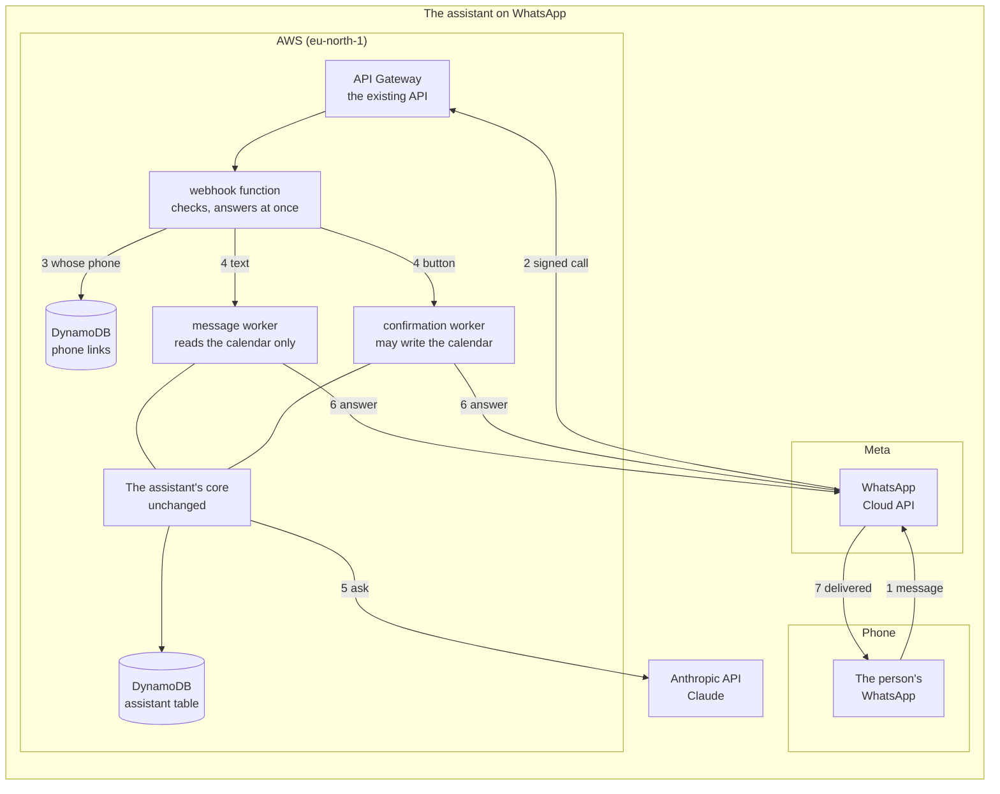
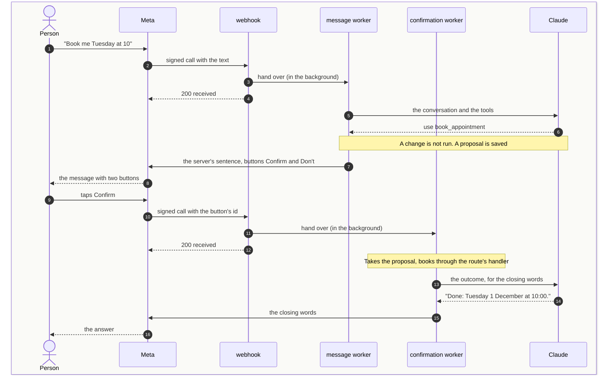

# Shared Calendar: the assistant on WhatsApp (how it can work, and what to do)

| | |
|---|---|
| Status | An explanation, to decide on. Nothing is built, nothing is planned yet |
| Date | 2026-11-24 |
| Brief | `prompts/wa-w00-explain-how-to-integrate-whatsapp.md` |
| Builds on | `docs/CONVERSATIONAL_ARCHITECTURE.md`, above all its section 16, "A second channel later" |
| Would add to the stack | Meta's WhatsApp Business Platform, one small DynamoDB table, three secrets in Parameter Store, three or four functions |

This document explains in simple words how the Administrator and the Users could write to the
assistant from WhatsApp, what it would cost, what is risky, and what to do, in order. It is not
an architecture and not a plan: those come after the decisions of section 11.

The facts about WhatsApp were read on 2026-11-24 in Meta's documentation (the pages are listed
in section 13). Meta changes its prices and rules often: two changes of price in the last two
years. Read them again before anything is built.

---

## 1. The short answer

**It can be done, and the assistant was designed for it.** The assistant's core takes "who is
speaking" and "what they wrote", not a web request, and it keeps the conversation on the server
(`docs/CONVERSATIONAL_ARCHITECTURE.md` section 16). WhatsApp becomes a second door in front of
the same core. No rule of the calendar changes, and the web panel stays as it is.

What a person would see:

1. They link their phone once, from the web pages (section 5).
2. They write to the calendar's WhatsApp number: "which appointments do I have next week?".
   A few seconds later the answer arrives as a normal WhatsApp message.
3. They write "book me Tuesday at ten". The answer is a message with the server's own sentence,
   "Book an appointment on Tuesday 1 December 2026, from 10:00 to 11:00 (Visit).", and two
   buttons under it: **Confirm** and **Don't**. Nothing changes until they tap Confirm, exactly
   as in the panel.

**Three things are new and need care**, and none of them is code:

- **Who is speaking** (section 5). In the web pages a person proves who they are with a
  password. On WhatsApp the server only gets a phone number. The phone becomes a key to the
  account.
- **Meta** (sections 6, 8 and 9). A second outside company after Anthropic, with its own
  account, its own approval steps, its own bill, its own rules about assistants built on
  language models, and a place in the privacy notice.
- **No browser drives the steps** (section 4). Today the panel tells the server "do the next
  step" until the answer is ready. On WhatsApp nobody does, so the server must run the steps by
  itself, in the background.

**Speaking instead of typing** works from the first day through the phone keyboard's
dictation, on WhatsApp as in today's web panel. WhatsApp's voice notes are a separate feature
to build, and I would leave them for later (section 7).

---

## 2. How it works

| # | What happens |
|---|---|
| 1 | The person writes to the calendar's WhatsApp number, or taps a button of a proposal |
| 2 | Meta calls an address of ours, the *webhook*, with the message. The call carries a signature made with a secret only Meta and we know: a call without the right signature is thrown away |
| 3 | The webhook function looks the phone number up in a small table of links: which account is this? An unknown number gets one fixed sentence that says how to link, and Claude is never asked |
| 4 | The webhook function hands the work to a second function that runs in the background, and answers Meta "received" at once. A typed text goes to the message worker; a tapped button goes to the confirmation worker |
| 5 | The worker runs the same steps the panel drives today: ask Claude, run the reads Claude asks for, ask again, until there is a text for the person or a proposal |
| 6 | The worker sends the result to Meta: a text, or a text with the two buttons |
| 7 | Meta delivers it to the person's phone |

**Why a webhook.** WhatsApp has no "log in and ask" like a web page. Meta holds the phone
number; when somebody writes to it, Meta calls us. So our API gets one address that is open to
the internet without a Cognito token. It is protected by Meta's signature instead.

**Why a background function.** Meta wants its call answered quickly, and tries again when it
is not, sometimes delivering the same message twice. An exchange with Claude takes from three
seconds to a minute. So the webhook function only checks and hands over, and remembers the
message's id to ignore a second copy. Section 4 explains this in full.

**Why two workers.** Today's main safety property is that the function which reads free text
and talks to Claude can only *read* the calendar, and only `confirmProposal` can write it
(`docs/CONVERSATIONAL_ARCHITECTURE.md` section 10.1). Two workers keep that property: a typed
message can never reach the function that is able to write.

**What does not change.** The core, the tools, the instructions, the `assistant` table, the
limits (30 messages a day, shared between the panel and WhatsApp), the two languages, the rule
that every change is confirmed with a button, and the rule that a typed "yes" confirms nothing.

---

## 3. A change, step by step

The button carries the id of the proposal, so an old button tapped later finds a proposal that
is gone and gets a fixed sentence, as `404 proposal_not_found` does in the panel.

---

## 4. Why the server must run the steps by itself

### 4.1 What the browser does today

It looks like the panel waits for an answer. In fact the panel drives the work, one step at a
time. The reason is a time limit, combined with the way Claude works
(`docs/CONVERSATIONAL_ARCHITECTURE.md` section 5.1).

1. **One answer takes several rounds with Claude.** Claude cannot see the calendar. For
   "which slots are free next week?" it first replies "I need to read the calendar". The
   server reads it, gives Claude the result, and only then does Claude write the answer. That
   is two rounds; a harder question can take up to eight. A round takes a few seconds,
   sometimes much longer.
2. **A request to our API may last 30 seconds at most.** That is a fixed limit of API Gateway,
   the front door of the API. A request that did all the rounds and ran past 30 seconds would
   be cut off: the person would see an error and nobody would know how far the work had got.
3. **So the work is cut into pieces that always fit.** Each request does exactly one round
   with Claude, saves the result in the table, and answers at once: "working" when there is
   more to do, otherwise the text or a proposal to confirm.
4. **Somebody has to say "next".** When the panel receives "working" it calls again
   (`POST /assistant/continue`) and the server does the next round, until the answer is ready.

This is not polling. Polling is asking "is it ready yet?" while the work happens elsewhere.
Here each call does the next piece of work, and nothing happens between two calls. It gives
three things: no request can run out of time, nothing is lost when a step fails (every round
is saved, and the next call carries on from there), and the person sees a line of progress
("Looking at the calendar…").

### 4.2 What changes on WhatsApp

Meta calls us once per message, wants "received" back quickly, and never calls again to say
"continue". The phone cannot do it either. After round 1 nobody would ask for round 2, and the
person would never get an answer. So the server runs the loop:

1. The webhook function checks the message, starts a second function, and answers Meta
   "received".
2. That second function, the worker, does the rounds one after another until there is an
   answer or a proposal, then sends it to Meta.

The worker is not behind API Gateway, so the 30 seconds do not apply to it. The rounds are the
same code as today: only who says "next" changes.

`docs/CONVERSATIONAL_ARCHITECTURE.md` section 17 turned a background worker down for the
panel, because the `continue` call solved the same problem with less. On WhatsApp there is no
panel to call `continue`, so this time it is needed. What it brings that the project does not
have today:

- **One function starting another** in the background, with a permission for exactly that and
  nothing else.
- **Failures nobody sees.** When the worker stops half-way there is no panel to show an error.
  The worker must send a fixed sentence ("not available, please write again"), and the saved
  conversation must stay in a state from which the next message carries on, as it does today.
- **A difference between local and cloud.** `sam local` does not start one function in the
  background of another, so locally the webhook function would do the rounds itself before
  answering.

---

## 5. Who is speaking: linking a phone to an account

This is the part to think about longest.

**How the link is made** (the idea of `docs/CONVERSATIONAL_ARCHITECTURE.md` section 16):

1. Signed in to the web pages, the person opens "Link WhatsApp". The page shows a short code,
   good for a few minutes, and a link or QR code that opens WhatsApp with the code already
   typed.
2. The person sends the code from their phone.
3. The server finds the code, and stores "this phone number is this account". From then on a
   message from that phone is a message from that account.
4. The page can show the linked number and remove the link.

**What this means in plain words:**

- **Whoever holds the unlocked phone is the account**, with no password, for as long as the
  link lasts. For a User the damage is bounded: their own appointments. **For the
  Administrator it is the whole calendar**: opening hours, types, settings, everybody's
  appointments. Every change still needs the Confirm button, but the person holding the phone
  can tap it.
- At every message the server must check that the account still exists and read its role
  again, since no fresh token says so. A deleted account's link is dead from that moment.
- One phone number links to one account, and one account to one phone number.
- The phone number is personal data the application did not hold before. It must never be
  written to a log in full.

My opinion: let Users link freely; for the Administrator either leave WhatsApp out at first, or
give the link an end (for example 30 days, then link again). It is your decision (section 11).

---

## 6. What WhatsApp imposes

| Rule of Meta | What it means for us |
|---|---|
| **The 24-hour window.** A business may write freely only for 24 hours after the person's last message. Outside it, only message models approved by Meta in advance ("templates") | No trouble: the assistant only ever answers. But **reminders and other messages the calendar would start by itself are a different, larger feature** and are not part of this |
| **Buttons**: three at most, each label 20 characters at most, the text above them 1 024 characters at most | Two buttons are enough, and today's labels fit ("Confirm", "Don't", "Conferma", "Non lo faccia"). A proposal with five changes may be longer than 1 024 characters: then the sentences go in a plain message and the buttons in a short one after it |
| **Anybody in the world can write to the number** | An unknown phone gets the linking sentence at most once a day and never reaches Claude. Without that guard a stranger could spend our free messages |
| **The same message may arrive twice**, and failed calls are tried again for up to 7 days | The webhook function remembers the ids of the messages it has seen |
| **Voice notes, pictures, positions** arrive as other kinds of message | The server answers with one fixed sentence: "I can only read text". For a voice note the sentence also says how to dictate (section 7) |
| **No line of progress.** In the panel "Looking at the calendar…" costs nothing; on WhatsApp every delivered message counts | No progress messages. The person waits a few seconds, as with a person typing |
| **Rules for assistants built on language models.** Since 15 January 2026 Meta's terms bar "AI providers" from offering general-purpose assistants on WhatsApp | A business's own assistant for its own service is the case the reports describe as still allowed, and ours refuses anything that is not about the calendar. **Meta's page does not say this in so many words: read the terms themselves before starting** |

---

## 7. Speaking instead of typing

There are two ways to speak to the assistant. They look alike on the screen and send different
things.

| | Dictation | Voice note |
|---|---|---|
| How | Tap the message field so the keyboard opens, tap the microphone **on the keyboard** (on an iPhone at its bottom right, on Android usually in its top row), speak, read the words, send | Press and hold the microphone **of WhatsApp**, at the right of the message field, speak, lift the finger |
| What is sent | Text | A recording of the voice |
| Who turns speech into text | The phone, before sending | Nobody. For the assistant, our server would have to |
| Can it be checked before it goes | Yes: the words are there to read and fix | No, only listened to again |
| What we must build | Nothing: it is a normal message | The work described below |

**Dictation works today, and not only on WhatsApp.** It belongs to the device's keyboard, not
to the application. The web panel's message field is an ordinary text field, so a person can
already dictate there: with the keyboard's microphone on a phone or tablet, with the system's
dictation on a Mac, with the Windows key and H on Windows. I did not try it on the panel
myself. In the browser there is only one microphone, so nobody sends a voice note by mistake.

**A voice note is a feature to build.** Meta does not send us the words: it sends a notice
that an audio file exists. As far as I know Claude's API takes no audio (I found no audio
input in Anthropic's documentation), so the server would have to download the file from Meta,
turn it into text with a speech-to-text service, and hand the text to the assistant as if it
had been typed. Amazon Transcribe is the natural choice: it runs in `eu-north-1`, knows
Italian and English, and keeps the audio inside AWS. I did not check that it takes WhatsApp's
audio format as it is. What voice notes would add:

- **A new AWS service and a storage bucket.** Transcribe reads the file from S3, so the audio
  is kept there for a short time and then deleted. A small cost per second of audio, no longer
  zero.
- **More waiting**: some seconds to transcribe before the assistant even starts.
- **Mistakes in what was heard.** "Tuesday at ten" may become "Thursday at two". The Confirm
  button already protects every change, since the person reads the server's sentence before
  tapping. For a question, the answer should begin by repeating what was understood.
- **A limit on length**, in seconds, as a typed message has its 2 000 characters.
- **More weight on privacy**: a recording of a voice is more personal than text, and one more
  service processes it (section 8).
- **A harder local stack**: a fake transcriber beside the fake Claude and the fake Meta.

A real phone call to the number is a different and much larger thing, and is left out.

My opinion: start with text only. The two microphones sit a centimetre apart and people will
mix them up, so the fixed sentence for a voice note says which one to use: "I can only read
text: you can dictate with the microphone on your keyboard". Voice notes can follow later as a
step of their own, if people ask for them.

---

## 8. Privacy and the GDPR

I am not a lawyer: this is a map of what to check, not advice.

**Whether the GDPR applies at all.** A calendar used purely within a family or a household is
outside it. A calendar for the clients of a practice or a business is inside it, and already
is today, with the web pages and with Anthropic. WhatsApp adds no new kind of duty: it
stretches the ones that exist.

| What WhatsApp adds | What to do about it |
|---|---|
| **A new piece of personal data**: the phone number. Meta's call also carries the person's WhatsApp profile name | Store the number and the account it links to, nothing else. Never store the profile name. Never write the number to a log in full |
| **A new company that receives the data**: Meta, beside Anthropic. Every message and every answer passes through Meta's servers in clear | Meta's data processing terms must be in place for the account. I did not read which terms cover the Cloud API, nor where Meta processes the data |
| **Probably a transfer outside the EU**, as with Anthropic | Name it in the privacy notice |
| **The privacy notice** | It gains the phone number, Meta as a recipient, the purpose, and how long a link is kept. The page "Link WhatsApp" says it too, as the panel says it for Anthropic |
| **The right to be deleted** | Removing the link deletes the number, and so does deleting the account. Our stored conversation is gone within two days. The chat stays on the person's phone, and for some time at Meta, where we cannot delete it |
| **Security of access** | "The phone is a key with no password" (section 5) is also a matter of the GDPR: the protection must be defensible. One more reason to keep the Administrator out, or to give the link an end |
| **Sensitive data.** If the appointments or their notes can reveal something about a person's health (a doctor's or a therapist's calendar) | Sending them through Meta weighs much more, and a written assessment of the risks may be required. **This is the point to check with someone qualified** |

Two things help. Linking is each person's own choice, and nobody loses anything by not
linking: every function stays in the web pages. And the assistant only answers: there are no
reminders and no marketing, which would need a consent of their own.

---

## 9. What it costs

| Who | What | How much |
|---|---|---|
| **Meta** | Since 1 October 2026 every message we send is charged, replies included. Each business phone number has **1 000 delivered messages a month free**; from the 1 001st the country's rate applies, and a payment method must be on file or the messages stop | Expected use (10 people, about 20 exchanges each a month, one to three messages per exchange): 300 to 600 messages, **free**. The ceiling the daily limit allows (10 people, 30 messages every day) is about 9 000 to 20 000 messages: some tens of euro, to work out from Meta's rate card for Italy, which I did not read |
| **Anthropic** | The same as in the panel: an exchange costs what it costs today (`docs/CONVERSATIONAL_ARCHITECTURE.md` section 14) | Nothing new per exchange. People may simply use it more, because it is closer to hand. The monthly spending limit in the Anthropic Console still holds whatever happens |
| **AWS** | Three or four small functions, one small table, three standard parameters | About 0 €, as today |
| **A phone number** | A number that is not in use on WhatsApp already, able to receive one SMS or call | A SIM or a virtual number |

Voice notes, if they are built one day (section 7), add Amazon Transcribe's price per second of
audio and a little storage. Dictation costs nothing.

---

## 10. What is hard, honestly

1. **Meta's paperwork, not the code.** A Meta business account, an app, a phone number, a
   display name Meta approves, a payment method, and possibly the verification of the business
   with documents. I could not confirm today whether a private person without a registered
   business can take a real number live: **this is the first thing to find out**, and it costs
   nothing to try (section 12, step 1).
2. **Dependence on Meta.** Prices changed in July 2025 and again in October 2026; the rule on
   assistants arrived in January 2026. A feature on WhatsApp lives by rules that can change in
   a few weeks. The web panel must stay complete, so that WhatsApp is always an extra.
3. **Testing locally.** The project's rule is that everything runs on the local stack. Meta
   would be played by a small fake in Docker, as Claude is today. The background hand-over is
   the awkward part (section 4.2): locally the webhook function would do the work itself
   before answering. That is one small difference between local and cloud, and the
   architecture must say it plainly.
4. **Privacy.** A message now passes through Meta and then Anthropic, and the phone number is
   new personal data. How much this weighs depends on what the calendar is for (section 8).
5. **The size of the work.** Smaller than the assistant was: I estimate six to eight plan
   steps. The core is not touched.

**An alternative I do not recommend**: AWS has a service, "AWS End User Messaging Social", that
stands between Meta and us and hands the messages to a function. It removes the signature
check and puts Meta's bill on the AWS invoice. But it adds an AWS service and a fee per
message, the local stack cannot run it, the Meta account and its approvals are needed all the
same, and I did not confirm that it exists in `eu-north-1`. Meta's API called directly is one
HTTPS request and one signature: simpler, and it fits the project's rule of no service the
design does not need.

---

## 11. What you must decide

| # | Question | My recommendation |
|---|---|---|
| 1 | **Is it worth it?** For about ten people, against a new outside company and a weaker proof of identity | Do step 1 of section 12 first: an evening, free, nothing to undo. Decide after it |
| 2 | **May the Administrator use it**, or only the Users? | Users first. The Administrator later, with a link that ends |
| 3 | **Does a link end by itself?** | Users: no, until they remove it or the account is deleted. Administrator: yes |
| 4 | **One conversation or two?** Today a person has one conversation. The same one on the panel and on WhatsApp, or one each? | The same one: nothing changes in the core or the table, and the instructions already fit both. The answer goes where the message came from |
| 5 | **Reminders** ("your appointment is tomorrow")? | Not now. Templates, Meta's approval of each, another price, and a scheduler: a feature of its own |
| 6 | **What may be done on WhatsApp?** | Everything the assistant does today. What stays in the web pages only stays there (`docs/CONVERSATIONAL_ARCHITECTURE.md` section 3.1) |
| 7 | **Voice notes?** (section 7) | Not now: text only, with dictation, and a fixed sentence that says how to dictate. Later as a step of their own, if people ask |
| 8 | **What is the calendar for?** A family, or the clients of a practice or business? Can an appointment or its note reveal something about a person's health? (section 8) | This is a fact only you know, and it decides how much the GDPR part weighs. If health is involved, ask someone qualified before step 3 of section 12 |

---

## 12. What to do, step by step

**Step 1. Try Meta by hand, before any document or code** (you; one evening; free).

1. Create a Meta developer account and a business portfolio at `developers.facebook.com`.
2. Create an app with the use case "Connect with customers through WhatsApp". Meta gives a
   test phone number and a temporary token.
3. Add your own phone to the test number's list of recipients, send the test message from
   Meta's page, answer it from your phone.
4. Look at what Meta asks to go live with a real number: the business verification, the
   display name, the payment method. Write down what you could not do as a private person.
5. Read Meta's terms on "AI providers", the pricing page (section 13) and Meta's data
   processing terms for the WhatsApp Business Platform (section 8).

Then tell me what you found. If the paperwork is a wall, we stop here and nothing is lost.

**Step 2. Decide** the eight questions of section 11.

**Step 3. The architecture and the plan** (a brief for me; no code). A document
`docs/WHATSAPP_ARCHITECTURE.md` in the manner of `docs/CONVERSATIONAL_ARCHITECTURE.md`, and a
plan `docs/WHATSAPP_PLAN.md` with one acceptance check per step. You review both.

**Step 4. Build, one plan step at a time**, each reviewed. The likely order:

1. The contract in `shared/`: the new codes, the fixed sentences in both languages (how to
   link, "only text" with how to dictate, "this button is no longer valid", "not available,
   please write again").
2. The table of links and the linking: the routes, the page "Link WhatsApp", the removal.
3. The module that talks to Meta in `backend/src/lib`, the three secrets in Parameter Store
   (Meta's token, the signing secret, the webhook's check word), the fake Meta in Docker.
4. The webhook: the signature, the copies, the unknown numbers.
5. The two workers on the existing core, and the proposal as a message with buttons.
6. The journeys against the fake Meta, and their pages in `docs/journeys/`.
7. A trial with the real model and Meta's test number, from your own phone.

**Step 5. Go live** (you, with the runbook's steps): the real number registered and its
display name approved, the payment method, the permanent token and the secrets set by a script,
the privacy notice brought in line (section 8), the stack deployed, the webhook's address given
to Meta, the smoke test's exchange, a spending alert on Meta's side.

---

## 13. Sources

Read on 2026-11-24.

- Meta, "WhatsApp Cloud API Get Started":
  `https://developers.facebook.com/documentation/business-messaging/whatsapp/get-started`
- Meta, "Pricing on the WhatsApp Business Platform" and "Pricing for non-template messages"
  (the charge since 1 October 2026 and the 1 000 free messages):
  `https://developers.facebook.com/documentation/business-messaging/whatsapp/pricing` and
  `https://developers.facebook.com/documentation/business-messaging/whatsapp/pricing/non-template-messages`
- Meta, the page on "AI providers":
  `https://developers.facebook.com/documentation/business-messaging/whatsapp/pricing/ai-providers`
- Meta, the webhooks' overview (the signature, the repeated calls, the copies):
  `https://developers.facebook.com/documentation/business-messaging/whatsapp/webhooks/overview`
- Meta, "Interactive reply buttons messages" (three buttons, 20 and 1 024 characters):
  `https://developers.facebook.com/documentation/business-messaging/whatsapp/messages/interactive-reply-buttons-messages`
- TechCrunch, 18 October 2025, on the terms that bar general-purpose assistants:
  `https://techcrunch.com/2025/10/18/whatssapp-changes-its-terms-to-bar-general-purpose-chatbots-from-its-platform/`
- AWS, "What is AWS End User Messaging Social?":
  `https://docs.aws.amazon.com/social-messaging/latest/userguide/what-is-service.html`
- AWS, the availability of Amazon Transcribe's `StartTranscriptionJob` in `eu-north-1`, and
  its languages (Italian among them).
- This repository: `docs/CONVERSATIONAL_ARCHITECTURE.md` sections 5.1, 10, 16 and 17, and the
  panel's message field in `frontend/src/views/assistant.view.ts`.

Not confirmed, and marked so in the text: whether a private person can take a real number
live; Meta's rate for Italy; whether a business's own assistant is outside the rule on "AI
providers" in Meta's own words; whether AWS End User Messaging Social exists in `eu-north-1`;
which of Meta's data processing terms cover the Cloud API and where Meta processes the data;
that Claude's API takes no audio; that Amazon Transcribe takes WhatsApp's audio format as it
is; dictation tried on the web panel. Section 8 is not legal advice.
