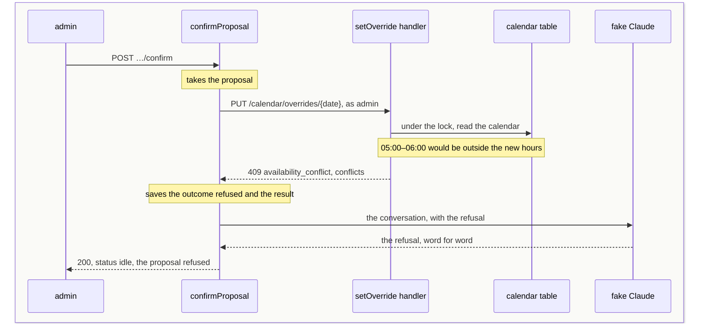

# The "a block over an appointment is refused by the calendar (3, 5.4, 8.3)" journey, in simple words

| | |
|---|---|
| Test file | `backend/tests/integration/assistant.test.ts` |
| `describe` | `a block over an appointment is refused by the calendar (3, 5.4, 8.3)` |
| Tests | 1. "the block is proposed all the same: the server looks for no appointment before the confirmation" 2. "confirm: the calendar refuses, the proposal is shown as refused with the code, and Claude is told which appointment is in the way, whose it is and when" 3. "the calendar's own route shows the day as it was, from its pattern, and the appointment still booked" |
| Runs against | the local stack: the API on port 3000 (`sam local`), cognito-local on port 9229, DynamoDB Local on `DYNAMODB_PORT`, the fake Claude on port 9230 (`RUN_INTEGRATION=1`) |

Ideas used here, explained once for all journeys:
[one local calendar, shared](../concepts.md#one-local-calendar-shared),
[the deleted-user marker](../concepts.md#the-deleted-user-marker),
[why a pointer item](../concepts.md#why-a-pointer-item),
[the calendar lock](../concepts.md#the-calendar-lock),
[the event log](../concepts.md#the-event-log),
[the settings](../concepts.md#the-settings),
[availability types](../concepts.md#availability-types),
[where a window comes from](../concepts.md#where-a-window-comes-from),
[windows and slots](../concepts.md#windows-and-slots),
[booked appointments keep their window](../concepts.md#booked-appointments-keep-their-window),
[the life of an appointment](../concepts.md#the-life-of-an-appointment),
[the assistant in the journeys](../concepts.md#the-assistant-in-the-journeys),
[the fake Claude](../concepts.md#the-fake-claude),
[the language of a conversation](../concepts.md#the-language-of-a-conversation),
[steps, `continue` and the tools](../concepts.md#steps-continue-and-the-tools),
[a proposal, and its two buttons](../concepts.md#a-proposal-and-its-two-buttons),
[the Administrator's tools](../concepts.md#the-administrators-tools),
[the opening hours through the assistant](../concepts.md#the-opening-hours-through-the-assistant),
[the Administrator's conversation in the journeys](../concepts.md#the-administrators-conversation-in-the-journeys),
[the `assistant` table](../concepts.md#the-assistant-table),
[the daily limit](../concepts.md#the-daily-limit).

## What this block proves

- The assistant does not weaken the calendar's rule that a booked appointment keeps its
  window (`docs/SHARED_CALENDAR_SPEC.md` R-AV-03). Asked to block an hour somebody booked, the
  server proposes the change all the same; the route refuses it at the confirmation, as it
  does from the web page (`docs/CONVERSATIONAL_ARCHITECTURE.md` section 3).
- Confirming skips no check: the code of `PUT /calendar/overrides/{date}` runs every check of
  its route at that moment, and a refusal is the change's outcome, shown on the proposal with
  the route's error code (`docs/CONVERSATIONAL_ARCHITECTURE.md` section 5.4, and section 5.5,
  rule 3).
- The refusal is a result Claude reads, with the appointments in the way in local dates and
  times (`docs/CONVERSATIONAL_ARCHITECTURE.md` section 8.3), so that it can tell the
  Administrator which one and whose.

## Who takes part

- **The Administrator** (`admin`): the person of this block, the one who talks to the
  assistant and confirms. It also creates `chat-in-the-way`, prepares and removes the piece
  of calendar the block works on, and reads the day through the calendar's own route. It is
  the seeded account, the same at every run.
- **`chat-in-the-way`**: a throw-away User. They never talk to the assistant: they book the
  hour from 05:00 through the calendar's own route, and read their own appointments.
- **The fake Claude**: for the block's sentence it asks, one step after the other, for
  `get_calendar` on the day, for `list_types`, and for `set_date_override` on the day with the
  hours 04:00–05:00 and 06:00–07:00, which leave 05:00–06:00 out; then it answers with the
  last result of a tool it was given, word for word. The type's name is written in its
  script, where it stands for the type's id (`{{id:types:assistant blocked journey}}`): the
  block must give its type that name.

## Before the block starts

The file's `beforeAll` signs in `admin` and removes what an interrupted run of any block that
uses the calendar left, today or on a day still to come (`removeFromCalendar()` for each name
of `JOURNEY_TYPES`). The block's `beforeAll`:

1. works out **the day** (`saturdayOfJourney(19)`): the first Saturday on or after the date 19
   days after today's date in the calendar's time zone, which it reads from the settings as
   `admin`. So the day is 19 to 25 days ahead, the Saturday after the one of the blocking
   journey. It is the day the fake asks about: its script names it `{{saturday+19}}`, counted
   from the date the server tells Claude at the message of test 1. The two agree unless local
   midnight falls between the `beforeAll` and test 1;
2. creates `chat-in-the-way` again and signs it in (`newUser()`);
3. removes again what its own earlier run may have left (`removeFromCalendar()`), on every day
   from today to 28 days ahead: under the type name `assistant blocked journey` it cancels
   the booked appointments, deletes the hours of its own of each day that hold the type, the
   weekly patterns of the type and its one-off windows, then the types of that name;
4. creates the type `assistant blocked journey` and a weekly pattern of it, 04:00–07:00, on
   the weekday of the day, valid from the day to the day (`openPattern()`), and checks `201`
   for both;
5. books, as `chat-in-the-way` and through `POST /calendar/appointments`, the second of the
   day's free slots of the type (`bookSlots()`), checks `201` and keeps the appointment's id.
   The slots of the type are 04:00, 05:00 and 06:00, so the appointment is 05:00–06:00;
6. builds the sentence the proposal must show (`summary`), with the same function of `shared/`
   the server uses (`assistantTexts('en').changes.setDateOverride`): the day; as it is now,
   every window the day has that is not an extra window (`hoursOfDay()`); as it would become,
   04:00–05:00 and 06:00–07:00 of the type; and the day's extra windows, if it has any;
7. starts the Administrator's count of the day again (`forgetDailyUse()`) and ends their
   conversation (`DELETE /assistant/conversation`, checked `204`).

| The day, 04:00–07:00 from the weekly pattern | |
|---|---|
| 04:00 | free |
| 05:00 | `chat-in-the-way`, booked by themself |
| 06:00 | free |

The Administrator has no conversation and all of the day's messages. The `calendar` table is
not emptied. Why the day is a Saturday and its hours come from a pattern is told in
[the opening hours through the assistant](../concepts.md#the-opening-hours-through-the-assistant).

## Test 1: the block is proposed all the same

`admin` sends `fake: block an hour that somebody booked`, and the test calls
`POST /assistant/continue` for as long as the reply is `working` (`sayAndRead()`).

1. **`POST /assistant/messages`.** There is no conversation, so the server asks the language:
   English. The fake asks for `get_calendar` on the day; the server runs the read, as `admin`.
   The reply is `working`.
2. **`POST /assistant/continue`.** The fake asks for `list_types`; the server runs it. The
   reply is `working` again.
3. **`POST /assistant/continue`.** The fake asks for `set_date_override`: the day, with
   04:00–05:00 and 06:00–07:00 under the id of the block's type. The server reads the day and
   the types, as `admin`, and words the proposal from them. It does not look for appointments
   the new hours would leave outside them: that is the route's to find, under the calendar
   lock, when the person confirms.

The test checks:

- each `working` reply has `proposal` `null`, and there are two of them (`reads` is 2);
- the last reply is `200`, with `status` `awaiting_confirmation` and `remainingToday` equal to
  `LIMIT` − 1;
- the proposal (`proposalOf()`): a `proposalId` that is a ULID, `question` "Make this change?",
  `confirmLabel` "Confirm", `declineLabel` "Don't", and one action whose `outcome` and `error`
  are `null` and whose `summary` is the sentence built in the `beforeAll`.

The result of the read of step 1 did hold the appointment: the Administrator's `get_calendar`
lists everybody's. A model that reads it can warn the person; the fake asks for the block
whatever it was given, which is what puts the server to the test. The test keeps the
`proposalId`.

## Test 2: confirm, and the calendar refuses

`admin` calls `POST /assistant/proposals/{proposalId}/confirm` with the id of test 1.

1. The server takes the proposal, so no other request can run it.
2. It calls the code of `PUT /calendar/overrides/{date}` with the stored body, as `admin`. The
   route works out the day as it would be with the new hours: the appointment 05:00–06:00
   would lie in no window. It answers `409 availability_conflict` with the appointment in
   `conflicts`, and writes nothing.
3. The server saves the outcome `refused` with the route's code, and the result Claude will
   read, marked as an error: the route's code and message, and each appointment in the way as
   its id, its username, its local date and its times (`refusalForModel()`). Then it asks
   Claude for the closing words. The fake answers with that result as its text.

The test checks:

- `200`, `status` `idle`: a refused change is an answer, not a failure of the request;
- the same proposal, same id, same summary, its action now with `outcome` `refused` and
  `error` `availability_conflict`;
- the text of the first message of the reply is JSON equal to exactly: `error`
  `availability_conflict`, `message` "1 appointment would fall outside the availability", and
  `conflicts` with one item, `{ id: <the appointment's id>, username: "chat-in-the-way", date:
  <the day>, start: "05:00", end: "06:00" }`.

So Claude is told which appointment is in the way, whose it is and when, in the calendar's
local time, where the route answered instants. The list `conflicts` is one only the
Administrator ever sees, and only the Administrator can cause this refusal.

## Test 3: the calendar's own route

`admin` reads the day with `GET /calendar` (`hoursOfDay()`). The test checks that the day has
`hasOverride` `false` and that its hours still hold 04:00–07:00 of the type, from a pattern.
Then `chat-in-the-way` lists their appointments with `GET /calendar/appointments?upcoming=true`
(`appointmentsOf()`): the server lists a User's own booked appointments that have not ended,
by the `sub` of the token, and `chat-in-the-way` is a new account. The test checks exactly
one, with the id kept in the `beforeAll` and `status` `booked`. Nothing was changed.

## What the block leaves

The `afterAll` ends the Administrator's conversation, cancels the appointment as `admin`,
deletes the pattern and the type (`removeFromCalendar()`), checks that no weekly pattern of
the block's type is left and that the day has `hasOverride` `false`
(`expectHoursAsBefore()`), then removes `chat-in-the-way` from cognito-local.

| In the `calendar` table | State |
|---|---|
| the appointment of `chat-in-the-way`, the day, 05:00–06:00 | `cancelled`, booked by `chat-in-the-way`, cancelled by `admin`; its pointer item too |
| events | one for the booking, one for the cancellation |
| the pattern and the type | deleted for good |
| hours of its own on the day | none: the route refused them |

The pattern can be deleted because the appointment is cancelled first: a cancelled
appointment needs no window. In the `assistant` table the Administrator's items stay: the
`META` with `conversationId` `null` (the conversation is ended), the entries of the ended
conversation beside those of the Administrator's earlier conversations, and one item of daily
use with `messages` 1, which stays until a block next calls `forgetDailyUse()`.
`chat-in-the-way` has no item there: they never talked to the assistant.

## If the block fails halfway

- The `beforeAll` fails, and every test with it, when `chat-in-the-way` cannot book: the day
  is 19 to 25 days ahead, so a booking horizon shorter than that or a minimum notice longer
  than that, left in the settings by somebody else, stands in the way. The calendar's
  journeys leave bookings open 30 days ahead.
- The tests build on one another: test 2 needs the `proposalId` of test 1. Test 3 holds
  whenever nothing was changed, so also when test 1 or test 2 failed without a change.
- Test 2 fails when the route does not refuse: then the day has hours of its own and the
  appointment lies outside them. The `afterAll` still clears up, in the order that works:
  the appointment cancelled, the day's own hours deleted, then the pattern and the type.
- Test 2 also fails when the route lists more than one appointment: for example when other
  weekly patterns open hours on that Saturday (the front end's `seed:local` creates one) and
  somebody booked in them, since the new hours would close those too.
- If the run is stopped before the `afterAll`, the next run removes the appointment, the
  pattern and the type first, in the file's `beforeAll` and again in the block's:
  `removeFromCalendar()` looks for the appointments on every day from today to 28 days
  ahead, and finds the pattern and the type by the type's name. An appointment left on a day
  that has since passed is not looked at. The next run also ends the
  Administrator's conversation before it starts.
- `chat-in-the-way` is removed with `removeUserIfPresent()`, straight in cognito-local: no
  deleted-user marker is written and nothing is cancelled by it. The cancellation is the
  Administrator's, in `removeFromCalendar()`, which runs first.

## Where in the code

| What | Where |
|---|---|
| The routes | `POST /assistant/messages`: `backend/src/handlers/sendAssistantMessage.ts`; `POST /assistant/continue`: `backend/src/handlers/continueAssistant.ts`; `POST /assistant/proposals/{proposalId}/confirm`: `backend/src/handlers/confirmProposal.ts`; `DELETE /assistant/conversation`: `backend/src/handlers/endConversation.ts` |
| The proposal made | `runStep()` in `backend/src/assistant/exchange.ts`, with `asksForChange()` and `proposeChange()` of `backend/src/assistant/tools/run.ts` |
| The tool | `backend/src/assistant/tools/setDateOverride.ts`: its opening comment says what is left to the route at the confirmation |
| The facts | `presentDay()`, `presentTypes()` and `hoursOf()` in `backend/src/assistant/tools/facts.ts` |
| The summary | `changes.setDateOverride` in `shared/src/assistant/texts.en.ts` |
| The confirmation | `confirmProposal()` in `backend/src/assistant/confirm.ts`; the handler of the change, `set_date_override` in `CHANGE_HANDLERS`, `backend/src/assistant/tools/changeHandlers.ts` |
| What Claude is told | `refusalForModel()` in `backend/src/assistant/tools/result.ts`, after `refusalOf()` of `backend/src/assistant/tools/run.ts` |
| The calendar's rule | `backend/src/handlers/setOverride.ts`, with `checkAvailabilityWrite()` in `backend/src/lib/calendarRules.ts` and `setOverride()` in `backend/src/lib/calendarDb.ts` |
| The calendar's routes | `backend/src/handlers/getCalendar.ts`, `backend/src/handlers/listAvailabilityTypes.ts` and `backend/src/handlers/setOverride.ts`, called inside the assistant's functions; `GET /calendar` and `GET /calendar/appointments` (`backend/src/handlers/listAppointments.ts`) by the test |
| The fake's answers | the sentence, `tool-get-calendar-saturday19`, `tool-list-types`, `tool-override-saturday19-block-0500` and `text-last-tool-result` in `backend/tests/integration/fake-claude/answers.json`; the marks `{{saturday+N}}` and `{{id:LIST:NAME}}` in `backend/docker/fake-claude.mjs` |
| Creating the User | `POST /users`, as `admin` (`newUser()`) |
| Preparing the calendar | as `admin`: `POST /calendar/types`, `POST /calendar/patterns`, `POST /calendar/appointments/{appointmentId}/cancel`, `DELETE /calendar/patterns/{patternId}`, `DELETE /calendar/types/{typeId}`, `GET /calendar`, `GET /calendar/types`, `GET /calendar/patterns`, `GET /calendar/appointments`, `GET /calendar/settings`; as `chat-in-the-way`: `GET /calendar`, `POST /calendar/appointments` (`bookSlots()`) |
| Test helpers | in the file: `newUser()`, `sayAndRead()`, `say()`, `goOn()`, `confirm()`, `startAgain()`, `appointmentsOf()`, `proposalOf()`, `bookSlots()`, `saturdayOfJourney()`, `dayOfJourney()`, `openPattern()`, `hoursOfDay()`, `dayOfCalendar()`, `expectHoursAsBefore()`, `removeFromCalendar()`; in `backend/tests/integration/setup.ts`: `api()`, `signIn()`, `removeUserIfPresent()`, `forgetDailyUse()`, `subOf()`, `localDailyMessageLimit()`; from `shared/`: `addDays()`, `localDateOf()`, `localTimeOf()`, `weekdayOf()`, `assistantTexts()` |
| Constants | the block's `TYPE`, `ASK` and `USER`; `JOURNEY_TYPES`, `LIMIT` |
