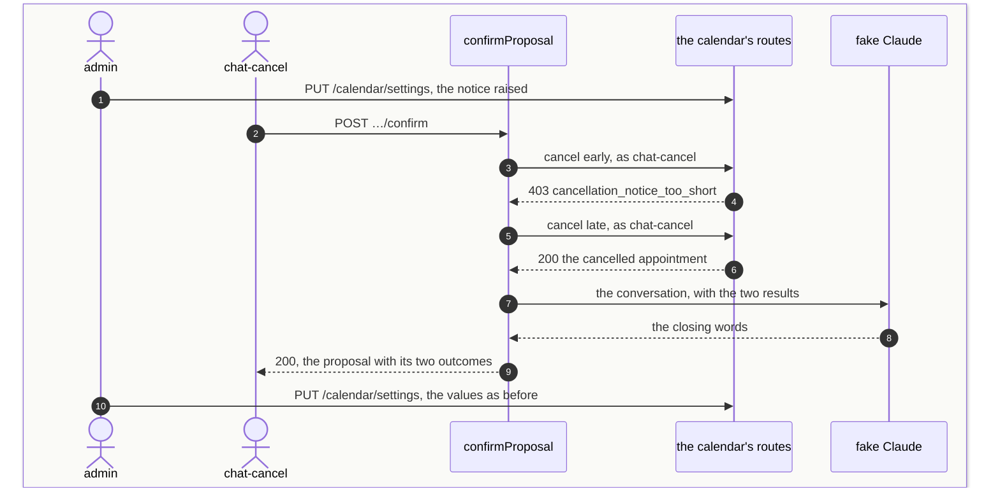

# The "two cancellations in one proposal (5.4, 5.5 rule 4)" journey, in simple words

| | |
|---|---|
| Test file | `backend/tests/integration/assistant.test.ts` |
| `describe` | `two cancellations in one proposal (5.4, 5.5 rule 4)` |
| Tests | 1. "\"cancel both\": Claude asks for two changes in one answer, and one proposal holds both, each in its own sentence" 2. "confirmed while the first is inside the notice for cancelling: the calendar refuses that one and cancels the other, and each line of the proposal has its own outcome" 3. "Claude is given one result for each change, in the order it asked: the refusal with its code, and the cancelled appointment" 4. "the calendar's own route shows the first appointment still booked and the second cancelled" |
| Runs against | the local stack: the API on port 3000 (`sam local`), cognito-local on port 9229, DynamoDB Local on `DYNAMODB_PORT`, the fake Claude on port 9230 (`RUN_INTEGRATION=1`) |

Ideas used here, explained once for all journeys:
[one local calendar, shared](../concepts.md#one-local-calendar-shared),
[the `calendar` table and its items](../concepts.md#the-calendar-table-and-its-items),
[the deleted-user marker](../concepts.md#the-deleted-user-marker),
[the event log](../concepts.md#the-event-log),
[the settings](../concepts.md#the-settings),
[availability types](../concepts.md#availability-types),
[where a window comes from](../concepts.md#where-a-window-comes-from),
[windows and slots](../concepts.md#windows-and-slots),
[the life of an appointment](../concepts.md#the-life-of-an-appointment),
[the assistant in the journeys](../concepts.md#the-assistant-in-the-journeys),
[the fake Claude](../concepts.md#the-fake-claude),
[the language of a conversation](../concepts.md#the-language-of-a-conversation),
[the line of the application, and the gaps in `seq`](../concepts.md#the-line-of-the-application-and-the-gaps-in-seq),
[steps, `continue` and the tools](../concepts.md#steps-continue-and-the-tools),
[a proposal, and its two buttons](../concepts.md#a-proposal-and-its-two-buttons),
[the `assistant` table](../concepts.md#the-assistant-table),
[the daily limit](../concepts.md#the-daily-limit).

## What this block proves

- Two changes Claude asks for in one answer make one proposal, listed one by one and confirmed
  together (`docs/CONVERSATIONAL_ARCHITECTURE.md` section 5.5, rule 4).
- At the confirmation the changes are run in order, each with its own outcome: one refused does
  not stop the other (`docs/CONVERSATIONAL_ARCHITECTURE.md` section 5.5, rule 4, and section
  5.4, "Confirming" and "The outcome of a change").
- The notice for cancelling is not checked when the proposal is made. The calendar's route
  checks it at the confirmation, and a cancellation inside the notice is shown as refused, with
  the route's code `cancellation_notice_too_short` (`docs/CONVERSATIONAL_ARCHITECTURE.md`
  section 5.4, "What is not checked at the proposal"; `docs/SHARED_CALENDAR_SPEC.md` R-CAN-03).
- Claude learns an appointment's id from the list it reads, as the tool's description tells
  it (`backend/src/assistant/tools/cancelAppointment.ts`), and asks for the change by that id
  and nothing else (`docs/CONVERSATIONAL_ARCHITECTURE.md` section 8.2, `cancel_appointment`).

## Who takes part

- **`chat-cancel`**: a throw-away User, the person of this block. They book two appointments
  through the calendar's own route, then ask the assistant to cancel both.
- **The Administrator** (`admin`): creates `chat-cancel`, prepares and removes the piece of
  calendar the block uses, and in test 2 changes one setting of the calendar and puts it back.
- **The fake Claude**: for the block's sentence it answers three times. First it asks for the
  tool `list_appointments`, for the one day `{{date+24}}`. Then it asks, in one answer, for
  `cancel_appointment` twice: with `{{appointment-id-1}}` and with `{{appointment-id-2}}`, the
  ids of the first and second appointment of the list it was just given. Last, it answers with
  the last result of a tool it was given, word for word.

## Before the block starts

The file's `beforeAll` signs in `admin` and removes what an interrupted run of any block that
uses the calendar left on a day still to come (`removeFromCalendar()` for each name of
`JOURNEY_TYPES`). The block's `beforeAll`:

1. works out **the day** (`dayOfJourney(24)`): 24 days after today's date in the calendar's time
   zone, which it reads from the settings as `admin`. It is the day the fake asks the list of:
   its script names it `{{date+24}}`, counted from the date the server tells Claude at the
   message of test 1. The two agree unless local midnight falls between the `beforeAll` and
   test 1;
2. creates `chat-cancel` again and signs it in (`newUser()`);
3. removes again what its own earlier run may have left (`removeFromCalendar()`), on every day
   from tomorrow to 28 days ahead: it cancels the booked appointments whose type is named
   `assistant cancelling journey`, deletes the one-off windows of that type, then the types of
   that name;
4. creates the type `assistant cancelling journey` and, on the day, a one-off window 04:00–07:00
   of that type (`openWindow()`), and checks `201` for both;
5. books two appointments as `chat-cancel`, through `POST /calendar/appointments`, without the
   assistant (`bookSlots()` with the places 0 and 2). The helper reads the day through
   `GET /calendar` as `chat-cancel`, keeps the free slots of the block's type in order of time,
   and books the first and the third. It checks `201` for each.

The window gives the day three slots of one hour. After the `beforeAll`:

| Slot | State | The test's name for it |
|---|---|---|
| 04:00–05:00 | booked by `chat-cancel` | `early` |
| 05:00–06:00 | free | |
| 06:00–07:00 | booked by `chat-cancel` | `late` |

The second appointment starts two hours after the first. Test 2 depends on that gap. The
`calendar` table is not emptied: the day may hold other things, and the block looks only at its
own.

## Test 1: "cancel both"

`chat-cancel` sends `fake: cancel both my appointments of the cancelling journey`. The exchange
takes two requests (`askForChange()`).

1. `POST /assistant/messages`. There is no conversation yet, so the server asks the language:
   English. Then it asks Claude for the step. The fake asks for `list_appointments` for the day.
   The server runs the read as `chat-cancel` and saves the result: the two appointments, each
   with its id.
2. `POST /assistant/continue`. The server asks Claude again. The fake answers with two requests
   for `cancel_appointment`, with the ids of the first and the second appointment of that list.
3. The server cancels nothing. For each request it looks for the id among the appointments of
   `chat-cancel` that have not ended, through the code of `GET /calendar/appointments`
   (`appointmentById()`), and words the cancellation from what it finds. The two requests ask
   that route the same thing, so its code is called once for both. Both can be proposed, so the
   server saves Claude's answer and one proposal with the two changes, in one write.

The test checks:

- for the first request: `200`, `status` `working`, `activity` "Looking at the appointments…"
  and `proposal` `null` (inside `askForChange()`);
- for the second: `200`, `status` `awaiting_confirmation`, `remainingToday` equal to
  `LIMIT` − 1, and the proposal (`proposalOf()`): a `proposalId` that is a ULID, `confirmLabel`
  "Confirm", `declineLabel` "Don't", and two actions, in the order 04:00 then 06:00, each with
  `outcome` and `error` `null`. Each `summary` is the sentence the shared texts make for a
  cancellation of that day, 04:00 to 05:00 or 06:00 to 07:00, of the type
  `assistant cancelling journey`, with no username: a User's proposal is about their own
  appointments. The test builds the expected sentences with the same function of `shared/` the
  server uses (`assistantTexts('en').changes.cancelAppointment`), so it checks the facts in
  them, not their wording;
- the `question` is "Make these 2 changes?";
- `chat-cancel` still has two booked appointments (`appointmentsOf()`).

In the table, the test checks that the fifth entry of the conversation (`storedEntries()`) is
one answer of Claude. The four before it are the person's message, the line of the
application, Claude's request for the list and the list it was given. That fifth entry is one
answer with exactly two `tool_use` blocks, both for `cancel_appointment`: the
first with the input `{ appointmentId: <the id of early> }`, the second with the id of `late`.
The ids are those the calendar's route answered at the bookings of the `beforeAll`.

The test keeps the `proposalId`.

## Test 2: confirmed while the first is inside the notice

A User may cancel only until `cancellationNoticeHours` before the start
(`docs/SHARED_CALENDAR_SPEC.md` R-CAN-03): the cancellation is allowed while
`start − now ≥ cancellationNoticeHours`. Both appointments are about 24 days ahead, far outside
any usual notice. So the test moves the notice instead of the appointments.

**How the notice is put between the two.** The test takes the hours from now to the start of
`early`, a number with decimals (`hoursToTheFirst`), and sets the notice to
`Math.floor(hoursToTheFirst) + 1`: the next whole number of hours above it.

| | Hours to its start | Against the notice | The route's answer |
|---|---|---|---|
| `early` | `hoursToTheFirst`, less than the notice | inside the notice | refused |
| `late` | `hoursToTheFirst` + 2, more than the notice | outside the notice | cancelled |

For example, with `early` 569.5 hours away the notice becomes 570 hours: `early` is 569.5 hours
away, too late; `late` is 571.5 hours away, still in time. The notice is at most one hour above
`hoursToTheFirst`, and `late` is two hours further, so the notice always ends between the two.
The value is a whole number because the setting takes whole hours only; it stays inside the
setting's range of 0 to 720, since 24 days and a few hours are less than 600 hours.

The steps:

1. As `admin`, the test reads the settings (`GET /calendar/settings`) and keeps the four values.
2. As `admin`, it writes them back with the new `cancellationNoticeHours`
   (`PUT /calendar/settings`).
3. `chat-cancel` calls `POST /assistant/proposals/{proposalId}/confirm` with the id of test 1.
   The server takes the proposal, then runs the two changes in order, each by calling the code
   of `POST /calendar/appointments/{appointmentId}/cancel` as `chat-cancel`. The route reads the
   settings at that moment. For `early` it answers `403 cancellation_notice_too_short`, and the
   server goes on to the next change. For `late` it answers `200` with the cancelled appointment.
   The server saves the two outcomes and the two results, then asks Claude for the closing
   words. The fake answers with the last result it was given.
4. As `admin`, the test writes the four values of step 1 back. This is in a `finally`: it
   happens whether step 2 and step 3 went well, failed or threw.

Arrows 1 and 10 go to the settings route of the calendar, not to the cancel route: the diagram
draws the calendar's routes as one participant.

The test checks:

- `200` for the two `PUT /calendar/settings`;
- `200` for the confirmation, and `status` `idle`;
- the same proposal, same id, same question, labels and summaries, its first action now with
  `outcome` `refused` and `error` `cancellation_notice_too_short`, its second with `outcome`
  `done` and `error` `null`;
- exactly one new message, from `assistant`. The test does not read its text.

## Test 3: what Claude was given

No call to the API. In the table, the test checks that the conversation of `chat-cancel` holds
three results of tools (`storedToolResults()`: the `tool_result` blocks of the entries of role
`user`, in order, each read as JSON) and that:

- the second is exactly `{ error: "cancellation_notice_too_short", message }`, the message
  being any text;
- the third has `outcome` `done` and an `appointment` with the id of `late`, `start` `06:00`
  and `status` `cancelled`.

The first result is the list of test 1; the test checks only that it is there, by the count. The
second and third are stored together, in one entry, in the order Claude asked for the two
changes. So Claude is told which cancellation was refused and why, and that the other was made.

## Test 4: the calendar's own route

`chat-cancel` lists the day with `GET /calendar/appointments?from=<the day>&to=<the day>&status=all`.
The server lists a User's own appointments dated in the range, by the `sub` of the token;
`status=all` adds the cancelled ones; the list is in order of start. `chat-cancel` is a new
account, so the list is this block's two appointments. The test checks exactly two, in this
order: the id of `early` with `status` `booked`, the id of `late` with `status` `cancelled`.

## What the block leaves

The `afterAll` cancels the appointment still booked as `admin`, deletes the window and the type
(`removeFromCalendar()`), then removes `chat-cancel` from cognito-local.

| In the `calendar` table | State |
|---|---|
| `early`, the day, 04:00–05:00 | `cancelled`, booked by `chat-cancel`, cancelled by `admin` in the `afterAll`; its pointer item too |
| `late`, the day, 06:00–07:00 | `cancelled`, booked by `chat-cancel`, cancelled by `chat-cancel` at the confirmation of test 2; its pointer item too |
| events | two for the bookings, two for the cancellations |
| the window and the type | deleted for good |
| the settings | the four values as they were before test 2. The settings item was written twice, so it exists even if the calendar ran on its defaults before, and it names `admin` as the last to update it |

A cancelled appointment keeps no slot busy, so the next run finds the three slots free again.
In the `assistant` table the items of `chat-cancel` stay, under a `sub` no account has any more:
a `META` with the conversation open and its proposal settled, the seven entries of the exchange
(the five above, the results of the two changes, Claude's closing words), and
one item of daily use with `messages` 1.

## If the block fails halfway

- The `beforeAll` fails, and every test with it, when the window cannot be created (something
  else already opens hours between 04:00 and 07:00 on the day), or when `chat-cancel` may not
  book the two slots: bookings open fewer than 24 days ahead (`bookingHorizonDays`), or a limit
  of one future appointment per User (`maxFutureAppointmentsPerUser`), set by hand or left by a
  calendar journey that stopped while it had changed them.
- The tests build on one another: test 2 needs the proposal of test 1, tests 3 and 4 the
  confirmation of test 2. A failed test does not stop the block: the later ones still run. When
  test 1 fails before it has kept the proposal's id, test 2 confirms with no id, the route
  refuses it, and tests 2 to 4 fail too. Test 2 still writes the setting and puts it back.
- **The setting of test 2.** The `finally` writes the old values back when a check inside the
  `try` fails or a call throws. It cannot run when the run is killed between the two writes:
  the process stopped, the machine switched off. The local calendar then keeps a notice for
  cancelling of between 555 and 585 hours, about 24 days. Nothing in this file puts it back: the
  next run of this block reads that value as "the values before" and restores it at its end.
  Until someone writes the setting again (`PUT /calendar/settings` as `admin`), a local User
  can cancel or change no appointment of their own that starts sooner than that. The back end's
  calendar journeys end it too: they empty the `calendar` table, the settings item with it.
- The `afterAll` cancels, deletes and removes whatever happened. If the run is stopped before
  it, the next run removes the appointments still booked, the window and the type first, in the
  file's `beforeAll` and again in the block's: `removeFromCalendar()` looks at every day from
  tomorrow to 28 days ahead, so a run started on a later date finds them too. What was left on
  a day that has since become today or passed is not looked at.
- `chat-cancel` is removed with `removeUserIfPresent()`, straight in cognito-local: no
  deleted-user marker is written and nothing is cancelled by it. The cancellation of `early` is
  the Administrator's, in `removeFromCalendar()`.

## Where in the code

| What | Where |
|---|---|
| The routes | `POST /assistant/messages`: `backend/src/handlers/sendAssistantMessage.ts`; `POST /assistant/continue`: `backend/src/handlers/continueAssistant.ts`; `POST /assistant/proposals/{proposalId}/confirm`: `backend/src/handlers/confirmProposal.ts` |
| Several changes, one proposal | `runStep()` in `backend/src/assistant/exchange.ts`, with `asksForChange()` and `proposeChange()` of `backend/src/assistant/tools/run.ts`; the one reading shared by the changes of an answer: `FactsRead`, in the same file |
| The tool | `backend/src/assistant/tools/cancelAppointment.ts`: its input, the appointment it reads, the request to run, and what Claude gets of the route's answer |
| The appointment an id stands for | `appointmentById()` and `summaryOf()` in `backend/src/assistant/tools/facts.ts` |
| The read of the first step | `backend/src/assistant/tools/listAppointments.ts` |
| The summaries and the question | `changes.cancelAppointment` and `proposalQuestion` in `shared/src/assistant/texts.en.ts` |
| The confirmation | `confirmProposal()` in `backend/src/assistant/confirm.ts`: each change in order, with its own outcome; the handler of the change in `backend/src/assistant/tools/changeHandlers.ts` |
| What Claude is told | `DONE` and `settlement()` in `backend/src/assistant/proposal.ts`; the refusal: `errorResult()` in `backend/src/assistant/tools/run.ts`; the appointment: `appointmentForModel()` in `backend/src/assistant/tools/result.ts` |
| The notice | `checkCancel()` in `backend/src/lib/calendarRules.ts`, called by `backend/src/handlers/cancelAppointment.ts` |
| The calendar's routes | `backend/src/handlers/listAppointments.ts` and `backend/src/handlers/cancelAppointment.ts`, called inside the assistant's functions; `PUT /calendar/settings`: `backend/src/handlers/updateCalendarSettings.ts` |
| The fake's answers | the sentence, `tool-list-appointments-day24`, `tool-cancel-first-and-second` and `text-last-tool-result` in `backend/tests/integration/fake-claude/answers.json`; the marks in `backend/docker/fake-claude.mjs` |
| Creating the User | `POST /users`, as `admin` (`newUser()`) |
| Preparing the calendar | `POST /calendar/types`, `POST /calendar/windows`, `POST /calendar/appointments/{appointmentId}/cancel`, `DELETE /calendar/windows/{windowId}`, `DELETE /calendar/types/{typeId}`, `GET /calendar`, `GET /calendar/types`, `GET /calendar/appointments`, `GET /calendar/settings`, as `admin`; `GET /calendar` and `POST /calendar/appointments`, as `chat-cancel` (`bookSlots()`) |
| Test helpers | in the file: `newUser()`, `say()`, `goOn()`, `askForChange()`, `confirm()`, `appointmentsOf()`, `proposalOf()`, `bookSlots()`, `storedEntries()`, `storedToolResults()`, `dayOfJourney()`, `openWindow()`, `removeFromCalendar()`; in `backend/tests/integration/setup.ts`: `api()`, `signIn()`, `removeUserIfPresent()`, `subOf()`, `queryAssistantPartition()`, `localDailyMessageLimit()`; from `shared/`: `addDays()`, `localDateOf()`, `assistantTexts()` |
| Constants | the block's `TYPE` and `ASK`; `JOURNEY_TYPES`, `LIMIT` |
