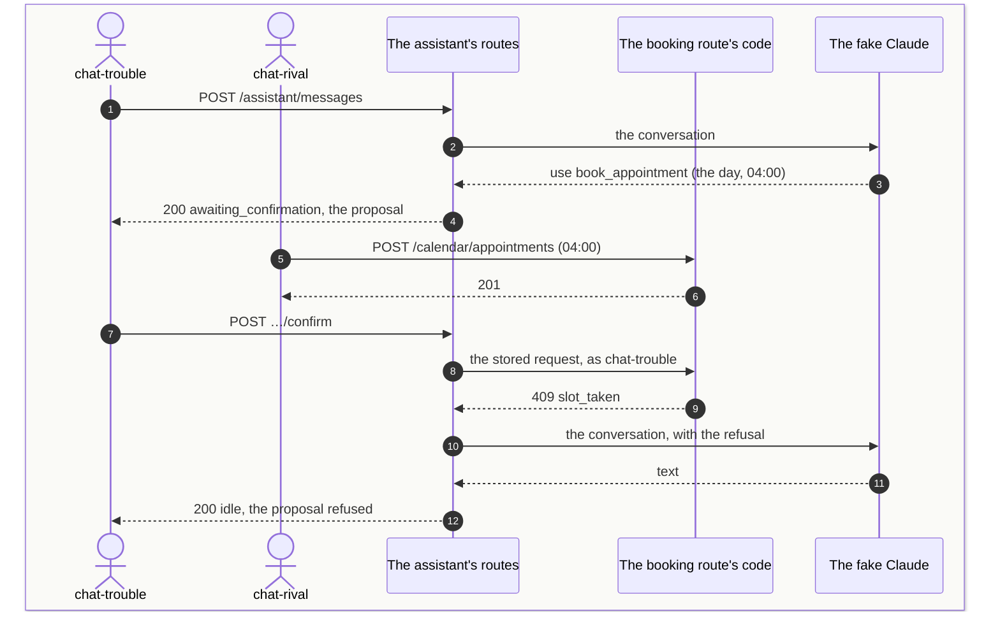

# The "a confirmation that meets trouble (5.4, 7.4)" journey, in simple words

| | |
|---|---|
| Test file | `backend/tests/integration/assistant.test.ts` |
| `describe` | `a confirmation that meets trouble (5.4, 7.4)` |
| Tests | 1. "the slot is taken between the proposal and the confirmation: the booking is refused by the calendar, shown as refused with its code, and Claude is told" 2. "two confirmations of one proposal at the same moment: one books, the other finds no proposal, and there is one appointment" 3. "Anthropic's spending limit is met after the change was made: the booking stays, the answer is 503, and continue gets the closing words without booking again" |
| Runs against | the local stack: the API on port 3000 (`sam local`), cognito-local on port 9229, DynamoDB Local on `DYNAMODB_PORT`, the fake Claude on port 9230 (`RUN_INTEGRATION=1`) |

Ideas used here, explained once for all journeys:
[one local calendar, shared](../concepts.md#one-local-calendar-shared),
[the deleted-user marker](../concepts.md#the-deleted-user-marker),
[windows and slots](../concepts.md#windows-and-slots),
[the calendar lock](../concepts.md#the-calendar-lock),
[the life of an appointment](../concepts.md#the-life-of-an-appointment),
[the assistant in the journeys](../concepts.md#the-assistant-in-the-journeys),
[the fake Claude](../concepts.md#the-fake-claude),
[the `assistant` table](../concepts.md#the-assistant-table),
[the event log](../concepts.md#the-event-log),
[the settings](../concepts.md#the-settings),
[steps, `continue` and the tools](../concepts.md#steps-continue-and-the-tools),
[a proposal, and its two buttons](../concepts.md#a-proposal-and-its-two-buttons).

## What this block proves

- Confirming does not skip a check: a slot taken since the proposal is refused by the booking
  route itself, with `slot_taken` (`docs/SHARED_CALENDAR_SPEC.md` R-BOOK-07), and the proposal
  shows it (`docs/CONVERSATIONAL_ARCHITECTURE.md` section 5.5, rule 3).
- A confirmation runs once: of two at the same moment one books and the other answers
  `404 proposal_not_found` (`docs/CONVERSATIONAL_ARCHITECTURE.md` section 5.5, rule 6).
- When Claude cannot be asked after the change was made, the change stays made and saved, the
  answer is 503, and `POST /assistant/continue` gets the closing words
  (`docs/ARCHITECTURE.md` section 4, "The assistant's routes").

## Who takes part

- **`chat-trouble`**: a throw-away User, the person who talks to the assistant.
- **`chat-rival`**: a second throw-away User, who books through the calendar's own route.
- **The Administrator** (`admin`): creates the two Users, and prepares and removes the piece of
  calendar the block books in.
- **The fake Claude**: for each of the block's three sentences it first asks for the tool
  `book_appointment`, at 04:00, 05:00 and 06:00 of the day. Then it answers with the last result
  of a tool it was given; for the third sentence it first fails once, as Anthropic does when a
  spending limit is reached.

## Before the block starts

The file's `beforeAll` signs in `admin` and removes what an interrupted run of any of the four
blocks that use the calendar left on a day still to come (`removeFromCalendar()` for each name of
`JOURNEY_TYPES`). The block's `beforeAll` works out **the day**, 28 days
after today in the calendar's time zone (`dayOfJourney(28)`, the fake's `{{date+28}}`), creates
`chat-trouble` and `chat-rival` again and signs them in, removes again what its own earlier run may
have left under the type name `assistant trouble journey` (`removeFromCalendar()`, every day from
tomorrow to 28 days ahead), then creates that type and a one-off window 04:00–07:00 of it on the
day (`openWindow()`), and keeps the type's id.

The window gives three slots of one hour, one for each test:

| Slot | Test | Who holds it at the end |
|---|---|---|
| 04:00 | 1 | `chat-rival` |
| 05:00 | 2 | `chat-trouble` |
| 06:00 | 3 | `chat-trouble` |

Each test starts with the block's `propose()`: `chat-trouble` sends the sentence, and the helper
checks `status` `awaiting_confirmation` and gives the `proposalId`.

## Test 1: the slot is taken meanwhile

1. `chat-trouble` sends `fake: book me the slot somebody else takes`. The proposal is for 04:00.
2. `chat-rival` reads the day with `GET /calendar` and books, with
   `POST /calendar/appointments`, the first free slot whose type is the journey's: 04:00. The
   test checks `201`.
3. `chat-trouble` confirms. The server calls the booking route's code, which checks the slot
   again under the calendar lock and refuses: `409 slot_taken`. The server saves the refusal as
   the outcome and as the result Claude reads, and asks Claude for the closing words.
4. `chat-trouble` ends the conversation.

The test checks:

- for the confirmation: `200`, `status` `idle`, and the proposal with its id, for the day, 04:00
  to 05:00, its action with `outcome` `refused` and `error` `slot_taken`;
- one new message, from `assistant`, whose text is JSON with `error` `slot_taken`: what Claude
  was given;
- `chat-trouble` has no appointment, and `chat-rival` has one (`appointmentsOf()`);
- ending the conversation answers `204`.

## Test 2: two confirmations at once

1. `chat-trouble` sends `fake: book me the slot confirmed twice`. The proposal is for 05:00.
2. The test sends two confirmations of it at the same moment (`Promise.all`). Taking a proposal
   is a write that succeeds only if nobody took it first, so one request wins and runs the
   booking, and the other finds no proposal waiting.
3. `chat-trouble` ends the conversation.

The test checks:

- the two statuses are one `200` and one `404`, whichever request got which;
- the `404` has `error` `proposal_not_found`;
- the `200` holds the proposal with its id and its action `done`;
- `chat-trouble` has exactly one appointment;
- ending the conversation answers `204`.

## Test 3: the spending limit after the change

1. `chat-trouble` sends `fake: book me a slot when the money runs out`. The proposal is for
   06:00.
2. `chat-trouble` confirms. The server books, saves the outcome, then asks Claude for the closing
   words. The fake answers with the error of a spending limit.
3. `chat-trouble` reads the conversation, confirms again, then calls `POST /assistant/continue`.
   The fake, asked the very same request a second time, now answers.

The test checks:

- for the confirmation: `503` and the body `{ error: "assistant_budget_reached", message }`, the
  message being any text;
- `chat-trouble` now has two appointments, the one of test 2 and this one: the change was made;
- the conversation, read back: `status` `working`, and the proposal with its id and its action
  `done`, `error` `null`: the outcome was saved before Claude was asked;
- confirming again: `404 proposal_not_found`;
- for `continue`: `200`, `status` `idle`, the same proposal with its action `done`, and a message
  whose text is JSON with `outcome` `done` and an `appointment` on the day at `start` `06:00`;
- `chat-trouble` still has two appointments: `continue` did not book again.

The local stack does not remember a spending limit, which is why the `continue` right after is
asked of Claude at all (`docs/ARCHITECTURE.md` section 8).

## What the block leaves

The `afterAll` cancels the three appointments as `admin`, deletes the window and the type
(`removeFromCalendar()`), then removes the two Users from cognito-local.

| In the `calendar` table | State |
|---|---|
| 04:00–05:00, the day | `cancelled`, booked by `chat-rival`, cancelled by `admin` |
| 05:00–06:00, the day | `cancelled`, booked by `chat-trouble`, cancelled by `admin` |
| 06:00–07:00, the day | `cancelled`, booked by `chat-trouble`, cancelled by `admin` |
| events | one for each booking and one for each cancellation |
| the window and the type | deleted for good |

Cancelled appointments keep no slot busy, so the next run finds the three slots free. In the
`assistant` table the items of `chat-trouble` stay, under a `sub` no account has any more: a
`META` with the conversation of test 3 still open, `status` `idle`, its proposal settled; the
entries of the three conversations; and one item of daily use with `messages` 3. `chat-rival`
never talked to the assistant and has no item there.

## If the block fails halfway

- The `beforeAll` fails, and every test with it, when the window cannot be created: for example
  when something else already opens part of 04:00–07:00 on the day. The other blocks of this file open
  these early hours on other days, and the file's `beforeAll` has removed what an interrupted
  run of theirs left; no other journey opens them.
- The three tests use different slots, and tests 1 and 2 end their conversation, so a failed
  test does not stop the next from making its proposal: a message while a proposal waits drops
  it. But the tests count the appointments of `chat-trouble`: none after test 1, one after test
  2, two in test 3. So test 2 fails when test 1 left one, and test 3 when the count before it is
  not one.
- No test gets a proposal when a User may not book the day: bookings open fewer than 28 days
  ahead (`bookingHorizonDays`), set by hand or left by a calendar journey that stopped while it
  had lowered it.
- The `afterAll` cancels, deletes and removes whatever happened; if the run is stopped before
  it, the next run removes the appointments, the window and the type first, in the file's
  `beforeAll` and again in the block's: `removeFromCalendar()` looks at every day from tomorrow
  to 28 days ahead, so a run started on a later date finds them too.
- The two Users are removed with `removeUserIfPresent()`, straight in cognito-local: no
  deleted-user marker is written and nothing is cancelled by it.

## Where in the code

| What | Where |
|---|---|
| The routes | `POST /assistant/messages`: `backend/src/handlers/sendAssistantMessage.ts`; `POST /assistant/proposals/{proposalId}/confirm`: `backend/src/handlers/confirmProposal.ts`; `POST /assistant/continue`: `backend/src/handlers/continueAssistant.ts`; `GET` and `DELETE /assistant/conversation`: `backend/src/handlers/getConversation.ts`, `backend/src/handlers/endConversation.ts` |
| The confirmation | `confirmProposal()` in `backend/src/assistant/confirm.ts`: the outcomes `done`, `refused` and `unknown`, saved before Claude is asked |
| Taking the proposal | `takeProposal()` in `backend/src/lib/assistantDb.ts`, a conditional write |
| The refusal | `checkBooking` in `backend/src/lib/calendarRules.ts`, run by `backend/src/handlers/bookAppointment.ts` under the calendar lock |
| The 503 | `REFUSALS` in `backend/src/assistant/conversation.ts`; `runStep()` in `backend/src/assistant/exchange.ts` |
| The fake's answers | the three sentences, `tool-book-day28-0400`, `tool-book-day28-0500`, `tool-book-day28-0600`, `error-own-spend-limit` and `text-last-tool-result` in `backend/tests/integration/fake-claude/answers.json`; the step that fails once in `backend/docker/fake-claude.mjs` |
| Test helpers | in the file: `newUser()`, `say()`, `conversation()`, `startAgain()`, `goOn()`, `confirm()`, `appointmentsOf()`, `bookingProposal()`, `dayOfJourney()`, `openWindow()`, `removeFromCalendar()`, the block's `propose()`; in `backend/tests/integration/setup.ts`: `api()`, `signIn()`, `removeUserIfPresent()` |
| Constants | the block's `TYPE`; `JOURNEY_TYPES` |
