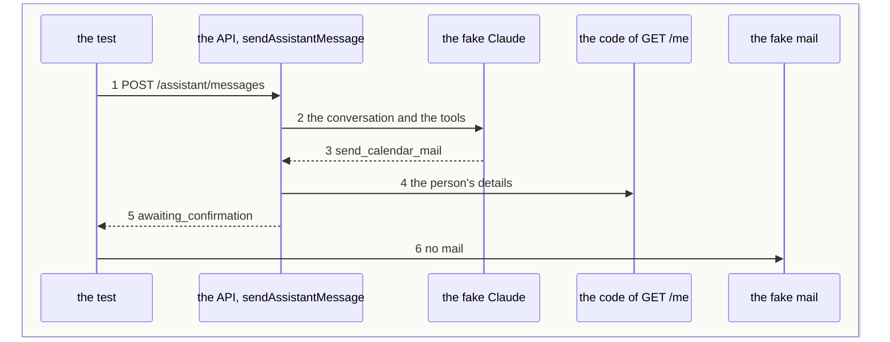

# The "a mail asked for through the assistant (3, 5.4, 5.5)" journey, in simple words

| | |
|---|---|
| Test file | `backend/tests/integration/assistant.test.ts` |
| `describe` | `a mail asked for through the assistant (3, 5.4, 5.5)` |
| Tests | 1. "a request for a mail: Claude asks for the tool, nothing is sent, and the proposal shows the two dates and the masked address" 2. "confirm: Claude is told the mail is on its way, and one mail comes to the User's own address" 3. "Don't: nothing is sent" 4. "an account without an address is told no_email_address at the proposal: nothing is proposed" |
| Runs against | the local stack: the API on port 3000 (`sam local start-api`), the functions' invoke on port 3001 (`npm run local:lambda`), cognito-local on port 9229, DynamoDB Local on `DYNAMODB_PORT`, the fake Claude on port 9230, the fake mail on port 8025 (`RUN_INTEGRATION=1`) |

Ideas used here, explained once for all journeys:
[the four facts of a person](../concepts.md#the-four-facts-of-a-person),
[mail in the journeys](../concepts.md#mail-in-the-journeys),
[the assistant in the journeys](../concepts.md#the-assistant-in-the-journeys),
[the fake Claude](../concepts.md#the-fake-claude),
[steps, `continue` and the tools](../concepts.md#steps-continue-and-the-tools),
[a proposal, and its two buttons](../concepts.md#a-proposal-and-its-two-buttons),
[the `assistant` table](../concepts.md#the-assistant-table).

## What this block proves

- The tool `send_calendar_mail` is a change like the calendar's: asked for by Claude it sends
  nothing, and the proposal, worded by the server, shows the two dates and the person's address
  masked (`docs/EMAIL_ARCHITECTURE.md` section 7, `docs/CONVERSATIONAL_ARCHITECTURE.md` section
  5.5).
- Confirm runs the code of `POST /mail/calendar` with the person's identity, and the mail goes to
  the account's own address; Don't sends nothing.
- An account without an address is told `no_email_address` at the proposal, before any button
  (`docs/EMAIL_ARCHITECTURE.md` section 7).

## Who takes part

- **`chat-mail`**, a throw-away User made again for the block (`newUser()`), with the four facts
  of `factsOf('chat-mail')`: address `chat-mail@example.com` (`ADDRESS`), masked
  `c•••@example.com`. The new account has a new `sub`: no conversation, all of today's messages
  and all of today's five mails.
- **`chat-mail-nobody`** (`NOBODY`), a second administrator made in test 4 straight in
  cognito-local (`createSecondAdmin()`), with no fact, so with no address.
- **The fake Claude**: to the sentence `fake: e-mail me my appointments of the mail journey`
  (`ASK`) it first asks for `send_calendar_mail` with `from` `{{date+7}}` and `to` `{{date+13}}`
  (the answer `tool-send-mail-week`), then answers with the last result of a tool, word for word
  (`text-last-tool-result`). It asks the same for whoever writes.
- **The API**, the mailer it starts through `npm run local:lambda`, and **the fake mail**.

## Before the block starts

The file's `beforeAll` signed `admin` in and removed what an interrupted run of the calendar
blocks left; this block uses no calendar data. The block's `beforeAll` works out the two dates
the fake asks for, `from` (today + 7) and `to` (today + 13) in the calendar's zone
(`dayOfJourney()`), makes `chat-mail` again and signs it in, removes `chat-mail-nobody` if an
earlier run left it, and makes the fake mail forget the mails of `ADDRESS`.

## Test 1: the proposal, and nothing sent

| Step | What happens |
|---|---|
| 1 | `chat-mail` sends `ASK` |
| 2 | the server asks Claude, with the User's tools, the mail tool among them |
| 3 | the fake asks for `send_calendar_mail` with `{ from, to }` |
| 4 | the server checks the stage (`MAIL_STAGE` is `on` locally), then reads the User's own details through the code of `GET /me`, inside the same function |
| 5 | it saves the proposal and answers it; nothing is sent |
| 6 | three seconds later, the fake mail holds nothing for `ADDRESS` |

The test checks:

- the answer is `200`;
- the sentence the server writes for these dates (`assistantTexts('en').changes.sendCalendarMail`
  with the kind `mine` and the masked address) reads "Send your appointments from …day date month
  year… to …day date month year… to c•••@example.com.";
- the answer is `awaiting_confirmation`, with no line of progress and the proposal of that one
  sentence, its question "Make this change?" and its two buttons (`proposalOf()`);
- the whole address appears nowhere in the answer;
- the one request for a tool stored in the conversation is `send_calendar_mail` with `{ from, to }`
  (`storedToolRequests()`);
- after three seconds the fake mail holds no mail for `ADDRESS`.

## Test 2: Confirm, and the mail

1. The test reads the conversation for the proposal's id and confirms it.
2. The server takes the proposal and runs the code of `POST /mail/calendar` with `chat-mail`'s
   identity: the stage, the body, the address, the count of the day (now 1 of 5), then the mailer
   started in the background.
3. It saves the outcome and asks the fake Claude for its closing words, which are the result the
   server gave it.

The test checks:

- the answer is `200`, `idle`, and the proposal is the same sentence with the outcome `done` and
  no error;
- what Claude was given (the fake's words) is exactly `{ outcome: "done", message }`, the message
  saying the mail is on its way, and holds neither an `@` nor a `•`: nothing of the address;
- one mail comes to `ADDRESS` (`waitForMails()`), and only one, sent to `[ADDRESS]`, whose text
  says "You have no appointments in this period.": the new account has booked nothing.

The test then makes the fake mail forget the mails of `ADDRESS`.

## Test 3: Don't

`chat-mail` sends `ASK` again. The test checks the answer is `awaiting_confirmation` with the same
proposal. It declines it, and checks the answer is `idle`, with no proposal and the notice "Nothing
was changed.". Three seconds later the fake mail holds no mail for `ADDRESS`: the decline asks
neither the route nor Claude.

## Test 4: no address

1. The test makes `chat-mail-nobody` (`createSecondAdmin()`, no fact) and signs it in.
2. It sends `ASK` and does the steps that only read (`sayAndRead()`): the fake asks for the tool,
   the server reads the account's details, finds no address, proposes nothing and gives Claude an
   error result; the answer is `working`, so the test calls `continue`, and the fake answers with
   that result.

The test checks the last answer is `idle` with no proposal, and that the result Claude was given
is exactly `{ error: "no_email_address", message }`, the message saying the account has no e-mail
address. The route was never reached: nothing was counted, and no mailer started.

## What the block leaves

- **Cognito**: the `afterAll` removes `chat-mail` and `chat-mail-nobody`.
- **The fake mail**: the `afterAll` forgets the mails of `ADDRESS`.
- **The table `mail`**: the count of the day of `chat-mail`'s `sub`, 1, under a `sub` no account
  has any more; it expires after two days.
- **The table `assistant`**: the conversations of the two `sub`s, which nothing reads again; they
  run out by themselves.
- **The calendar**: unchanged.

## If the block fails halfway

A failed check skips the rest of its test; the later tests still run. Test 2 confirms the proposal
test 1 left: if test 1 failed before the proposal was made, test 2 fails too. Test 3 starts its own
proposal; test 4 its own account. The `afterAll` runs whatever happens, and the next run makes
both accounts again, with new `sub`s.

## Where in the code

| What | Where |
|---|---|
| The tool | `backend/src/assistant/tools/sendCalendarMail.ts`: its schema is `MailCalendarBody` of `shared/src/mail/schemas.ts`; its `confirmation.read` checks `MAIL_STAGE`, reads `GET /me` (`backend/src/handlers/getMe.ts`), and proposes the call `POST /mail/calendar`; its sentence is `sendCalendarMail` of `shared/src/assistant/texts.en.ts` and `texts.it.ts`, with `maskAddress()` of `shared/src/mail/mask.ts` |
| The confirmation | `backend/src/assistant/confirm.ts`, which reaches the route's handler `backend/src/handlers/sendCalendarMail.ts` through `backend/src/assistant/tools/changeHandlers.ts` |
| The fake's answers | `backend/tests/integration/fake-claude/answers.json`: the sentence `ASK`, the answers `tool-send-mail-week` and `text-last-tool-result` |
| Test helpers | in the file: `newUser()`, `say()`, `conversation()`, `confirm()`, `decline()`, `sayAndRead()`, `proposalOf()`, `storedToolRequests()`, `dayOfJourney()`; in `backend/tests/integration/setup.ts`: `factsOf()`, `createSecondAdmin()`, `signIn()`, `removeUserIfPresent()`, `mailsTo()`, `waitForMails()`, `forgetMailsTo()` |
| Constants | `ASK`, `USERNAME`, `NOBODY`, `NOBODY_PASSWORD`, `ADDRESS` |
