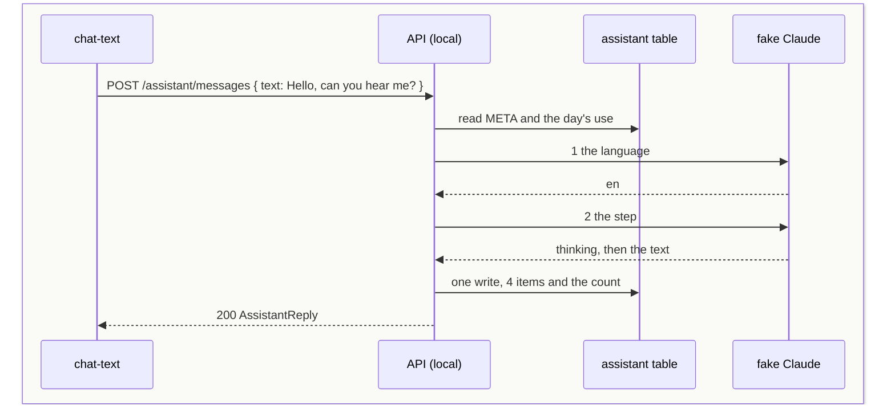

# The "a conversation in text (5.6, 6)" journey, in simple words

| | |
|---|---|
| Test file | `backend/tests/integration/assistant.test.ts` |
| `describe` | `a conversation in text (5.6, 6)` |
| Tests | 1. "has no conversation at first" 2. "refuses a message that is not one, and starts no conversation for it" 3. "answers the person's message with Claude's text" 4. "reads the conversation back" 5. "stored three entries for it, the middle one being the line of the application, and counted one message today" 6. "goes on in the same conversation" 7. "\"New conversation\" ends it: nothing to read, today's count kept, and the next message starts another" |
| Runs against | the local stack: the API on port 3000 (`sam local`), cognito-local on port 9229, DynamoDB Local on `DYNAMODB_PORT`, the fake Claude on port 9230 (`RUN_INTEGRATION=1`) |

Ideas used here, explained once for all journeys:
[the assistant in the journeys](../concepts.md#the-assistant-in-the-journeys),
[the fake Claude](../concepts.md#the-fake-claude),
[the language of a conversation](../concepts.md#the-language-of-a-conversation),
[the line of the application, and the gaps in `seq`](../concepts.md#the-line-of-the-application-and-the-gaps-in-seq),
[the `assistant` table](../concepts.md#the-assistant-table),
[the daily limit](../concepts.md#the-daily-limit).

## What this block proves

- A person writes, Claude answers in text, and the conversation is remembered: the three routes
  of `docs/ARCHITECTURE.md` section 4 ("The assistant's routes"), which are the branch "Claude
  answers with text" of `docs/CONVERSATIONAL_ARCHITECTURE.md` section 5.6 and the contract of
  its section 6.
- A body that is not a message is refused before anything is stored or asked of Claude.
- What is stored is the exchange exactly as Claude needs it back, with the line of the
  application between the message and the answer (`docs/ARCHITECTURE.md` section 4, "The
  assistant's routes"; the items in its section 5.4).
- "New conversation" ends a conversation for the person without giving back the day's messages.

## Who takes part

- **`chat-text`**: a throw-away User, the person of this block.
- **The Administrator** (`admin`): only creates `chat-text`.
- **The fake Claude**: answers for Anthropic, from its script.
- **The test itself**, reading the `assistant` table directly in DynamoDB Local
  (`queryAssistantPartition()`), and reading the `sub` of `chat-text` from its token (`subOf()`).

## Before the block starts

**The file's `beforeAll`** signs in `admin`. The file empties no table: it relies on new accounts
instead.

**The block's `beforeAll`** (the helper `newUser()`) removes `chat-text` if an earlier run left it
(`removeUserIfPresent()`, straight to cognito-local), creates it through `POST /users` as the
Administrator (`201`), sets its password straight in cognito-local (`setPasswordOf()`: the answer
carries none) and signs it in with it. Then `chat-text` calls
`DELETE /assistant/conversation` and the test checks `204`: there is nothing to end, and the route
answers the same.

`LIMIT` is the local daily limit, 10 unless `local:up` was given another value.

## Test 1: no conversation at first

`chat-text` calls `GET /assistant/conversation`. The test checks `200` and the whole body: the
empty reply (`conversationId` and `language` `null`, `status` `idle`, no messages, `activity` and
`proposal` `null`) with `remainingToday` equal to `LIMIT`. The helper `none()` builds that body.

## Test 2: what is not a message

Four calls of `POST /assistant/messages`, each refused by the handler before the conversation is
read: the first because the body is not JSON (`parseJsonBody()`), the other three by the schema
of a message (`AssistantMessageBody` in `shared/src/assistant/`):

| Sent | The test checks |
|---|---|
| no body at all | `400 invalid_json` |
| `{ text: "   " }` (empty once trimmed) | `400 invalid_request` |
| a text of 2 001 characters (one over the limit) | `400 invalid_request` |
| `{ text, language: "it" }` (a field the contract does not have) | `400 invalid_request` |

Then the test reads the conversation and checks that it is still the empty reply with
`remainingToday` `LIMIT`: none of the four started a conversation or counted as a message.

## Test 3: a message and its answer

| Arrow | What happens |
|---|---|
| 1 the language | there is no conversation, so the server first asks in which language the message is written |
| 2 the step | the request that gets the answer: the instructions, the message, the line of the application |
| one write | a new `META`, three messages, and the day's use, in one transaction |

`chat-text` sends `Hello, can you hear me?`. The test checks `200` and the whole body:

- `conversationId` is a ULID; the test keeps it;
- `language` `en`, `status` `idle`, `activity` and `proposal` `null`;
- `messages` holds exactly two: `seq` 1 from `person` with the text sent, and `seq` 3 from
  `assistant` with "Hello. I am the assistant of the shared calendar.", each with a time `at`;
- `remainingToday` is `LIMIT` − 1.

The reply of a `POST` holds the messages that request added, not the whole conversation.

## Test 4: reading it back

`GET /assistant/conversation`. The test checks `200`, the same `conversationId`, `language` `en`,
`status` `idle`, the same two messages (`seq` 1 and 3, their `from` and `text`) and
`remainingToday` `LIMIT` − 1.

## Test 5: what was stored

No call to the API here: the test reads the two partitions of `chat-text` in the table. In the
table, the test checks that:

- the partition `CONV#` holds exactly four items, in this order: `META`, then
  `MSG#<conversationId>#000001`, `…#000002` and `…#000003`;
- `META` holds the `conversationId`, `language` `en`, `status` `idle`, `messageCount` 1 (only the
  person's message counts), `nextSeq` 4 and `proposal` `null`;
- the `content` of the three messages, read as JSON, has the roles `user`, `system`, `assistant`
  in that order;
- the first is the text sent, as a plain string;
- the second, the line of the application, starts with "Now it is", a weekday, a date written
  out and as `YYYY-MM-DD`, a time, "in the calendar's time zone (Europe/Rome)", and then says
  that the language of the conversation is English;
- the third, Claude's answer, is a list of two blocks of types `thinking` and `text`: the answer
  is stored as Anthropic gave it, with the thinking a person never sees;
- the partition `USAGE#` holds one item, with `messages` 1 and `inputTokens` above 0.

## Test 6: a second message

`chat-text` sends `And once more?`, which the fake has no script for. The test checks `200`, the
same `conversationId`, two messages (`seq` 4 from `person`, and `seq` 6 from `assistant` with
"Fake Claude: no answer is scripted for this message.") and `remainingToday` `LIMIT` − 2. Then it
reads the conversation and checks that it holds four messages.

No language question is asked this time: the conversation has its language.

## Test 7: "New conversation"

1. `chat-text` calls `DELETE /assistant/conversation`. The test checks `204` and no body.
2. It reads the conversation. The test checks the empty reply with `remainingToday` `LIMIT` − 2:
   the conversation is gone for the person, the day's count is not.
3. It calls `DELETE` again. The test checks `204`: ending twice is not an error.
4. It sends `Hello, can you hear me?` again. The test checks `200`, a `conversationId` different
   from the first one, messages numbered 1 (`person`) and 3 (`assistant`) again, and
   `remainingToday` `LIMIT` − 3.
5. It reads the conversation. The test checks that it holds two messages: none of the first
   conversation.

## What the block leaves

`chat-text` is removed from cognito-local by the `afterAll`. Its items stay in the `assistant`
table, under a `sub` that no account has any more:

| Item | State |
|---|---|
| `META` | the second conversation, `idle`, in English |
| Messages | six of the first conversation, three of the second |
| Daily use | one item for today, `messages` 3 |

The blocks after this one play other accounts and never look at these items.

## If the block fails halfway

- A failed check skips the rest of its test only; the later tests still run. Tests 4 to 6 compare
  with the `conversationId` that test 3 keeps: when test 3 fails before keeping it, they fail too.
  Test 7 only needs the two messages of tests 3 and 6 to have been saved, for its counts.
- The `afterAll` removes `chat-text` whatever happened, and the next run's `beforeAll` removes it
  again before creating it. `removeUserIfPresent()` deletes straight in cognito-local: no
  deleted-user marker is written and nothing of the calendar is touched.
- The next run starts clean without any clean-up of the table: the new `chat-text` has a new
  `sub`. What the failed run stored stays as history.

## Where in the code

| What | Where |
|---|---|
| The routes | `GET /assistant/conversation`: `backend/src/handlers/getConversation.ts`; `DELETE /assistant/conversation`: `backend/src/handlers/endConversation.ts`; `POST /assistant/messages`: `backend/src/handlers/sendAssistantMessage.ts` |
| The body's check | `parseJsonBody()` in `backend/src/lib/http.ts`, then `AssistantMessageBody` in `shared/src/assistant/` (test 2) |
| A message and its step | `sendMessage()` in `backend/src/assistant/exchange.ts` (tests 3, 6, 7) |
| Reading and ending | `showConversation()`, `closeConversation()`, and `shown()`, which decides what a person reads of a stored message, in `backend/src/assistant/conversation.ts` |
| The line of the application | `timeLine()` in `backend/src/assistant/prompt.ts` (test 5) |
| The table | `readConversation()`, `startConversation()`, `saveStep()`, `endConversation()` in `backend/src/lib/assistantDb.ts` |
| Claude | `askLanguage()`, `askStep()` in `backend/src/lib/anthropic.ts`; the fake's script `backend/tests/integration/fake-claude/answers.json` |
| Test helpers | in the file: `newUser()`, `say()`, `conversation()`, `startAgain()`, `none()`; in `backend/tests/integration/setup.ts`: `api()`, `setPasswordOf()`, `signIn()`, `removeUserIfPresent()`, `subOf()`, `queryAssistantPartition()`, `localDailyMessageLimit()` |
| Constants | `HELLO`, `HELLO_ANSWER`, `LIMIT` |
