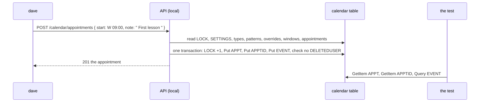
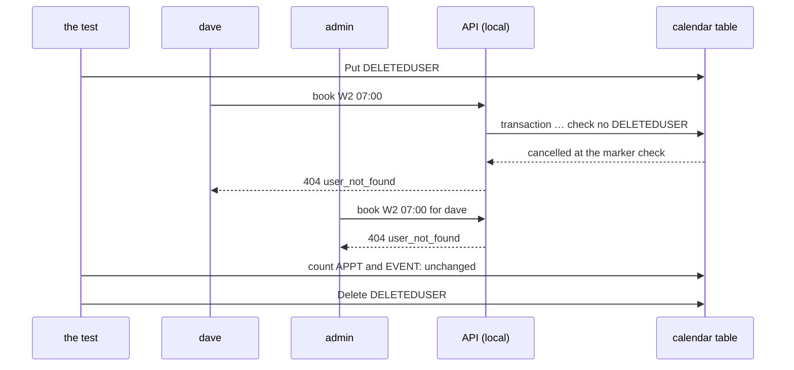

# The "booking (route 17)" journey, in simple words

| | |
|---|---|
| Test file | `backend/tests/integration/calendar.test.ts` |
| `describe` | `booking (route 17)` |
| Tests | 1. "prepares the settings, two types and the Wednesday pattern 08:00–12:00 from a past Wednesday"<br>2. "AC-10: dave books W 09:00: 201, end + 60 min, the type, cancellableUntil; APPT, APPTID and EVENT items written"<br>3. "AC-11: erin books the same slot: 409 slot_taken"<br>4. "AC-12: erin’s view of W has the busy interval and no slot at 09:00, and nothing of dave’s"<br>5. "AC-13: dave books 09:30, on the step but not a slot: 409 outside_availability"<br>6. "AC-14: the Administrator books dave W2 09:15–10:00: 201, cancellableUntil null"<br>7. "AC-15: dave then books W2 09:00: 409 user_busy, the hour overlaps dave’s own 09:15 in part; erin is refused slot_taken"<br>8. "AC-16: dave books 12:00, outside the window: 409 outside_availability"<br>9. "AC-17: horizon 7, W 11:00 (8 or more days ahead): dave 409 booking_beyond_horizon; the Administrator books it for dave: 201"<br>10. "AC-18: notice 720 h: dave books W 10:00: 409 booking_notice_too_short"<br>11. "AC-19: limit 1 while dave holds future appointments: dave 409 appointment_limit_reached; the Administrator books for dave: 201"<br>12. "a User naming someone else is 403; the Administrator booking without a username is 400, for admin 409 target_not_user, for an unknown username 404"<br>13. "AC-25: an empty override on W is 409 availability_conflict listing dave’s appointments; a User gets 403 and no conflicts"<br>14. "AC-26: changing the pattern’s type is 409 availability_conflict; AC-27: extending it to 07:00–12:00 is 200"<br>15. "AC-34: two bookings of the same slot at the same moment: exactly one 201, the other 409 slot_taken"<br>16. "R-BOOK-10: a deleted-user marker for dave’s sub makes his booking 404 user_not_found and writes nothing"<br>17. "every booking wrote exactly one event; the settings are restored to what the earlier journeys left" |
| Runs against | the local stack: the API on port 3000 (`sam local`), cognito-local on port 9229, DynamoDB Local on `DYNAMODB_PORT` (`RUN_INTEGRATION=1`) |

Ideas used here, explained once for all journeys: [the settings](../concepts.md#the-settings),
[availability types](../concepts.md#availability-types),
[where a window comes from](../concepts.md#where-a-window-comes-from),
[windows and slots](../concepts.md#windows-and-slots),
[places in a slot](../concepts.md#places-in-a-slot),
[booked appointments keep their window](../concepts.md#booked-appointments-keep-their-window),
[`busy` and `appointments`](../concepts.md#busy-and-appointments-in-the-calendar-view),
[the `calendar` table and its items](../concepts.md#the-calendar-table-and-its-items),
[the calendar lock](../concepts.md#the-calendar-lock),
[the event log](../concepts.md#the-event-log).

## What this block proves

- Booking (`POST /calendar/appointments`) applies the rules R-BOOK-01, 02, 04 to 07, 09, 10 and 12
  of `docs/SHARED_CALENDAR_SPEC.md` section 8.2, for a User and for the Administrator, with the error
  code of each (scenarios AC-10 to AC-19 of `docs/SHARED_CALENDAR_SPEC.md` section 18.3).
- A successful booking stores three items, in the same transaction as the lock update and the
  marker check: the appointment, its pointer and one `appointment.booked` event
  (`docs/SHARED_CALENDAR_SPEC.md` sections 13.2, 13.4 and 15.2).
- Once appointments exist, the Administrator cannot take their window away or change its type,
  but can extend it (`docs/SHARED_CALENDAR_SPEC.md` AC-25 to AC-27, R-AV-03 and R-AV-04).
- Two bookings of the same slot at the same moment give exactly one appointment
  (`docs/SHARED_CALENDAR_SPEC.md` AC-34), and a deleted-user marker stops every booking for that
  User (`docs/SHARED_CALENDAR_SPEC.md` R-BOOK-10).

## Who takes part

The scenarios of `docs/SHARED_CALENDAR_SPEC.md` section 18.3 speak of `alice` and `bob`. The seeded
`alice` must never be deleted, so here two throw-away Users play them
(`docs/SHARED_CALENDAR_SPEC.md` section 18.2): **`dave` plays `alice`**, **`erin` plays `bob`**.

- **The Administrator** (`admin`): saves the settings, makes the types and the pattern, books for
  `dave` where a User may not, and tries the availability changes.
- **`dave`**: a plain User. Books for themself, gets most of the refusals, and owns most of the
  appointments.
- **`erin`**: a second plain User. Tries the slot `dave` took, looks at the calendar through
  other eyes, and shows that the limit and the marker are counted per User.
- **The test itself**, reading and writing the `calendar` table directly in DynamoDB Local (the
  helpers `getCalendarItem()`, `queryCalendarPartition()`, `putCalendarItem()`,
  `deleteCalendarItem()`).

## Before the block starts

**The file's `beforeAll`** empties the local `calendar` table (`resetCalendarTable()`) and signs in
`admin` and `alice`. So the file knows the table's exact contents: everything in it was made by the
blocks above.

**What the blocks above leave**, as the block's opening comment lists it: the settings 48 / 2 / 30 /
no limit, the types `GYM` and `Studio`, two Monday patterns and one Sunday pattern, an empty override
on a Monday, a one-off window dated yesterday, and **no appointment**. This block relies on none of
it. It books on **Wednesdays**, which no block above touches, with its own types and pattern.

**The block's `beforeAll`** removes `dave` and `erin` if an earlier run left them
(`removeUserIfPresent()`, straight to cognito-local), creates them again through `POST /users` as
the Administrator (`201`), and signs each in with the password the answer carries. The tokens stay
in variables.

**The two dates.** Everything happens on two Wednesdays, counted from the real today in
`Europe/Rome` with the shared date helpers:

| Name | What it is | How far ahead |
|---|---|---|
| `W` | the first Wednesday on or after today + 8 days | 8 to 14 days |
| `W2` | `W` + 7 | 15 to 21 days |

"At least 8 days ahead" is what makes the timing rules decidable on a real clock: a horizon of 7
days puts `W` out of reach (test 9), a notice of 720 hours (30 days) is longer than the wait for
either date (test 10), and the default horizon of 56 days reaches both.

## Test 1: settings, two types and a Wednesday pattern

1. The Administrator reads the settings and keeps them as `leftover`, to put back in test 17.
2. It saves the block's own settings, `BOOKING_SETTINGS` (the helper `setSettings({})`). They
   happen to equal the defaults:

   | Setting | Value | What it means here |
   |---|---|---|
   | `cancellationNoticeHours` | 24 | a User's `cancellableUntil` is 24 hours before the start |
   | `minBookingNoticeHours` | 0 | no notice needed |
   | `bookingHorizonDays` | 56 | `W` and `W2` are both within reach |
   | `maxFutureAppointmentsPerUser` | `null` | no limit |

   Tests 9, 10 and 11 change one value for their own check and then call `setSettings({})` again.
3. It creates two types: **"Booking room"** (`room.main`) and **"Booking pool"** (`room.other`),
   each `201`. "Booking pool" is used only in test 14, as the type to change to.
4. It creates one weekly pattern, `201`: **Wednesday 08:00–12:00, "Booking room"**, from `W` − 21
   days (a past Wednesday) with no end. So every Wednesday from then on, `W` and `W2` included,
   has one window with four slots: 08:00, 09:00, 10:00 and 11:00.

## Test 2 (AC-10): `dave` books `W` 09:00



`dave` sends only `start` and a note with spaces around it. A User's booking is always one hour, so
`end` may be left out. The test checks the answer, exactly:

- `201`, with an `appointmentId` that is a ULID;
- `username` `dave`, `start` as sent, `end` = `start` + 60 minutes, `date` = `W`;
- `typeId` and `typeName` of "Booking room": the appointment takes the type of the window it lies
  in;
- `note` `First lesson`: trimmed (`docs/SHARED_CALENDAR_SPEC.md` R-BOOK-11);
- `status` `booked`; `createdBy` and `updatedBy` `{ username: 'dave', role: 'user' }`; `updatedAt`
  equal to `createdAt`;
- every cancellation and change field `null` (`cancelledAt`, `cancelledBy`, `cancelReason`,
  `replaces`, `replacedBy`);
- `cancellableUntil` = `start` − 24 hours: `dave` is a User, so the answer says until when `dave`
  may still cancel or change it.

The test keeps the answer as `booked.ac10`. In the table, the test checks that:

- **the appointment item** `APPT` / `<start>#<appointmentId>` holds, besides its keys, exactly the
  answer's fields minus `appointmentId`, `typeName` and `cancellableUntil`,
  plus `userId` (`dave`'s `sub`, read from the token), `typeNameAtBooking` "Booking room" and `version` 1
  ([the appointment item](../concepts.md#the-appointment-item));
- **the pointer** `APPTID#<appointmentId>` / `APPTID` holds `sk`, the appointment's `SK`, and
  nothing else ([why a pointer item](../concepts.md#why-a-pointer-item));
- **exactly one event** names this appointment: `SK` `<createdAt>#<eventId>`, `type`
  `appointment.booked`, `occurredAt` = `createdAt`, `actor` `dave`, `recipients`
  `{ userId: dave's sub, username: 'dave', administrator: true }`, `appointment` the same fields as
  the `APPT` item with the `appointmentId`, and `schemaVersion` 1
  ([the event log](../concepts.md#the-event-log)).

## Test 3 (AC-11): `erin` tries the same slot

`erin` books `W` 09:00. The test checks `409 slot_taken`: `dave`'s appointment overlaps it
(`docs/SHARED_CALENDAR_SPEC.md` R-BOOK-07).

## Test 4 (AC-12): what `erin` and `dave` see on `W`

`erin` loads the calendar view for `W` alone. The test checks that:

- the day's `busy` list is exactly one interval, 09:00–10:00;
- the free `slots` are 08:00, 10:00 and 11:00: 09:00 is gone;
- `appointments` is empty: `erin` has none;
- the whole answer contains neither the text `dave` nor the id of `dave`'s appointment.

Then `dave` loads the same day. The test checks that the `appointments` are exactly `[booked.ac10]`,
the answer of test 2, `cancellableUntil` included. This is the privacy rule of
[`busy` and `appointments`](../concepts.md#busy-and-appointments-in-the-calendar-view).

## Test 5 (AC-13): `dave` books 09:30

The test checks `409` with exactly `{ error: 'outside_availability', message: 'The time is not
inside the availability' }`. 09:30 is on the 5-minute step, so it passes the check of the body
(`docs/SHARED_CALENDAR_SPEC.md` R-BOOK-02). Under the lock the server finds the window 08:00–12:00,
whose slots are 08:00, 09:00, 10:00 and 11:00; a User's start must be one of them, and 09:30 is
not (`docs/SHARED_CALENDAR_SPEC.md` R-BOOK-06, R-SLOT-01). The hour would also overlap `dave`'s own
09:00 of test 2, but `docs/SHARED_CALENDAR_SPEC.md` section 8.2 checks R-BOOK-06 before R-BOOK-12,
so `outside_availability` answers.

## Test 6 (AC-14): the Administrator books `dave` a custom time on `W2`

The Administrator books `{ username: 'dave', start: W2 09:15, end: W2 10:00 }`. A User could not:
the Administrator may book any 5-minute steps inside a window (`docs/SHARED_CALENDAR_SPEC.md`
R-BOOK-08). It goes on `W2` because on `W` it would overlap `dave`'s 09:00–10:00. The test checks
that:

- the answer is `201`, with `username` `dave`, `createdBy` `{ username: 'admin', role: 'admin' }`
  and `cancellableUntil` `null` (the Administrator has no notice to respect).

In the table, the test checks that:

- the `APPT` item's `userId` is **`dave`'s `sub`**. The Administrator named `dave` by username; the
  handler looked up `dave`'s `sub` in Cognito before the lock, so the appointment belongs to `dave`.

## Test 7 (AC-15): `dave` books `W2` 09:00, then `erin`

`W2` 09:00–10:00 overlaps the 09:15–10:00 of test 6 for three quarters of an hour. That 09:15 is
`dave`'s own appointment, so the test checks `409` with exactly `{ error: 'user_busy', message: 'The
User already has an appointment at this time' }`: one person is never in two places
(`docs/SHARED_CALENDAR_SPEC.md` R-BOOK-12). The server checks this before the places, so the answer
is `user_busy`, not `slot_taken`. To move the 09:15 to 09:00, `dave` would change that appointment
instead (`docs/SHARED_CALENDAR_SPEC.md` section 8.4).

Then `erin` books the same `W2` 09:00. The test checks `409 slot_taken`: the type holds one person,
and the 09:15–10:00 fills the hour although part of it is free (`docs/SHARED_CALENDAR_SPEC.md`
R-BOOK-07, R-SLOT-05). The server refuses both under the lock and writes nothing.

## Test 8 (AC-16): `dave` books 12:00

The window ends at 12:00, so 12:00–13:00 lies outside it. The test checks
`409 outside_availability` (`docs/SHARED_CALENDAR_SPEC.md` R-BOOK-06).

## Test 9 (AC-17): a horizon of 7 days

1. The Administrator sets `bookingHorizonDays` to 7.
2. `dave` books `W` 11:00. `W` is at least 8 days ahead, beyond today + 7. The test checks
   `409 booking_beyond_horizon` (`docs/SHARED_CALENDAR_SPEC.md` R-BOOK-05).
3. The Administrator books the same time for `dave`. It is exempt from the horizon. The test checks
   `201` and keeps the answer as `booked.ac17`.
4. The settings go back to `BOOKING_SETTINGS`.

## Test 10 (AC-18): a notice of 720 hours

1. The Administrator sets `minBookingNoticeHours` to 720 (30 days).
2. `dave` books `W` 10:00, which is free but at most 15 days away. The test checks
   `409 booking_notice_too_short` (`docs/SHARED_CALENDAR_SPEC.md` R-BOOK-04).
3. The settings go back.

The scenario in `docs/SHARED_CALENDAR_SPEC.md` section 18.3 uses 48 hours and a fixed "now". The
journey runs on the real clock, so it picks a notice long enough to be decided whatever today is,
as that section explains under "How a fixed now is proven".

## Test 11 (AC-19): a limit of one future appointment

At this point `dave` holds three future appointments (tests 2, 6 and 9) and `erin` none.

1. The Administrator sets `maxFutureAppointmentsPerUser` to 1.
2. `dave` books `W2` 10:00. The slot is free (it only touches the 09:15–10:00 of test 6), so the
   limit decides. The test checks `409 appointment_limit_reached`
   (`docs/SHARED_CALENDAR_SPEC.md` R-BOOK-09).
3. `erin` books `W2` 08:00. The test checks `201`: the limit counts each User's own appointments,
   by `userId`.
4. The Administrator books `W2` 10:00 for `dave`. It is exempt from the limit. The test checks
   `201`.
5. The settings go back.

The scenario says `alice` holds one future appointment; here `dave` holds three. Any number at or
above the limit gives the same answer.

## Test 12: who may book for whom

All four requests aim at `W2` 11:00, which stays free: none of them is booked.

| Who | Body | The test checks | Why (`docs/SHARED_CALENDAR_SPEC.md` R-BOOK-01) |
|---|---|---|---|
| `dave` | `username: 'erin'` | `403 forbidden` | a User books only for themself |
| the Administrator | no `username` | `400`, exactly `{ error: 'invalid_request', message: 'Invalid input: username' }` | the Administrator must name the User |
| the Administrator | `username: 'admin'` | `409 target_not_user` | the account exists but is not a plain User |
| the Administrator | `username: 'nobody-here'` | `404 user_not_found` | no such account in Cognito |

The first two are decided from the body alone; the last two by Cognito, before the lock.

## Test 13 (AC-25): the Administrator tries to close `W`

The Administrator sets an empty override on `W`, which would close the day. Two booked
appointments lie on `W`, both `dave`'s: 09:00 (test 2) and 11:00 (test 9). The test checks:

- `409`, exactly `{ error: 'availability_conflict', message: '2 appointments would fall outside the
  availability', conflicts: [...] }`, the two listed by start, each with `appointmentId`,
  `username` `dave`, `start` and `end`;
- `dave` sending the same request gets `403`, and the answer has no `conflicts`: only the
  Administrator ever sees that list.

In the table, the test checks that:

- there is no `OVERRIDE` item for `W`: nothing was written.

See [booked appointments keep their window](../concepts.md#booked-appointments-keep-their-window).

## Test 14 (AC-26, AC-27): changing the pattern

1. The Administrator updates the pattern to the type "Booking pool". Every booked appointment on a
   Wednesday would then lie in a window of another type: the place would change under the User's
   feet (`docs/SHARED_CALENDAR_SPEC.md` R-AV-04). The test checks `409 availability_conflict` and
   that `conflicts` includes `dave`'s appointment of test 2. In the table, the test checks that the
   `PATTERN` item still has the type "Booking room".
2. The Administrator updates the pattern to 07:00–12:00, same type. Extending never conflicts. The
   test checks `200` and the answer `start` `07:00`, `end` `12:00`, type "Booking room".

From now on, every Wednesday has a fifth slot, 07:00. Test 16 uses it.

## Test 15 (AC-34): two bookings at the same moment

`dave` and `erin` both book `W2` 11:00, sent together (`Promise.all`). The test checks that:

- the two status codes are one `201` and one `409`;
- the `409` is `slot_taken`.

In the table, the test checks that:

- exactly one `APPT` item starts at `W2` 11:00.

**Why exactly one wins.** Each booking checks the slot and then writes, and between the two steps
the other booking may write. Without a guard, both could see a free slot and both be stored. The
[calendar lock](../concepts.md#the-calendar-lock) is the guard. If the two requests really run at
the same time:

```mermaid
sequenceDiagram
    participant D as dave's request
    participant E as erin's request
    participant T as calendar table
    D->>T: read LOCK: version v; read the calendar: 11:00 free
    E->>T: read LOCK: version v; read the calendar: 11:00 free
    D->>T: transaction: LOCK v → v+1 (if still v), APPT, APPTID, EVENT
    T-->>D: written
    E->>T: transaction: LOCK v → v+1 (if still v), APPT, APPTID, EVENT
    T-->>E: cancelled: the version is v+1 now
    Note over E: wait 50–150 ms, start again
    E->>T: read LOCK: version v+1; read the calendar: 11:00 taken
    Note over E: 409 slot_taken, nothing written
```

`sam local` may also serve the two requests one after the other. Then the second one reads the
first one's appointment at once and answers `slot_taken` without a retry. The test cannot tell the
two paths apart, and either User may win. The retry itself is proven by the unit tests of
`withCalendarLock()` (`docs/SHARED_CALENDAR_SPEC.md` AC-34).

## Test 16 (R-BOOK-10): a deleted-user marker



A real User deletion writes this marker before removing the account
([the deleted-user marker](../concepts.md#the-deleted-user-marker)). Deleting `dave` here would end
the block, so the test writes the marker by hand (`putCalendarItem()`) and leaves `dave`'s account
alone. It counts the `APPT` and `EVENT` items first. Then:

1. `dave` books `W2` 07:00, the slot test 14 opened, and the Administrator books the same for
   `dave`. Both pass every rule, and both transactions are cancelled by the marker check. The test
   checks, for each, `404` with exactly `{ error: 'user_not_found', message: 'The user has been
   deleted' }`. For the Administrator, Cognito still knows `dave`: only the marker refuses.
2. In the table, the test checks that the numbers of `APPT` and `EVENT` items are unchanged: a
   cancelled transaction writes nothing.
3. `erin` books `W2` 07:00. The test checks `201`: the marker is keyed by `dave`'s `sub` only.
4. In a `finally`, so even if a check failed, the test deletes the marker. In the table, the test
   checks that it is gone.

## Test 17: one event per booking, and the settings put back

1. The test reads the `APPT` and `EVENT` partitions. In the table, the test checks that:
   - there are as many `EVENT` items as `APPT` items;
   - every event is `appointment.booked` with `schemaVersion` 1.

   This holds for the whole table because the file emptied it and no block above booked anything:
   every appointment in it was booked here, and nothing was cancelled or changed yet.
2. The Administrator writes back the four values kept in test 1 (48 / 2 / 30 / no limit). The test
   checks `200` and those values in the answer.

## What the block leaves

The settings are back at 48 / 2 / 30 / no limit. The types "Booking room" and "Booking pool" stay,
and so does the Wednesday pattern, now 07:00–12:00 "Booking room". On the two Wednesdays:

| Date | Time | Whose | Booked by | Test |
|---|---|---|---|---|
| `W` | 09:00 | `dave` | `dave` | 2 |
| `W` | 11:00 | `dave` | the Administrator | 9 |
| `W2` | 07:00 | `erin` | `erin` | 16 |
| `W2` | 08:00 | `erin` | `erin` | 11 |
| `W2` | 09:15–10:00 | `dave` | the Administrator | 6 |
| `W2` | 10:00 | `dave` | the Administrator | 11 |
| `W2` | 11:00 | `dave` or `erin` | whoever won | 15 |

Seven appointments, seven events, all booked. The `afterAll` then removes `dave` and `erin`
straight from cognito-local, not through `DELETE /users`. So no marker is written and nothing is
cancelled: the seven appointments stay booked, as history under the names `dave` and `erin`. The
next block, "listing, note and cancel", creates a new `dave` and `erin` (new `sub`s) and books on
Thursdays.

## If the block fails halfway

- **Later tests still run.** vitest does not stop a block at its first failure, and these tests
  share state, so one failure often makes the next ones fail too. Read the first failure first.
- **Settings may stay changed.** Tests 9, 10 and 11 put the settings back at their end, and
  test 17 restores the leftover values; a failed check before those lines skips them. The blocks
  after this one then run with whatever was left. The marker of test 16 is the exception: it is
  removed in a `finally`.
- **The Users go.** The `afterAll` removes `dave` and `erin` whatever happened, and the next run's
  `beforeAll` removes them again before creating them.
- **The table starts empty next time.** The next run of the file empties the `calendar` table
  first, so leftover appointments, types, the pattern, changed settings or a stray marker are all
  gone, and the run starts from the defaults.

## Where in the code

| What | Where |
|---|---|
| The route | `POST /calendar/appointments`: `backend/src/handlers/bookAppointment.ts`. The checks in the order of `docs/SHARED_CALENDAR_SPEC.md` section 8.2: the body, who books for whom, the times, the Administrator's target in Cognito, then under the lock the calendar rules, and last the marker |
| Times, before the lock | `checkBookingTimes()` in `backend/src/lib/calendarRules.ts` (tests 5, 6: both pass it) |
| Rules under the lock | `checkBooking()` in `backend/src/lib/calendarRules.ts` (tests 3, 5, 7–11, 15) |
| `cancellableUntil` | `cancellableUntilFor()` in `backend/src/lib/calendarRules.ts` (tests 2, 6) |
| The transaction | `bookAppointment()` and `withCalendarLock()` in `backend/src/lib/calendarDb.ts`; the event item from `appointmentEvent()` in `backend/src/lib/calendarEvents.ts` |
| The Administrator's target | `getUserSub()` and `isPlainUser()` in `backend/src/lib/cognito.ts` (tests 6, 12) |
| Availability writes | `PUT /calendar/overrides/{date}`, `PUT /calendar/patterns/{patternId}`, checked by `checkAvailabilityWrite()` (tests 13, 14) |
| Test helpers | in the block: `W()`, `W2()`, `at()`, `plus()`, `book()`, `subOf()`, `setSettings()`, `pattern()`; in `backend/tests/integration/setup.ts`: `api()`, `signIn()`, `removeUserIfPresent()`, `resetCalendarTable()`, `getCalendarItem()`, `queryCalendarPartition()`, `putCalendarItem()`, `deleteCalendarItem()` |
| Constants | `BOOKING_SETTINGS`, `ZONE` (`Europe/Rome`), `ULID` (the id pattern); the state `room`, `booked`, `patternId`, `leftover` |

## Background: which test proves which rule

The booking rules of `docs/SHARED_CALENDAR_SPEC.md` section 8.2, in the order the server checks
them. The first that fails decides the answer.

| Order | Rule | Error | Test |
|---|---|---|---|
| 1 | the body's shape, the note (R-BOOK-11) | `400 invalid_request` | 2 (the note is trimmed) |
| 2 | R-BOOK-01 from the body: a User naming someone else; the Administrator naming nobody; then R-BOOK-13, a User sending `overbook: true` | `403 forbidden`, `400 invalid_request` | 12; R-BOOK-13 in [the capacity journey](calendar-capacity.md) |
| 3 | R-BOOK-02 times | `400 invalid_request` | 6 (the Administrator's custom times, R-BOOK-08); a time off the step in [the time-step journey](calendar-time-step.md) |
| 4 | R-BOOK-01 in Cognito: unknown, not a plain User | `404 user_not_found`, `409 target_not_user` | 12 |
| 5 | under the lock: R-BOOK-03 in the future | `409 booking_in_past` | not in this block |
| | R-BOOK-04 notice (User only) | `409 booking_notice_too_short` | 10 |
| | R-BOOK-05 horizon (User only) | `409 booking_beyond_horizon` | 9 |
| | R-BOOK-06 inside one window, and for a User a slot's start | `409 outside_availability` | 8; 5 (on the step, not a slot) |
| | R-BOOK-12 no appointment of the same User overlapping | `409 user_busy` | 7 |
| | R-BOOK-07 a place left (the types here hold one person) | `409 slot_taken` | 3, 7, 15 |
| | R-BOOK-09 limit (User only) | `409 appointment_limit_reached` | 11 |
| 6 | R-BOOK-10 no deleted-user marker, in the transaction | `404 user_not_found` | 16 |

`409 concurrent_update` (the lock busy three times in a row) is not reached here: two requests are
not enough.
