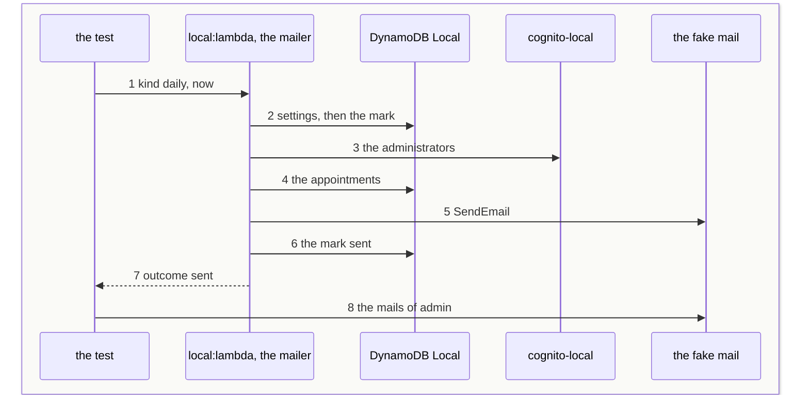

# The "the daily mail (6.2, 6.3, 9.1)" journey, in simple words

| | |
|---|---|
| Test file | `backend/tests/integration/mail.test.ts` |
| `describe` | `the daily mail (6.2, 6.3, 9.1)` |
| Tests | 1. "GET and PUT /mail/settings: the Administrator reads and saves, a User is refused, an hour out of range is 400" 2. "at the chosen hour: one mail to admin's address with two files, the booked of the next 7 days and the backup of every status" 3. "a day whose next 7 days end before the journey's day: its rows only in the backup" 4. "the same hour twice sends once" 5. "an earlier hour, a later hour with no mark, or the mail switched off, send none" 6. "a mark left failed is taken again and sends, at the chosen hour and at a later hour of the same day" 7. "a mark sending younger than 10 minutes is not taken; older, at a later hour, it is" |
| Runs against | the local stack: the API on port 3000 (`sam local start-api`), the functions' invoke on port 3001 (`npm run local:lambda`), cognito-local on port 9229, DynamoDB Local on `DYNAMODB_PORT`, the fake mail on port 8025 (`RUN_INTEGRATION=1`) |

Ideas used here, explained once for all journeys:
[the people of the local stack](../concepts.md#the-people-of-the-local-stack),
[one local calendar, shared](../concepts.md#one-local-calendar-shared),
[the life of an appointment](../concepts.md#the-life-of-an-appointment),
[mail in the journeys](../concepts.md#mail-in-the-journeys),
[the daily mail in the journeys](../concepts.md#the-daily-mail-in-the-journeys).

## What this block proves

- The Administrator reads and saves the daily mail's settings; a User may not; an hour outside
  0 to 23 is refused (`docs/EMAIL_ARCHITECTURE.md` section 9.1).
- At the chosen hour the daily mail goes once, with two files: the booked appointments of the
  next 7 days and a backup of every status from the 1st of last month
  (`docs/EMAIL_ARCHITECTURE.md` sections 6.2 and 6.3).
- At most once a day: a second run, an earlier hour, a later hour with nothing to retry, or the
  mail switched off send nothing; a mark left `failed`, or `sending` for more than 10 minutes, is
  taken again, also at a later hour of the same day (`docs/EMAIL_ARCHITECTURE.md` section 6.2).

## Who takes part

- **The Administrator** (`admin`, seeded, address `admin@example.com`): saves the settings, and
  is the one administrator with an address, so the one who receives the daily mail.
- **`alice`** (seeded): tries the settings' routes, and is refused.
- **The mailer**, run through `npm run local:lambda` by `runMailer()` with the event
  `{ kind: 'daily', now }` (`runDaily()`); **the fake mail**, which keeps the mails;
  **DynamoDB Local**, where the test writes, reads and removes the daily marks of the table `mail`.

## Before the block starts

The file's `beforeAll` (see [the mailer run by hand](mail-mailer.md#before-the-block-starts))
takes the journey's day `D`, today plus 45 days, and books three appointments on it under the
type `mail journey`, each with the note `MARK` of this run:

| Slot on `D` | Who | Status |
|---|---|---|
| 20:00–21:00 | `alice` | booked |
| 21:00–22:00 | `mail-bob` | booked |
| 22:00–23:00 | `alice` | cancelled |

The block before (`POST /mail/calendar`) made a new `mail-bob`; the old one's appointment stays
on `D` under the old account, still booked, with the same username.

The block's own `beforeAll`:

1. Reads the settings (`GET /mail/settings`) and keeps them as `found`, to write them back at the
   end.
2. Saves `{ dailyEnabled: true, dailyHour: 7 }` (`HOUR`).
3. Removes the daily marks of the seven dates before `D` (`removeMarks()`, straight in DynamoDB
   Local): the dates this block uses, one or two per test.

Before each test the fake mail forgets the mails of `admin@example.com`.

Each run is given its "now" as `at(date, hour)`: that local date and whole hour in the calendar's
zone, as an instant. The test checks a file's rows by the date, start, username and status of the
rows marked `MARK` (`fileRows()`), never by a count of the file.

## Test 1: the settings' routes

The test checks that `GET /mail/settings` as `admin` answers `200 { dailyEnabled: true,
dailyHour: 7 }`, the values the `beforeAll` saved; that `GET` and `PUT` as `alice` are `403`;
that a `PUT` with `dailyHour: 24` is exactly `400 { error: "invalid_request", message: "Invalid
input: dailyHour" }`; and that a second `GET` still answers 7: the refused save changed nothing.
Both routes check the role first, then the stage, then the body
(`docs/ARCHITECTURE.md` section 4).

## Test 2: at the chosen hour

The day is `D − 6`, so its next 7 days, `D − 6` to `D`, end on the journey's day.

| Step | What happens |
|---|---|
| 1 | `runDaily(D − 6, 7)`: the event `{ kind: daily, now }`, `now` 07:00 of `D − 6` in the calendar's zone |
| 2 | the mailer reads the settings (on, 7: the hour) and takes the day's mark: no mark yet, so it writes one, `sending` |
| 3 | it reads the members of the group `admin` and their addresses: `admin@example.com` |
| 4 | one read of the appointments, every status, from the 1st of last month to a year ahead, with the Users' names |
| 5 | one mail to `admin@example.com` with the two files |
| 6 | the mark becomes `sent` |
| 7 | it answers `{ outcome: sent, date, hour, mailCount, … }` |
| 8 | the test reads the mails of `admin@example.com` |

The test checks:

- the result holds `outcome` `sent`, the `date` `D − 6`, the `hour` 7 and `mailCount` 1;
- exactly one mail, to `['admin@example.com']`, its subject starting
  `Calendar: next 7 days and backup, `;
- its two files, in this order: `calendar-next-7-days-<D − 6>.xlsx` and a backup named
  `calendar-backup-from-<a 1st of a month>.xlsx`;
- the first file's rows marked `MARK` are alice's booked one and mail-bob's, by start: not the
  cancelled one;
- the backup's rows marked `MARK` are all three, the cancelled one too.

In the table, the test checks that the mark of `D − 6` is `sent`, with `startedAt` the run's now.

## Test 3: a day whose next 7 days end before `D`

`runDaily(D − 7, 7)`. The test checks `outcome` `sent`; then that in the one mail the first file
has no row marked `MARK` (its days, `D − 7` to `D − 1`, do not reach `D`), and the backup has
all three.

## Test 4: the same hour twice

Two runs on `D − 5` at 7. The test checks the first is `sent` and the second exactly
`{ outcome: already_sent, date, hour }`: the mark of the day is `sent`, and the conditional write
that takes it fails. After a second's wait, the test checks the fake holds one mail.

## Test 5: no mail at the wrong moment

On `D − 4`, the test checks three runs, each answered exactly with its `date` and `hour`:

1. at 6, `not_the_hour`: an hour before the chosen one stops before the mark;
2. at 8, `not_the_hour`: a later hour may only retake a mark that is `failed` or `sending` too
   long, and there is none;
3. with the settings saved off (`dailyEnabled: false`), at 7, `switched_off`. A `finally` saves
   them on again, and the test checks that save answers `200`.

The test checks that no mail came. In the table, the test checks that `D − 4` has no mark: none of
the three wrote one.

## Test 6: a failed mark is taken again

The test writes, straight in DynamoDB Local, a mark `failed` on `D − 3` and on `D − 2`, as a run
that failed at 7 would leave it. It checks that a run on `D − 3` at 7 and a run on `D − 2` at 9
(`HOUR + 2`) are both `sent`, with their date and hour, and that two mails came. In the table, the
test checks that the mark of `D − 2` is `sent`, with `startedAt` the second run's now (09:00): the
run took it over.

## Test 7: a mark still sending

The test writes a mark `sending` on `D − 1` started at 06:55 (`at(D − 1, 7, −5)`), as a run under
way would leave it. A run at 7 is five minutes later: the test checks it is exactly
`{ outcome: in_progress, date, hour }`, and that no mail came. A run at 8 finds the mark 65
minutes old, a run cut off: the test checks it is `sent` at hour 8, and that one mail came.

## What the block leaves

- **The table `mail`**: no daily mark on the seven dates before `D` (the `afterAll` removes
  them); the settings as the block found them (written back, `200` checked). A first run on a
  fresh stack found none saved and leaves them saved with the defaults' values.
- **The fake mail**: nothing for `admin@example.com` (the `afterAll` forgets it).
- **The calendar**: unchanged by this block. The file's `afterAll` then removes its type, window
  and appointments.

## If the block fails halfway

A failed check skips the rest of its test; the next tests still run, each on dates of its own.
Test 5's `finally` switches the mail on again even when its check failed. The `afterAll` runs
whatever happens: it removes the seven dates' marks, writes back the settings found and forgets
the mails; the next run's `beforeAll` removes the marks again first. Only `admin` must be an
administrator with an address: one left by an interrupted run of another block would also get
each mail, and test 2's `mailCount` 1 would fail. The block before removes its own
(`mail-boss`) in its `afterAll`.

## Where in the code

| What | Where |
|---|---|
| The settings' routes | `backend/src/handlers/getMailSettings.ts`, `backend/src/handlers/updateMailSettings.ts`; the body `MailSettingsBody` of `shared/src/mail/` |
| The daily run | `daily()` in `backend/src/handlers/mailer.ts`; its event `DailyEvent` in `backend/src/lib/mailerEvent.ts` |
| The settings and the mark | `getMailSettings()`, `putMailSettings()`, `takeDailyMark()`, `finishDailyMark()` in `backend/src/lib/mailDb.ts` |
| The administrators | `adminRecipients()` in `backend/src/lib/cognito.ts` |
| The files and the text | `appointmentsFile()` in `backend/src/lib/excel.ts`; `dailyMailText()` of `shared/src/mail/texts.ts` |
| Test helpers | in the block: `at()`, `runDaily()`, `removeMarks()`, `putSettings()`, `fileRows()`, `asRow()`, `byStart()`; in the file: `journeyRows()`; in `backend/tests/integration/setup.ts`: `api()`, `runMailer()`, `waitForMails()`, `forgetMailsTo()`, `putMailItem()`, `getMailItem()`, `deleteMailItem()` |
| Constants | `HOUR`, `ADMIN`; the file's `DAYS_AHEAD`, `MARK` |
