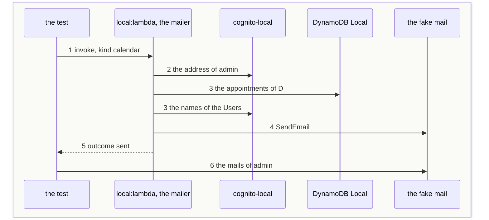

# The "the mailer run by hand (6.1, 6.3)" journey, in simple words

| | |
|---|---|
| Test file | `backend/tests/integration/mail.test.ts` |
| `describe` | `the mailer run by hand (6.1, 6.3)` |
| Tests | 1. "calendar: one mail to the Administrator's own address, From and Reply-To of the stack, the file with every appointment of the day and the names" 2. "mine: one mail to the User's own address, their appointments listed and in the file, nobody else's and no name" 3. "mine in Italian: a User whose language is Italian gets the mail, its list, its file and the file's name in Italian" 4. "an event carrying an address, or a kind not of the role, sends nothing" |
| Runs against | the local stack: the API on port 3000 (`sam local start-api`), the functions' invoke on port 3001 (`npm run local:lambda`), cognito-local on port 9229, DynamoDB Local on `DYNAMODB_PORT`, the fake mail on port 8025 (`RUN_INTEGRATION=1`) |

Ideas used here, explained once for all journeys:
[the people of the local stack](../concepts.md#the-people-of-the-local-stack),
[the four facts of a person](../concepts.md#the-four-facts-of-a-person),
[one local calendar, shared](../concepts.md#one-local-calendar-shared),
[windows and slots](../concepts.md#windows-and-slots),
[the life of an appointment](../concepts.md#the-life-of-an-appointment),
[mail in the journeys](../concepts.md#mail-in-the-journeys).

## What this block proves

- The mailer sends one mail, only to the asker's own address, read in Cognito: the event that
  starts it carries none (`docs/EMAIL_ARCHITECTURE.md` section 6.1).
- The Administrator's mail holds every appointment of the range with the names; a User's holds
  only their own, without names (`docs/EMAIL_ARCHITECTURE.md` section 6.3).
- The mail, its file and the file's name are in the recipient's own language, read in Cognito
  with the address (`docs/MULTILANGUAGE_ARCHITECTURE.md` section 8).
- An event the mailer does not accept sends nothing (`docs/EMAIL_ARCHITECTURE.md` section 6.1).

## Who takes part

- **The Administrator** (`admin`, seeded, address `admin@example.com`): makes the journey's day
  and receives the mail of the whole calendar.
- **`alice`** (seeded, address `alice@example.com`, named Alice Liddell): two appointments of the
  day, one booked and one cancelled; receives the mail of their own.
- **`mail-bob`**: a throw-away User with one booked appointment of the day, whose name must show
  in the Administrator's file and whose appointment must not show in alice's. In test 3 its
  language is Italian, and it receives the mail of its own at `mail-bob@example.com`.
- **The mailer**, run through `npm run local:lambda` by `runMailer()`, which waits for its
  result; **the fake mail**, which keeps the mails. The local stack runs with the template's
  default language (`DefaultLanguage`, English), so a person whose account holds no language
  gets English: `admin` and `alice` in tests 1 and 2.

## Before the block starts

The file's `beforeAll`, shared by both blocks of the file:

1. Signs in `admin` and `alice`, reads the calendar settings (`GET /calendar/settings`): the time
   zone, and the four values it keeps as `leftover`. Then saves its own (`SETTINGS`, with
   `PUT /calendar/settings`): a booking horizon of 56 days, no booking notice, no limit of
   appointments, 24 hours' notice to cancel. Another file may have left a shorter horizon (the
   calendar journeys leave 30 days) or a limit, and the bookings below would find no slot. It
   takes the journey's day `D`: today plus 45 days (`DAYS_AHEAD`), inside that horizon and far
   from the days other journeys use.
2. Removes what an earlier, interrupted run left (`removeFromCalendar()`, see "If the block
   fails halfway").
3. As the Administrator, creates the type `mail journey` (`TYPE`) and a one-off window on `D`,
   20:00–23:00 local, under it: three one-hour slots.
4. Creates `mail-bob` again (`newUser()`: removed first, then `POST /users` with the four facts
   of `withFacts()`, then its password set with `setPasswordOf()`, and the sign-in).
5. Books, each time the first slot of the journey's type the view still offers
   (`bookSlot()`), each appointment with the note `MARK` (`mail journey <milliseconds>`, the
   mark of this run):

| Slot | Who | Then |
|---|---|---|
| 20:00–21:00 | `alice` | stays booked |
| 21:00–22:00 | `mail-bob` | stays booked |
| 22:00–23:00 | `alice` | cancelled by alice (`POST …/cancel`) |

The test keeps the three answers as `booked`, in that order, the third being the answer of the
cancel. The calendar table is never emptied (see [one local calendar,
shared](../concepts.md#one-local-calendar-shared)): `D` may also hold cancelled appointments of
earlier runs, with another mark. So every check on a file looks at the rows whose `Note` is
`MARK` (`journeyRows()`), never at the count of all rows.

Before each test, the fake mail forgets the mails of `admin@example.com` and
`alice@example.com` (`forgetMailsTo()`).

## Test 1: the whole calendar, to the Administrator

| Step | What happens |
|---|---|
| 1 | `runMailer()` sends the event `{ kind: calendar, sub, username: admin, role: admin, from: D, to: D, requestId }` and waits |
| 2 | the mailer reads `admin`'s e-mail (`getProfile()`) |
| 3 | at the same time, it reads the appointments of `D`, every status, and the names of the Users (`namesBySub()`) |
| 4 | it sends one mail to `admin@example.com`, with the file |
| 5 | it answers `{ outcome: sent, appointmentCount }` |
| 6 | the test reads the mails of `admin@example.com` from the fake |

1. `runMailer()` invokes the mailer with the event of kind `calendar` for `admin`, from `D` to
   `D`. The test checks the result has `outcome` `sent`.
2. It reads the mails of `admin@example.com` (`waitForMails()`). The test checks:
   - exactly one mail, to `['admin@example.com']`;
   - the sender `"Shared calendar" <noreply@example.com>` (`FROM`: the template's default
     domain) and the Reply-To `['local@example.invalid']` (`REPLY_TO`: the local stack's
     `AlertEmail`);
   - a subject starting `Calendar, `, and a file named `calendar-D-to-D.xlsx`.
3. It opens the file (`rowsOf()`, which also checks there is exactly one file). The test checks
   the heading row: `Date`, `Start`, `End`, `Type`, `Username`, `First name`, `Last name`,
   `Status`, `Cancelled because`, `Note`, `Booked at`.
4. The test checks the rows marked `MARK` are exactly the three appointments, by start: for each
   its date `D`, its local start and end, the type, the username, the status, `Cancelled
   because` (`cancelled` for alice's cancelled one, empty otherwise), the note, a `Booked at`
   in the form `YYYY-MM-DD HH:mm`, and the names: Alice Liddell for both of alice's,
   `Throw` and `Away mail-bob` for mail-bob's.
5. The test checks `alice@example.com` holds no mail.

## Test 2: their own, to alice

1. `runMailer()` invokes the mailer with the event of kind `mine` for `alice`, from `D` to `D`.
   The test checks `outcome` `sent`.
2. It reads alice's mails. The test checks: exactly one, to `['alice@example.com']`, a subject
   starting `Your appointments, `, the file `my-appointments-D-to-D.xlsx`.
3. The test checks the plain text lists both of alice's appointments, each as
   `<start>–<end>, mail journey, <status>`. The list names nobody; that mail-bob's is not there
   is seen in the file.
4. It opens the file. The test checks the heading row has no `First name` or `Last name`
   (`Date`, `Start`, `End`, `Type`, `Username`, `Status`, `Cancelled because`, `Note`,
   `Booked at`); that every row's `Username` is `alice`, the earlier runs' rows too; and that the
   rows marked `MARK` are exactly alice's two of the journey, by start.
5. The test checks `admin@example.com` holds no mail.

## Test 3: their own, to mail-bob, in Italian

1. The fake mail forgets `mail-bob@example.com`'s mails. The test sets `mail-bob`'s language to
   `it` straight in cognito-local (`setLanguageOf()`: the attribute `locale`, as the person's
   choice in "My details" stores it), sets its password again and signs it in, for its `sub`.
2. `runMailer()` invokes the mailer with the event of kind `mine` for `mail-bob`, from `D` to
   `D`. The test checks `outcome` `sent`. The mailer reads the language with the address
   (`getProfile()`), and writes the mail, the file and its name in it.
3. It reads mail-bob's mails. The test checks: exactly one; a subject starting
   `I suoi appuntamenti, dal `; the plain text listing mail-bob's appointment as
   `<start>–<end>, mail journey, prenotato` and holding the Italian footer's first sentence,
   `Questa è un'e-mail automatica.`; the file `miei-appuntamenti-dal-D-al-D.xlsx`.
4. It opens the file. The test checks the heading row in Italian (`Data`, `Inizio`, `Fine`,
   `Tipo`, `Nome utente`, `Stato`, `Motivo dell'annullamento`, `Nota`, `Prenotato il`), and
   that the rows marked `MARK` are exactly one: `D`, `mail-bob`, `prenotato`. The dates and
   times stay as they are in every language.
5. The fake mail forgets mail-bob's mails again.

## Test 4: events the mailer refuses

The test invokes the mailer twice with alice's `mine` event changed: once with an extra field
`email: 'admin@example.com'`, once with `kind` `calendar` for the role `user`. It checks both
results are exactly `{ outcome: 'invalid_event' }`, and that neither address then holds a mail.
The mailer checks its event (`MailerEvent` of `backend/src/lib/mailerEvent.ts`: no field it does
not know, the kind that goes with the role) before it reads anything.

## What the block leaves

- **The fake mail**: nothing for `admin@example.com`, `alice@example.com` and
  `mail-bob@example.com` (test 4 sends none, each test starts by forgetting the first two, and
  test 3 forgets the third before and after).
- **The calendar**: the three appointments of the file's `beforeAll`, as they were, and its
  settings, which the file's `afterAll` writes back; the block changes nothing. The next block
  uses them.
- **Cognito**: `mail-bob` as the `beforeAll` made it, with its language Italian since test 3;
  the file's `afterAll` removes it.

## If the block fails halfway

A failed check skips the rest of its test; the next test still runs, and needs nothing from the
one before (each forgets the mails first). A failure in test 3 after its first step leaves
`mail-bob` Italian and may leave its mail in the fake mail; the account goes with the file's
`afterAll`. The file's `afterAll` runs whatever happens: it
removes what the file made in the calendar (`removeFromCalendar()`: as the Administrator, it
cancels every appointment of the type `mail journey` still booked from today to 56 days ahead,
deletes the type's one-off windows found in the view, two reads of at most 31 days, and deletes
the type), removes `mail-bob` straight in cognito-local (`removeUserIfPresent()`), and writes back the
calendar settings it found (`leftover`, with `PUT /calendar/settings`). The next
run's `beforeAll` does the same removal first. The cancelled appointments stay in the table as
history, which is why the checks look for `MARK`.

## Where in the code

| What | Where |
|---|---|
| The mailer | `backend/src/handlers/mailer.ts`; its event `backend/src/lib/mailerEvent.ts` |
| The file | `appointmentsFile()` in `backend/src/lib/excel.ts` |
| The mail | `sendMail()` in `backend/src/lib/ses.ts`; the texts `calendarMailText()` and `mineMailText()` of `shared/src/mail/texts.ts` |
| The address, the language and the names | `getProfile()` and `namesBySub()` in `backend/src/lib/cognito.ts` |
| The words of each language | `mailTexts()` of `shared/src/mail/texts.ts`, with `texts.en.ts` and `texts.it.ts` |
| The appointments | `listAppointments()` in `backend/src/lib/calendarDb.ts` |
| The fake mail | `backend/docker/fake-mail.mjs` |
| Test helpers | in the file: `removeFromCalendar()`, `newUser()`, `bookSlot()`, `rowsOf()`, `journeyRows()`, `rowOf()`; in `backend/tests/integration/setup.ts`: `api()`, `setPasswordOf()`, `setLanguageOf()`, `signIn()`, `subOf()`, `factsOf()`, `withFacts()`, `removeUserIfPresent()`, `runMailer()`, `waitForMails()`, `forgetMailsTo()` |
| Constants | `TYPE`, `DAYS_AHEAD`, `MARK`, `FROM`, `REPLY_TO` |
