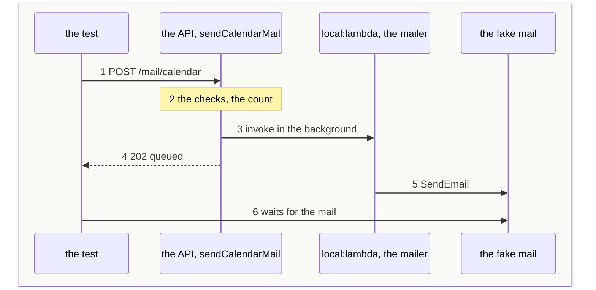

# The "POST /mail/calendar (6.5, 9.1)" journey, in simple words

| | |
|---|---|
| Test file | `backend/tests/integration/mail.test.ts` |
| `describe` | `POST /mail/calendar (6.5, 9.1)` |
| Tests | 1. "the Administrator: 202 queued, then the whole calendar of the dates in a mail to their own address" 2. "a User: 202 queued, then their own appointments only, here none: the new account booked nothing" 3. "a range of 367 days is 400, and counts nothing" 4. "the sixth request of the day is 429 mail_limit_reached, and sends nothing" 5. "an account without an address is 409 no_email_address" |
| Runs against | the local stack: the API on port 3000 (`sam local start-api`), the functions' invoke on port 3001 (`npm run local:lambda`), cognito-local on port 9229, DynamoDB Local on `DYNAMODB_PORT`, the fake mail on port 8025 (`RUN_INTEGRATION=1`) |

Ideas used here, explained once for all journeys:
[the people of the local stack](../concepts.md#the-people-of-the-local-stack),
[the four facts of a person](../concepts.md#the-four-facts-of-a-person),
[one local calendar, shared](../concepts.md#one-local-calendar-shared),
[mail in the journeys](../concepts.md#mail-in-the-journeys).

## What this block proves

- `POST /mail/calendar` answers `202 { status: "queued" }` to both roles, and the mail follows;
  the role decides what it holds, never the body (`docs/EMAIL_ARCHITECTURE.md` section 9.1).
- The limits: a range longer than 366 days is `400 invalid_request`; the sixth request of a
  local day is `429 mail_limit_reached`; an account without an e-mail is
  `409 no_email_address` (`docs/EMAIL_ARCHITECTURE.md` section 6.5).

## Who takes part

- **`mail-boss`**: a second administrator made for the block straight in cognito-local
  (`createSecondAdmin()`), then given the four facts of `factsOf('mail-boss')` (`setFactsOf()`),
  address `mail-boss@example.com` (`BOSS`). The seeded `admin` is not used: its `sub` is the same
  from one run to the next, so its five mails of the day would run out.
- **`mail-bob`**, made again for this block (`newUser()`), address `mail-bob@example.com`
  (`BOB`). The new account has a new `sub`, so all five of the day, and no appointment: the one
  the first `mail-bob` booked stays in the calendar under the old `sub`.
- **`mail-nobody`**: a second administrator with no fact, made in test 5.
- **The route**, the mailer it starts through `npm run local:lambda`, and **the fake mail**.

## Before the block starts

The file's `beforeAll` made the journey's day `D` (45 days ahead), the type `mail journey`, its
window 20:00–23:00 and three appointments with the note `MARK`; the block before changed none of
it ([the page of that block](mail-mailer.md), "Before the block starts"). The block's
`beforeAll` makes `mail-bob` and `mail-boss` again as above, signs both in, and makes the fake
mail forget the mails of `BOB` and `BOSS`.

Each request of the block asks for `{ from: D, to: D }` unless a test says otherwise.

## Test 1: the Administrator's mail

| Step | What happens |
|---|---|
| 1 | `mail-boss` asks for `{ from: D, to: D }` |
| 2 | the route's checks, in order; the count becomes 1 of 5 |
| 3 | the route starts the mailer with the kind `calendar` (an `Event` invocation) |
| 4 | the route answers without waiting for the mailer |
| 5 | the mailer sends one mail to `mail-boss@example.com` |
| 6 | the test reads the fake until the mail is there (`waitForMails()`) |

`mail-boss` asks. The test checks the answer is exactly `202 { status: "queued" }`. It waits for
the mail of `BOSS` (`waitForMails()`) and checks: exactly one, to `[BOSS]`, a subject starting
`Calendar, ` (the kind `calendar`, chosen by the role), and a file whose rows marked `MARK` are
three: the journey's appointments, whoever booked them.

## Test 2: a User's mail, with nothing in it

`mail-bob` asks. The test checks `202 { status: "queued" }`; then, in the mail that comes to
`BOB`, the recipient `[BOB]`, the plain text `You have no appointments in this period.`, and a
file of one row, the headings: the new account owns no appointment, so even the one the first
`mail-bob` booked on `D` is not there. `mail-bob` has used one of the day's five.

## Test 3: a range too long, and a body with a recipient

`mail-bob` asks for `D` to `D` + 366 days, 367 days in all. The test checks the answer is exactly
`400 { error: "invalid_request", message: "Invalid input: to" }`. Then `mail-bob` asks for `D` to
`D` with an extra field `recipient: BOSS`; the test checks `400`: the body takes no address.

The route checks the body before it counts, so neither request is counted. The test does not
read the count; test 4 shows it, since its fifth request is still accepted.

## Test 4: the sixth request of the day

1. `mail-bob` asks four more times; the test checks `202` each time. With test 2's, that is five.
2. The sixth time, the test checks the answer is exactly
   `429 { error: "mail_limit_reached", message: "No more e-mails can be asked for today" }`.
3. It waits for five mails to `BOB`, then three seconds more, and checks `BOB` holds exactly five
   (`MAIL_LIMITS.mailsPerDay`), every one to `BOB`: the refused request started no mailer.

The count is one item of the table `mail` per `sub` and local day, raised under a condition that
fails at five; its item expires two days later.

## Test 5: no address

The test removes `mail-nobody` if present, makes it a second administrator with no fact
(`createSecondAdmin()`), signs it in and asks. It checks the answer is exactly
`409 { error: "no_email_address", message: "This account has no e-mail address" }`. The route
reads the address in Cognito before it counts, so nothing is counted and no mailer starts.

## What the block leaves

- **Cognito**: the `afterAll` removes `mail-boss` and `mail-nobody`; the file's `afterAll` then
  removes `mail-bob`.
- **The fake mail**: the `afterAll` forgets the mails of `BOB` and `BOSS`.
- **The table `mail`**: the counts of the day, one for `mail-boss`'s `sub` and five for
  `mail-bob`'s, under `sub`s no account has any more. They are marked to expire after two days;
  nothing reads them again.
- **The calendar**: unchanged by this block. The file's `afterAll` cancels the journey's
  appointments still booked (alice's and the first `mail-bob`'s) and deletes the window and the
  type ([the page of the block before](mail-mailer.md), "If the block fails halfway").

## If the block fails halfway

A failed check skips the rest of its test; the later tests still run. Test 4 counts on test 2
having used exactly one of `mail-bob`'s five and test 3 none: if test 2 failed before asking,
test 4's sixth request is still accepted and the test fails. The `afterAll` and the file's
`afterAll` run whatever happens, and the next run makes every account of the block again, with
new `sub`s and so a fresh count.

## Where in the code

| What | Where |
|---|---|
| The route | `POST /mail/calendar`: `backend/src/handlers/sendCalendarMail.ts`, its checks in this order: the token's role, the stage (`MAIL_STAGE`, `on` locally), the body (`MailCalendarBody` of `shared/src/mail/schemas.ts`), the address (`getProfile()`), the count (`countMailRequest()` of `backend/src/lib/mailDb.ts`), the start (`startMailer()` of `backend/src/lib/lambdaInvoke.ts`) |
| The kind | `kindFor()` in `backend/src/lib/mailerEvent.ts`: `calendar` for the Administrator, `mine` for a User |
| The limits | `MAIL_LIMITS` in `shared/src/mail/` |
| The mailer and the fake mail | as in [the page of the block before](mail-mailer.md) |
| Test helpers | in the file: `newUser()`, `rowsOf()`, `journeyRows()`, the block's `ask()`; in `backend/tests/integration/setup.ts`: `api()`, `signIn()`, `factsOf()`, `setFactsOf()`, `createSecondAdmin()`, `removeUserIfPresent()`, `waitForMails()`, `forgetMailsTo()` |
| Constants | `BOB`, `BOSS`, `BOSS_PASSWORD`, `MAIL_LIMITS.rangeDays`, `MAIL_LIMITS.mailsPerDay` |
