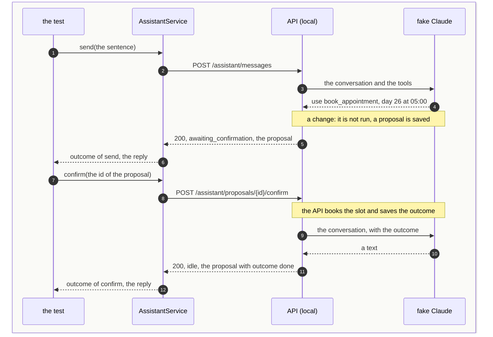

# The "a booking confirmed" journey, in simple words

| | |
|---|---|
| Test file | `frontend/tests/integration/assistant.test.ts` |
| `describe` | `a booking confirmed` |
| Tests | 1. "send: the reply holds the proposal in the words of the server, and nothing is booked" 2. "confirm and decline with an id that is not one: invalid_request, no request sent" 3. "confirm with the id of no proposal: proposal_not_found, and the proposal keeps waiting" 4. "confirm: the booking is made, the proposal comes back with its outcome done, and Claude's closing words follow" 5. "the calendar's own services show the appointment: in the person's list and in the day, whose slot at 05:00 is no longer free" 6. "the same proposal cannot be confirmed or declined again, and nothing more is booked" 7. "load: the settled proposal is still shown, with its outcome" |
| Runs against | the local stack: the API on port 3000, cognito-local on port 9229, the fake Claude on port 9230 (`RUN_INTEGRATION=1`) |

Ideas used here, explained once for all journeys:
[the front end's services in the journeys](../concepts.md#the-front-ends-services-in-the-journeys),
[the assistant's service: one stream for six calls](../concepts.md#the-assistants-service-one-stream-for-six-calls),
[refused before sending, or by the API](../concepts.md#refused-before-sending-or-by-the-api),
[the assistant in the journeys](../concepts.md#the-assistant-in-the-journeys),
[the fake Claude](../concepts.md#the-fake-claude),
[a proposal, and its two buttons](../concepts.md#a-proposal-and-its-two-buttons),
[one local calendar, shared](../concepts.md#one-local-calendar-shared),
[windows and slots](../concepts.md#windows-and-slots),
[the deleted-user marker](../concepts.md#the-deleted-user-marker),
[the event log](../concepts.md#the-event-log).

## What this block proves

- `AssistantService.confirm()` is the call that makes a change: the booking exists only after it,
  and the reply carries the proposal with the outcome of its change
  (`docs/CONVERSATIONAL_ARCHITECTURE.md` sections 5.4 and 5.5, rule 1).
- The service refuses an id that is not a ULID before sending anything; an id of no proposal is
  sent, and the API answers `proposal_not_found`, a reason of its own
  (`docs/FRONTEND_SERVICES.md` sections 20.4 and 20.5).
- A proposal is settled once: a second `confirm` or `decline` finds none
  (`docs/CONVERSATIONAL_ARCHITECTURE.md` section 5.5, rule 6).
- The appointment made through the assistant is an ordinary appointment: `AppointmentsService`
  and `CalendarService` show it.

## Who takes part

- **`fe-assistant-book`**: a plain User the block creates. It signs in, talks to the assistant
  through one `AssistantService`, and reads its own calendar.
- **The Administrator** (`admin`): creates and removes the User, the type and the window.
- **The fake Claude**: answers for Anthropic. It knows the sentence the block sends.

## Before the block starts

The file's `beforeAll` has refused the real Claude, signed the Administrator in and worked out
today's date in the calendar's time zone.

The block's `beforeAll` calls the helper `open('fe-assistant-book', 'fe-assistant booking', 26)`.
It removes what an earlier run left, creates the type `fe-assistant booking`, opens one extra
window of that type, **05:00–07:00**, on the 26th day after today, and creates and signs in the
User. The window gives two one-hour slots, 05:00 and 06:00. The fake asks to book 05:00 on that
day.

The User is new, so it has no appointment at all. That is why the block can count its
appointments.

## The story

## Test 1: send, and a proposal comes back

`fe-assistant-book` calls `send()` with the sentence
`fake: book me the slot of the booking journey`. The fake asks for the tool `book_appointment`.
The server does not run it: it reads the slot itself and answers with a proposal.

The test checks that:

- the reply says the language `en` and the status `awaiting_confirmation`, with `activity` `null`;
- `proposal` has a `proposalId` that is a ULID, the question `Make this change?`, the labels
  `Confirm` and `Don't`, and one action. Its `summary` is the sentence that
  `assistantTexts('en').changes.bookAppointment()` of `shared/` makes for the block's day, from
  05:00 to 06:00, of the type `fe-assistant booking`, with no note. Its `outcome` and its `error`
  are `null`: nothing is decided yet;
- `messages` holds the person's sentence and nothing else;
- **nothing is booked**: the User's list of upcoming appointments is empty (the helper
  `upcoming()`, which asks `AppointmentsService.list({ upcoming: 'true' })`; the server lists the
  caller's own booked appointments that have not ended).

The test keeps the proposal's id.

## Test 2: an id that is not one

`fe-assistant-book` calls `confirm('not-an-id')`, then `decline('not-an-id')`. The test checks
that the first outcome is exactly `{ call: 'confirm', status: 'failure', reason:
'invalid_request', message: 'proposalId: expected a ULID' }`, that the second says `call:
'decline'` with the reason `invalid_request`, and that **no request left** either time: a spy on
`fetch` stays uncalled (the helper `noRequest()`). The service checks the id with the shared
schema `Ulid` before it builds the path.

## Test 3: the id of no proposal

`fe-assistant-book` calls `confirm()` with a well-formed ULID that names no proposal
(`NO_PROPOSAL`). The service has no way to know that, so the request leaves and the API answers
`404`. The test checks that the outcome says `call: 'confirm'`, the status `failure` and the
reason `proposal_not_found`. Then it checks, with `load()`, that the conversation still says
`awaiting_confirmation` with the same `proposalId`, and that the list of upcoming appointments is
still empty.

## Test 4: confirm

`fe-assistant-book` calls `confirm()` with the proposal's id. The server books the slot through
the code of the calendar's own route, saves the outcome, and asks Claude once for the closing
words. Should that reply say `working`, the helper `untilTheExchangeEnds()` would call
`continue()`; with the fake it does not need to.

The test checks that:

- the last reply says `idle`, with `activity` `null`;
- `proposal` is the same proposal, with the same id and the same summary, and its action now has
  `outcome: 'done'` and `error: null`;
- the messages added are one, from `assistant`: Claude's closing words.

## Test 5: the calendar's own services show the appointment

The test asks the calendar, as `fe-assistant-book`, without the assistant.

Through `upcoming()` it checks that the User has **one** appointment, and that it:

- starts at 05:00 and ends at 06:00 of the block's day, as instants (`toInstant()` of `shared/`,
  in the calendar's time zone), with `date` the block's day;
- has the block's type, by id and by name;
- belongs to `fe-assistant-book`, is `booked`, has no note, and was created by
  `fe-assistant-book` with the role `user`: the confirmation ran with the identity of the person
  who pressed the button.

Through `CalendarService.load()` for that one day (the helper `dayOf()`) it checks that:

- the view's `appointments` are exactly that appointment. A User's view lists the User's own
  appointments only;
- the day's free slots **of the block's type** are 06:00 alone. 05:00 is taken. The filter on the
  type is there because other journeys' hours may lie on the same day.

## Test 6: the same proposal again

`fe-assistant-book` calls `confirm()`, then `decline()`, with the id of the settled proposal. The
test checks that both outcomes say `failure` with the reason `proposal_not_found`, each with its
own `call`, and that the User still has exactly one upcoming appointment.

## Test 7: load

`fe-assistant-book` calls `load()`. The test checks that the reply says `idle` and still carries
the proposal, with the same id and its action `done`. A settled proposal stays in every reply
until the person's next message, so a page loaded again shows what was done.

## What the block leaves

The block's `afterAll` calls `close()`:

1. the User is deleted through `DELETE /users/{username}`. That cancels its appointment, with the
   reason `user_deleted`, and writes the deleted-user marker;
2. the window is deleted. A cancelled appointment keeps no window;
3. the type is deleted.

| What stays | Where |
|---|---|
| the appointment at 05:00, cancelled (`user_deleted`), with its two events: `appointment.booked` from the confirmation and `appointment.cancelled` from the deletion of the User ([the event log](../concepts.md#the-event-log)) | `calendar` |
| the deleted-user marker of `fe-assistant-book` | `calendar` |
| the conversation and the day's count of one message, under an account that no longer exists, which nobody reads | `assistant` |

No type, no window and nothing booked stays.

## If the block fails halfway

A failed test does not stop the block. Tests 3 to 7 need the proposal's id from test 1; tests 5 to
7 need the confirmation of test 4. The `afterAll` runs in any case; should the run be killed
before it, the next run's `open()` cleans up first, in the same order: the User, whose booked
appointment is cancelled with it, then the window, then the type.

If hours somebody else opened lie on the block's day between 05:00 and 07:00, opening the window
fails with `availability_overlap` in the `beforeAll`, and every test of the block fails.

## Where in the code

| What | Where |
|---|---|
| The calls | `AssistantService` (`frontend/src/services/assistant.service.ts`), all on the stream `outcome$`: `send(text)` → `POST /assistant/messages`; `confirm(proposalId)` → `POST /assistant/proposals/{proposalId}/confirm`; `decline(proposalId)` → `POST /assistant/proposals/{proposalId}/decline`; `load()` → `GET /assistant/conversation` |
| The refusal before sending | `checkedProposalId()` in the service, with `Ulid` of `shared/` and `invalidRequest()` of `frontend/src/services/api.ts` |
| The calendar read back | `AppointmentsService.list()` on `appointmentsResult$` → `GET /calendar/appointments` (helper `upcoming()`); `CalendarService.load()` on `calendarResult$` → `GET /calendar` (helper `dayOf()`) |
| The expected proposal | the helper `bookingProposal()`, with `assistantTexts()` of `shared/` |
| The stage | the helpers `open()`, `close()`, `removeUser()`, `removeFromCalendar()`, `noRequest()` |
| Constants | `USER` (`fe-assistant-book`), `TYPE` (`fe-assistant booking`), `ASK` (the sentence), `NO_PROPOSAL` |
| What the fake answers | `backend/tests/integration/fake-claude/answers.json`, under the sentence |
