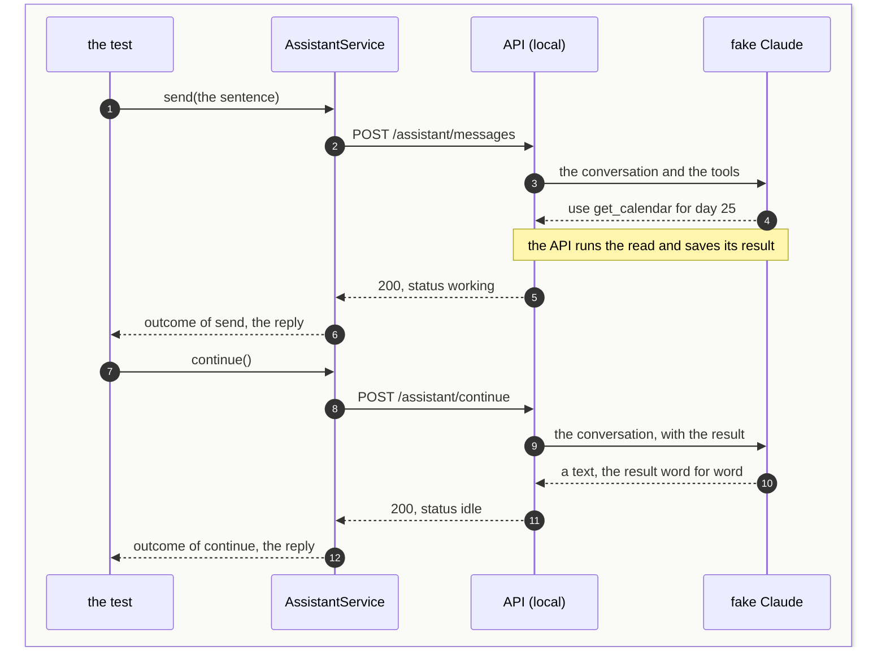

# The "a reading driven by continue" journey, in simple words

| | |
|---|---|
| Test file | `frontend/tests/integration/assistant.test.ts` |
| `describe` | `a reading driven by continue` |
| Tests | 1. "load, with no conversation yet: an empty reply, with the messages the person may still send today" 2. "send: one request, and the reply says working with the line of the read; the service does not continue by itself" 3. "send again while the step waits: assistant_busy, a reason of its own" 4. "continue, repeated by the caller while the reply says working: one more request ends the exchange, with the answer made from what the calendar gave" 5. "load: the whole conversation, the person's message and the answer, in order" 6. "continue with nothing to continue: nothing_to_continue" 7. "end: the conversation is over, a load gives the empty reply again, and the day's count is kept" |
| Runs against | the local stack: the API on port 3000, cognito-local on port 9229, the fake Claude on port 9230 (`RUN_INTEGRATION=1`) |

Ideas used here, explained once for all journeys:
[the front end's services in the journeys](../concepts.md#the-front-ends-services-in-the-journeys),
[the assistant's service: one stream for six calls](../concepts.md#the-assistants-service-one-stream-for-six-calls),
[the assistant in the journeys](../concepts.md#the-assistant-in-the-journeys),
[the fake Claude](../concepts.md#the-fake-claude),
[steps, `continue` and the tools](../concepts.md#steps-continue-and-the-tools),
[the daily limit](../concepts.md#the-daily-limit),
[one local calendar, shared](../concepts.md#one-local-calendar-shared),
[windows and slots](../concepts.md#windows-and-slots),
[the deleted-user marker](../concepts.md#the-deleted-user-marker),
[the `assistant` table](../concepts.md#the-assistant-table).

## What this block proves

- `AssistantService` makes the calls `load`, `send`, `continue` and `end`, and notifies the
  outcome of each on its one stream, `outcome$`, with the call it answers
  (`docs/FRONTEND_SERVICES.md` sections 3.4 and 21.4).
- A call makes one request. When a reply says `working`, the service does nothing more: the
  caller calls `continue` (`docs/FRONTEND_SERVICES.md` section 8, decision 60;
  `docs/CONVERSATIONAL_ARCHITECTURE.md` section 5.1).
- Two refusals of the routes arrive as reasons of their own: `assistant_busy` on `send` and
  `nothing_to_continue` on `continue` (`docs/CONVERSATIONAL_ARCHITECTURE.md` section 6).
- The reply is passed on as the server gave it: the text of the answer is still the text the
  server wrote (`docs/FRONTEND_SERVICES.md` section 21.5).

## Who takes part

- **`fe-assistant-read`**: a plain User the block creates. It signs in and talks to the assistant
  through one `AssistantService`, kept for the whole block.
- **The Administrator** (`admin`): creates and removes the User, the type and the window. It never
  talks to the assistant here.
- **The fake Claude**: answers for Anthropic. It knows the sentence the block sends.

## Before the block starts

The file's `beforeAll` runs first:

- `refuseRealClaude()` (`frontend/tests/integration/claude.ts`) reads `backend/env.local.json` and
  throws unless the stack is wired to the fake Claude. No request has left yet.
- The Administrator signs in. The settings are loaded for the calendar's time zone, and `today`
  is today's date in that zone.

Then the block's `beforeAll` calls the helper `open('fe-assistant-read', 'fe-assistant reading', 25)`:

1. it removes what an earlier run left: the User (through `UsersService.deleteUser`, accepting
   `user_not_found`), then the extra windows of the type `fe-assistant reading` from today to 28
   days ahead, then the type (the helpers `removeUser()` and `removeFromCalendar()`);
2. it creates the type `fe-assistant reading`;
3. it opens one extra window of that type, **05:00–07:00**, on the block's day: the 25th day after
   today. That is the day the fake asks the calendar for;
4. it creates the User and signs it in. A new account has no conversation and all of the day's
   messages.

Other journeys' data may lie on that day too. The block looks only at its own window.

## The story

## Test 1: load, with no conversation yet

`fe-assistant-read` calls `load()`, which sends `GET /assistant/conversation`. The outcome arrives
on `outcome$` and says `call: 'load'`. The test checks that the reply is the empty one:
`conversationId` and `language` are `null`, `status` is `idle`, `messages` is empty, `activity`
and `proposal` are `null`, and `remainingToday` is a number. It keeps that number as `atFirst`,
and checks that it is more than zero. The later tests count from it, so the block does not need
to know the local limit.

## Test 2: send, and the reply says `working`

`fe-assistant-read` calls `send()` with the sentence
`fake: what is open on the day of the journey?`, written with two spaces before it and a line
break after it. A spy on `fetch` counts the requests.

The test checks that:

- **exactly one request left**. The reply says `working`, and the service did not call
  `continue` by itself;
- the reply has a `conversationId` that is a ULID, the language `en`, the status `working`, and
  the line of progress `Looking at the calendar…` in `activity`;
- `messages` holds one message, from `person`, whose text is the sentence **without** the spaces
  and the line break. The service sends what the shared schema `AssistantMessageBody` made of the
  text, which trims it. Nothing of the read is among the messages;
- `proposal` is `null`, and `remainingToday` is `atFirst - 1`: the message counted.

What happened on the server: the fake asked for the tool `get_calendar` for the block's day, the
server ran that read and saved its result, and answered at once. The answer in words is still to
come: it is the next step.

## Test 3: send again while the step waits

`fe-assistant-read` sends another message, `Hello, can you hear me?`. The API refuses it, because
a step of the exchange is waiting. The test checks that the outcome says `call: 'send'`, the
status `failure` and the reason `assistant_busy`. The request left: this is the API's answer, not
a check of the service.

## Test 4: continue, repeated by the caller

1. `fe-assistant-read` calls `load()`. The test checks that the conversation still says `working`,
   with the same line `Looking at the calendar…`. A page loaded again at this moment would see
   the same.
2. The helper `untilTheExchangeEnds()` does what the screen's logic will do: while the last reply
   says `working`, it calls `continue()` and waits for its outcome, at most
   `ASSISTANT_LIMITS.modelRequestsPerMessage` times. It collects the messages each reply adds.
   The test hands it the reply of step 1 with its `messages` emptied: `load` gives every message
   of the conversation, the person's included, and the test wants only what the steps add.

The test checks that:

- the helper continued **once**;
- the last reply says `idle`, with `activity` and `proposal` `null` and `remainingToday` still
  `atFirst - 1`: `continue` is not a message of the day;
- the one message added is from `assistant`.

The fake's second answer is the result of the tool, word for word, so the text of that message is
JSON: what Claude was given of the calendar. The test reads it and checks that:

- it holds exactly one day with the block's date;
- that day's `windows` include `{ start: '05:00', end: '07:00', type: 'fe-assistant reading' }`:
  local times, and the type by its name;
- that day's `freeSlots` include `05:00` and `06:00`;
- the text does not contain the id of the type: a User is given the type by its name.

That the text can be read as JSON at all shows that the service passed it on as written.

## Test 5: load, the whole conversation

`fe-assistant-read` calls `load()` again. The test checks that the reply says `idle`, the language
`en` and `remainingToday` `atFirst - 1`; that `messages` holds two messages, from `person` then
from `assistant`; that the first one's text is the sentence; and that its `seq` is lower than the
second's. `load` gives every message of the conversation; the other calls give only the messages
their request added.

## Test 6: continue with nothing to continue

`fe-assistant-read` calls `continue()` while the conversation waits for the person. The API
answers `409`. The test checks that the outcome says `call: 'continue'`, the status `failure` and
the reason `nothing_to_continue`.

## Test 7: end

`fe-assistant-read` calls `end()`, which sends `DELETE /assistant/conversation`. The route answers
`204` with no body. The test checks that the outcome is exactly `{ call: 'end', status: 'success' }`.

Then it calls `load()` and checks that the reply is the empty one again, with `remainingToday`
`atFirst - 1`: ending a conversation does not give the message back.

## What the block leaves

The block's `afterAll` calls `close()`: the User is deleted, then the window, then the type.
Nothing of the block stays in the calendar but the deleted-user marker of `fe-assistant-read`
([the deleted-user marker](../concepts.md#the-deleted-user-marker)). The `assistant` table keeps
the items of the ended conversation and the day's count of one message, under an account that no
longer exists. Nobody reads them; in the cloud they would expire by themselves, which DynamoDB
Local may never do.

## If the block fails halfway

A failed test does not stop the block: the later tests run, and each needs what the ones before
it did.

- Tests 2, 4, 5 and 7 use `atFirst`, which test 1 sets.
- Tests 3 and 4 need the message of test 2. Without it no step waits: the second message of test
  3 is answered instead of refused, and there is nothing to continue in test 4.
- Tests 5 and 6 need the `continue` of test 4. Without it the conversation still says `working`:
  test 5 does not find `idle`, and the `continue` of test 6 succeeds instead of being refused.

The `afterAll` runs in any case and removes the User, the window and the type. Should the run be
killed before it, the next run's `open()` removes them first. The User is removed through
`DELETE /users/{username}`, which writes the deleted-user marker.

If hours somebody else opened lie on the block's day between 05:00 and 07:00, opening the window
fails with `availability_overlap` in the `beforeAll`, and every test of the block fails. The
block cannot move elsewhere: the fake's answer fixes the day.

## Where in the code

| What | Where |
|---|---|
| The calls | `AssistantService` (`frontend/src/services/assistant.service.ts`), all on the stream `outcome$`: `load()` → `GET /assistant/conversation`; `send(text)` → `POST /assistant/messages`; `continue()` → `POST /assistant/continue`; `end()` → `DELETE /assistant/conversation` |
| The outcomes | `AssistantOutcome` (`frontend/src/services/assistant.types.ts`); the reply is the shared `AssistantReply` |
| One call and its outcome | the helpers `ask()` and `reply()` of the test file, on `outcome()` of `frontend/tests/integration/local.ts` |
| The loop | the helper `untilTheExchangeEnds()` |
| The stage | the helpers `open()`, `close()`, `removeUser()`, `removeFromCalendar()`; `refuseRealClaude()` in `frontend/tests/integration/claude.ts` |
| Constants | `USER` (`fe-assistant-read`), `TYPE` (`fe-assistant reading`), `ASK` (the sentence), `PREFIX` (`fe-assistant `), `DAYS_AHEAD` (28) |
| What the fake answers | `backend/tests/integration/fake-claude/answers.json`, under the sentence |
