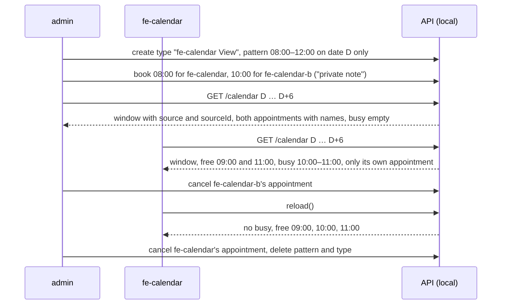

# The "calendar view" journey, in simple words

| | |
|---|---|
| Test file | `frontend/tests/integration/calendar.test.ts` |
| `describe` | `calendar view` |
| Tests | 1. "a week: the Administrator sees sources and names; fe-calendar its own appointment and fe-calendar-b's as busy" 2. "a range of 32 days: invalid_request with the field, no request sent" 3. "reload before any load: invalid_request, no request sent" |
| Runs against | the local stack: the API on port 3000, cognito-local on port 9229 (`RUN_INTEGRATION=1`) |

Ideas used here, explained once for all journeys:
[the front end's services in the journeys](../concepts.md#the-front-ends-services-in-the-journeys),
[refused before sending, or by the API](../concepts.md#refused-before-sending-or-by-the-api),
[the settings](../concepts.md#the-settings),
[availability types](../concepts.md#availability-types),
[where a window comes from](../concepts.md#where-a-window-comes-from),
[windows and slots](../concepts.md#windows-and-slots),
[`busy` and `appointments`](../concepts.md#busy-and-appointments-in-the-calendar-view).

## What this block proves

- `CalendarService` loads the calendar view, and the server shapes it by role: the Administrator
  sees where each window comes from and every appointment with its User's name. A User sees its own
  appointments and other people's only as anonymous busy time (`docs/SHARED_CALENDAR_SPEC.md`
  sections 11.6 and 17).
- `reload()` asks again for the range loaded last and gets the fresh state
  (`docs/SHARED_CALENDAR_SPEC.md` section 16.3).
- The service refuses a range of more than 31 days, or a reload with nothing loaded, without
  sending a request (`docs/SHARED_CALENDAR_SPEC.md` section 16.4).

## Who takes part

- **The Administrator** (`admin`): sees and manages everything. It makes the window, books both
  appointments and cancels them.
- **`fe-calendar`**: a plain User created by the test file. It signs in, so the test can look at
  the calendar through its eyes.
- **`fe-calendar-b`**: a second plain User created by the test file. It never signs in. It only
  exists so that `fe-calendar` has *somebody else's* appointment to see.

## Before the block starts

- Both Users exist. The test file creates them in its `beforeAll`, after removing what an earlier
  run may have left.
- The block's `beforeAll` (the helper `bookingSettings()`) changes three settings, so that a User
  can book about a year ahead, and its `afterAll` writes back the values it read:

  | Setting | Set to | Why |
  |---|---|---|
  | `bookingHorizonDays` | 365 | the test's dates lie about a year ahead (from today + 330 days) |
  | `minBookingNoticeHours` | 0 | no notice can get in the way |
  | `maxFutureAppointmentsPerUser` | `null` (no limit) | a limit left by the back end's journeys (say 3) must not make a User's own booking fail |
  | `cancellationNoticeHours` | kept as read | the update needs all four values; at most 720 hours cannot block a cancel 330 days ahead |

  In this block the Administrator makes every booking, and it is exempt from all four settings. The
  values matter in the "appointments" block, where `fe-calendar` books for itself. The blocks share
  the same helper.

  Before writing, the helper keeps the values it read in
  `frontend/tests/integration/fe-calendar-settings.local.json` (git-ignored). If a run is killed
  before the write-back, the next run finds the file and writes the values back first.

## Test 1: a week, as the Administrator and as a User

### 1. Prepare a bookable day

The helper `bookableDate('View')` creates the test's own availability type, named
`fe-calendar View`. It then picks a date about a year ahead that has no window and no override
yet (the helper `freeDate()`), so that nobody else's data is in the way. On that date it opens one
window, **08:00–12:00**, of the new type, through a weekly pattern valid on that date only (see
"Background: the helper `bookableDate()`" below).

That gives four one-hour slots: 08:00, 09:00, 10:00 and 11:00.

### 2. The Administrator books two appointments

- **08:00–09:00** for `fe-calendar`.
- **10:00–11:00** for `fe-calendar-b`, with the note "private note".

The day now looks like this:

| Time | State |
|---|---|
| 08:00 | `fe-calendar`'s appointment |
| 09:00 | free |
| 10:00 | `fe-calendar-b`'s appointment |
| 11:00 | free |

### 3. The Administrator looks at the week

The Administrator loads the calendar for seven days, starting with the chosen date. The test
checks that:

- the answer covers exactly those seven days, in the calendar's time zone;
- the chosen day has the 08:00–12:00 window, and the Administrator can also see **where it comes
  from**: `source: 'pattern'`, and `sourceId` is the id of the pattern the test created;
- the day has no date override (`hasOverride: false`);
- the day's `busy` list is empty, and **both** appointments are in the view's `appointments` list,
  each with its User's name. The Administrator gets the full appointments, not anonymous busy
  intervals;
- neither appointment carries a cancellation deadline (`cancellableUntil` is `null`): the
  Administrator has no notice to respect.

### 4. `fe-calendar` looks at the same week

The test loads the same week as `fe-calendar`. It keeps this `CalendarService` for step 6. The
test checks that:

- the window is there, but **without** the Administrator-only details (no `source`, no `sourceId`,
  no `hasOverride`);
- the **free slots** are 09:00 and 11:00 only. The User's own 08:00 appointment and the other
  User's 10:00 appointment are not free;
- **10:00–11:00 shows as `busy`**: just a start time and an end time, nothing else;
- the only appointment listed is **its own** 08:00 one, with the deadline until which it may still
  cancel or change it. Its own appointment is not in `busy`: it is already in `appointments`;
- nothing in the whole answer mentions `fe-calendar-b`: not its name, not its appointment's id, not
  the "private note".

This is the privacy rule: a User sees other people's appointments only as anonymous busy time.

### 5. The Administrator cancels `fe-calendar-b`'s appointment

10:00 becomes free again.

### 6. `fe-calendar` reloads its view

The test calls `reload()` on the same service. It does not repeat the dates: the service remembers
the range it loaded last. The test checks that:

- there is no `busy` time any more;
- the free slots are now 09:00, 10:00 and 11:00.

### 7. Tidy up

- The Administrator cancels `fe-calendar`'s 08:00 appointment.
- The helper `release()` deletes the pattern, then the type. This works only now. While a booked
  appointment lies in the window, deleting the pattern is refused with `availability_conflict`
  ([booked appointments keep their window](../concepts.md#booked-appointments-keep-their-window)).
  The type cannot be deleted while a pattern or a booked appointment still uses it (`type_in_use`).

The two cancelled appointments stay in the local table as history.

## Test 2: a range of 32 days

`fe-calendar` asks `CalendarService.load()` for 32 days, from today + 330 days. The test checks that
the service answers `invalid_request` with the message `to: the range spans more than 31 days`,
and that **no request leaves**: a spy on `fetch` stays uncalled (the helper `noRequest()`). The
service checks its input with the shared schemas before sending, so the server never sees a range
it would refuse anyway.

## Test 3: reload before any load

A brand-new `CalendarService` for `fe-calendar` is asked to `reload()`. It has no range to repeat.
The test checks the answer `invalid_request` with the message `nothing loaded yet`, again with no
request sent.

## What the block leaves

Nothing for the blocks after it. The type and the pattern are deleted in test 1, and the block's
`afterAll` writes the settings back to the values it read, then removes
`fe-calendar-settings.local.json`. The two Users stay until the file's `afterAll`. Only history
remains in the local `calendar` table: the two cancelled appointments, each with its
`appointment.booked` and `appointment.cancelled` events ([the event log](../concepts.md#the-event-log)).

## If the block fails halfway

The file's `afterAll` (and the next run's `beforeAll`) clean up whatever is left:

1. they write the saved settings back, if the file is still there;
2. they delete both Users, which cancels their remaining appointments;
3. they delete the one-off windows, overrides and patterns of the `fe-calendar …` types, then the
   types (the helper `cleanUp()`).

So a failed run leaves nothing booked behind, and the test can simply be run again.

## Where in the code

| What | Where |
|---|---|
| The view | `CalendarService` (`frontend/src/services/calendar.service.ts`): `load(from, to)`, `reload()`, the stream `calendarResult$`; route `GET /calendar` |
| Bookings and cancels | `AppointmentsService`: `book`, `cancel`, through the test helpers `book()` and `cancel()` |
| The window | `AvailabilityTypesService` and `AvailabilityRulesService`, through the helpers `bookableDate()` and `release()` |
| Settings | `bookingSettings()`, `saveSettings()`, `restoreSettings()`, the file `fe-calendar-settings.local.json` |
| Constants | `USER` (`fe-calendar`), `USER_B` (`fe-calendar-b`), `PREFIX` (`fe-calendar `), `BAND_OFFSET` (330 days) |

## Background: the helper `bookableDate()`

It is shared by this block, "appointments" and "availability conflict". It creates a type and a
pattern:

| Field | Value |
|---|---|
| `weekday` | the weekday of the chosen date |
| `start`, `end` | `08:00`, `12:00` (local time, in the calendar's time zone) |
| `typeId` | the new type, `fe-calendar <label>` |
| `validFrom`, `validUntil` | both the chosen date |

Because `validFrom` and `validUntil` are the same day, this "weekly" pattern produces a window on
that one date only. The chosen date had no window and no override before, so this pattern is the
only thing open there. That is why the test expects exactly one window, 08:00–12:00.

**Why a pattern and not a one-off window?** For this block either would do. The "availability
conflict" block needs a pattern: it sets an override that would strand a booked appointment and
expects `availability_conflict`. An override replaces a pattern's window, but not a one-off window,
so with a one-off window the server would answer `availability_overlap` instead
([booked appointments keep their window](../concepts.md#booked-appointments-keep-their-window)).
