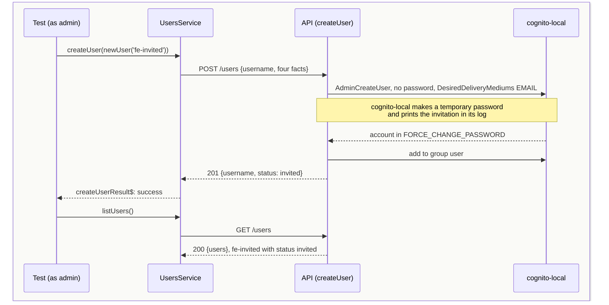

# The "invitation" journey, in simple words

| | |
|---|---|
| Test file | `frontend/tests/integration/login.service.test.ts` |
| `describe` | `the invitation` |
| Tests | 1. "the Administrator creates the User: the answer is the username and the state invited, no password, and the list shows it invited" 2. "with a temporary password, the first sign-in asks for a new one; the one chosen signs the User in" 3. "after the first sign-in the list shows the User active" 4. "the invitation is not sent again: to an active User (not_invited), to an administrator (cannot_edit_admin), to an unknown username (user_not_found)" |
| Runs against | the local stack: the API on port 3000 for every call of `UsersService`, and cognito-local on port 9229 for the sign-ins and the temporary password (`RUN_INTEGRATION=1`) |

Ideas used here, explained once for all journeys:
[the people of the local stack](../concepts.md#the-people-of-the-local-stack),
[the four facts of a person](../concepts.md#the-four-facts-of-a-person),
[the front end's services in the journeys](../concepts.md#the-front-ends-services-in-the-journeys),
[the deleted-user marker](../concepts.md#the-deleted-user-marker).

## What this block proves

- The Administrator creates a User with the four facts and no password: the API answers the
  username and the state `invited`, and never a password, because Cognito makes the temporary
  password and e-mails it as the invitation (`docs/EMAIL_ARCHITECTURE.md` sections 5.1 and 9.1).
- The Administrator's list shows each User's state: `invited` until the first sign-in, `active`
  after it (`docs/EMAIL_ARCHITECTURE.md` section 5.3).
- The invitation is sent again only to a User still invited: the route
  `POST /users/{username}/invitation` refuses an active User (`not_invited`), an administrator
  (`cannot_edit_admin`) and an unknown username (`user_not_found`) (`docs/EMAIL_ARCHITECTURE.md`
  sections 5.3 and 9.1). A resend that succeeds is not tried here: cognito-local does not support
  it (`docs/EMAIL_ARCHITECTURE.md` section 14.1).

## Who takes part

- **`fe-invited`**: a plain User the block creates. It signs in once, with a temporary password,
  and chooses a password of its own.
- **The Administrator** (`admin`): signed in once for the whole block; one `UsersService` made
  with its store creates, lists, removes `fe-invited` and asks for the resends.
- **A `LoginService`** for `fe-invited`, made in test 2 with a store of its own. It runs both the
  sign-in and the new password, because the open challenge stays inside it.
- **cognito-local**, the local stand-in for Cognito. When the API creates an account without a
  password, it makes a temporary password and prints "the invitation" in its container's log
  instead of mailing it; it refuses `AdminCreateUser` with `MessageAction: RESEND`
  (`docs/EMAIL_ARCHITECTURE.md` section 14.1).

## Before the block starts

The block comes last in the file. The block before it (`first sign-in with a temporary password`)
creates and removes its own User, `fe-first`; nothing it does touches `fe-invited`.

The block's `beforeAll` signs the Administrator in, makes the block's `UsersService` with that
store, and removes `fe-invited` through `DELETE /users/{username}` if an earlier run left it
(`user_not_found` is accepted; any other failure stops the block).

Locally `backend/env.local.json` sets `MAIL_STAGE` to `on`. The creation and the resend answer
`503 mail_unavailable` at any other stage, before anything is made or read
(`docs/EMAIL_ARCHITECTURE.md` section 13.2); here they go through.

## Test 1: the creation, and the state `invited`

1. The Administrator's service calls `createUser()` with the four facts `newUser()` makes from the
   username (the e-mail `fe-invited@example.com`). The service checks them with the shared rule
   and sends `POST /users`. The handler `createUser` calls `createUser()` of
   `backend/src/lib/cognito.ts`: Cognito's `AdminCreateUser` with the four facts, without a
   password and without `MessageAction: SUPPRESS`, with `DesiredDeliveryMediums: EMAIL`. Then it
   puts the account in the group `user`, and answers `201 { username, status: 'invited' }`.
2. The test lists the users with its helper `statusOf()`: `listUsers()` (`GET /users`), then the
   `status` of the entry named `fe-invited`. The API reads the state from Cognito: an account in
   `FORCE_CHANGE_PASSWORD` is `invited`, any other state is `active` (`statusOf()` of
   `backend/src/lib/cognito.ts`).

The test checks that:

- the result on `createUserResult$` is exactly
  `{ status: 'success', user: { username: 'fe-invited', status: 'invited' } }`: no password, and
  nothing else;
- the list shows `fe-invited` as `invited`.

The temporary password cognito-local made is in its log only; the journey never reads it.

## Test 2: the first sign-in

The test gives `fe-invited` a temporary password of its own, `Fe-Invited-Temp-1!`, with the helper
`setTemporaryPassword()` of `frontend/tests/integration/local.ts`: Cognito's
`AdminSetUserPassword` with `Permanent: false`, which cognito-local takes unsigned. The account
stays one that must choose its own password, as the e-mailed invitation would leave it
(`docs/EMAIL_ARCHITECTURE.md` section 14.1).

Then, on a new `LoginService` with its own store, the test checks that:

- `login('fe-invited', 'Fe-Invited-Temp-1!')` answers on `loginResult$` exactly
  `{ status: 'new_password_required', username: 'fe-invited' }`: Cognito's challenge
  `NEW_PASSWORD_REQUIRED`, no token;
- `choosePassword('Fe-Invited-Chosen-2?')` on the same service answers a `success` as
  `fe-invited` with `role: 'user'`: the service sends `RespondToAuthChallenge` and cognito-local
  answers with the tokens.

The whole first sign-in, with its refusals, is the journey
[`first-sign-in.md`](first-sign-in.md); here it only moves the account out of
`FORCE_CHANGE_PASSWORD`.

## Test 3: the state `active`

The test lists the users again with `statusOf()` and checks that `fe-invited` is now `active`:
after the new password, cognito-local holds the account as `CONFIRMED`, which the API answers as
`active`.

## Test 4: three resends refused

Three calls of `resendInvitation()` on the Administrator's service, each answered on
`resendInvitationResult$` from `POST /users/{username}/invitation`. The handler
`resendInvitation` checks, in this order, the first failure deciding: the admin role, the stage,
the username's form; the account's groups (`AdminListGroupsForUser`: unknown is `404`, in group
`admin` is `403`); the account's state (`AdminGetUser`: not `invited` is `409`); and only then
sends `AdminCreateUser` with `MessageAction: RESEND`. None of the three calls reaches that last
step. The test checks that:

- for `fe-invited`, now active, the result is a failure with reason `not_invited` (`409`): the
  person has already chosen a password, so a new temporary one would have nothing to do;
- for `admin`, a failure with reason `cannot_edit_admin` (`403`): an administrator is never
  invited, its password is set once by the bootstrap (`docs/EMAIL_ARCHITECTURE.md` section 5.4);
- for `fe-nobody`, a username no journey creates, a failure with reason `user_not_found` (`404`).

The three usernames pass the username rule, so each call sends its request and the API decides.

## What the block leaves

The block's `afterAll` removes `fe-invited` through `DELETE /users/{username}` and clears every
store it opened. Nothing of the block stays in Cognito. In the `calendar` table the deletion
leaves the deleted-user marker of `fe-invited`, one per run; it booked nothing, so nothing is
cancelled. The resends sent nothing and changed nothing. cognito-local's log keeps the printed
invitation of each run. The block is the last of the file.

## If the block fails halfway

A failed test does not stop the block, and each test needs the one before it:

- without the account of test 1, `setTemporaryPassword()` in test 2 fails, test 3 finds no
  `fe-invited` in the list, and in test 4 the first resend answers `user_not_found` instead of
  `not_invited`;
- without the new password of test 2, the account stays `invited`: test 3 fails, and in test 4
  the first resend passes every check and reaches the resend itself, which cognito-local refuses,
  so the API answers `500 internal_error`. That check fails, and the other two resends of test 4
  are skipped.

A failure anywhere may leave `fe-invited` invited or active. The `afterAll` removes it all the
same, and should the run be killed first, the next run's `beforeAll` removes it before test 1
creates it anew. So the block is repeated without a step by hand.

## Where in the code

| What | Where |
|---|---|
| The creation | `UsersService.createUser()` (`frontend/src/services/users.service.ts`) on `createUserResult$` → `POST /users`; handler `backend/src/handlers/createUser.ts`, `createUser()` and `addToGroup()` of `backend/src/lib/cognito.ts` |
| The list | `UsersService.listUsers()` on `listUsersResult$` → `GET /users`; `listPlainUsers()` and `statusOf()` of `backend/src/lib/cognito.ts` |
| The resend | `UsersService.resendInvitation()` on `resendInvitationResult$` → `POST /users/{username}/invitation`; handler `backend/src/handlers/resendInvitation.ts`, `listGroups()`, `getProfile()` and `resendInvitation()` of `backend/src/lib/cognito.ts` |
| The removal | `UsersService.deleteUser()` on `deleteUserResult$` → `DELETE /users/{username}` (helper `removeInvited()`) |
| The first sign-in | `LoginService.login()` and `choosePassword()` (`frontend/src/services/login.service.ts`) on `loginResult$` → Cognito's `InitiateAuth` and `RespondToAuthChallenge` |
| The results' types | `CreateUserResult`, `ListUsersResult`, `ResendInvitationResult` in `frontend/src/services/users.types.ts` |
| Helpers and constants | `statusOf()`, `removeInvited()` in the block; `signedIn()`, `outcome()`, `newUser()`, `setTemporaryPassword()`, `cognito()`, `API` of `frontend/tests/integration/local.ts`; `INVITED` (`fe-invited`), `INVITED_TEMPORARY`, `INVITED_CHOSEN` |
