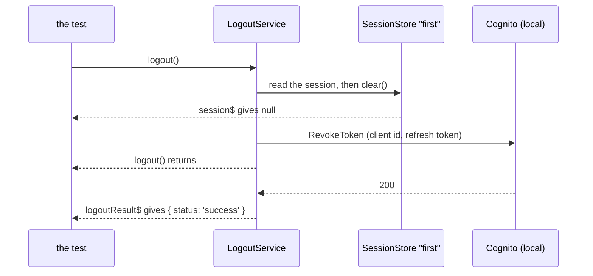

# The "logout" journey, in simple words

| | |
|---|---|
| Test file | `frontend/tests/integration/logout.service.test.ts` |
| `describe` | `logout` |
| Tests | 1. "1. alice signs in twice: two sessions with their own refresh tokens, and the first can be renewed" 2. "2. alice signs out of the first: the store is empty when the call returns, and Cognito revoked" 3. "3. the refresh token of the session alice left makes no new session: session_rejected" 4. "4. the access token of the session alice left still passes the API: the limit that stays" 5. "5. the second sign-in of alice is not affected: it is renewed" 6. "6. a sign-out with nobody signed in: not_signed_in, no request sent" 7. "7. alice signs in again: a sign-out does not lock the account" |
| Runs against | the local stack: the API on port 3000, cognito-local on port 9229 (`RUN_INTEGRATION=1`) |

Ideas used here, explained once for all journeys:
[the people of the local stack](../concepts.md#the-people-of-the-local-stack),
[the front end's services in the journeys](../concepts.md#the-front-ends-services-in-the-journeys).

## What this block proves

A session is three tokens; which one a sign-out is about is explained at the end of this page,
in "Background: the three tokens of a session".

- `LogoutService` signs a person out in two acts: the page forgets the session at once, and
  then Cognito is told to revoke the session's refresh token (`docs/FRONTEND_SERVICES.md`
  section 20).
- After that, the refresh token makes no new session, even for somebody who kept a copy of it
  (`docs/FRONTEND_SERVICES.md` section 20.1).
- What a sign-out does **not** do: it does not stop the access token already made, and it does
  not end the same person's other sign-ins (`docs/FRONTEND_SERVICES.md` section 20.7).

## Who takes part

- **`alice`**: a plain User of the local stack. They sign in three times in this block. Nobody
  else takes part, and nothing of the calendar is touched.
- **Cognito** (cognito-local): gives the tokens at a sign-in, renews a session, and revokes a
  refresh token when asked.
- **The API**: asked once, in test 4, with an access token.

## Before the block starts

Nothing is prepared: the file has no `beforeAll`. `alice` exists because `local:up` made the
account.

## The story

In the tests each sign-in has a store of its own. The names below are the test file's variables.

| Store | Holds |
|---|---|
| `first` | `alice`'s first sign-in: the one that signs out |
| `second` | `alice`'s second sign-in, as if on another computer |
| `copy` | not a store: the session of `first` as it was just before the sign-out, kept by the test. It stands for a copy somebody took |

### Test 1: alice signs in twice

1. `alice` signs in into the store `first`, then again into the store `second`, each time with
   the helper `signedIn()`, which uses a real `LoginService`.
2. `RefreshService.refresh()` is called on `first`. It sends the refresh token to Cognito and
   gets a new access token (`docs/FRONTEND_SERVICES.md` section 11).
3. The test keeps the session `first` now holds, as `copy`.

The test checks that:

- the two sessions have different refresh tokens: each sign-in gets its own;
- the renewal's result is a `success` for `alice`. So the refresh token works before the
  sign-out: when it stops working in test 3, the sign-out is the reason.

### Test 2: alice signs out of the first

`logout()` clears the store **before** it sends anything to Cognito, and it returns without
waiting for Cognito's answer. A slow Cognito never keeps a person signed in
(`docs/FRONTEND_SERVICES.md` section 8, decision 47).

The test checks that:

- right after the call, without waiting for its result, the store `first` gives `null`;
- the result is exactly `{ status: 'success' }`: Cognito answered that the refresh token is
  revoked. The result holds nothing else: no token and no name.

The service is built here with an empty list of other services. In the page it is given the
`LoginService` and the `RefreshService`, which it puts back to their first state
(`docs/FRONTEND_SERVICES.md` section 8, decision 53); this block does not need that.

### Test 3: the refresh token of the session alice left

A new store is set to `copy`, as if somebody had kept the session from before the sign-out.
`RefreshService.refresh()` on it sends the old refresh token to Cognito, which refuses it.

The test checks that:

- the result is a `failure` with the reason `session_rejected`;
- that store then gives `null`: the `RefreshService` clears a store whose refresh token Cognito
  refuses (`docs/FRONTEND_SERVICES.md` section 11.5).

This is the point of the sign-out: the copy is worth nothing for making new sessions.

### Test 4: the access token of the session alice left

Another new store is set to the same `copy`, and `HelloService.hello()` calls `POST /hello` with
its access token.

The test checks that the result is a `success` with the message `Hello World, I am alice`.

So the old **access** token still works. The API's authorizer checks that a token is signed by
Cognito and has not run out; it does not ask Cognito whether the token was revoked
(`docs/ARCHITECTURE.md` section 7.3). A copied access token therefore works until it runs out by
itself. This is a known limit, accepted and written down (`docs/FRONTEND_SERVICES.md` section
20.7), and the test is there so that it is not forgotten.

### Test 5: the second sign-in is not affected

`RefreshService.refresh()` on the store `second`. The test checks that the result is a
`success` for `alice`.

Revoking one refresh token ends that one sign-in. The same person signed in elsewhere stays
signed in there.

### Test 6: a sign-out with nobody signed in

`logout()` on a new, empty store, while a spy counts the calls of `fetch`.

The test checks that:

- the result is a `failure` with the reason `not_signed_in`;
- `fetch` was not called: with no session there is no refresh token to revoke, so the service
  answers by itself and no request leaves.

### Test 7: alice signs in again

`alice` signs in once more with `signedIn()`, which fails the test if the sign-in does not
succeed. The test checks that the new store holds a session of `alice` with the role `user`.

A sign-out ends sessions, not the account.

## What the block leaves

Nothing that works. The block's `afterAll` calls `logout()` on every store of the file, so the
refresh tokens of the second and of the third sign-in are revoked too. The stores that are
empty by then answer `not_signed_in` and send nothing. The store of test 4 still holds `copy`,
whose refresh token is already revoked: Cognito refuses that request, and the `afterAll` does
not look at any of the results. The stores are cleared by the same calls, which also stops
their expiry timers.

The local tables are as they were, except for the row `POST /hello` writes in `hello-messages`
in test 4.

## If the block fails halfway

- A failed check skips the rest of its test only; the later tests still run. Tests 3 and 4 need
  `copy` from test 1, test 2 needs `first` and test 5 needs `second`: if test 1 fails, they
  fail too.
- If test 2 fails, tests 3 to 5 still run, but test 3 then fails as well: the refresh token
  was not revoked.
- The `afterAll` runs in every case and signs out whatever is still signed in.
- A run that is killed leaves `alice`'s refresh tokens alive in cognito-local until they run
  out. Nothing needs cleaning: the next run signs in anew and does not look at them.

## Where in the code

| What | Where |
|---|---|
| The sign-out | `LogoutService` (`frontend/src/services/logout.service.ts`): `logout()`, the stream `logoutResult$`; Cognito's operation `RevokeToken`, sent by `revokeToken()` of `frontend/src/services/cognito.ts` |
| The renewal | `RefreshService` (`frontend/src/services/refresh.service.ts`): `refresh()`, the stream `refreshResult$`; Cognito's operation `InitiateAuth` with the flow `REFRESH_TOKEN_AUTH` |
| The call to the API | `HelloService` (`frontend/src/services/hello.service.ts`): `hello()`, the stream `helloResult$`; route `POST /hello` |
| The session | `SessionStore` (`frontend/src/services/session.store.ts`): `set()`, `session$` |
| Helpers of `frontend/tests/integration/local.ts` | `signedIn()`, `current()`, `outcome()`, `cognito()`, `API` |
| Helpers of the test file | `track()`, `storeWith()`, `refresh()`, `logout()` |

## Background: the three tokens of a session

A sign-in gives three tokens, which the front end keeps in a `SessionStore` and nowhere else
(`docs/FRONTEND_SERVICES.md` section 9).

| Token | What it is for | How long it lasts |
|---|---|---|
| the access token | sent to the API with every call | minutes (in the cloud 15; cognito-local gives 24 hours) |
| the id token | says who the person is; the front end does not send it | the same |
| the refresh token | sent to Cognito to get a new access token when the old one is about to end | days |

The refresh token is the one that matters for a sign-out. Whoever holds it can keep making new
access tokens, for days, without the password. To *revoke* it is to tell Cognito: do not accept
this refresh token any more.
