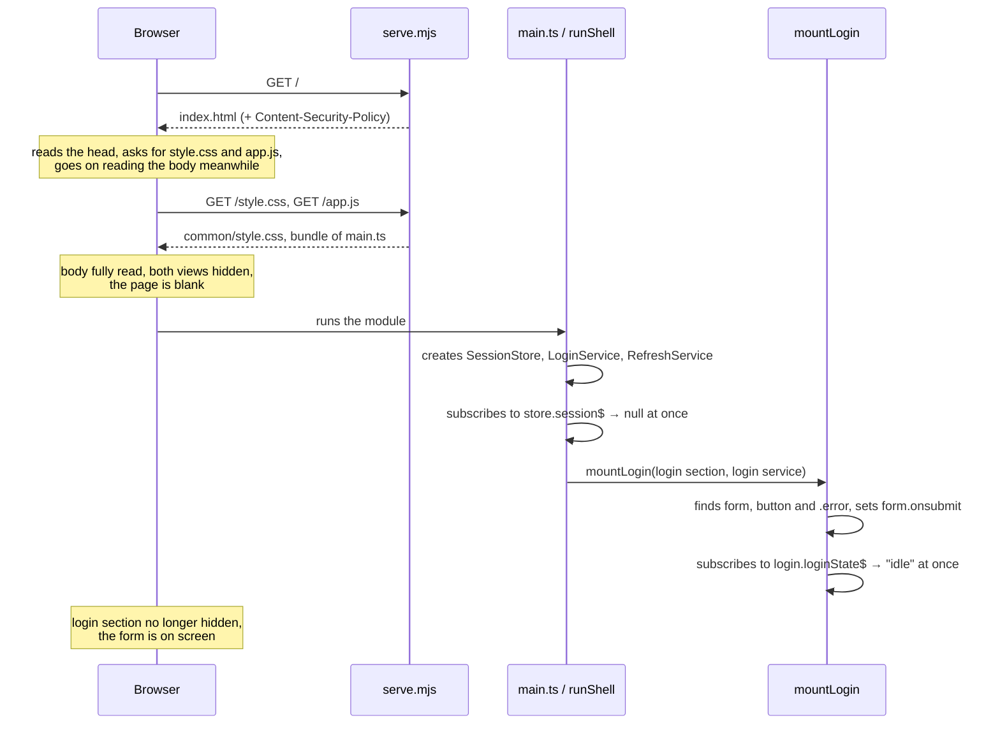

# What happens when `index.html` is loaded (plain prototype)

This page follows the plain-HTML prototype from the moment the browser asks for the page to the
moment a week is on screen, and shows which line of HTML each TypeScript function works on.
It describes the code as it is in `prototypes/view-plain/` and `prototypes/common/`; if the two
disagree, the code is right.

## 1. The idea in five sentences

1. `index.html` holds **all** the markup, for both views, and no behaviour: no `onclick`, no
   inline script, no data.
2. Both views start `hidden`. The TypeScript decides which one is shown.
3. The TypeScript never creates the page's structure. It **finds** elements that are already
   there (`querySelector`), **fills** them (`textContent`, `hidden`, `disabled`) and **attaches**
   handlers to them (`onclick`, `onsubmit`).
4. The only elements made at run time are the repeated ones (days, blocks, legend entries,
   `<option>`s). The blocks and days are copies of the `<template>` elements at the bottom of
   `index.html`.
5. Every change on screen comes from one of two directions: a **stream notification** (a service
   says something changed, the view fills elements) or a **user action** (a handler calls a
   service or opens a dialog).

## 2. The files involved

| File | Role |
|---|---|
| `view-plain/index.html` | The markup: `<main id="login">`, `<main id="calendar">` with its two `<dialog>`s and five `<template>`s |
| `view-plain/main.ts` | The entry point, one statement: `runShell({ mountLogin, mountCalendar })` |
| `common/app.ts` | `runShell`: creates the services, shows one view or the other according to the session |
| `view-plain/login.view.ts` | `mountLogin`: wires the `#login` section |
| `view-plain/calendar.view.ts` | `mountCalendar`: wires the `#calendar` section |
| `common/logic.ts` | No DOM. `WeekScreen` (which week, when to reload) and `weekModel` (the week ready to draw) |
| `common/style.css` | The style sheet, served as `/style.css` |
| `serve.mjs` | The dev server. `/app.js` is not a file: it is `main.ts` bundled by esbuild at every request |

## 3. The sequence, from the request to the login form



Step by step:

1. **The browser asks for `/`.** `serve.mjs` answers with `view-plain/index.html` and the header
   `Content-Security-Policy: default-src 'self'`. This is why the HTML has no inline script or
   `style=` attribute: the policy would refuse them.

2. **The browser reads the `<head>`** (`index.html` lines 7–8):

   ```html
   <link rel="stylesheet" href="style.css" />
   <script type="module" src="app.js"></script>
   ```

   `type="module"` matters: a module script is **deferred**. The browser downloads it while it
   goes on reading the page, and runs it only when the whole document has been parsed. That is
   the reason the script can sit in the `<head>` and still find every element of the `<body>`
   without waiting for an event such as `DOMContentLoaded`.

3. **The browser reads the `<body>`.** It builds both `<main>` sections, the two `<dialog>`s
   (closed, so not shown) and the five `<template>`s (never shown: a template's content is kept
   aside, outside the visible page). Both `<main>` carry the attribute `hidden`, and
   `style.css` has `[hidden] { display: none !important; }`, so at this point the page is blank.
   Nothing flashes before the script decides.

4. **The bundle runs.** There is no file `app.js`, and it is not `common/app.ts` under another
   name. When the browser asks for `/app.js`, `serve.mjs` gives esbuild one starting file,
   `view-plain/main.ts` (its `entryPoints`), and esbuild follows the imports from there and writes
   everything it meets into one script: `main.ts`, the two views, `common/app.ts`,
   `common/logic.ts`, the services, `rxjs`, `zod`. No file imports `main.ts`: it is the start of
   the chain, and its top-level statement is what runs when the browser runs the bundle
   (the server's code is in section 8). `main.ts` imports the two mount functions and calls
   `runShell({ mountLogin, mountCalendar })` (`common/app.ts`). `runShell`:

   - creates the `SessionStore`, the `LoginService`, and starts the `RefreshService`. The URLs
     come from `location.origin` (`/cognito/`, `/api`), the client id from the constant
     `CLIENT_ID` that `serve.mjs` wrote into the bundle;
   - looks up the two roots, the first meeting of script and markup:

     ```ts
     const loginRoot = document.querySelector<HTMLElement>('#login')!;
     const calendarRoot = document.querySelector<HTMLElement>('#calendar')!;
     ```

   - subscribes to `store.session$`.

5. **The session stream answers at once with `null`.** `session$` is a `BehaviorSubject`: a
   subscriber gets the current value immediately, and the store starts empty (the session is kept
   in memory only, so every page load starts signed out). The subscriber in `runShell` then does:

   ```ts
   loginRoot.hidden = session !== null;    // false → the login section appears
   calendarRoot.hidden = session === null; // true  → the calendar stays hidden
   mounted = views.mountLogin(loginRoot, login);
   ```

6. **`mountLogin` wires the login section** (`login.view.ts`). All of this runs inside the same
   script run, before the browser paints:

   | In `index.html` (`#login`) | In `login.view.ts` |
   |---|---|
   | `<form>` | `root.querySelector('form')` → `form.onsubmit = …` |
   | `<button class="primary">Sign in</button>` | `root.querySelector('button')` → `button.disabled = …` |
   | `<p class="error" role="alert">` | `root.querySelector('.error')` → `error.textContent = …` |
   | `<input name="username">`, `<input name="password">` | never looked up: read at submit time with `new FormData(form).get('username')` |

   It then subscribes to `login.loginState$`, also a `BehaviorSubject`, which answers at once
   with `{ status: 'idle' }`: the button is enabled, the error text is empty.

The page is now loaded: the login form is on screen, and the script is idle, waiting for either
a stream notification or a user action.

## 4. From "Sign in" to the week on screen

The load does not go further on its own, but the rest of the wiring only shows after a sign-in.

1. **The user submits the form.** The browser first applies the `required` attributes of the two
   inputs (plain HTML validation, no script). Then `form.onsubmit` runs: `preventDefault()` stops
   the browser from reloading the page, and the handler calls `login.login(username, password)`.

2. **`loginState$` notifies `pending`**, and the subscriber disables the button. On a wrong
   password it notifies `failure`: the button is enabled again and `.error` shows the message.
   The sequence ends here until the next submit.

3. **On success the `LoginService` puts the session in the `SessionStore`**, and `session$`
   notifies the subscriber in `runShell`, which:

   - calls `mounted.unsubscribe()`. This ends the login view: its `loginState$` subscription
     stops, and the teardown registered in `mountLogin` runs `form.reset()` and empties the
     error. The section stays in the page, only hidden, so the typed password must be wiped by
     hand;
   - sets `loginRoot.hidden = true` and `calendarRoot.hidden = false`;
   - creates new `CalendarService`, `AppointmentsService`, `UsersService` and a `WeekScreen` for
     this session;
   - calls `mountCalendar(calendarRoot, deps)`;
   - then calls `screen.start()` and, for the Administrator, `users.listUsers()`.

   The order of the last two points is deliberate: **subscribe first, then call**. The view is
   listening before the first request leaves.

4. **`mountCalendar` wires the calendar section** (`calendar.view.ts`), in five blocks, in the
   order of the file:

   - **The elements.** About twenty `find('…')` calls, one per element the script will touch
     (table in section 5).
   - **The drawing functions** (`windowFor`, `slotFor`, `dayFor`, `draw`, …) are defined, not yet
     called.
   - **What never changes.** `.bar .who` gets `alice (User)`; the label `.for-user` (the "For"
     list in the book dialog) is un-hidden only for the Administrator.
   - **The user's actions.** `onclick` on `.sign-out`, `.previous`, `.today`, `.next`, on every
     `dialog .close`, on `.cancel`; `onsubmit` on the book form.
   - **The streams.** Four subscriptions: `screen.week$`, `users.listUsersState$`,
     `appointments.bookState$`, `appointments.cancelState$`. Each answers at once with its
     starting value: the week label is filled (`16 Nov – 22 Nov 2026`), "Loading…" stays hidden,
     the user list is empty, the two dialog buttons are enabled. No week yet: `state.week` is
     `null`.

5. **`screen.start()` asks for the week.** It subscribes to the screen's own "which Monday"
   subject, which answers at once with this week's Monday, and so calls
   `calendar.load(monday, monday + 6)`: `GET /api/calendar?from=…&to=…`.

6. **`week$` notifies `loading: true`**: the view un-hides `<span class="loading">` and adds the
   class `stale` to `<div class="week">` (half opacity).

7. **The answer arrives.** `WeekScreen` turns it into a `WeekModel` with `weekModel()`
   (`common/logic.ts`): every block already has its `top` and `height` as percentages, its time
   as text and its colour number. `week$` notifies `loading: false` with the new `week`; the view
   hides "Loading…", removes `stale`, and since `state.week !== drawn`, calls `draw(model)`.

8. **`draw` builds the week from the templates:**

   ```ts
   legend.replaceChildren(…)  // one <li> per type
   hours.replaceChildren(…)   // one <li> per hour: "08:00", "09:00", …
   days.replaceChildren(...model.days.map(dayFor));
   ```

   `dayFor` copies `#tpl-day`, sets its `<h3>` to `Mon 16 Nov`, and appends to its `.day-body`
   one copy of `#tpl-window`, `#tpl-busy`, `#tpl-slot` or `#tpl-appointment` per block. Each copy
   gets its position (`element.style.top`, `element.style.height`), its colour class
   (`type-3`), its texts, and, for a slot or an appointment, its own `onclick`.

The week is on screen.

## 5. The map: each element and the code that touches it

### Elements that exist once (`#calendar`)

| In `index.html` | Variable in `calendar.view.ts` | Filled by | With |
|---|---|---|---|
| `<span class="who">` in `.bar` | (none, `find('.bar .who')`) | once, at mount | username and role |
| `<h2 class="week-label">` | `weekLabel` | `week$` | `state.label` |
| `<span class="loading" hidden>` | `loading` | `week$` | `hidden = !state.loading` |
| `<p class="error week-error" hidden>` | `weekError` | `week$` | `state.error` |
| `<p class="zone">` | `zone` | `draw` | the time zone sentence |
| `<ul class="legend">` | `legend` | `draw` | one `<li>` per type |
| `<div class="week">` | `week` | `week$`, `draw` | class `stale`; CSS variable `--hours` (the grid's height) |
| `<ol class="hours">` | `hours` | `draw` | one `<li>` per hour |
| `<div class="days">` | `days` | `draw` | one copy of `#tpl-day` per day |
| `<dialog class="book">` | `bookDialog` | `openBook`, `bookState$` | `showModal()`, `close()` |
| `.book .what` | `bookWhat` | `openBook` | day, time, type of the slot |
| `.book select[name="username"]` | `bookUser` | `listUsersState$` | one `<option>` per user |
| `.book .error` | `bookError` | `bookState$` | the failure in plain words |
| `.book .submit` | `bookSubmit` | `bookState$` | `disabled` while pending |
| `<dialog class="detail">` | `detailDialog` | `openDetail`, `cancelState$` | `showModal()`, `close()` |
| `.detail .when`, `.type`, `.who`, `.note`, `.hint` | `detailWhen`, … | `openDetail` | the appointment's texts |
| `.detail .error` | `detailError` | `cancelState$` | the failure in plain words |
| `.detail .cancel` | `detailCancel` | `openDetail`, `cancelState$` | `hidden` if it cannot be cancelled; `disabled` while pending |

### Templates (copied, never shown themselves)

| `<template>` | Copied by | Filled with | Handler on the copy |
|---|---|---|---|
| `#tpl-day` | `dayFor` | `<h3>` label, class `today`, the blocks in `.day-body` | none |
| `#tpl-window` | `windowFor` | type name, colour class, position | none |
| `#tpl-busy` | `busyFor` | `.time`, position | none |
| `#tpl-slot` | `slotFor` | `.time`, `title`, colour class, position | `onclick` → `openBook(block)` |
| `#tpl-appointment` | `appointmentFor` | `.time`, `.who`, `.note`, colour class, position | `onclick` → `openDetail(block)` |

The copy is made by the helper `copy(id)`:
`template.content.firstElementChild.cloneNode(true)`.

### User actions

| Element | Handler | What it calls |
|---|---|---|
| `#login form` | `onsubmit` | `login.login(username, password)` |
| `.sign-out` | `onclick` | `deps.signOut()` → `store.clear()` |
| `.previous`, `.today`, `.next` | `onclick` | `screen.previous()`, `.today()`, `.next()` |
| a free slot (copy of `#tpl-slot`) | `onclick` | `openBook(slot)`: fills and opens the book dialog |
| an appointment (copy of `#tpl-appointment`) | `onclick` | `openDetail(appointment)`: fills and opens the detail dialog |
| `dialog.book form` | `onsubmit` | `appointments.book(bookingFor(slot, note, username))` |
| `.detail .cancel` | `onclick` | `appointments.cancel(appointmentId)` |
| `dialog .close` (both) | `onclick` | `button.closest('dialog').close()` |

Note that a handler never changes the screen to show a result. Clicking "Book" only calls the
service; the dialog closes because `bookState$` later notifies `success`, and the week changes
because `WeekScreen.start()` reloads the calendar after every booking or cancellation and `week$`
notifies a new week. The same loop as at load time, steps 6 to 8 of section 4.

## 6. Signing out: the sequence backwards

`.sign-out` calls `store.clear()`; `session$` notifies `null`; the subscriber in `runShell` calls
`mounted.unsubscribe()`. That stops the four calendar subscriptions and the ones of
`screen.start()`, and runs the teardown registered at the end of `mountCalendar`: both dialogs
closed, `draw(null)` (legend, hours and days emptied). The calendar section is hidden, the login
section shown, and `mountLogin` runs again on the same, emptied, form.

The handlers set on the calendar's fixed elements (`.previous`, `.sign-out`, …) are not removed.
They stay on hidden elements, and the next `mountCalendar` replaces each of them, because
assigning `onclick` overwrites the previous one.

## 7. What to remember

- **The contract between the HTML and the TypeScript is the selectors**: two ids for the roots,
  five ids for the templates, class names for everything else, and `name` attributes for the form
  fields. Nothing checks it at build time. A class renamed in `index.html` and not in the script
  makes `find(…)` return `null` and fails when the view is mounted (finding 2 of
  `prototypes/README.md`).
- **The HTML is complete before the script runs**, thanks to `type="module"`. The script has no
  start-up event to wait for.
- **`hidden` is the switch** between the two views and for the optional parts (`.loading`,
  `.week-error`, `.for-user`, `.cancel`).
- **Mounting returns an RxJS `Subscription`**, and unsubscribing it is how a view is left: it
  stops the streams and runs the clean-up of the markup, which stays in the page.

## 8. The dev server: how `serve.mjs` answers `/app.js`

### Nobody builds `serve.mjs`

`serve.mjs` is plain JavaScript, written by hand, that Node runs as it is. The extension `.mjs`
tells Node that the file is a JavaScript module; there is no compile step and no build output.
It is started by hand and runs until it is stopped with Ctrl-C:

```sh
node prototypes/serve.mjs plain   # http://localhost:5173
```

The only building in the prototype is what `serve.mjs` does while it runs, so there are two
different moments:

| What | Built? | When |
|---|---|---|
| `serve.mjs` | No, Node runs it as it is | When `node prototypes/serve.mjs plain` is typed |
| `app.js` (from `main.ts` and its imports) | Yes, by esbuild inside `serve.mjs` | At every request for `/app.js`, so at every page load |

An edit to a `.ts` file shows after a page reload, with the server left running. An edit to
`serve.mjs` itself takes effect only after the server is stopped and started again.

### The code that runs when the browser asks for `/app.js`

Three pieces of `serve.mjs`.

**1. The request handler** receives every request and picks the branch for the URL:

```js
createServer(async (req, res) => {
  const url = req.url ?? '/';
  try {
    if (url.startsWith('/api/')) return pass(req, res, API + url.slice('/api'.length));
    if (url.startsWith('/cognito/')) return pass(req, res, COGNITO + url.slice('/cognito'.length));
    if (url === '/') { /* … index.html … */ }
    if (url === '/style.css') return send(res, 'text/css; charset=utf-8', await readFile(new URL('common/style.css', here)));
    if (url === '/app.js') return send(res, 'text/javascript; charset=utf-8', await bundle());   // ← this line
    res.writeHead(404).end();
  } catch (error) {
    console.error(error);
    res.writeHead(500, { 'content-type': 'text/plain' }).end(String(error));
  }
}).listen(port, () => console.log(`${variant} prototype on http://localhost:${port}`));
```

**2. `bundle()`** is the build. It calls esbuild's `build` function, imported at the top of the
file with `import { build } from 'esbuild'`:

```js
async function bundle() {
  const result = await build({
    entryPoints: [fileURLToPath(new URL(`view-${variant}/main.ts`, here))],
    bundle: true,
    format: 'esm',
    target: 'es2022',
    sourcemap: 'inline',
    write: false,
    logLevel: 'silent',
    define: { CLIENT_ID: JSON.stringify(clientId) },
  });
  return result.outputFiles[0].text;
}
```

| Option | Meaning |
|---|---|
| `entryPoints` | The starting file: `view-plain/main.ts` when the server was started with `plain` |
| `bundle: true` | Follow every `import` and put all the code into one script |
| `format: 'esm'` | Output a JavaScript module, which is why `index.html` says `type="module"` |
| `target: 'es2022'` | The JavaScript version to emit; esbuild also strips the TypeScript types here |
| `sourcemap: 'inline'` | Lets the browser's developer tools show the original `.ts` files |
| `write: false` | Keep the result in memory instead of writing a file, so no `app.js` exists on disk |
| `define` | Replace the name `CLIENT_ID` in the code with the actual client id, as a text constant |

The `clientId` comes from two lines that run once, when the server starts. They read the app
client id of the local user pool, which the back end's local seed wrote:

```js
const env = JSON.parse(await readFile(new URL('../backend/env.local.json', here), 'utf8'));
const clientId = env.AuthorizerFunction.CLIENT_ID;
```

**3. `send()`** writes the answer to the browser:

```js
const send = (res, type, body, headers = {}) => res.writeHead(200, { 'content-type': type, 'cache-control': 'no-store', ...headers }).end(body);
```

`cache-control: no-store` tells the browser not to keep a copy, so every page reload asks again
and gets a fresh bundle.

### When the build fails

If esbuild fails, for example on a syntax error in a `.ts` file, `bundle()` throws. The `catch`
of the handler answers 500 with the error text and prints the error in the terminal where
`serve.mjs` runs. The browser gets no script, so the page stays blank: both views are still
`hidden`.

### The other URLs

The same handler serves `/` (`view-plain/index.html`, with the Content-Security-Policy header)
and `/style.css` (`common/style.css`), and passes `/api/…` and `/cognito/…` on to the back end's
local stack, so that the browser sees one origin.
